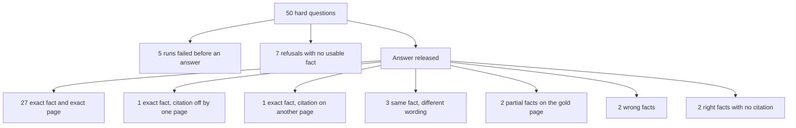
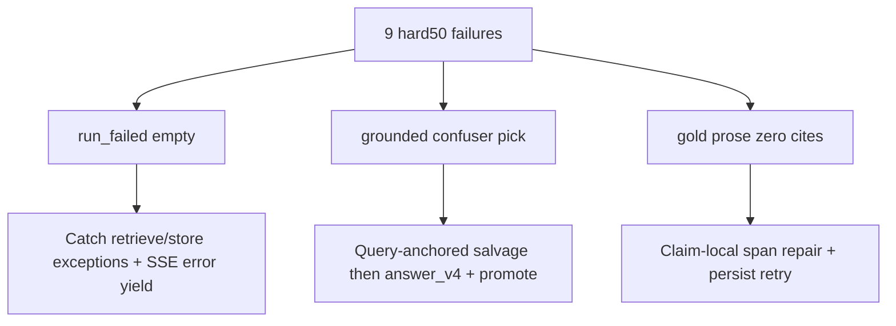

# Hard known-answer 50 (2026-09-28)

Fifty questions whose answers are specific figures, names, or code literals
on one page of *Building Applications with AI Agents*. Several questions
sit next to a similar number or name, so a nearby passage is the wrong
answer. The private gold file is `.private-eval/hard50-v1.json`. Expected
phrases and answer text stay in that private tree (plan decision D4).

This is a different question set from
[FRESH_KNOWN_ANSWER_50_2026-09-23.md](./FRESH_KNOWN_ANSWER_50_2026-09-23.md)
and
[ANSWER_ONLY_50_2026-09-24.md](./ANSWER_ONLY_50_2026-09-24.md).
Every prompt named the book. Scoring rules for the phrase check are in
[DUAL_METRIC_SCORING.md](./DUAL_METRIC_SCORING.md).

## Result

The indexed document is `b56d5774-8810-4ee9-a4d3-f3c93fa90ea7`, version
`d7e3206a-b262-44d7-90bc-b1572d864c35`. Each question was a new
`company_documents` conversation against `http://127.0.0.1:8000`.
`/health/ready` reported `query_ready: true`.

A question is fully correct only when every required phrase is in the
stored answer and at least one persisted citation is on the gold page.
By that bar the agent is right on **27 of 50**. The runner's phrase
check, before the page check, is **29 of 50**.

| Outcome | Count |
| --- | ---: |
| Required phrases present and citation on the gold page | 27 |
| Required phrases present, citation one page away | 1 |
| Required phrases present, citation on another page | 1 |
| Gold page cited, wording differs but the same fact is stated | 3 |
| Gold page cited, only part of a multi-part fact | 2 |
| Wrong fact stated (hallucination) | 2 |
| Right fact in the prose, no citation, marked insufficient | 2 |
| Refused, no usable fact | 7 |
| Run failed before an answer | 5 |

## Refusal repair (2026-09-29)

The seven “Refused, no usable fact” IDs were re-asked after retrieval and
answer-path fixes (BM25 conjunction-first + flat-score discard,
`dense_head_pin` 12→20 with pin-order pool reservation, evidence-present
refusal salvage, correction gate that no longer aborts when Hybrid already
selected IDs). Private re-ask outputs:
`.private-eval/hard50-refusals-7b-answers.json`,
`hard50-refusals-7b-summary.json`, `hard50-refusals-7b-stages.json`.

**Target met: 0 of 7 remain in the empty-refusal bucket.** None of the
re-asks ended as citation-free `Insufficient authorized evidence.` with no
usable prose.

| ID | Before | After re-ask | Notes |
| --- | --- | --- | --- |
| h04 | Refused | Answered, wrong phrasing | Gold page in pool/fusion; phrase check still misses |
| h05 | Refused | Answered, wrong phrasing | Gold still outside rerank pool (dense rank 61); retrieval-limited |
| h18 | Refused | Answered, wrong phrasing | No longer empty refusal |
| h23 | Refused | Strict pass (fact + gold page) | Evidence-present refusal fixed |
| h25 | Refused before fusion | Answered; states `$30.00` | Correction no longer blocks; gold phrase form differs (`30.00 dollars`) |
| h35 | Refused | Strict pass (fact + gold page) | Evidence-present refusal fixed |
| h44 | Refused | Answered, wrong phrasing | Gold never in dense/fused top-100; retrieval-limited |

Strict dual-metric on this slice: **2 of 7** (`h23`, `h35`). The other five
left the refusal bucket but are not full known-answer passes; `h05` and
`h44` remain retrieval-limited after BM25 + dense pin.

Original full-set counts above are unchanged for the September 28 baseline
run. Use this section for the refusal cohort only.

## Near-miss repair (2026-09-29)

The seven citation / wording / partial-multi-part near-misses were re-asked
after unique-token citation rebind (`bind.py`), tighter `answer_v4`
verbatim and multi-part completeness rules, and additive multi-part
figure salvage in `generate_grounded` plus `verify_answer`. Private
outputs: `.private-eval/hard50-nearmiss-7b-answers.json` (full cohort),
`hard50-nearmiss-remain-answers.json` (`h06`, `h24`), and
`hard50-nearmiss-h45-answers.json`.

**Phrase dual-metric on the repaired cohort: 6 of 7 strict on the 7b
pass, then 7 of 7 after the `h06` remain re-ask.** A follow-up fix for
`h24` (snake-case multi-cite + helper-naming prose promotion into
selected evidence) was re-asked in
`.private-eval/hard50-nearmiss-h24c-answers.json`: strict phrase pass
with persisted citation on **page 159**. **0 of 7 remain in the four
near-miss buckets.**

| ID | Baseline bucket | After repair | Notes |
| --- | --- | --- | --- |
| h50 | Citation one page away (321 vs 322) | Strict phrase; cites 322 | Left near-miss buckets |
| h24 | Citation other page (162 vs 159) | Strict phrase; cites 159 | Helper prose promoted + multi-cite |
| h06 | Wording differs | Strict phrase; cites 54 | Verbatim noun-phrase salvage |
| h32 | Wording differs | Strict phrase; cites 204–205 | `greater than 8` restored |
| h39 | Wording differs | Strict phrase; cites 249–250 | `confidence < 0.7` kept |
| h08 | Partial multi-part | Strict phrase; cites 73 | Reading/skimming rates appended |
| h45 | Partial multi-part | Strict phrase; cites 293 | `over 40%` and `$4.8 million` present |

Original full-set September 28 counts above stay as the baseline snapshot.
Use this section for the near-miss cohort only.

Two of the 27 exact hits were still marked partial because a citation
leaf could not be bound (`h40`, `h43`). The gold page was persisted and
the required phrases were present.

## Remaining-bucket repair (2026-09-29)

The nine baseline IDs outside the refusal and near-miss cohorts were
re-asked after three targeted fixes:

1. **Crash harden** — Hybrid `FusionError` / retrieve errors in
   `company_scope` map to `insufficient_evidence` / `routing_rejected`
   instead of killing the graph; BM25/hybrid variant fan-out capped at
   three; `store_get` soft-fails in `load_memory`; SSE yields
   `run_failed` before re-raise.
2. **Uncited leaf repair** — claim-local leaf citation repair plus one
   verify persist retry so gold prose is not released as
   `insufficient_evidence` with `pages: []`.
3. **Confuser salvage** — query-anchored expose Manual/Assist/Auto and
   ADAS dated-model salvage (with mojibake-safe triad matching and
   single-line extractive spans), `answer_v4` guidance, and secondary
   promote helpers.

Private outputs: `.private-eval/hard50-remain-9-*.json` (first pass),
`hard50-remain-5-*.json` (crash + PSI slice after variant cap),
`hard50-remain-h10-*.json` (expose salvage ValidationError fix), merged
answers in `hard50-remain-9b-answers.json`.

**Target met: 0 of 9 remain in their baseline buckets** (empty
`run_failed`, wrong-fact Manual/Ask/Agent or undated `gpt-4o@0`, or
gold prose with zero citations / `insufficient_evidence`).

| ID | Baseline bucket | After repair | Notes |
| --- | --- | --- | --- |
| h01 | Run failed | Strict phrase; gold page | Left crash bucket |
| h02 | Run failed | Answered; IFEval `0.726` vs gold `0.949` | Left crash; still wrong neighbor figure |
| h10 | Wrong fact (Ask/Agent @ 77) | Strict phrase; cites 79 | Expose triad salvage |
| h20 | Run failed | Strict phrase; gold page | Left crash bucket |
| h21 | Run failed | Strict phrase; gold page | Memory soft-fail + left crash |
| h33 | Wrong fact (`gpt-4o` @ 0) | Strict phrase; gold page | ADAS dated defaults salvage |
| h34 | Run failed | Strict phrase; gold page | Left crash bucket |
| h41 | Right fact, no citation | Strict phrase; ≥1 citation | Leaf repair + PSI salvage |
| h48 | Right fact, no citation | Strict phrase; ≥1 citation | Leaf repair |

Strict dual-metric on the repaired cohort (latest per ID): **8 of 9**.
`h02` left the crash bucket but is not a full known-answer pass.

Original full-set September 28 counts above stay as the baseline snapshot.
Use this section for the remaining-bucket cohort only.

## Hallucinations

Two answers state a fact that is not the fact on the gold page
(September 28 baseline). After the remaining-bucket repair re-ask, both
left this bucket; see that section.

| ID | Gold page | Cited pages | What went wrong |
| --- | ---: | --- | --- |
| h10 | 79 | 77 | Autonomy-mode labels. The page says Manual, Assist, and Auto. The answer says Manual, Ask, and Agent. |
| h33 | 208 | 28, 195 | Asked for the ADAS example's model id and temperature. The answer is a different code sample: `gpt-4o` at temperature 0. |

Baseline near-miss notes (pre-repair): `h45` stated the incident cost and
omitted the percentage; `h08` stated speaking rate only. See the
near-miss repair section for the post-repair cohort.

## Citations

Persisted citation pages come from `app.citations` joined to
`app.document_chunks.page_number` for this document. 32 runs cite the
gold page. 27 of those also contain every required phrase.

| ID | Gold page | Cited pages | Note |
| --- | ---: | --- | --- |
| h50 | 322 | 321 | Baseline: fact present, one page away (repaired; see near-miss section) |
| h24 | 159 | 162 | Baseline: fact present, other page (repaired; cites 159 — see near-miss section) |
| h10 | 79 | 77 | Wrong labels, wrong page |
| h33 | 208 | 28, 195 | Wrong code sample |

`h40` and `h43` cite the gold page and contain the fact, and the run
status is `citation_leaf_unresolved`. One citation leaf failed to bind,
so a correct answer was released as partial.

`h41` (page 261) and `h48` (page 304) contain the required fact in the
stored prose and have no persisted citation in the September 28 baseline.
Both runs are `insufficient_evidence`. `h41` also starts mid-sentence.
After the remaining-bucket repair re-ask, both cite and leave that bucket.

## Refusals and crashes

Refused with no usable fact (baseline run): `h04` (31), `h05` (33),
`h18` (115), `h23` (152), `h35` (216), `h44` (293). Those six used
`Insufficient authorized evidence.`

`h25` (page 160) stopped in correction before fusion in the baseline and
used a different sentence: company sources could not support an answer.

After the 2026-09-29 refusal repair re-ask (see above), **none** of these
seven remain empty refusals. `h23` and `h35` are full known-answer passes.

Crashed with an empty answer and `run_failed` (September 28 baseline):

| ID | Page | Last recorded stage |
| --- | ---: | --- |
| h01 | 28 | `company_scope` started. API log: `FusionError` |
| h02 | 28 | `company_scope` started. API log: `FusionError` |
| h20 | 116 | No stage path |
| h21 | 123 | `load_memory` started |
| h34 | 213 | `compile_plan` planned |

After the remaining-bucket repair re-ask, **none** of these five remain
empty `run_failed` runs. See that section.

There were no deadline refusals and no empty-retrieval outcomes. No
answer body was a raw claims JSON object.

## Wording that is still the right fact

Baseline wording near-misses were `h06`, `h32`, and `h39`. After the
near-miss repair re-ask, those three pass the strict phrase check with
gold-page citations. See the near-miss repair section.

## Question results

| ID | Page | Result | Cited pages |
| --- | ---: | --- | --- |
| h01 | 28 | Crashed before an answer (`FusionError` in company scope) | none |
| h02 | 28 | Crashed before an answer (`FusionError` in company scope) | none |
| h03 | 31 | Right fact and gold page | 31 |
| h04 | 31 | Refused: insufficient evidence | none |
| h05 | 33 | Refused: insufficient evidence | none |
| h06 | 54 | Same fact, different wording | 54 |
| h07 | 61 | Right fact and gold page | 61 |
| h08 | 73 | Partial: speaking rate only | 73 |
| h09 | 73 | Right fact and gold page | 73 |
| h10 | 79 | Wrong fact: Manual, Ask, and Agent | 77 |
| h11 | 87 | Right fact and gold page | 87 |
| h12 | 97 | Right fact and gold page | 97 |
| h13 | 97 | Right fact and gold page | 97 |
| h14 | 103 | Right fact and gold page | 103 |
| h15 | 109 | Right fact and gold page | 109 |
| h16 | 112 | Right fact and gold page | 112 |
| h17 | 115 | Right fact and gold page | 115 |
| h18 | 115 | Refused: insufficient evidence | none |
| h19 | 116 | Right fact and gold page | 115, 116 |
| h20 | 116 | Crashed before an answer (no stage path) | none |
| h21 | 123 | Crashed before an answer (`load_memory` started) | none |
| h22 | 144 | Right fact and gold page | 144 |
| h23 | 152 | Refused: insufficient evidence | none |
| h24 | 159 | Right fact, citation on another page | 162 |
| h25 | 160 | Refused before fusion | none |
| h26 | 161 | Right fact and gold page | 161 |
| h27 | 175 | Right fact and gold page | 175 |
| h28 | 182 | Right fact and gold page | 180, 182 |
| h29 | 186 | Right fact and gold page | 186, 189 |
| h30 | 187 | Right fact and gold page | 187 |
| h31 | 199 | Right fact and gold page | 199 |
| h32 | 205 | Same fact, different wording | 205 |
| h33 | 208 | Wrong fact: different code sample | 28, 195 |
| h34 | 213 | Crashed before an answer (`compile_plan` planned) | none |
| h35 | 216 | Refused: insufficient evidence | none |
| h36 | 230 | Right fact and gold page | 229, 230 |
| h37 | 233 | Right fact and gold page | 233 |
| h38 | 234 | Right fact and gold page | 234 |
| h39 | 250 | Same fact, different wording | 249, 250 |
| h40 | 256 | Right fact and gold page; citation leaf unresolved | 256 |
| h41 | 261 | Right fact, no citation, marked insufficient | none |
| h42 | 261 | Right fact and gold page | 261 |
| h43 | 286 | Right fact and gold page; citation leaf unresolved | 286 |
| h44 | 293 | Refused: insufficient evidence | none |
| h45 | 293 | Partial: cost only, percentage omitted | 293 |
| h46 | 296 | Right fact and gold page | 296 |
| h47 | 304 | Right fact and gold page | 304 |
| h48 | 304 | Right fact, no citation, marked insufficient | none |
| h49 | 305 | Right fact and gold page | 305 |
| h50 | 322 | Right fact, citation one page away | 321 |

## How the run was executed

The first session stored 19 answers, then `POST /conversations` returned
HTTP 500 and the runner aborted. `scripts/run_company_ask.py` now treats
`HTTPStatusError` like the existing transport retry: one fresh login and
conversation, then a timeout row if the second attempt also fails.
Resuming the same gold file finished questions 20–50. Asking time was
about 11 minutes plus about 17 minutes. Private outputs:
`.private-eval/hard50-answers.json`, `hard50-summary.json`,
`hard50-stages.json`, and `hard50-citation-score.json`.

## Limits

Naming the book in every prompt is not the same condition as the
unscoped September runs, so 27 of 50 is not a rescore of those files.
Generalization to another document was not measured. The two
`FusionError` crashes were taken from the API log at the time of `h01`
and `h02`; the run event payload only stores `run_failed`.
