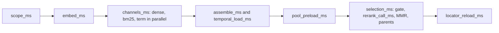

# Hybrid stage timings (2026-09)

Aggregate retrieve-stage durations for the answer-loss repair
([ADR-retrieved-answer-loss-repair.md](../adr/ADR-retrieved-answer-loss-repair.md),
Fix 2 step 1). Field contract:
[HYBRID_RETRIEVAL_CONTRACT.md](../retrieval/HYBRID_RETRIEVAL_CONTRACT.md#stage-timings-and-rerank-sub-codes).
The motivating misses are in
[ANSWER_ONLY_50_ROOT_CAUSES_2026-09-24.md](./ANSWER_ONLY_50_ROOT_CAUSES_2026-09-24.md).
This file holds aggregates only: no question text, answer text, chunk
IDs, or document text.

## Method

- Ten private answer-only questions (`a01` to `a10`) on the rebuilt
  laptop Compose `api` image, 2026-09-24. 10 s retrieve slice, 3 s rerank
  reserve, `rerank_v1`.
- Source: the private stage export (`stages.json`), summarized by a
  private script. Values are integer milliseconds.
- p50 is the lower median. p90 is nearest-rank
  (`sorted[min(n - 1, int(0.9 * n))]`), so with n = 10 it equals the
  maximum.
- `rerank_call_ms` exists only when the rerank callback ran. A
  `rerank_timeout` without it is the remaining-slice gate; with it,
  the provider call ran out of time.
- `post_channel_ms` is the per-run sum of `assemble_ms`,
  `temporal_load_ms`, and `pool_preload_ms`. It is the time between
  the end of the channels and the rerank gate's budget use.



## Results (after A2, before A3)

| Key | n | p50 ms | p90 ms | max ms |
| --- | --- | --- | --- | --- |
| `scope_ms` | 10 | 905 | 1177 | 1177 |
| `embed_ms` | 10 | 739 | 2840 | 2840 |
| `channels_ms` | 10 | 1387 | 2310 | 2310 |
| `channel_dense_ms` | 10 | 1386 | 2310 | 2310 |
| `channel_bm25_ms` | 10 | 981 | 1101 | 1101 |
| `channel_term_ms` | 10 | 776 | 916 | 916 |
| `assemble_ms` | 10 | 2 | 2 | 2 |
| `temporal_load_ms` | 10 | 639 | 680 | 680 |
| `pool_preload_ms` | 10 | 461 | 571 | 571 |
| `rerank_gate_remaining_ms` | 10 | 7805 | 8112 | 8112 |
| `rerank_call_ms` | 10 | 8050 | 8465 | 8465 |
| `selection_ms` | 10 | 8565 | 8993 | 8993 |
| `locator_reload_ms` | 10 | 0 | 0 | 0 |
| `retrieve_total_ms` | 10 | 12045 | 14284 | 14284 |
| `post_channel_ms` | 10 | 1102 | 1213 | 1213 |

Rerank outcomes: none=1, rerank_schema_invalid=4, rerank_timeout (provider)=5. Schema-invalid sub-codes: duplicate=4.

## Results after A5 (full 50)

| Key | n | p50 ms | p90 ms | max ms |
| --- | --- | --- | --- | --- |
| `scope_ms` | 50 | 941 | 1068 | 1287 |
| `embed_ms` | 50 | 728 | 923 | 2083 |
| `channels_ms` | 50 | 1347 | 2069 | 2471 |
| `channel_dense_ms` | 50 | 1334 | 2068 | 2471 |
| `channel_bm25_ms` | 50 | 998 | 1167 | 1572 |
| `channel_term_ms` | 50 | 780 | 1116 | 1487 |
| `assemble_ms` | 50 | 2 | 3 | 4 |
| `temporal_load_ms` | 50 | 638 | 656 | 868 |
| `pool_preload_ms` | 50 | 463 | 528 | 752 |
| `rerank_gate_remaining_ms` | 50 | 7972 | 8109 | 8121 |
| `rerank_call_ms` | 50 | 3370 | 4397 | 8444 |
| `selection_ms` | 50 | 3932 | 4872 | 9023 |
| `locator_reload_ms` | 50 | 0 | 0 | 0 |
| `retrieve_total_ms` | 50 | 7332 | 8624 | 12230 |
| `post_channel_ms` | 50 | 1103 | 1185 | 1438 |

Rerank outcomes: none=28, none_partial=21, rerank_timeout (provider)=1. Schema-invalid sub-codes: none.

Run-total p90: 24.4 s (latency_probe TOTAL p90).

## Reading

`selection_ms` takes most of the 10 s retrieve slice (p50 8565 ms, p90 8993 ms). The rerank callback ran on 10 of 10 questions, so the remaining-slice gate skipped none; 5 of those 10 still finished as a provider `rerank_timeout`. `post_channel_ms` p90 is 1213 ms.

## Limits

- Ten questions from one book on one laptop stack against hosted
  Supabase. With n = 10, p90 is the maximum.
- Channel durations are measured inside each worker thread;
  `channels_ms` is the wall time of the parallel wait.
- `scope_ms` covers scope resolution plus frozen-profile load.
- `rerank_gate_remaining_ms` is measured before pool preload, which
  is exactly the value the gate compares.

## Verification

```powershell
uv run python -m pytest tests/unit/test_hybrid_stage_timings.py -q
```
