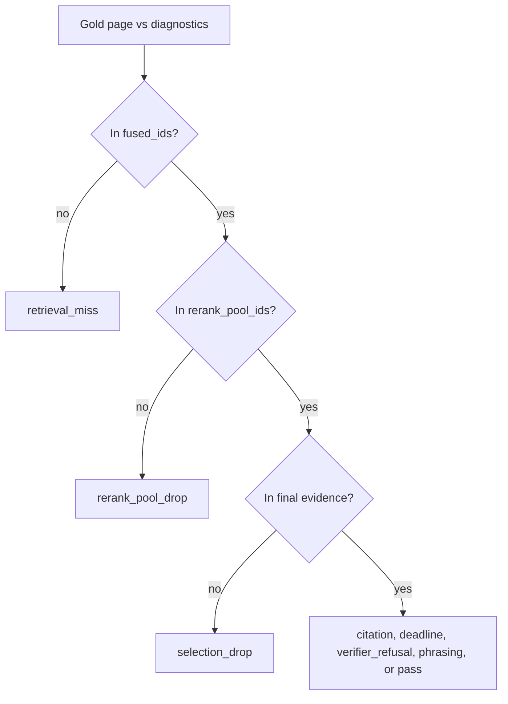

# Known-answer 50 repair evidence (2026-09-22)

Baseline review:
[KNOWN_ANSWER_50_REVIEW_2026-09-22.md](./KNOWN_ANSWER_50_REVIEW_2026-09-22.md).
Root causes:
[KNOWN_ANSWER_50_ROOT_CAUSES_2026-09-22.md](./KNOWN_ANSWER_50_ROOT_CAUSES_2026-09-22.md).
Scoring rules:
[DUAL_METRIC_SCORING.md](./DUAL_METRIC_SCORING.md).
A later 50-question set, written from other pages of the same PDF, is
[FRESH_KNOWN_ANSWER_50_2026-09-23.md](./FRESH_KNOWN_ANSWER_50_2026-09-23.md).
That run is not a rescore of the questions in this file.

This is one fresh 50-question run against the rebuilt Compose `api`
image. It does not tune profiles, prompts, or gold. No answer text, gold
phrases, or database URLs are recorded here.

## Provenance

| Item | Value |
| --- | --- |
| Branch | `fix/ka50-accuracy-repair` |
| Commit | `a126112` |
| Image | `smart-rag-api:latest` id `153490f42b03` |
| Probe | P0–P5 `present` |
| Health | `{"status":"ready","query_ready":true,"detail":"ok"}` |
| Documents | 4 non-deleted `app.documents` rows |
| Gold version | `e119bf87-1c70-4e10-abb1-5666c4f728c4` (same as the baseline review) |
| Runner wall time | 2970 s for 50 questions (mean 59.4 s) |

`docker compose --env-file .env.compose -f docker-compose.yml -f docker-compose.packet8.yml up -d --build --wait api` exited 0. The runner exited 0 with `questions=50`. The previous `ka50-*.json` files were moved to `.private-eval/runs/2026-09-22-baseline/` before the run, so the runner did not resume.

A paired before/after timing subset for the event-store round trip was not run. The mean above is this run only.

P6 did not change the gold file. The adjudication sheet is in `.private-eval/adjudication-p6.md` with every decision still `PENDING`. Four of the five baseline phrasing ids were judged `NO ALIAS` against the baseline answers. None of those aliases were added.

## Commands

| Command | Exit |
| --- | ---: |
| Compose `api` rebuild and `--wait` | 0 |
| In-container P0–P5 probe | 0 (`present` x6) |
| `GET /health/ready` | 0 (`query_ready: true`) |
| `scripts/run_company_ask.py` full gold file | 0 |
| `.private-eval/page_in_pool.py` | 0 |

Unit, lint, types, and docs tiers passed on `a126112` before the image build. The composite `scripts/check.py --tier fast` command was not re-run as a single process after that commit. GitHub `PR fast` on `a126112` (run `35774027955`) exited 0.

## Acceptance

| Metric | Baseline | This run | Target | Pass |
| --- | ---: | ---: | ---: | --- |
| `strict_pass` | 17 | 29 | >= 32 | no |
| `grounded_fact_pass` | 17 | 29 | >= 36 | no |
| gold page in `rerank_pool_ids` | 31 | 47 | >= 46 | yes |
| gold page in `selected_ids` | 31 | 37 | >= 42 | no |
| `retrieval_profile_id` `hybrid_long_document_v2` | 0 | 50 | 50 | yes |
| `deadline` bucket whose answer contains every canonical phrase | 2–4 | 0 | 0 | yes |
| `citation_persist_failed` terminals | 3 | 0 | 0 | yes |

`drop_histogram=citation:2,deadline:1,pass:29,phrasing:4,rerank_pool_drop:3,selection_drop:11`

Stage helper: dense 50/50, BM25 29/50, fused 50/50, rerank pool 47/50, selected 37/50. Resolution on the DIAG lines is `unscoped` with profile `hybrid_long_document_v2`.

## Residuals

Twenty-one questions are not `pass`. The largest bucket is `selection_drop` (11). Those gold pages were in the rerank pool and not in the final evidence. The plan treats a reranker cut below the evidence window as out of scope. Do not tune pool size or quota from this run.

| Id | Bucket | Fused rank | In pool | Terminal | Detail | Owner |
| --- | --- | ---: | --- | --- | --- | --- |
| k01 | selection_drop | 11 | yes | verified_partial | verified_partial | reranker cut, out of scope |
| k02 | selection_drop | 11 | yes | completed | — | reranker cut, out of scope |
| k07 | selection_drop | 2 | yes | insufficient_evidence | insufficient_evidence | reranker cut, out of scope |
| k18 | selection_drop | 3 | yes | insufficient_evidence | insufficient_evidence | reranker cut, out of scope |
| k21 | selection_drop | 2 | yes | insufficient_evidence | insufficient_evidence | reranker cut, out of scope |
| k25 | selection_drop | 10 | yes | completed | — | reranker cut, out of scope |
| k26 | selection_drop | 13 | yes | insufficient_evidence | insufficient_evidence | reranker cut, out of scope |
| k28 | selection_drop | 24 | yes | completed | — | reranker cut, out of scope |
| k32 | selection_drop | 26 | yes | verified_partial | verified_partial | reranker cut, out of scope |
| k43 | selection_drop | 11 | yes | insufficient_evidence | insufficient_evidence | reranker cut, out of scope |
| k44 | selection_drop | 2 | yes | insufficient_evidence | paragraph_unmapped | reranker cut, out of scope |
| k09 | rerank_pool_drop | 41 | no | completed | — | promised residual; dense rank was already outside the pin window |
| k19 | rerank_pool_drop | 25 | no | completed | — | P1 pins did not cover this fused rank |
| k39 | rerank_pool_drop | 25 | no | citation_leaf_unresolved | citation_leaf_unresolved | P1 pins did not cover this fused rank |
| k12 | phrasing | 2 | yes | citation_leaf_unresolved | citation_leaf_unresolved | P6; leaf skip released a partial answer |
| k23 | phrasing | 3 | yes | citation_leaf_unresolved | citation_leaf_unresolved | P6; leaf skip released a partial answer |
| k31 | phrasing | 9 | yes | citation_leaf_unresolved | citation_leaf_unresolved | P6; leaf skip released a partial answer |
| k42 | phrasing | 1 | yes | completed | — | P6; proposal still PENDING, not applied |
| k30 | citation | 2 | yes | insufficient_evidence | paragraph_index_invalid | P4; index mismatch still fails closed |
| k48 | citation | 4 | yes | insufficient_evidence | paragraph_index_invalid | P4; index mismatch still fails closed |
| k33 | deadline | 3 | yes | deadline_exhausted | deadline_exhausted | real deadline after generate returned insufficient_evidence; phrases were not all present, so this is not a P2 mislabel |

`citation_persist_failed` does not appear on any stage or answer record. `k33` is the only deadline bucket, and its answer does not contain every canonical phrase.

## Deviations

Shipped code follows the accepted ADRs for small-corpus long-document routing, channel-head pins, and leaf-unresolved citation skips. This run adds no further product deviation.

P8 is not started from this document. `strict_pass` is 29, under the gate of 32. The largest residual bucket is `selection_drop`.
