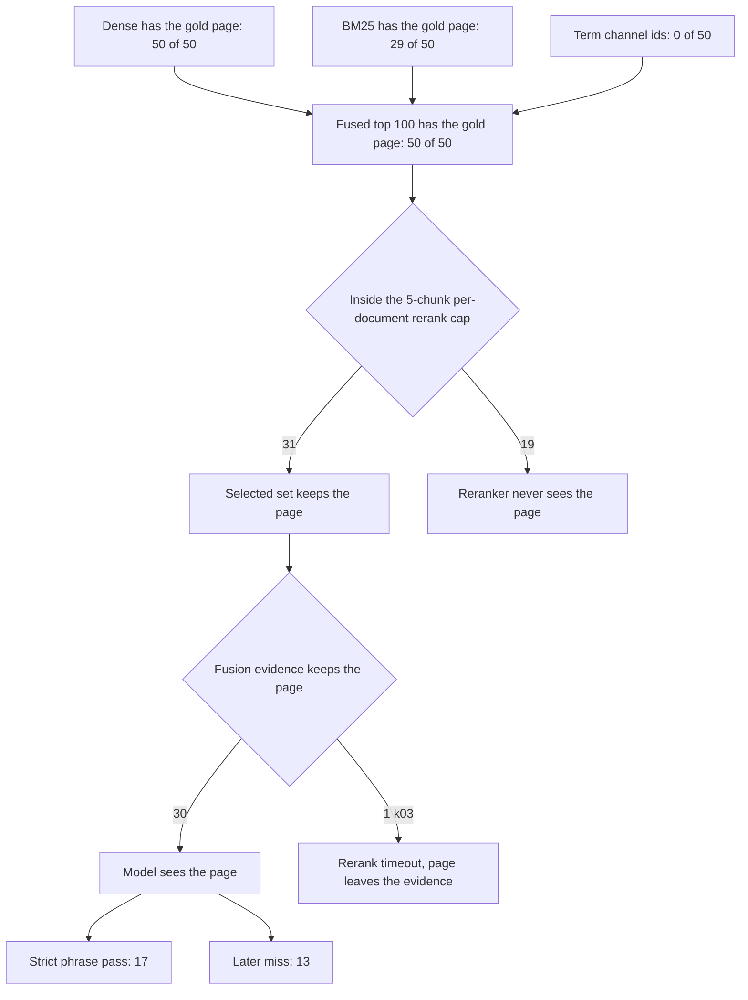

# Known-answer 50 review (2026-09-22)

Prior gate:
[p06-post-fix-v2-acceptance-2026-09-22.md](../development/phase-06/p06-post-fix-v2-acceptance-2026-09-22.md).
Scoring rules:
[DUAL_METRIC_SCORING.md](./DUAL_METRIC_SCORING.md).
Root-cause analysis of the 33 misses:
[KNOWN_ANSWER_50_ROOT_CAUSES_2026-09-22.md](./KNOWN_ANSWER_50_ROOT_CAUSES_2026-09-22.md).
Repair rerun:
[KNOWN_ANSWER_50_REPAIR_EVIDENCE_2026-09-22.md](./KNOWN_ANSWER_50_REPAIR_EVIDENCE_2026-09-22.md).

Fifty questions whose required phrases were checked against the current
indexed book, version `e119bf87-1c70-4e10-abb1-5666c4f728c4`. Each
question was a fresh `company_documents` conversation. The gold file
stays under gitignored `.private-eval/` and is not quoted here. A pass
means every required phrase appeared in the stored answer. Runtime was
about 51 minutes. `query_ready` was true. There were no run errors and
no empty retrievals.

## Verdict

**17 of 50 passed.** The gold page was in the fused top 100 on every
question. Dense search contained that page on every question. The
default profile then reranks at most 5 chunks from one document. On 19
questions the gold page sat outside those 5, so the reranker never
scored it. Those 19 are exactly the questions whose selected set is
also missing the page.

`hybrid_default_v1` leaves `rerank_max_per_document` at its default of
5 and sets `rerank_pool_size` to 20. Every question in this run was
unscoped, so the profile was `hybrid_default_v1` and source resolution
was `unscoped`. `hybrid_long_document_v2` raises the per-document cap
to 20, and it never ran, because none of these questions named the
book title.

## How the 50 split

The scorer's first-label histogram was
`citation:2, deadline:4, pass:17, phrasing:5, retrieval_miss:18, verifier_refusal:4`.
Deadline is labeled before a missing gold page, so `k32` is a deadline
in that histogram and a cap drop in the stage split below. `k03` is
the one question whose page was inside the cap and then disappeared
from fusion evidence.

| First stage | Count | What the run showed |
| --- | ---: | --- |
| Strict phrase pass | 17 | Gold page was in the answer evidence and every required phrase was in the stored answer. |
| 5-chunk cap | 19 | Page was in the fused top 100 and outside the rerank pool. |
| Phrasing | 5 | Page was in the evidence, the run completed, and the required phrase was absent. |
| Verifier refusal | 4 | Page was in the evidence and the product still refused. |
| Citation binding | 2 | Page was in the evidence and the failure code was `paragraph_unmapped`. |
| Deadline after the page was kept | 2 | `k24` and `k48`. |
| Selected, then lost | 1 | `k03`. Rerank timed out and fusion evidence no longer contained the page. |

17 + 19 + 5 + 4 + 2 + 2 + 1 = 50.

Of the 30 questions whose gold page stayed in fusion evidence, 17
passed and 13 failed afterward.

## What this run rules out

Coverage was 0.80, 0.90, or 1.00 on every question, including the 19
cap drops. Coverage is computed on the chunks that survive selection,
so a high score here means those surviving chunks looked sufficient.
The 0.65 coverage gate never fired. No measured score was 0.60, so
the support-confidence fallback condition from the repair plan was
also absent.

| Stage field | Result on all 50 |
| --- | --- |
| Route | `hybrid` |
| Profile | `hybrid_default_v1` |
| Source resolution | `unscoped` |
| Dense ids | 100 |
| BM25 ids | 75 |
| Term ids | 0 |
| Fused ids | 100 |
| Retrieval empty | false |
| Fallback reason | `none` |
| Rerank | `(1, none)` on 48, `(0, rerank_timeout)` on `k03` and `k15` |
| Unknown required stage fields | 0 |

The term channel returned zero chunk ids on all 50 questions. Dense
still carried the gold page into the fused list, so the term miss did
not remove the page. BM25 contained the gold page on 29 of 50. The
export flag `bm25_degraded_explicit` is true because the exporter
treats fallback `none` as an explicit value. BM25 returned 75 ids on
every question.

Selected-set sizes were 2, 3, 4, 5, 6, 8, or 11. The final evidence
cap is 12. The token budget of 6000 is not what excluded the 19 pages.
Those pages never entered the rerank pool.

`k15` recorded `rerank_timeout` and was already outside the 5-chunk
cap, so that timeout did not cause its miss. `k03` is the timeout that
lines up with a page leaving the evidence after it had been selected.

The Ask event stream does not emit coverage or answer origin. The
coverage numbers above come from the Hybrid checkpoint. Every question
still walked the same graph path through `fuse_evidence:fused` and
`verify_answer`.

## Cap drops

Thirteen of these 19 still returned an answer the verifier accepted or
partially accepted. Six of them are terminal `completed`. The product
status says the answer is fine while the page that holds the fact
never reached the model.

| Question | Product status | Coverage | Citation previews |
| --- | --- | ---: | ---: |
| k01 | verified_partial | 0.90 | 1 |
| k02 | refused | 0.90 | 0 |
| k04 | insufficient_evidence | 0.90 | 1 |
| k05 | completed | 1.00 | 1 |
| k08 | completed | 0.90 | 1 |
| k09 | verified_partial | 0.90 | 1 |
| k11 | refused | 0.80 | 0 |
| k14 | completed | 0.90 | 1 |
| k15 | verified_partial | 1.00 | 1 |
| k19 | verified_partial | 0.90 | 1 |
| k25 | completed | 1.00 | 1 |
| k26 | completed | 0.90 | 1 |
| k28 | verified_partial | 0.90 | 1 |
| k31 | insufficient_evidence | 0.90 | 1 |
| k32 | deadline_exhausted | 1.00 | 0 |
| k37 | verified_partial | 0.90 | 1 |
| k39 | insufficient_evidence | 1.00 | 1 |
| k43 | verified_partial | 0.90 | 1 |
| k47 | completed | 0.90 | 1 |

`k28` also stored `citation_link_mismatch` and `paragraph_unmapped`
on evidence from other pages. `k31` stored the required phrase and
the status was still `insufficient_evidence`. `k32` also hit the
deadline. `k02` stored `paragraph_index_invalid` on evidence that was
not the gold page.

## After the page is in the answer evidence

### Phrasing, 5

`k06`, `k29`, `k30`, `k33`, and `k42` finished `completed` and
`verified`. The gold page was in the evidence, and the required phrase
was not in the answer. This bucket is a strict substring check. Some
of these answers can be correct paraphrases. Coverage was 1.00, 1.00,
0.90, 0.80, and 1.00.

### Citation binding, 2

`k07` and `k12` kept the gold page and then failed with
`paragraph_unmapped`. `k12` refused and emitted no citation preview.
`k07` was `verified_partial`. `k44` also logged
`citation_link_mismatch` and still passed, so a citation code does
not always replace the answer.

### Verifier refusal, 4

`k18` and `k41` refused with no citation preview. `k41` failed inside
`generate_answer`, before verify. `k34` and `k49` were marked
`insufficient_evidence` even though the required phrase was already in
the stored answer, and neither stored a citation-failure code.

### Deadline, 2 plus k03

`k24` and `k48` reached the gold page and still ended
`deadline_exhausted`. `k24` never produced an answer
(`generate_answer:insufficient_evidence`, no citation preview). `k48`
had a `verified_partial` answer that already contained the phrase.
`k03` is separate: the page was inside the rerank cap, rerank timed
out, and the fusion evidence no longer contained the page.

## Product terminals

| Terminal reason | Count |
| --- | ---: |
| completed, no limitation | 23 |
| verified_partial | 13 |
| insufficient_evidence, including refused | 10 |
| deadline_exhausted | 4 |

`completed` includes the 17 passes, the 5 phrasing misses, and 6 cap
drops (`k05`, `k08`, `k14`, `k25`, `k26`, `k47`). A completed terminal
does not mean the gold page was used.

## What to change first

1. Raise the per-document rerank cap when one book dominates an
   unscoped question. 19 of the 33 misses never entered the rerank
   pool. The long-document profile already uses a cap of 20, and it
   only runs after a title match.
2. Stop treating coverage 0.80–1.00 as evidence the right page was
   selected. Coverage stayed in that band on the cap drops.
3. Fix citation paragraph mapping and the verifier wipe. These explain
   6 of the 13 misses that happen after the right page is already in
   the evidence. `k34` and `k49` discarded an answer that already
   contained the phrase.
4. Treat the term channel returning zero ids as its own defect. It did
   not remove the gold page from this run, because dense carried it.
   It also added no lexical hits on any of the 50 questions.
