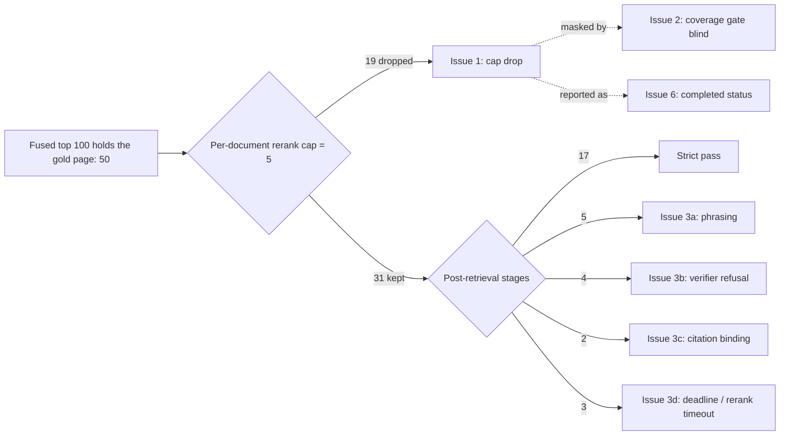

# Known-answer 50 root causes (2026-09-22)

Source run:
[KNOWN_ANSWER_50_REVIEW_2026-09-22.md](./KNOWN_ANSWER_50_REVIEW_2026-09-22.md).
Scoring rules:
[DUAL_METRIC_SCORING.md](./DUAL_METRIC_SCORING.md).
Retrieval contract:
[HYBRID_RETRIEVAL_CONTRACT.md](../retrieval/HYBRID_RETRIEVAL_CONTRACT.md).

The review document reports what the run showed. This document names
the defects behind the 33 misses, ties each one to the code path that
produces it, and orders them by how many misses they explain. Counts
come from the review's stage split and are not re-derived here.

Corpus for this run: one indexed book, version
`e119bf87-1c70-4e10-abb1-5666c4f728c4`. Every question was unscoped, so
every question ran `hybrid_default_v1` and source resolution was
`unscoped`.

## Summary

Retrieval found the gold page on 50 of 50 questions. Dense contained it
on 50 of 50 and the fused top 100 contained it on 50 of 50. The system
then lost the page or the answer in later stages on 33 questions.

Misses by issue: 19 cap drops, 5 phrasing, 4 verifier refusals,
2 citation binding, and 3 deadline or rerank timeout (including `k03`),
for 33 in total.

## Issue 1. Per-document rerank cap of 5 removes the gold page before rerank

**Misses explained: 19 of 33.**

`hybrid_default_v1` does not set `rerank_max_per_document`, so it takes
the model default of 5 from `FrozenHybridProfile`
(`packages/core/src/smart_rag_core/retrieval/frozen_profile.py`, field
`rerank_max_per_document: int = Field(default=5, ge=1)`). The same value
is the module constant `RERANK_MAX_PER_DOCUMENT = 5` in
`packages/core/src/smart_rag_core/retrieval/profiles.py`.

`rerank_preload_ids` in
`packages/core/src/smart_rag_core/retrieval/rerank.py` walks the fused
list in rank order and skips any candidate whose `document_id` already
has 5 entries in the pool. With one book in the corpus, the fused top
100 is one `document_id`, so the advertised 20-slot rerank pool holds
exactly 5 chunks. A gold page ranked 6th to 100th in RRF order never
reaches the reranker. Nothing downstream can recover it: selection,
evidence assembly, generation, and verification only see the 5.

The 19 cap-drop questions are exactly the questions whose selected set
does not contain the gold page. BM25 missing the page on 21 of 50
(Issue 5) makes this worse, because a dense-only RRF score sits lower in
the fused order.

### Why the existing fix did not run

`hybrid_long_document_v2` sets `rerank_max_per_document` to 20 and
`rerank_pool_size` to 20. It is selected by `select_runtime_profile` in
`packages/core/src/smart_rag_core/retrieval/source_scope.py`, which
requires all of:

- `resolution is SourceResolution.EXACT_ONE`
- `representative_count > 5`
- `version_id is not None`
- `long_document_runtime_enabled()` (v2 digest pinned)
- `query_class` not in `{"exact_code", "exact_acronym"}`

`EXACT_ONE` is produced by `resolve_retrieval_scope` only when
`requested_sources` (named-source confidence at or above 0.80) or an
authorized title of at least 8 normalized characters contained in the
question resolves to exactly one current version. None of the 50
questions named the book, so all 50 stayed `unscoped` and got the
default profile with `eligibility_reason = default_profile_required`.

The gate keys on how the user phrased the question. The condition that
matters is the shape of the candidate set or the authorized corpus: one
document dominating the fused list, or a single authorized document in
scope. The long-document ADR
([ADR-hybrid-long-document-profile.md](../adr/ADR-hybrid-long-document-profile.md))
is still `proposed` and describes the title-match trigger only.

### Constraint on the fix

Frozen profiles are digest-pinned. Editing `hybrid_default_v1.json` in
place breaks the freeze contract. The change needs a new frozen profile
(for example `hybrid_default_v2`) or a corpus-shape eligibility rule
that routes to `hybrid_long_document_v2` without a title match, plus
the measured digest and freeze evidence the plan requires.

## Issue 2. Coverage is computed on survivors, so the 0.65 gate cannot see a cap drop

**Misses explained: 0 directly. Masks all 19 in Issue 1.**

Coverage on every question was 0.80, 0.90, or 1.00, including all 19 cap
drops. The score is produced by the second `call_assemble_hybrid` in
`packages/core/src/smart_rag_core/retrieval/hybrid_run/retriever.py`,
after selection, using only the chunks that survived selection and the
`matched_terms` found in them. Five topically related chunks from the
right book look sufficient to that measure.

Consequences:

- The `coverage_score_baseline` of 0.65 never fired on any question.
- The single allowed correction (retry same route or escalate to
  Combined) was never spent, because its trigger is this gate.
- No support-confidence fallback fired either; no measured score was
  0.60.

Coverage answers "does what I kept look sufficient?" It does not answer
"did I drop a candidate that ranked above what I kept?" The second
question is the one that detects Issue 1. The eval now names that stage:
`rerank_pool_drop` when the gold page is in `fused_ids` but not the rerank
pool, and `selection_drop` when it is in the pool but not final evidence.
See the [KA50 accuracy repair plan](../../.cursor/plans/ka50_accuracy_repair_7e21c4d9.plan.md).
Related calibration notes:
[COVERAGE_CALIBRATION.md](./COVERAGE_CALIBRATION.md).

## Issue 3. Post-retrieval stages lose the answer after the gold page is in evidence

**Misses explained: 13 of 33** (of the 31 questions that kept the page,
17 passed and 13 failed later; `k03` is counted here under 3d).

### 3a. Phrasing, 5

`k06`, `k29`, `k30`, `k33`, `k42`. Terminal `completed`, verifier
`verified`, gold page in evidence, required phrase not a substring of
the stored answer. Some of these may be correct paraphrases. This bucket
is partly a scorer limitation, not a system defect, and needs a manual
read before it is counted as a product miss.

### 3b. Verifier refusal, 4

- `k34` and `k49`: the required phrase was already in the stored answer
  and the verifier still returned `insufficient_evidence` with no
  citation-failure code. The verifier discarded a correct, grounded
  answer.
- `k41`: failed inside `generate_answer`, before verification.
- `k18`: refused with no citation preview.

The verifier contract is in
[ANSWER_VERIFICATION.md](../agent/ANSWER_VERIFICATION.md). A verifier
that can wipe an answer whose phrase is present in kept evidence is a
false-refusal defect and is weighted by
`unnecessary_refusal_loss_weight` in the frozen profile.

### 3c. Citation binding, 2

`k07` (`verified_partial`) and `k12` (refused, no citation preview) kept
the gold page and failed with `paragraph_unmapped`. The same code, plus
`citation_link_mismatch` and `paragraph_index_invalid`, appears on
non-gold evidence in `k28`, `k02`, and `k44`. `k44` still passed, so the
code does not always replace the answer, but paragraph mapping is
unreliable across the run, not just on these two questions.

### 3d. Deadline and rerank timeout, 3

- `k24`: gold page in evidence, no answer produced
  (`generate_answer:insufficient_evidence`), terminal
  `deadline_exhausted`.
- `k48`: `verified_partial` answer that already contained the phrase,
  then `deadline_exhausted`.
- `k03`: gold page inside the rerank pool, rerank returned
  `(0, rerank_timeout)`, and fusion evidence no longer contained the
  page. This is the only question where the page was selected and then
  lost.

`k15` also recorded `rerank_timeout` but was already a cap drop, so the
timeout did not cause its miss. `k32` hit both a cap drop and the
deadline; the scorer labels it deadline, the stage split labels it cap.

Two rerank timeouts and four deadline terminals at roughly one minute
per question means the per-slice budget is tight for the live reranker.
Budget policy: [QUERY_BUDGETS.md](../agent/QUERY_BUDGETS.md) and
[ADR-ask-evidence-budget-repair.md](../adr/ADR-ask-evidence-budget-repair.md).

## Issue 4. Term channel returned zero ids on 50 of 50

**Misses explained: 0 in this run.**

`TermRetriever.retrieve` in
`packages/core/src/smart_rag_core/retrieval/terms.py` calls
`app.retrieve_term_candidates` over populated search terms (filenames,
titles, codes, aliases) plus needles from `extract_term_needles`. A
prose book has no seeded codes or aliases, so the channel returns
nothing on every question and sets `empty_channel=True`.

Dense carried the gold page, so this did not cause a miss. It still
means:

- Fusion ran as two channels while `channel_weights` in the frozen
  profile assume three equal channels.
- Any claim of alias or code recall for this corpus is vacuous.
- The exporter records the outcome as `fallback_reason = none`, so a
  dead channel is indistinguishable from a healthy channel with no
  matches.

## Issue 5. BM25 held the gold page on 29 of 50

**Misses explained: 0 directly. Compounds Issue 1.**

BM25 returned 75 ids on every question and contained the gold page on
29. When BM25 misses, the gold page's RRF score is dense-only, which
lowers it in the fused order and makes the 5-slot cap more likely to
exclude it. The export flag `bm25_degraded_explicit` is true only
because the exporter treats fallback `none` as explicit; BM25 was not
degraded. Tuning notes: [HYBRID_TUNING.md](../retrieval/HYBRID_TUNING.md).

## Issue 6. Product status reports success on cap drops

**Misses explained: 0. Trust defect.**

Of the 19 cap drops, 13 returned an answer the verifier accepted or
partially accepted, and 6 ended `completed` with no limitation (`k05`,
`k08`, `k14`, `k25`, `k26`, `k47`). The client sees a verified answer
while the page that holds the fact never reached the model. `k31`
stored the required phrase and still ended `insufficient_evidence`,
which is the opposite error on the same surface.

`completed` therefore does not mean the gold page was used, and
`insufficient_evidence` does not mean the phrase was absent. Neither
terminal is trustworthy as an accuracy signal until Issues 1, 2, and 3b
are fixed.

## Priority order

1. Issue 1. Make the per-document cap follow fused-list or corpus shape
   rather than title match, via a new frozen profile or a corpus-shape
   eligibility rule for `hybrid_long_document_v2`. Addresses 19 of 33.
2. Issue 2. Add a "dropped higher-ranked candidate" signal so the
   correction gate can fire on cap drops.
3. Issue 3b and 3c. Stop the verifier from discarding an answer whose
   phrase is grounded in kept evidence; fix `paragraph_unmapped`.
   Addresses 6 of the 13 post-retrieval misses.
4. Issue 3d. Re-examine rerank slice budget and deadline after 1 and 3
   land, because a larger rerank pool costs more time.
5. Issue 3a. Manually read the 5 phrasing misses; reclassify true
   paraphrases before counting them.
6. Issues 4 and 5. Real, but secondary for a single prose book.

## What this document does not claim

- It does not re-run the 50 questions. Counts are taken from the review.
- It does not measure how many of the 19 cap drops would pass with a
  cap of 20. The long-document profile ran on zero questions here, so
  there is no in-run evidence for that number.
- It does not classify the 5 phrasing misses as correct or incorrect.
