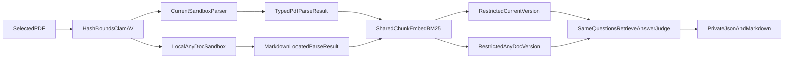

# Isolated PDF parser bake-off

Experiment-only comparison of the production PDF parser against local AnyDoc
0.2.4 on one sealed book. Production ingest is unchanged.

Related: [ADR-anydoc-local-parser-bakeoff.md](../adr/ADR-anydoc-local-parser-bakeoff.md)
· [PDF_HYBRID_EVALUATION.md](./PDF_HYBRID_EVALUATION.md)
· [PARSER_SANDBOX.md](../ingestion/PARSER_SANDBOX.md)
· [CHUNKING_CONTRACT.md](../ingestion/CHUNKING_CONTRACT.md)
· [docs index](../README.md)



## Fixed scope

| Item | Value |
| --- | --- |
| Source PDF | `dataset/building-applications-with-ai-agents-designing-and-implementing-multiagent-systems-1 (1).pdf` |
| Lane `current` | PyMuPDF + local Tesseract (`parser_v1`) in `smart-rag-parser-sandbox:local` |
| Lane `anydoc_local` | `firecrawl-anydoc==0.2.4`, `ocr=reject`, image `smart-rag-parser-bakeoff:local` |
| Firecrawl Parse / hosted OCR | Forbidden |
| OpenAI | Existing `OPENAI_API_KEY` through shared gateways only |
| Graph | Disabled; both versions `graph_eligible=false` |
| Holdout | Never opened |
| Generalization | `generalization_claim=false` |

## Limits

| Limit | Value | Failure |
| --- | --- | --- |
| Input bytes | 104857600 | `limit_exceeded:input_bytes` |
| Pages | 500 | `limit_exceeded:pages` |
| AnyDoc sandbox memory | 1024 MiB hard | kill + failed parse |
| CPUs / PIDs | 1.0 / 64 | sandbox policy |
| Timeout | 120 s | `timeout` |
| AnyDoc OCR | `reject` only | `needs_ocr` (no hosted fallback) |
| Network | `--network none` | block launch |
| Secrets in parser | none | block launch |

## Isolation

This repository has no document workspace column. Isolation is:

- unique `run_id`;
- one restricted document/version per lane titled `parser-bakeoff:<run-id>:<lane>`;
- one ACL evaluation actor;
- retrieval `restrict_version_id`;
- cleanup by exact manifest UUIDs only.

This is logical isolation on one hosted stack, not a separate database.

## Artifact layout

Gitignored under `.private-eval/parser-bakeoff/<run-id>/`:

```text
manifest.json
neutral-cases.json
current/parse-result.json
current/chunk-summary.json
current/ingest-ids.json
current/gold-map.json
current/retrieval-report.json
current/agent-report.json
anydoc_local/parse-result.json
anydoc_local/chunk-summary.json
anydoc_local/ingest-ids.json
anydoc_local/gold-map.json
anydoc_local/mapping-review.json
anydoc_local/retrieval-report.json
anydoc_local/agent-report.json
comparison.json
comparison.md
```

Reports must not contain source text, questions, answers, excerpts, or
credentials. `char_coverage_ratio` is not an accuracy metric.

## Operator commands

```powershell
$Pdf = "dataset\building-applications-with-ai-agents-designing-and-implementing-multiagent-systems-1 (1).pdf"

uv run python scripts/parser_bakeoff.py prepare --pdf $Pdf
uv run python scripts/parser_bakeoff.py parse --run-id <run-id> --lanes current,anydoc_local
uv run python scripts/parser_bakeoff.py index --run-id <run-id>
uv run python scripts/parser_bakeoff.py map-gold --run-id <run-id> --split development
uv run python scripts/parser_bakeoff.py validate-gold --run-id <run-id> --reviewer Nagdy
uv run python scripts/parser_bakeoff.py evaluate --run-id <run-id> --split development --live
uv run python scripts/parser_bakeoff.py report --run-id <run-id>
uv run python scripts/parser_bakeoff.py cleanup --run-id <run-id> --manifest-sha256 <hash>
```

Resume without repeating paid model work:

```powershell
uv run python scripts/parser_bakeoff.py run --pdf $Pdf --lanes current,anydoc_local --split development --live --resume
```

`--force` cannot bypass label seals, provider-matrix gates, ACL checks, or
holdout denial. Qualification is blocked until development protocol hashes
are frozen. Holdout is never a valid split.

## Evaluation dimensions

Primary paired metrics (same sealed cases, same downstream settings):

- Hybrid Recall@10
- citation correctness / completeness
- atomic-fact completeness
- judge faithfulness
- page-locator correctness (`current` real pages; `anydoc_local` unavailable)

Safety gate: zero ACL / cross-lane leaks.

Secondary: parse success, chunk counts, token-band distribution, latency,
OpenAI token/cost ledger, mapping-review count.

Do not collapse these into one weighted accuracy score.

## Classification

| Token | Meaning |
| --- | --- |
| `current_primary` | AnyDoc does not improve accuracy, or loses required provenance |
| `anydoc_secondary_candidate` | AnyDoc improves retrieval/answer quality but lacks PDF locators |
| `anydoc_primary_candidate` | AnyDoc improves paired quality **and** supplies required locators |
| `inconclusive` | Confidence interval crosses zero, mappings unscored, or infra mismatch |

## Failure modes

| Condition | Result |
| --- | --- |
| Wrong PDF path | `blocked=selected_pdf_required` |
| Size/page overflow | Failed prepare, no run directory mutation beyond the attempt |
| ClamAV not clean | `blocked=scan_not_clean` |
| AnyDoc `NeedsOcrError` | Lane failed, `failure_code=needs_ocr`, no Firecrawl |
| Encrypted / malformed PDF | Lane failed, zero elements |
| Nondeterministic replay | Stop before index |
| Unapproved gold map | Stop before live evaluate |
| Cross-lane chunk ID | Retrieval hard-fail, leak counted |
| Invalid judge JSON/timeout | `unscored`, never a pass |
| Cleanup title mismatch | Refuse delete |

## Verification

```powershell
uv run ruff format --check packages/core/src/smart_rag_core/evaluation/parser_bakeoff scripts/parser_bakeoff.py infra/parser-bakeoff tests/unit/test_parser_bakeoff_lanes.py tests/unit/test_parser_bakeoff_mapping.py tests/unit/test_parser_bakeoff_metrics.py tests/unit/test_parser_bakeoff_report.py tests/contract/test_parser_bakeoff_sandbox.py tests/contract/test_parser_bakeoff_index.py tests/contract/test_parser_bakeoff_retrieval.py tests/contract/test_parser_bakeoff_cleanup.py
uv run ruff check packages/core/src/smart_rag_core/evaluation/parser_bakeoff scripts/parser_bakeoff.py infra/parser-bakeoff tests/unit/test_parser_bakeoff_lanes.py tests/unit/test_parser_bakeoff_mapping.py tests/unit/test_parser_bakeoff_metrics.py tests/unit/test_parser_bakeoff_report.py tests/contract/test_parser_bakeoff_sandbox.py tests/contract/test_parser_bakeoff_index.py tests/contract/test_parser_bakeoff_retrieval.py tests/contract/test_parser_bakeoff_cleanup.py
uv run pytest tests/unit/test_parser_bakeoff_lanes.py tests/unit/test_parser_bakeoff_mapping.py tests/unit/test_parser_bakeoff_metrics.py tests/unit/test_parser_bakeoff_report.py -q
uv run pytest tests/contract/test_parser_bakeoff_sandbox.py tests/contract/test_parser_bakeoff_index.py tests/contract/test_parser_bakeoff_retrieval.py tests/contract/test_parser_bakeoff_cleanup.py -q
```

Live development ingest/eval requires Compose parser image, AnyDoc image,
ClamAV, ParadeDB, hosted Supabase, and a verified provider matrix. Those
external steps are operator-run; missing infrastructure is a documented
blocker, not a silent skip in the CLI.

## Troubleshooting

- `docker executable not found`: build/start Docker Desktop; do not set
  `ALLOW_INPROCESS_PARSER` for the live bake-off.
- `needs_ocr`: the PDF is image-only for AnyDoc; the experiment stops that
  lane. Do not enable hosted OCR.
- `provider_matrix_unverified`: set `SMART_RAG_SUBPROCESSOR_MATRIX_VERIFIED`
  only after the signed matrix exists.
- Cross-lane hits: confirm `restrict_version_id` and distinct
  `ingest-ids.json` files.
