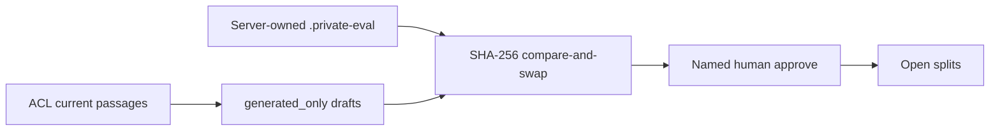

# Local PDF evaluation workspace

Local-only owner/admin store and (Packet 21) HTTP overlay for reviewing
private PDF evaluation cases. Private questions, answers, facts, and
excerpts stay under gitignored `.private-eval/`. This is not a hosted
label table and not a holdout opener.

Related: [ADR-local-pdf-evaluation-workspace.md](../adr/ADR-local-pdf-evaluation-workspace.md) ·
[PDF_HYBRID_EVALUATION.md](./PDF_HYBRID_EVALUATION.md) ·
[ADMINISTRATION.md](../frontend/ADMINISTRATION.md) ·
[AUTHORIZATION_MODEL.md](../security/AUTHORIZATION_MODEL.md) ·
[CONFIGURATION.md](../development/CONFIGURATION.md) ·
[docs index](../README.md)

## Store bounds (Packet 20)

| Bound | Limit |
| --- | --- |
| Cases | 60 |
| Question | 2,000 characters |
| Expected answer | 8,000 characters |
| Facts | 16 × 1,000 characters |
| Gold chunks | 1–3 |

Mutations require the expected SHA-256 revision. Writes use a process
lock and atomic replace. Editing question, answer, facts, or locators
clears `human_approved` and `reviewer`. Generated rows remain
`generated_only=true` until a named human approves.

The store rejects:

- `..` traversal and symlink escape from the server-owned root
- any path component `holdout` (case-insensitive)
- client-supplied filesystem paths (HTTP Packet 21 never accepts a path)
- `holdout_opened=true` envelopes

Logs may include `case_id` and revision prefixes. They never include
questions, answers, facts, excerpts, JWTs, or absolute roots.

Draft generation (`build_draft_rows`) is extractive and locator-grounded.
Unsupported glossary aliases are not cycled onto unrelated passages.
Duplicate question hashes are dropped rather than self-approved.

## HTTP (Packet 21)

Enable only with `APP_ENV=local` or `test` and `PDF_EVAL_WORKSPACE_ENABLED=true`.
Staging and production fail closed. Compose bind-mounts `./.private-eval` on
the API service only.

| Route | Auth | Notes |
| --- | --- | --- |
| `GET /api/meta` | public | Additive `pdf_eval_workspace` capability |
| `GET /admin/pdf-eval/status` | owner/admin | 404 when disabled |
| `GET /admin/pdf-eval/cases` | owner/admin | Summaries; no bulk questions; `split=holdout` → 400 |
| `GET /admin/pdf-eval/cases/{id}` | owner/admin | Includes question fields |
| `PATCH /admin/pdf-eval/cases/{id}` | owner/admin | Compare-and-swap; cannot set reviewer |
| `POST .../approve` / `.../reject` | owner/admin | Reviewer is `caller.user_id` |
| `POST /admin/pdf-eval/drafts/regenerate` | owner/admin | Generated-only rows |
| `GET /admin/pdf-eval/passages` | owner/admin | `app.list_authorized_eval_passages` |
| `GET /admin/pdf-eval/reports/latest` | owner/admin | Count-only |
| `POST .../compare-run` | owner/admin | Caller-owned run; citation overlap |

Passages use `app_api`. Operator/service-role DSNs are forbidden.

## Admin UI (Packet 22)

The Evaluation tab appears only when `GET /api/meta` reports
`pdf_eval_workspace=true`. Hidden nav is not authorization. Members still
receive 403. The answering model receives the question only. Expected
answers stay collapsed until a completed run and Reveal. Holdout cases
cannot Run. Official Recall@10 remains CLI.

## Rollback

Set `PDF_EVAL_WORKSPACE_ENABLED=false` and remove the Compose bind mount.
Dataset files under `.private-eval/` stay gitignored.
