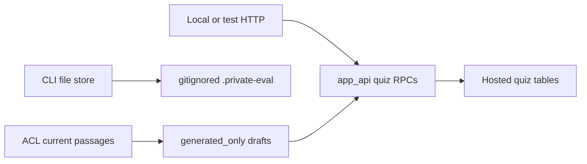
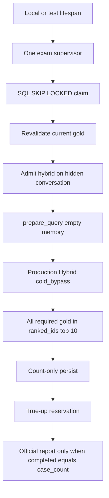
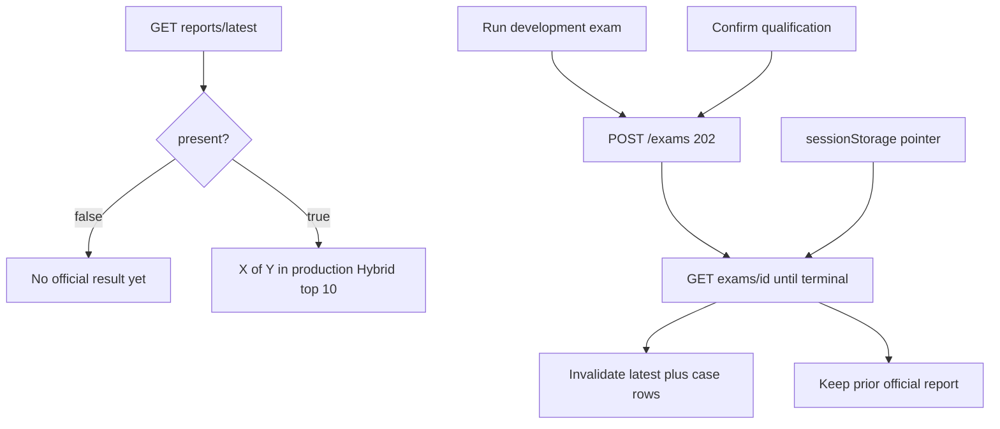
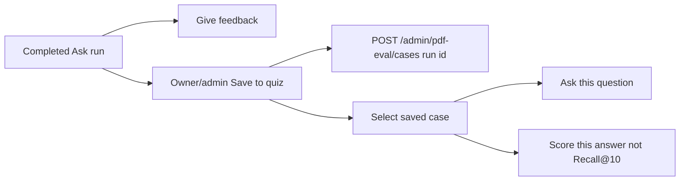

# Local PDF evaluation workspace

**Custody amendment (P06-27, 2026-09-10):** hosted quiz labels and a
production-corpus web exam are authorized by
[ADR-hosted-webapp-evaluation-workspace.md](../adr/ADR-hosted-webapp-evaluation-workspace.md).
Implementation is packets P06-28 through P06-36 after Packet 10 acceptance.
HTTP compare-run is citation overlap, not official Recall@10. Official Recall@10
in the Admin exam board is **All required gold chunks in the production Hybrid
top 10**. Holdout stays out. Ordinary thumbs feedback stays.

Local-only owner/admin HTTP overlay for reviewing hosted quiz cases. Historical
P06-19–P06-26 CLI modules still use gitignored `.private-eval/`. HTTP does not
fall back to that directory. This is not a holdout opener.

Related: [ADR-hosted-webapp-evaluation-workspace.md](../adr/ADR-hosted-webapp-evaluation-workspace.md) ·
[ADR-local-pdf-evaluation-workspace.md](../adr/ADR-local-pdf-evaluation-workspace.md) ·
[PDF_HYBRID_EVALUATION.md](./PDF_HYBRID_EVALUATION.md) ·
[COMPANY_DOCUMENTS_RAG_100.md](./COMPANY_DOCUMENTS_RAG_100.md) ·
[ADMINISTRATION.md](../frontend/ADMINISTRATION.md) ·
[AUTHORIZATION_MODEL.md](../security/AUTHORIZATION_MODEL.md) ·
[CONFIGURATION.md](../development/CONFIGURATION.md) ·
[docs index](../README.md)

## Store bounds (Packet 20)

| Bound | Limit |
| --- | --- |
| Cases | 60 |
| Question | 2,000 characters |
| Expected answer | 8,000 characters |
| Facts | 16 × 1,000 characters |
| Gold chunks | 1–3 |

Mutations require the expected SHA-256 revision. Writes use a process
lock and atomic replace. Editing question, answer, facts, or locators
clears `human_approved` and `reviewer`. Generated rows remain
`generated_only=true` until a named human approves.

The store rejects:

- `..` traversal and symlink escape from the server-owned root
- any path component `holdout` (case-insensitive)
- client-supplied filesystem paths (HTTP Packet 21 never accepts a path)
- `holdout_opened=true` envelopes

Logs may include `case_id` and revision prefixes. They never include
questions, answers, facts, excerpts, JWTs, or absolute roots.

Draft generation (`build_draft_rows`) is extractive and locator-grounded.
Unsupported glossary aliases are not cycled onto unrelated passages.
Duplicate question hashes are dropped rather than self-approved.

## HTTP (Packet 29)

Enable only with `APP_ENV=local` or `test` and `PDF_EVAL_WORKSPACE_ENABLED=true`.
Staging and production fail closed. Local Compose defaults the flag to true.
HTTP uses hosted quiz RPCs. Missing schema is 503, not an empty workspace.

| Route | Auth | Notes |
| --- | --- | --- |
| `GET /api/meta` | public | Additive `pdf_eval_workspace` capability |
| `GET /admin/pdf-eval/status` | owner/admin | 404 when disabled; 503 when quiz RPCs are missing |
| `POST /admin/pdf-eval/cases` | owner/admin | Create from a caller-owned completed run. No browser question |
| `GET /admin/pdf-eval/cases` | owner/admin | Summaries; no bulk questions; `split=holdout` → 400 |
| `GET /admin/pdf-eval/cases/{id}` | owner/admin | Includes question fields. XSS-escaped |
| `PATCH /admin/pdf-eval/cases/{id}` | owner/admin | `expected_row_version` CAS; cannot set reviewer |
| `PUT /admin/pdf-eval/cases/{id}/gold` | owner/admin | Server-derived locators from chunk IDs |
| `POST .../approve` / `.../reject` | owner/admin | Reviewer is `caller.user_id` |
| `DELETE /admin/pdf-eval/cases/{id}` | owner/admin | Immediate delete with CAS |
| `POST /admin/pdf-eval/drafts/regenerate` | owner/admin | Generated-only rows for one document. Never self-approves |
| `GET /admin/pdf-eval/passages` | owner/admin | Selected current document; `app.list_authorized_eval_passages` |
| `GET /admin/pdf-eval/reports/latest` | owner/admin | Split-isolated official report; `present=false` when none |
| `POST /admin/pdf-eval/exams` | owner/admin | 202 enqueue; `COST_MUTATION`; never scores in-request |
| `GET /admin/pdf-eval/exams/{id}` | owner/admin | Poll queued/running/terminal |
| `POST /admin/pdf-eval/exams/{id}/cancel` | owner/admin | Idempotent cancel; `COST_MUTATION` |
| `GET /admin/pdf-eval/reports/{id}/cases` | owner/admin | Count-only missed/hit rows; 404 if unpublished |
| `POST .../compare-run` | owner/admin | Caller-owned completed run; citation overlap |

Passages use `app_api`. Operator/service-role DSNs are forbidden. HTTP never
reads `.private-eval/`.

## Hosted quiz cases (Packet 28)

Canonical day-to-day labels live in `app.eval_quiz_cases` and
`app.eval_quiz_gold_chunks` in the existing hosted project. FastAPI still
must use `app_api`. Browser JWT roles have no table DML.

| Bound | Limit |
| --- | --- |
| Live cases | 60 non-expired |
| Retention | 365 days plus immediate delete RPC |
| Question / answer / facts | 2,000 / 8,000 / 16×1,000 |
| Gold chunks | 0–3 drafts; 1–3 to approve |
| Splits | `development` and `qualification` only |

Create loads the question from `app.load_query_run_user_message` when a
source run is supplied. Client locators are not trusted. Mutation audit
payloads are content-free. `holdout` is rejected. HTTP wrappers are Packet 29.

## Hosted exam runs (Packet 30)

`app.eval_exam_runs`, `app.eval_exam_case_results`, and
`app.eval_exam_reports` store durable exam jobs and count-only Recall@10.
Results never store questions, excerpts, ranked IDs, or gold UUID lists.
Successful reports are immutable. Latest-report lookup ignores
partial/failed/cancelled runs. Enqueue creates `conversations.purpose=evaluation`
rows that browser list/get/messages/title RPCs never return. HTTP start/poll
is Packet 32. The runner is Packet 31.

## Exam runner (Packet 31)

Local and test API processes start one exam supervisor when
`PDF_EVAL_WORKSPACE_ENABLED=true` and `SUPABASE_DB_URL` is set. The
supervisor claims queued or expired-running exams through SQL
`SKIP LOCKED`, heartbeats a 5-60s lease, and scores one case at a time.

Each case revalidates current gold, admits a `hybrid` query run on the
hidden evaluation conversation, runs P06-10 `prepare_query` with empty
memory and `requested_search_scope=company_documents`, and calls the
production Hybrid branch with `cache_mode=cold_bypass`. The runner
never passes an evaluator-only `restrict_version_id` and never writes
`query_budget` onto the process Hybrid adapter.

A case is a hit when every required gold chunk is in
`HybridRunResult.ranked_ids[:10]`. Results persist counts only. Official
reports require `completed_case_count = case_count`. BM25 outage names
`bm25_unavailable` and forces `gates_pass=false`. Qualification fails
closed when the candidate fingerprint is incomplete. Crash resume skips
already persisted cases; admit reconnects the same reservation.
Cancellation true-ups the active reservation. `holdout_opened` stays
false.

## Admin UI (Packet 34)

The Evaluation tab appears only when `GET /api/meta` reports
`pdf_eval_workspace=true`. Hidden nav is not authorization. Members still
receive 403. The tab uses three local task views: **Overview**, **Review
cases**, and **Exam results**. Only the selected view mounts. Overview
shows draft, approved, stale-source, and remaining-slot counts from status,
plus **Generate review cases**. That control is document-scoped and never
self-approves.

Review cases lists the first 20 summaries with Load more up to 60. Queue
rows show a friendly question type, dataset, review status, source
freshness, and required-source count. They never show the question or
expected answer. Filters are dataset (`all` / `development` /
`qualification`), review status, and client-side source state. Holdout is
never a split option.

Expected answer, atomic facts, query class, and required terms are
editable after an authorized case-detail GET. PATCH and required-source PUT
send `expected_row_version`. Unsaved details or unsaved source changes
block **Approve case**. Editing labels or remapping required sources clears
approval. Stale sources block Approve. The required-source picker lists
current authorized passages, including chunks that were not citations, with
document title, page label or PDF page number, heading, and a bounded
escaped preview. Native checkboxes are keyboard-operable. Approval still
needs 1–3 saved current passages.

Delete names the case by query class, split, and review status. The
answering model receives the question only. Expected answers stay collapsed
in **Test this case** until a completed run and Reveal. **Compare cited
sources** is labelled **not official Recall@10**. Official Recall@10 is the
Exam results scoreboard.

## Admin exam board (Packet 35)

The Evaluation tab **Exam results** scoreboard is the official web exam.
The visible headline is **All required gold chunks in the production Hybrid
top 10: X of Y (Z%)**. A `
` disclosure defines the metric.
Citation overlap from Ask or Compare cited sources is never labelled
Recall@10. There is no freeze button and no holdout control. Absent reports
use **No official result yet**. Candidate and dataset short hashes stay
under **Technical details**.

Development start posts `split`, `idempotency_key`, and the current dataset
hash when a prior official report exists. Qualification opens a confirmation
first; the server remains authoritative for `qualification_consumed`. HTTP
never scores inside the request. Polling uses a 2s interval doubling to 15s.
Refresh reconnects from a sessionStorage pointer `{ examRunId, split }`.
`already_running` 409 does not include the other exam id; Resume works only
when this browser stored the pointer.

Progress is a polite live region. Cancel is a COST mutation. Partial, failed,
or cancelled exams do not replace the official report. Drill-down rows are
ordinal, hit/miss, gold count, and ranked-hit count only. Opening a row loads
the existing case editor. Insufficient dataset shows workspace counts and never
labels `gates_pass`. `gates_pass=false` is degraded or failed retrieve gates,
including BM25 outage.

## Ask Save to quiz (Packet 33)

Owner/admin Ask shows **Save to quiz** beside **Give feedback** when
`GET /api/meta` `pdf_eval_workspace` is true. Members and viewers keep
ordinary thumbs feedback only. The quiz control never replaces thumbs. The
footer trigger opens a two-tab side sheet (**New case** and **Saved cases**).

Create sends the completed run ID. The server loads the question. Zero to
three citation chunk IDs are optional source suggestions. Chat deletion does
not delete the saved case. The new row is a development draft and is never
approved from Ask. **Save quiz case** submits the draft. **Ask this question**
fills the composer with the saved question only. **Score this answer (not
Recall@10)** is citation overlap for a pre-existing approved case whose
normalized question matches. A draft created from the current run cannot
score that run as quality.

## Rollback

Set `PDF_EVAL_WORKSPACE_ENABLED=false`. Dataset files under `.private-eval/`
stay gitignored. Do not down-migrate hosted quiz or exam tables.
