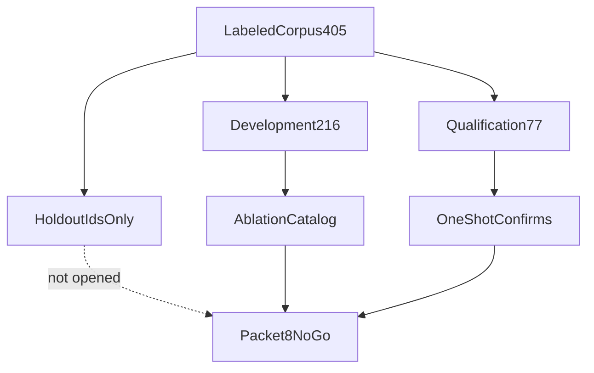

# Phase 4 Packet 8 ablation matrix

Compiled simpler-baseline and method evidence on development and
qualification only. Holdout labels were not read. Packet 9 measured
Phase-4-owned open-split ranked-ID Recall@K (not occupancy). Full-corpus
MRR/nDCG and holdout remain unverified.

Related: [PHASE4_FREEZE.md](./PHASE4_FREEZE.md) ·
[PHASE4_HOLDOUT.md](./PHASE4_HOLDOUT.md) ·
[RERANK_COUNTERFACTUAL.md](./RERANK_COUNTERFACTUAL.md) ·
[COVERAGE_QUALIFICATION.md](./COVERAGE_QUALIFICATION.md) ·
[EMBEDDING_QUALIFICATION_REPORT.md](./EMBEDDING_QUALIFICATION_REPORT.md) ·
[QUERY_PROFILE_EVAL.md](./QUERY_PROFILE_EVAL.md) ·
[HYBRID_RETRIEVAL_CONTRACT.md](../retrieval/HYBRID_RETRIEVAL_CONTRACT.md) ·
[docs index](../README.md)

## Scope

Graph, Combined, tool, injection, and frontend labels remain deferred.
Counting those unexecuted labels as Phase 4 passes is forbidden.

## Matrix

| Ablation | Status | What was measured | Live Recall@K |
| --- | --- | --- | --- |
| Embedding small vs large vs reduced-large | fixture_proven | Phase 2 `embedding-qual-v1` bake-off; pin `text-embedding-3-large` @1024 | Slice only, not 405 Hybrid |
| Structure-aware vs fixed chunks | fixture_proven | Phase 3 chunking fixtures and CHUNKING_CONTRACT | Not a retrieval Recall@10 |
| Dense-only | fixture_proven | Packet 2 filtered HNSW RPC fixtures, cap 100 | Unverified on labeled corpus |
| BM25-only | fixture_proven | Packet 2 typed ParadeDB queries, 75 authorized survivors | Unverified on labeled corpus |
| Populated term-only | fixture_proven | Packet 2 trigram/exact RPC, cap 30 | Unverified on labeled corpus |
| Dense+term BM25 outage | fixture_proven | Packet 4 `BM25_DEGRADED`; dense+term continue; snippets not evidence | Unverified envelope outage |
| Max vs summed variants | fixture_proven | Packet 4 max contribution across variants; summed not selected | Unverified |
| Static vs query-aware RRF | not_selected | Equal weights `1.0`; `rrf_k=60` not retuned | No ranked-ID weight search |
| Metadata / UTC temporal | fixture_proven | Clamp `[1.0, 1.15]`, `recent=90d` UTC; Hijri not authoritative | Unverified p95 |
| Always vs conditional rerank | mock_counterfactual | [RERANK_COUNTERFACTUAL.md](./RERANK_COUNTERFACTUAL.md); identity mock delta 0 | Live OpenAI unverified |
| MMR / quotas | fixture_proven | Packet 5 lambda `0.7`, document/section quota `2` | Not retuned |
| Parents / context | fixture_proven | Parent fetch without `is_search_representative`; 12 units / 3500 tokens | Unverified |
| Rewrites vs HyDE | not_selected | Bounded variants only; HyDE prohibited | N/A |
| Arabic tokenizer vs stemmer | fixture_proven | `arabic_norm_v1` parity; Unicode tokenizer; no English stemmer | Unverified Arabic Recall@10 |
| Selective ANN / exact oracle | fixture_proven | Iterative HNSW then bounded exact fallback 10000 rows | Unverified |
| Structured tables | fixture_proven | Packet 7 DuckDB sandbox unit+contract | Table p95 unverified |

## Stage metrics that exist

| Stage | Open-split evidence | Launch gate |
| --- | --- | --- |
| Query profile fields | Packet 3 `eval_query_profile.py` passed development 216 and qualification 77 | QT-QP-* measured on mock extract |
| Coverage occupancy | Packet 6 development n 216 loss `0.4583`; qualification PASS, false supported 0 | Not Hybrid Recall@10 |
| Rerank skip vs always | Packet 5 mock identity; 43 skips; ranking delta 0 | Not live token cost |
| Channel foundations | Packet 2/4 RPC fixtures and BM25 degradation | Not labeled Recall@K |
| Structured table | Packet 7 sum/count/avg/min/max/group/filter/sort/comparison | Not QT-LAT-006 p95 |
| ACL RPC | Hybrid and `resolve_structured_table` IDOR fixtures | QT-EVAL-001 fixture-only |
| Citations | Canonical chunk IDs only; BM25 text forbidden | QT-EVAL-002/003 blocker |
| Latency / cost | Mock mode; LangSmith gateway spans redacted | QT-LAT / cost unverified |

## Prohibited methods

HyDE, RAPTOR, SPLADE, ColBERT, learned-to-rank, and local rerankers remain
absent from `uv.lock` and runtime imports. See
[PROHIBITED_V1_METHODS.md](../retrieval/PROHIBITED_V1_METHODS.md).

## Failure modes

| Claim | Route |
| --- | --- |
| Occupancy PASS equals Recall@10 | Rejected; occupancy uses gold link visibility |
| Mock rerank delta 0 equals live quality | Rejected; `MOCK_MODEL_MODE=true` |
| Deferred graph labels as Hybrid passes | Rejected |
| Invented p95 or citation percent | Rejected |
| Holdout-derived ablation | Forbidden; access stays denied |

[docs index](../README.md)
