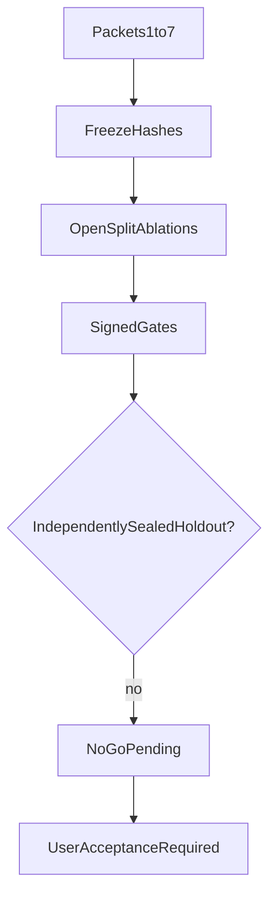

# Phase 4 Packet 8 freeze

Honest freeze of Hybrid code, config, prompts, and dataset manifests.
Launch decision is **no-go**. Sealed holdout labels were not opened.

Related: [PHASE4_ABLATIONS.md](./PHASE4_ABLATIONS.md) ·
[PHASE4_HOLDOUT.md](./PHASE4_HOLDOUT.md) ·
[QUALITY_TARGETS.md](../QUALITY_TARGETS.md) ·
[HYBRID_RETRIEVAL_CONTRACT.md](../retrieval/HYBRID_RETRIEVAL_CONTRACT.md) ·
[phase-04 evidence](../development/phase-04-hybrid-rag-evidence.md) ·
[docs index](../README.md)

## Decision

- Launch decision: `no_go`
- Holdout opened: `false`
- Client continue-versus-pilot: `pending_user_acceptance`
- SME corpus status: `synthetic_provisional`
- Holdout blocked: sealed holdout labels were not materialized; corpus SME status is synthetic_provisional, not independently_sealed; Packet 9 measured Phase-4-owned open-split ranked-ID gates without opening holdout



## Dataset counts

- Schema `phase4-dataset-v1` revision `phase4-labels-synthetic-v1`
- Development `216`
- Qualification `77`
- Open splits `293`
- Holdout ids in sealed manifest `112`
- Deferred later-phase labels on open splits `81`
- Profile `hybrid_default_v1` SHA-256 `def45b691e64707d07d3c7ea47f45eb1b23b5d2d2546c37a19a514f316c5940c`

## Artifact hashes

| Artifact | SHA-256 |
| --- | --- |
| `corpus_meta_file` | `887f770355041d65ed6238b1cd1f23ceacf13feadb964e07e5dabedd34399b7e` |
| `holdout_manifest_file` | `afcd733c02f65d18d2b745933e0b74ca4aec165c6279d651bb2ba6d491a2b052` |
| `hybrid_default_v1` | `def45b691e64707d07d3c7ea47f45eb1b23b5d2d2546c37a19a514f316c5940c` |
| `hybrid_default_v1_file` | `6fddae55bf127828192f93479f5454618ae1e5c71c2970d105ed868806f4aaa4` |
| `manifest_development` | `9dcbe2c564d33a38fba096253d60d2c8172fb9dd6c76bf95627446c857f89264` |
| `manifest_holdout` | `7c70b4267efbd9df46247c099333ef7e82ed4ccc6df906727d8997e7bcacada2` |
| `manifest_qualification` | `716ea031255217a82fa8ce2a1d7f89dbf17e841a99e7b1f4dc4de3a51d42cc14` |
| `query_profile_prompt` | `5a969a9d83d8716c6033fc1a7c5a773e5e63896953af3847d4e85216425e9e1f` |
| `rerank_prompt` | `4767049107cfe6e8591c84d3b1d202393dfd2564383e6c5bfa0bd5fece8f1925` |
| `schema` | `996fb7553dcffa1805020444b2c4e22eebf05d6a9909882468a2cc7b80d151c9` |

## Pins

| Pin | Value |
| --- | --- |
| `bm25_survivor_cap` | `75` |
| `channel_weights` | `1.0/1.0/1.0` |
| `coverage_baseline` | `0.65` |
| `dense_cap` | `100` |
| `duckdb` | `1.2.1` |
| `embedding_dimensions` | `1024` |
| `embedding_model` | `text-embedding-3-large` |
| `langsmith` | `0.10.18` |
| `langsmith_tracing_default` | `false` |
| `normalizer` | `arabic_norm_v1` |
| `openai` | `2.26.0` |
| `pyarrow` | `19.0.1` |
| `query_profile_prompt_version` | `query_profile_v1` |
| `rerank_model` | `gpt-4o-mini` |
| `rerank_prompt_version` | `rerank_v1` |
| `rrf_k` | `60` |
| `term_cap` | `30` |

## Signed gates

| ID | Title | Status | Target | Evidence |
| --- | --- | --- | --- | --- |
| `QT-EVAL-001` | Zero ACL leaks | `pass_open_split` | 0 leaks | Packet 9 live ranked-ID ACL leak count 0 on Phase-4-owned development/qualification; full 405-case ACL still not a holdout run |
| `QT-EVAL-002` | Citation correctness | `blocker` | >=98% | Packet 9 locator correctness **1.00** on returned Hybrid units (open splits). Answer/citation assembler remains Phase 6 |
| `QT-EVAL-003` | Citation completeness | `blocker` | >=90% | No Phase 4 answer/citation assembler run on labeled corpus |
| `QT-EVAL-004` | Answer faithfulness | `blocker` | >=90% | No answer/verifier prompts in Phase 4 |
| `QT-EVAL-006` | Hybrid Recall@10 | `pass_open_split` | >=85% | Packet 9 live ranked-ID development **0.902** / qualification **0.868** on Phase-4-owned classes; holdout sealed |
| `QT-EVAL-007` | Exact-code Recall@5 | `pass_open_split` | >=98% | Packet 9 live **1.00** development and qualification |
| `QT-EVAL-008` | Approved-alias Recall@10 | `pass_open_split` | >=95% | Packet 9 live **1.00** development and qualification |
| `QT-EVAL-009` | Combined vs Hybrid relationship/multi-hop | `deferred` | +10pp without ceiling breach | Phase 5/6; labels must not count as Phase 4 passes |
| `QT-QP-001` | Language/configuration accuracy | `pass` | >=95% | scripts/eval_query_profile.py open splits; mock extract |
| `QT-QP-002` | Temporal-intent macro-F1 | `pass` | >=90% | QUERY_PROFILE_EVAL.md Packet 3 open-split confirm |
| `QT-QP-003` | Exact-code/date extraction F1 | `pass` | >=98% | QUERY_PROFILE_EVAL.md; codes present in query text |
| `QT-QP-004` | Entity/approved-alias macro-F1 | `pass` | >=90% | eval_query_profile.py 2026-08-14; development and qualification passed |
| `QT-QP-005` | Metadata-filter precision and recall | `pass` | >=95% | eval_query_profile.py 2026-08-14; both splits passed |
| `QT-QP-006` | Query-type/relationship/table/decomposition macro-F1 | `pass` | >=90% | eval_query_profile.py 2026-08-14; both splits passed |
| `QT-LAT-001` | Hybrid first evidence p95 | `pass_open_split` | <=2s | Packet 9 live development **785 ms** / qualification **601 ms** (retrieve path, not first answer token) |
| `QT-LAT-006` | Structured-table p95 | `unverified` | <=5s deterministic | Packet 7 unit deadline 3s; labeled-table p95 not benchmarked |
| `QT-HOLD-001` | Immutable holdout run | `blocker` | one sealed end-to-end run | Holdout not independently SME-sealed; access remains denied |

## Ablations

Full narrative lives in [PHASE4_ABLATIONS.md](./PHASE4_ABLATIONS.md).
Live Recall@K is not claimed.

| ID | Title | Status | Evidence | Live recall claimed |
| --- | --- | --- | --- | --- |
| `embedding_small_vs_large` | Embedding small vs large vs reduced-large | `fixture_proven` | ADR-embedding-model-dimension.md; embedding-qual-v1 slice; text-embedding-3-large @1024 | `false` |
| `structure_aware_vs_fixed_chunks` | Structure-aware versus fixed chunks | `fixture_proven` | Phase 3 CHUNKING_CONTRACT.md and chunking unit fixtures | `false` |
| `dense_only` | Dense-only candidates | `fixture_proven` | Packet 2 HNSW RPC fixtures; live 405 Recall@10 unverified | `false` |
| `bm25_only` | BM25-only candidates | `fixture_proven` | Packet 2 ParadeDB typed query fixtures; live Recall@10 unverified | `false` |
| `term_only` | Populated term-only candidates | `fixture_proven` | Packet 2 trigram/exact RPC fixtures; live Recall@10 unverified | `false` |
| `dense_term_bm25_outage` | Dense plus term under BM25 outage | `fixture_proven` | Packet 4 BM25_DEGRADED signal; dense+term continue; no uncited snippets | `false` |
| `max_vs_summed_variants` | Max versus summed variant RRF | `fixture_proven` | Packet 4 max-across-variant contribution; summed path not selected | `false` |
| `static_vs_query_aware_rrf` | Static versus query-aware RRF weights | `not_selected` | Equal 1.0 weights frozen; unequal weights lack ranked-ID evidence | `false` |
| `metadata_temporal_factors` | Metadata and UTC temporal factors | `fixture_proven` | Packet 4 clamp [1.0, 1.15], recent=90d UTC; Hijri not authoritative | `false` |
| `always_vs_conditional_rerank` | Always versus conditional rerank | `mock_counterfactual` | RERANK_COUNTERFACTUAL.md; mock identity; live OpenAI delta unverified | `false` |
| `mmr_quotas` | MMR and document/section quotas | `fixture_proven` | Packet 5 unit fixtures; not retuned on ranked IDs | `false` |
| `parents_context` | Parent expansion and context budget | `fixture_proven` | Packet 5 parent fetch without is_search_representative; token cap 3500 | `false` |
| `rewrites` | Bounded query rewrites versus HyDE | `not_selected` | Packet 4 bounded variants only; HyDE prohibited in v1 | `false` |
| `arabic_tokenizer_stemmer` | Arabic tokenizer versus English stemmer | `fixture_proven` | arabic_norm_v1 parity; Unicode tokenizer; stemmer not selected | `false` |
| `selective_ann_exact_oracle` | Selective ANN then bounded exact fallback | `fixture_proven` | Packet 2/4 HNSW iterative scan plus 10000-row exact cap fixtures | `false` |
| `structured_tables` | Sandboxed DuckDB structured tables | `fixture_proven` | Packet 7 unit+contract; p95 table latency unverified | `false` |

## Verification

```powershell
uv run python scripts/eval_phase4_freeze.py
uv run pytest tests/unit/test_phase4_freeze.py tests/unit/test_langsmith_tracing.py -q
```

Re-run the freeze script after this packet lands to print the current
git SHA. Do not enable holdout access to force a pass.

[docs index](../README.md)
