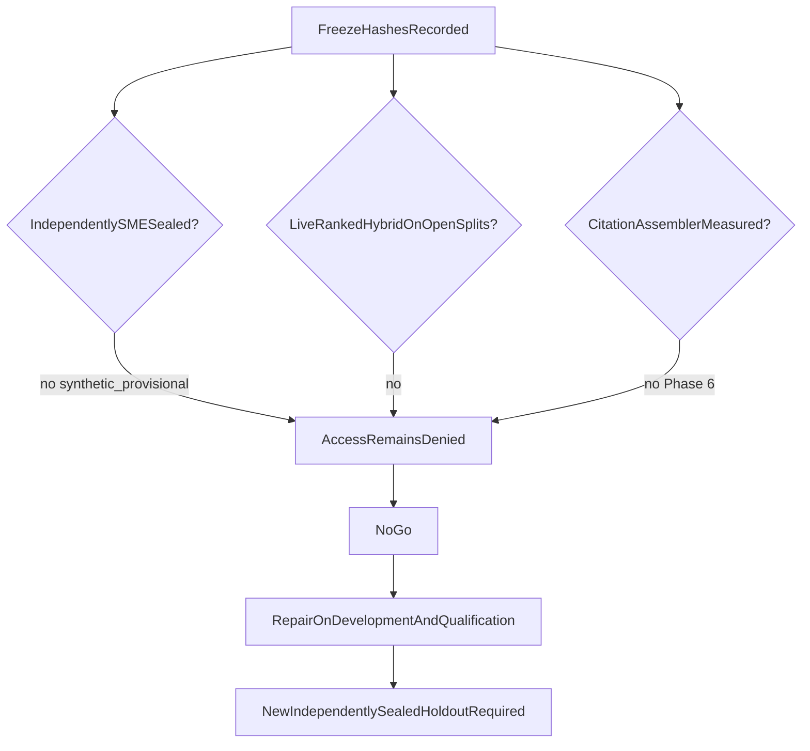

# Phase 4 Packet 8 holdout record

The immutable launch holdout was **not opened**. Packet 8 records a
**no-go**. A future launch claim needs a newly collected, independently
SME-sealed holdout after live ranked-ID Hybrid gates exist on
development and qualification.

Related: [PHASE4_FREEZE.md](./PHASE4_FREEZE.md) ·
[PHASE4_ABLATIONS.md](./PHASE4_ABLATIONS.md) ·
[DATASET_SPEC.md](./DATASET_SPEC.md) ·
[QUALITY_TARGETS.md](../QUALITY_TARGETS.md) ·
[ADR-hybrid-pilot-release-cut.md](../adr/ADR-hybrid-pilot-release-cut.md) ·
[docs index](../README.md)

## Why holdout stayed sealed

Packet 1 sealed `tests/fixtures/evaluation/phase4/manifests/holdout.json`
with ordered case ids and content hashes only. Query text and gold labels
are not in that file. Corpus metadata records SME approval as
`synthetic_provisional`, named Knowledge Owner hours **unverified**.

`scripts/eval_phase4_freeze.py` refuses to run when
`SMART_RAG_HOLDOUT_ACCESS` is true so a freeze job cannot coincide with
an authorized open.

## What was not executed

| Item | Status |
| --- | --- |
| `SMART_RAG_HOLDOUT_ACCESS` | false (default) |
| Holdout label materialization | not performed |
| Frozen end-to-end Hybrid/table qualification on holdout | not performed |
| Immutable holdout run id | none |
| Config change after holdout results | N/A; holdout never started |
| Repeated holdout rerun to obtain a pass | forbidden and not attempted |

## Launch comparison (unsigned by live holdout)

| Gate | Signed target | Packet 8 |
| --- | --- | --- |
| QT-EVAL-001 ACL leaks | 0 | Fixture-only on RPCs |
| QT-EVAL-002 citation correctness | >=98% | Blocker; no answer assembler |
| QT-EVAL-003 citation completeness | >=90% | Blocker |
| QT-EVAL-006 Hybrid Recall@10 | >=85% | Blocker; no live ranked IDs |
| QT-EVAL-007 exact-code Recall@5 | >=98% | Blocker |
| QT-EVAL-008 alias Recall@10 | >=95% | Blocker |
| QT-LAT-001 Hybrid first evidence p95 | <=2s | Unverified |
| Profile QT-QP-* | signed minima | Pass on open splits (mock extract; 2026-08-14) |
| Structured-table p95 | <=5s | Unverified |

## Repair rule

If a later holdout fails, record that failed release. Repair only against
development and qualification. A later launch claim requires a newly
collected and independently sealed holdout approved by the SME. Opening
the current synthetic holdout just to produce a number does not satisfy
that rule.

## Continue versus Hybrid Pilot

[ADR-hybrid-pilot-release-cut.md](../adr/ADR-hybrid-pilot-release-cut.md)
requires an explicit user choice before Phase 5. Packet 8 does **not**
choose continue-to-GraphRAG or `0.x Hybrid Pilot`. Phase 4 status stays
`pending` until the user accepts this no-go record or a later go record.

[docs index](../README.md)
