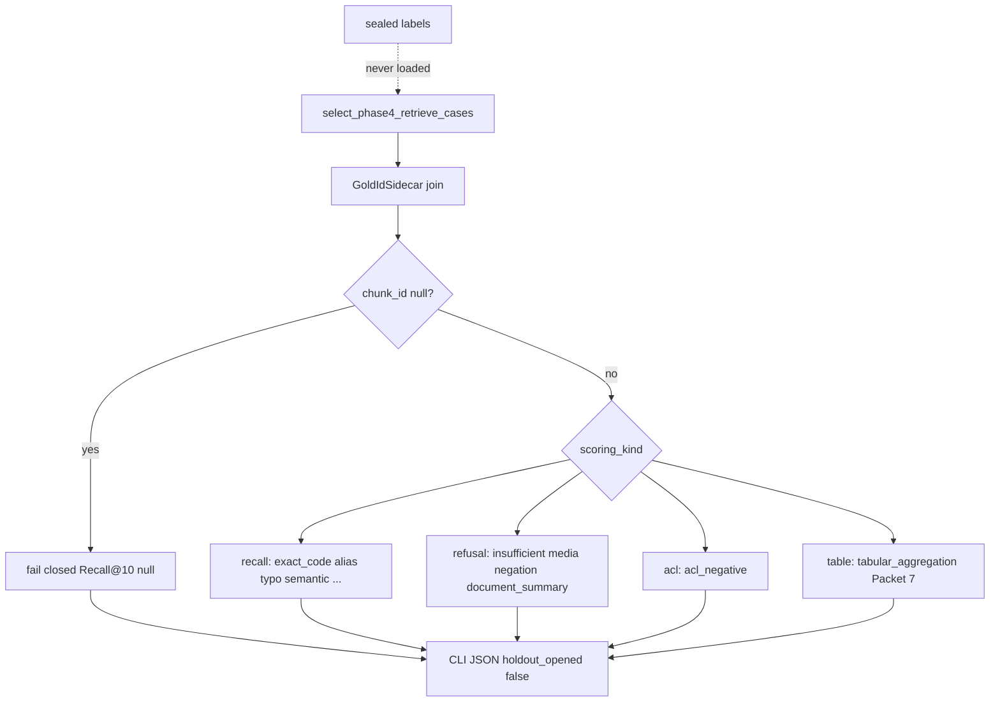

# Phase 4 ranked-ID evaluation

Packet 9 Wave 2 harness for **Phase-4-owned open splits**. Holdout stays sealed.
Occupancy scoring in `coverage_eval.py` is not Recall@K.

## Claim hygiene (do not over-claim)

Packet 9 live ranked-ID used **identity rerank**, not OpenAI Responses
rerank (`rerank_call_count=0`). The published Recall@10 / exact-code@5 /
alias@10 numbers are synthetic open-split scores on a compact markdown
corpus with sidecar-mapped UUIDs. Holdout remains sealed. Locator
correctness is **not** citation-assembler completeness. Structured-table
Parquet eval did **not** run (`execute_compiled_query` count 0). Do not
quote these percents as launch Hybrid quality, Combined gain, or live
OpenAI rerank evidence. Frozen `hybrid_default_v1` was not retuned. See
[HYBRID_RETRIEVAL_CONTRACT.md](../retrieval/HYBRID_RETRIEVAL_CONTRACT.md).

Related: [DATASET_SPEC.md](./DATASET_SPEC.md) · [QUALITY_TARGETS.md](../QUALITY_TARGETS.md) · [ADR-phase4-engineering-close.md](../adr/ADR-phase4-engineering-close.md) · [PHASE4_HOLDOUT.md](./PHASE4_HOLDOUT.md) · [HYBRID_RETRIEVAL_CONTRACT.md](../retrieval/HYBRID_RETRIEVAL_CONTRACT.md) · [runtime sidecar README](../../tests/fixtures/evaluation/phase4/runtime/README.md)

## Metric formulas

Gold synthetic ids (`p4-chk-NNNN`) are not database UUIDs. Join through
`GoldIdSidecar` (`tests/fixtures/evaluation/phase4/runtime/gold_id_map.json`).
If any sidecar row has a synthetic chunk id and `chunk_id=null` (dry run),
**fail closed**: do not report Recall@10; print `holdout_opened=false` and
`sidecar_unmapped=true`.

| Metric | Formula | Gate |
| --- | --- | --- |
| Recall@10 | Mean over recall-lane cases of: every mapped gold chunk UUID ∈ top-10 `HybridRunResult.ranked_ids` (final order after rerank/MMR when rerank ran) | QT-EVAL-006 ≥85% |
| Exact-code Recall@5 | Same @5 on `QueryClass.EXACT_CODE` | QT-EVAL-007 ≥98% |
| Alias Recall@10 | Same @10 on `QueryClass.ALIAS` | QT-EVAL-008 ≥95% |
| Locator correctness | Fraction of returned `EvidenceUnit`s whose page/section/sheet/range/URL match `ChunkContext` and gold locator; `citation_text` is canonical `raw_text`, never BM25 text | QT-EVAL-002 ≥98% (locators) |
| ACL | Restricted gold UUID must not appear in `ranked_ids` for the labeled unauthorized/restricted actor | QT-EVAL-001 zero leaks |
| First evidence p95 | p95 of `first_evidence_ms` (retrieve path, not first answer token). Report hardware. Do not raise the gate | QT-LAT-001 ≤2000 ms |
| Tables | `tabular_aggregation` uses Packet 7 `execute_compiled_query` / `structured_table_query`. Ordinary cell lookup stays Hybrid retrieve | n/a |
| Refusal | `insufficient_refusal`, `media_limitation`, `negation`, `document_summary` scored as coverage/refusal, **not** Recall@K | n/a |

Mock embeddings (`MOCK_MODEL_MODE=true`) may exercise harness wiring.
They must **not** be labeled live QT-EVAL-006 (`qt_eval_006_live=false`).

If a signed lexical/semantic gate misses, the harness **records** the miss.
Do not retune frozen `hybrid_default_v1` in this wave. Follow-up: at most two
development repairs then one qualification confirm.

## Scoring lanes



## Verification

```powershell
uv run ruff format packages/core/src/smart_rag_core/evaluation/ranked_ids.py scripts/eval_phase4_ranked_ids.py tests/unit/test_phase4_ranked_ids.py tests/contract/test_phase4_ranked_ids.py
uv run ruff check packages/core/src/smart_rag_core/evaluation/ranked_ids.py scripts/eval_phase4_ranked_ids.py tests/unit/test_phase4_ranked_ids.py tests/contract/test_phase4_ranked_ids.py
uv run pytest tests/unit/test_phase4_ranked_ids.py -q
uv run python scripts/eval_phase4_ranked_ids.py --split development --limit 3
```

Live retrieve (mapped sidecar + Packet 8 overlay required):

```powershell
docker compose --env-file .env.compose -f docker-compose.yml -f docker-compose.packet8.yml up -d
uv run python scripts/eval_phase4_ranked_ids.py --split development --live
```

Contract tests skip when Compose, ParadeDB `localhost:54329`, or mapped sidecar
UUIDs are missing.

Live Hybrid retrieve opens **one idle Supabase connection per parallel
channel** from the full Postgres URL (`supabase_dsn`). Sharing one `psycopg`
connection across dense, term, and BM25-recheck raises
`retrieval_requires_idle_connection`. Context loading batches fused IDs into
75-ID `fetch_authorized_chunk_context` RPC calls.

## Failure modes

- Unmapped sidecar: exit `2`, `recall_at_10=null`, `sidecar_unmapped=true`.
- Live stack down with `--live`: exit `2`, no invented occupancy Recall@10.
- Mock semantic Recall@10: reported with `embeddings=mock` and
  `qt_eval_006_live=false`.
- Locator BM25 citation: unit fails `citation_bm25_text` /
  `citation_not_raw_text`.
- Signed gate miss: JSON `follow_up` names two development repairs then
  qualification; RRF/weights stay frozen.

This harness does not open holdout, start Phase 5, or set wrapper
`status: complete` before user acceptance.

## Live Packet 9 measurements (2026-08-15)

Phase-4-owned open splits only. `holdout_opened=false`. Frozen
`hybrid_default_v1` not retuned. **Identity rerank**
(`rerank_call_count=0`); live OpenAI Responses rerank was not in this
run. Locator column is locator correctness, not citation completeness.
Table lane: 11/4 cases dispatched; `{case_id}.parquet` was not
materialized so `execute_compiled_query` ran **0** times (table p95
`not_run`). Sidecar SHA-256 development
`b5e8728da85bd227ebc956bfeab9bbd1de668ca39a77468d707fb9adcd40fea8`,
qualification
`8786aa5051f16c7abefe087101dc21a872f898fda2980e0bb3f95536bcea7dbd`.

| Split | Recall@10 | Exact-code@5 | Alias@10 | Locator | First-evidence p95 | Rerank |
| --- | --- | --- | --- | --- | --- | --- |
| development | 0.902 | 1.00 | 1.00 | 1.00 | 785 ms | identity (`rerank_call_count=0`) |
| qualification | 0.868 | 1.00 | 1.00 | 1.00 | 601 ms | identity (`rerank_call_count=0`) |

See [phase-04-hybrid-rag-evidence.md](../development/phase-04-hybrid-rag-evidence.md)
Packet 9.

[docs index](../README.md)
