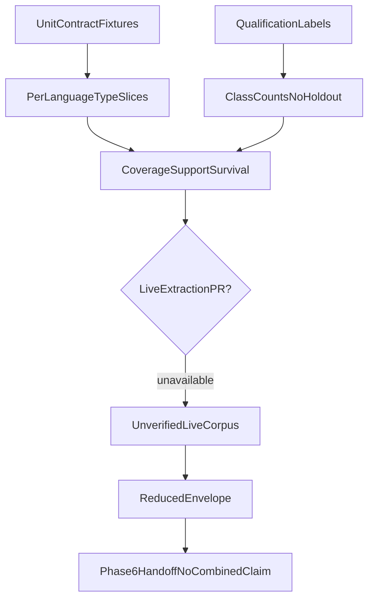

# Phase 5 Packet 8 graph evaluation

Fixture and qualification-label evaluation for GraphRAG
infrastructure. Live LightRAG extraction precision/recall on a
company corpus is **unverified**. Combined answer quality is
**not claimed**. Holdout stays sealed.

## Fixture floors are not Combined quality

Per-language CoverageSlice floors below (en 1.00, ar/mixed 0.85) prove
**fixture mapping/support/survival gates**, not live extraction P/R and
not Combined answer quality. Phase 6 must **not** score QT-EVAL-009
(+10 pp relationship/multi-hop gain) against these floors. Combined +10 pp
requires live mapping/extraction on the 15 labeled `graph_mapping`
documents (or a newly collected set). `P8-EXTRACT-LIVE` remains
`unverified`. See [PHASE6_HANDOFF.md](../graph/PHASE6_HANDOFF.md).

Related: [FROZEN_GRAPH_MANIFEST.md](../graph/FROZEN_GRAPH_MANIFEST.md) ·
[PHASE6_HANDOFF.md](../graph/PHASE6_HANDOFF.md) ·
[SCALING_OPTIONS.md](../graph/SCALING_OPTIONS.md) ·
[DATASET_SPEC.md](./DATASET_SPEC.md) ·
[QUALITY_TARGETS.md](../QUALITY_TARGETS.md) ·
[phase-05 evidence](../development/phase-05-graphrag-evidence.md) ·
[docs index](../README.md)

## No-claim

Phase 5 proves graph infrastructure, mapping, resolver, and envelope only. Phase 6 owns Combined fusion, verifier/citations, holdout, and the at-least-10-point relationship/multi-hop gain. This packet does not claim Combined answer quality.

## Qualification class counts (holdout sealed)

| Query class | Count |
| --- | --- |
| `acl_negative` | 4 |
| `alias` | 4 |
| `arabic_mixed` | 4 |
| `broad_synthesis` | 2 |
| `document_summary` | 2 |
| `exact_code` | 5 |
| `graph_mapping` | 4 |
| `insufficient_refusal` | 4 |
| `latest_as_of` | 2 |
| `media_limitation` | 1 |
| `mixed_locale_temporal` | 2 |
| `multi_hop` | 6 |
| `multi_part` | 4 |
| `negation` | 2 |
| `profile_fidelity` | 4 |
| `prompt_injection` | 6 |
| `relationship` | 6 |
| `selective_metadata_filter` | 2 |
| `semantic_factual` | 7 |
| `tabular_aggregation` | 4 |
| `typo` | 2 |

GRAPH_MAPPING qualification rows are labeled queries, not
extraction gold. ARABIC_MIXED rows are Phase 4 Hybrid labels.
Arabic/mixed mapping floors are proven by CoverageSlice fixtures,
not by live LightRAG output on those queries. Do not treat those
fixture ratios as Combined quality or as live extraction P/R.

## Per-language and per-type fixture metrics

| Language | Type | Accepted/eligible | Ratio | Floor | Passed |
| --- | --- | --- | --- | --- | --- |
| `en` | `entity` | 20/20 | 1.00 | 0.90 | `true` |
| `en` | `relation` | 20/20 | 1.00 | 0.90 | `true` |
| `en` | `path_edge` | 20/20 | 1.00 | 0.90 | `true` |
| `ar` | `entity` | 17/20 | 0.85 | 0.85 | `true` |
| `ar` | `relation` | 17/20 | 0.85 | 0.85 | `true` |
| `ar` | `path_edge` | 17/20 | 0.85 | 0.85 | `true` |
| `mixed` | `entity` | 17/20 | 0.85 | 0.85 | `true` |
| `mixed` | `relation` | 17/20 | 0.85 | 0.85 | `true` |
| `mixed` | `path_edge` | 17/20 | 0.85 | 0.85 | `true` |

Unmapped returned relations: `0`.

## Call accounting

| Counter | Value |
| --- | --- |
| query keyword_extract | `0` |
| query answer_generate | `0` |
| query support_searches | `0` |
| mapping Hybrid max per document | `1` |
| mapping rerank max per document | `1` |

Cited tests:

- `tests/contract/test_lightrag_contract.py::test_query_callbacks_bounds_delete_status_and_cancel`
- `tests/unit/test_graph_retriever.py::test_hidden_keyword_callback_fails_closed`
- `tests/unit/test_graph_retriever.py::test_survival_below_threshold_signal`
- `tests/unit/test_graph_mapping.py::test_unresolved_batch_uses_one_hybrid_and_one_rerank`
- `tests/unit/test_graph_mapping.py::test_empty_hybrid_skips_support_rerank`
- `tests/unit/test_graph_mapping.py::test_repair_must_not_query_hybrid`
- `tests/unit/test_graph_mapping_hybrid.py::test_graph_runner_binds_mapping_support_without_map_tables`

## Bound benchmarks (not Combined stream p95)

| Bound | Value | Provenance |
| --- | --- | --- |
| candidates | 12 | adapter clamp unit test |
| hops | 3 | resolver path expansion |
| paths | 6 | resolver path expansion |
| inspect depth | 3 | inspection RPC/unit |
| inspect rows | 200 | inspection RPC/unit |
| statement_timeout | 3s | inspection SQL |
| inspect deadline | 10.0s | inspection_query_bounds |
| Combined stream p95 | not measured | Phase 6 |

Pytest durations of mapping/resolver/lifecycle suites are lower
bounds for fixture runtime only. They are not production
documents/hour.

## Envelope and reserve

- Plan default: `2000` documents / `200000` source chunks
- Sequential 7-day deadline cap: `1008` documents at `0.5` estimate unused
- Supported advertised documents: `15`
- Supported advertised source chunks: `unverified`
- Bulk onboarding blocked: `true`
- Seven-day rebuild of the 2k envelope: `false`
- Measured full-rebuild cost: `unverified`
- Maintenance reserve: `USD 800` (floor; `4 x measured` unevaluable)
- Cleanup SLA constants: `24` hours targeted / `7` days dirty consolidation. Live production hardware SLA is unverified.

No live mapping-verified documents/hour or full-rebuild cost. Sequential jobs at the 600s deadline cannot finish 2000 documents inside 7 days (cap 1008). Source-chunk rebuild of 200000 is unmeasured. Advertised envelope is qualification-scale labeled graph_mapping volume; bulk onboarding is blocked.

## Fixture sweep (Packets 5-7 reused)

| Id | Packet | Test | Invariant |
| --- | --- | --- | --- |
| `collisions_aliases_do_not_merge` | 6 | `tests/unit/test_entity_rules.py` | PROJECT::atlas stays distinct from PRODUCT::atlas |
| `global_steering` | 5 | `tests/unit/test_graph_retriever.py::test_global_steering_is_not_evidence` | global expansions are steering only, never citations |
| `mapping_repair` | 4 | `tests/unit/test_graph_mapping.py::test_repair_must_not_query_hybrid` | repair does not run query-time Hybrid |
| `low_survival` | 5 | `tests/unit/test_graph_retriever.py::test_survival_below_threshold_signal` | survival < 0.50 emits graph_survival_below_threshold |
| `partial_readiness` | 5 | `tests/unit/test_graph_resolver.py::test_visibility_limitations_omit_names` | partial-readiness count never names restricted documents |
| `temporal_limitation` | 5 | `tests/unit/test_graph_retriever.py::test_historical_relationship_skips_vendor` | historical/as_of skips vendor and emits temporal_graph_limitation |
| `acl_blindness_versus_unauthorized_silence` | 5 | `tests/contract/test_graph_retrieval.py::test_resolver_maps_inspection_acl_and_repair` | authorized ACL-blindness count; unauthorized silence |
| `version_overlap` | 7 | `tests/contract/test_graph_lifecycle.py::test_version_switch_exposes_exactly_one_current` | pointer crashes expose exactly one current version |
| `deletion_acl_shared_source` | 7 | `tests/contract/test_graph_lifecycle.py::test_shared_entity_deleted_version_does_not_survive` | deleted/restricted shared-source evidence does not survive |
| `filtered_quarantined_disabled` | 7 | `tests/unit/test_graph_lifecycle.py::test_disabled_and_quarantined_emit_graph_outage` | disabled/quarantined query path is graph_outage |
| `upgrade_rollback_refuse_same_schema` | 7 | `tests/contract/test_graph_lifecycle.py::test_same_schema_upgrade_is_recorded_as_refused` | same-schema upgrade is refused; snapshot restore is rollback |
| `unfunded_rebuild_quarantine` | 7 | `tests/contract/test_graph_lifecycle.py::test_unfunded_rebuild_fails_closed` | unfunded rebuild quarantines; canonical deletion continues |
| `tombstone_24h_7d` | 7 | `tests/unit/test_graph_lifecycle.py::test_tombstone_slas_are_twenty_four_hours_and_seven_days` | target_cleanup 24h and clean_rebuild 7d; live SLA unverified |
| `inspection_bounds` | 5 | `tests/unit/test_graph_retriever.py::test_inspect_deadline_and_seed_limit` | inspect depth 3 / 200 rows / 3s statement_timeout / 10s deadline |
| `adapter_bounds` | 5 | `tests/unit/test_graph_resolver.py::test_clamp_graph_leads_caps_twelve_and_stable_sort` | 12 candidates, 3 hops, 6 paths |

## Gates

| Id | Title | Status | Target | Evidence |
| --- | --- | --- | --- | --- |
| `P8-EXTRACT-LIVE` | Live LightRAG extraction P/R on qualification corpus | `unverified` | per-language extraction P/R; do not average languages | No live extraction run. GRAPH_MAPPING qualification labels are query text, not extraction gold. Do not fake a pass. |
| `P8-MAP-LANG` | Per-language mapping coverage (en/ar/mixed) | `pass_fixture` | overall/en ≥ 0.90; ar/mixed ≥ 0.85 | evaluate_coverage_gates on unit CoverageSlice fixtures; mixed-fail-under-English-total is a negative test |
| `P8-SUPPORT` | Every returned relation is support-mapped | `pass_fixture` | support ≥ 0.80; unmapped not returned | test_unsupported_relation_has_no_statement_id; resolver whole-candidate drop |
| `P8-SURVIVAL` | Resolver survival fallback | `pass_fixture` | fallback < 0.50; rolling 0.80/20 | test_survival_below_threshold_signal; rolling window recorded not live-alerted |
| `P8-CALLBACKS` | Hidden keyword/answer and per-statement Hybrid | `pass_fixture` | keyword_extract=0; answer_generate=0; query support_searches=0 | contract callback spy plus retrieve_graph fail-closed hidden callback |
| `P8-ENVELOPE` | Seven-day rebuild envelope | `reduced` | 2000 docs / 200000 chunks | reduced to 15 labeled graph_mapping documents; 2k/200k unproven; bulk onboarding blocked |
| `P8-RESERVE` | Graph maintenance reserve | `pass_fixture` | max(USD 800, 4 x measured full-rebuild cost) | measured rebuild cost unavailable so floor USD 800 applies; unfunded rebuild already quarantines (Packet 7) |
| `P8-COMBINED` | Combined relationship/multi-hop +10pp | `deferred_phase_6` | ≥10 percentage points over Hybrid (QT-EVAL-009) | Phase 5 proves graph infrastructure, mapping, resolver, and envelope only. Phase 6 owns Combined fusion, verifier/citations, holdout, and the at-least-10-point relationship/multi-hop gain. This packet does not claim Combined answer quality. CoverageSlice fixture floors must not be used as Combined quality. Live extraction P/R is unverified (`P8-EXTRACT-LIVE`). |
| `P8-HOLDOUT` | Launch holdout sealed | `pass_fixture` | HoldoutAccess.denied(); no holdout labels | development and qualification loaders only |
