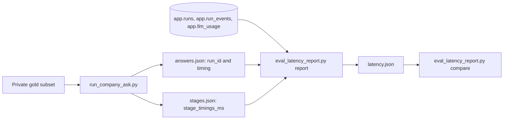

# Query latency report

How to measure company-documents question latency the same way before and
after a change. The tools read IDs, timestamps, token counts, stage names,
and fallback codes only. No answer, gold, query, or passage text enters a
report.

Related: [QUERY_LATENCY_REPAIR_EVIDENCE.md](./QUERY_LATENCY_REPAIR_EVIDENCE.md) ·
[DUAL_METRIC_SCORING.md](./DUAL_METRIC_SCORING.md) ·
[SSE contract](../api/SSE.md) ·
[docs index](../README.md)



## Prerequisites

- `OPERATOR_SUPABASE_DB_URL` in `.env` or `.env.compose` (both
  gitignored). The report and score scripts connect with it, run
  `SET ROLE postgres`, and issue SELECTs only.
- The laptop Compose `api` image rebuilt from the branch under test, and
  the image probe printing every packet under test as `present`.
- `.private-eval/eval-credentials.json` for the runner.
- Every output path must be under `.private-eval/`; the scripts refuse
  other paths with `blocked=out_not_private`.

## Commands

Write the fixed latency-12 subset once:

```powershell
uv run python scripts/eval_latency_report.py subset --gold .private-eval/fresh50-v1.json --ids f03,f14,f15,f16,f23,f24,f33,f39,f41,f46,f47,f49 --out .private-eval/latency12-v1.json
```

One timing run, with a fresh `<tag>` directory each time:

```powershell
New-Item -ItemType Directory -Force .private-eval/runs/<tag> | Out-Null
uv run python scripts/run_company_ask.py --gold .private-eval/latency12-v1.json --out .private-eval/runs/<tag>/summary.json --credentials .private-eval/eval-credentials.json --progress .private-eval/runs/<tag>/progress.json --answers-out .private-eval/runs/<tag>/answers.json --stage-export .private-eval/runs/<tag>/stages.json
uv run python scripts/eval_latency_report.py report --answers .private-eval/runs/<tag>/answers.json --stages .private-eval/runs/<tag>/stages.json --label <tag> --out .private-eval/runs/<tag>/latency.json
```

Compare two runs:

```powershell
uv run python scripts/eval_latency_report.py compare .private-eval/runs/<before-tag>/latency.json .private-eval/runs/<after-tag>/latency.json
```

Fact plus gold-page citation score for one run:

```powershell
uv run python scripts/eval_citation_page_score.py --gold .private-eval/latency12-v1.json --answers .private-eval/runs/<tag>/answers.json --summary .private-eval/runs/<tag>/summary.json --document-id 95e6c763-24ca-444b-b667-cd075d4f40cd --out .private-eval/runs/<tag>/citation.json
```

Which packets are inside the running image:

```powershell
Get-Content scripts/probe_latency_image.py -Raw | docker compose --env-file .env.compose -f docker-compose.yml -f docker-compose.packet8.yml exec -T api python -
```

## Metric definitions

Server metrics come from `app.run_events.created_at`, which is the time
each event row was committed.

| Metric | Definition |
| ------ | ---------- |
| `server_total_s` | Last event minus first event of the run. |
| `admission_to_first_event_s` | First event minus `app.runs.created_at`. |
| `deadline_budget_s` | `app.runs.deadline_at` minus `app.runs.started_at`. |
| `pre_first_stage_s` | First `status` `started` minus first event. |
| `stage_seconds[stage]` | `status` `completed` minus the matching `started`, summed if a stage runs twice. |
| `open_stage_seconds[stage]` | A stage with no `completed` (running or failed), up to the terminal event. |
| `node_gap_total_s` | Sum of every `started` minus the latest earlier `completed`. |
| `tail_s` | Terminal event minus the last `completed`. |
| `event_count` | Events in the run. |
| `event_spacing_median_s` | Median gap between consecutive events. |
| `deadline_exhausted` | A `deadline` event, or a `partial` event with reason `deadline_exhausted`. |
| `usage[kind]` | Calls, prompt tokens, and completion tokens per `app.llm_usage.usage_kind`. |
| `rerank_timeout_after_send` | Rerank usage rows with `timeout_after_send = true`. |
| `post_seconds` | Client: admission POST until its response. |
| `first_frame_seconds` | Client: event stream open until the first `event:` line. |
| `sse_seconds` | Client: event stream open until the runner stops reading. |
| `wall_seconds` | Client: first admission attempt until the stream ends. |
| `stage_timings_ms` | Per-run copy of `HybridBranchDiagnostics.stage_timings_ms`. |

`stage_timings_ms` keys (defined by answer-loss packet A2 as
`HYBRID_STAGE_TIMING_KEYS`): `scope_ms`, `embed_ms`, `channels_ms`,
`channel_dense_ms`, `channel_bm25_ms`, `channel_term_ms`, `assemble_ms`,
`temporal_load_ms`, `pool_preload_ms`, `rerank_gate_remaining_ms`,
`rerank_call_ms`, `selection_ms`, `locator_reload_ms`, and
`retrieve_total_ms`.

The aggregate reports `n`, `mean`, `median`, nearest-rank `p90`, and
`max` per metric, per stage, and per sub-stage, plus counts of terminal
types, rerank fallbacks, deadline runs, rerank timeouts after send, and
runs with `server_total_s` at most 25 s and 30 s. `compare` prints every
mean, median, p90, and count with `after - before`.

## Latency-12 subset and noise band

`f03 f14 f15 f16 f23 f24 f33 f39 f41 f46 f47 f49` from
`.private-eval/fresh50-v1.json`. It holds the four 2026-09-23 deadline runs
(`f14`, `f33`, `f39`, `f41`) and a spread of stage timings.

Two back-to-back baseline runs (`L0-a`, `L0-b`) define the noise band: the
absolute difference per metric. A change counts only when it moves its
target metric by more than the noise band.

## Limits

- An event's `created_at` is its commit time, not the time the graph
  produced it. Once events are written in the background, stage durations
  include writer lag. `wall_seconds` and `server_total_s` stay the primary
  metrics.
- Client timing exists only for runs made by the runner after latency
  packet L0. Older answers files report `n=0` for client metrics.
- `stage_timings_ms` exists only for runs whose `api` image includes
  answer-loss packet A2.
- Sub-stage timings are wall time inside one process. Channels run in
  parallel, so `channels_ms` is the slowest channel, not the sum.
- With 12 runs, p90 is the 11th value. Treat it as coarse.
- OpenAI latency varies by hour. Run before/after pairs on the same day.

## Privacy

Event payloads are reduced in SQL to `stage`, `phase`, `reason`, and
`code` before they leave the database. Reports, compare output, and score
files contain ids, page numbers, timings, and counts only. Do not paste
answer or gold text into chat, docs, or commits. Private files stay under
gitignored `.private-eval/`.

## Troubleshooting

| Symptom | Cause and fix |
| ------- | ------------- |
| `blocked=missing_operator_url` | Add `OPERATOR_SUPABASE_DB_URL` to `.env` or `.env.compose`. |
| `blocked=out_not_private` | Put the output under `.private-eval/`. |
| `unknown_ids=...` | An id is not in the gold file. Check the list. |
| Client metrics show `n=0` | The answers file came from an older runner, or the resume rule reused old rows. Use a new `<tag>` directory. |
| `stage_timings_ms` is empty | The `api` image does not include answer-loss packet A2. Rebuild it and run the probe. |
| Probe prints `L0 MISSING` | Stale image. Rebuild with `--build` and probe again. |

## Verification

```powershell
uv run python -m pytest tests/unit/test_eval_latency_report.py tests/unit/test_eval_citation_page_score.py tests/unit/test_probe_latency_image.py tests/unit/test_company_ask_timing.py tests/unit/test_hybrid_branch_diagnostics.py -q
```

## Rollback

Revert the L0 commit and rebuild the image. Checkpoints written by L0 code
hold `stage_timings_ms`, which older code rejects because
`HybridBranchDiagnostics` forbids unknown fields. After a rollback, use new
conversations.
