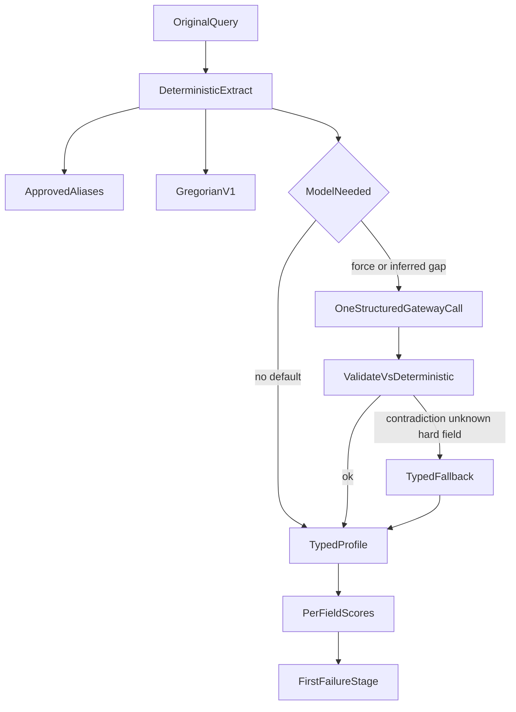

# Query profile evaluation

**Owning phase:** 4 Packet 3. Thresholds live in [QUALITY_TARGETS.md](../QUALITY_TARGETS.md) QT-QP-*.

Packet 1 froze labels in [DATASET_SPEC.md](./DATASET_SPEC.md) and [QUERY_PROFILE_LABELING.md](./QUERY_PROFILE_LABELING.md). Packet 3 scores each field independently on development then qualification and stores the first failing stage. Holdout remains sealed. The Packet 9 QueryType map is in [QueryType to Phase 6 family](./DATASET_SPEC.md#querytype-to-phase-6-family); it does not change QT-QP or weaken `model_calls == 0`.

Related: [HYBRID_RETRIEVAL_CONTRACT.md](../retrieval/HYBRID_RETRIEVAL_CONTRACT.md) ·
[prompt changelog](../../apps/agents/src/smart_rag_agents/prompts/CHANGELOG.md) ·
[phase-04 evidence](../development/phase-04-hybrid-rag-evidence.md)

## Versions

| Artifact | Value |
| --- | --- |
| Prompt | `query_profile_v1` |
| Prompt SHA-256 | `01f33dfbb98720b3cb08a89fdd7d8d8be48941e834e15deb53a8e8142ae20693` |
| Model (mock) | `query-profile-mock-v1` |
| Normalizer | `arabic_norm_v1` |
| Date parser | `gregorian_v1` |
| Retrieval profile ID | `hybrid_default_v1` only |
| Few-shots | empty; holdout ids forbidden |

Live OpenAI structured output is not configured. Deterministic extract covers the labeled corpus. At most one structured gateway call may fill inferred fields; a second hidden keyword/profile call is forbidden.

## Pipeline



Low-confidence inferred filters stay diagnostics. Low-confidence negation cannot invert a set. User-supplied document scope still requires later authorization.

## Signed gates

| ID | Metric | Minimum |
| --- | --- | --- |
| QT-QP-001 | Language/configuration accuracy | 95% |
| QT-QP-002 | Temporal-intent macro-F1 | 90% |
| QT-QP-003 | Exact code/date extraction F1 | 98% |
| QT-QP-004 | Entity/approved-alias macro-F1 | 90% |
| QT-QP-005 | Metadata-filter precision and recall | 95% |
| QT-QP-006 | Query-type/relationship/table/decomposition macro-F1 | 90% |

Code F1 uses gold codes that appear in the query. Packet 1 index codes that are absent from the query text are not treated as extraction misses. Negation, document scope, media, and variant-list F1 are reported separately. Historical-relationship F1 is below a 90% F1 because Packet 1 labels true only on even multi-hop indexes while every multi-hop query contains the same "after the ... handoff" span.

## Verification

```powershell
uv run pytest tests/unit/test_query_profile.py -q
uv run python scripts/eval_query_profile.py
```

## Failure modes

| Input | Route |
| --- | --- |
| Unknown retrieval profile ID | Keep `hybrid_default_v1`; `unknown_hard_field` |
| Low-confidence extra filter | Soft diagnostic; not a hard predicate |
| Variant that drops a code/date/quote | Rejected |
| More than three variants/subquestions | Schema rejection |
| Timeout / budget / malformed model | Typed fallback; deterministic extract kept |
| Holdout few-shot id | `FewShotManifestError` |

[docs index](../README.md)
