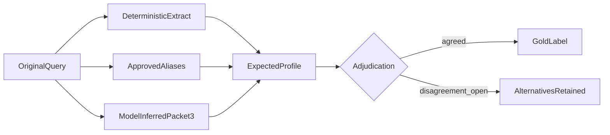

# Query profile labeling (Phase 4 Packet 1)

Labeling contract for expected query-profile fields. Packet 3 scores these fields; Packet 1 only freezes the schema and synthetic labels.

Related: [DATASET_SPEC.md](./DATASET_SPEC.md) · [QueryType to Phase 6 family](./DATASET_SPEC.md#querytype-to-phase-6-family) · [QUERY_PROFILE_EVAL.md](./QUERY_PROFILE_EVAL.md) · [QUALITY_TARGETS.md](../QUALITY_TARGETS.md)

## Field contract

Every inferred or normalized field stores `value`, `confidence` in `[0, 1]`, and provenance exactly `deterministic`, `approved_alias`, `model_inferred`, or `user_supplied`.

Required fields:

- language and locale/configuration
- query type
- exact terms, quoted phrases, codes, numbers, dates, entities, approved aliases
- requested sources and allow-listed metadata filters
- temporal intent, target date, timezone (`UTC` unless signed otherwise), authoritative date field
- negation scope, document/section/page/sheet/range scope
- media dependence and historical-relationship signal
- relationship and table intent plus table operation hints
- rewrite justification, at most three subquestions, at most three variants
- `hl_keywords` and `ll_keywords`
- allow-listed `retrieval_profile_id` (never free-form weights)

## Adjudication rules

- Two adjudicators are recorded as `synthetic-sme-v1` for this provisional corpus.
- Open disagreement keeps alternatives and notes. It is not a single gold answer.
- Holdout examples cannot become few-shots.

## Failure attribution

Packet 3 scores every gated field independently. The first failing stage is
`profile` when a gated field mismatches, `deferred_owner` when the case is
owned by a later phase and the profile passed, and `none` otherwise. Retrieval
is not blamed when the profile is wrong. Holdout examples cannot become
few-shots.

[docs index](../README.md)
