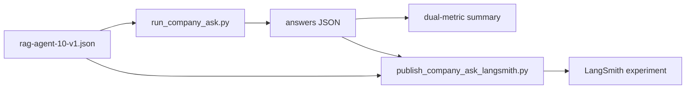

# RAG agent 10-question PDF smoke suite (2026-10-04)

Ten company-document questions from *Building Applications with AI Agents*
used to smoke-test the live Ask agent and the LangSmith dual-metric
experiment publisher. Gold phrases stay private under `.private-eval/`.

Related: [DUAL_METRIC_SCORING.md](./DUAL_METRIC_SCORING.md) ·
[COMPANY_ASK_LANGSMITH.md](./COMPANY_ASK_LANGSMITH.md) ·
[MIX_HARD_KNOWN_ANSWER_24_2026-10-02.md](./MIX_HARD_KNOWN_ANSWER_24_2026-10-02.md) ·
[docs index](../README.md)

## Suite shape

| Field | Value |
| --- | --- |
| Private gold | `.private-eval/rag-agent-10-v1.json` |
| Answer snapshot | `.private-eval/rag-agent-10-answers.json` |
| Mix | 3 code · 2 table · 5 text |
| Source pages | drawn from prior mix-hard / fresh50 gold (ids remapped `ra01`–`ra10`) |
| Scoring | Dual-metric (strict phrase + grounded fact) |
| LangSmith project | `smart-rag-company-ask-eval` |



## Commands

Live Ask (requires API `query_ready` + Docker stack):

```powershell
uv run python scripts/run_company_ask.py `
  --gold .private-eval/rag-agent-10-v1.json `
  --out .private-eval/runs/rag-agent-10/summary.json `
  --credentials .private-eval/eval-credentials.json `
  --answers-out .private-eval/rag-agent-10-answers.json `
  --stage-export .private-eval/runs/rag-agent-10/stages.json `
  --progress .private-eval/runs/rag-agent-10/progress.json `
  --langsmith-publish `
  --upload-private-content `
  --langsmith-project smart-rag-company-ask-eval `
  --langsmith-experiment-prefix rag10
```

Publish an existing answer snapshot to LangSmith (no re-ask):

```powershell
uv run python scripts/publish_company_ask_langsmith.py `
  --gold .private-eval/rag-agent-10-v1.json `
  --answers .private-eval/rag-agent-10-answers.json `
  --project smart-rag-company-ask-eval `
  --upload-private-content `
  --experiment-prefix rag10 `
  --out .private-eval/runs/rag-agent-10/langsmith-summary.json
```

Dry-run only:

```powershell
uv run python scripts/publish_company_ask_langsmith.py `
  --gold .private-eval/rag-agent-10-v1.json `
  --answers .private-eval/rag-agent-10-answers.json `
  --dry-run
```

## Live Ask result (2026-10-04)

Docker stack brought up; API `query_ready=true`. Fresh company-documents Ask
via `run_company_ask.py` completed in ~5.5 minutes and published experiment
`company-ask-dual-rag10-live-ae9e5106`.

| Metric | Count |
| --- | ---: |
| Strict phrase pass | **8 / 10** |
| Grounded fact pass | **8 / 10** |
| Deadline failures | 0 |
| Failures | ra09, ra10 (`wrong_phrasing`) |

Private artifacts: `.private-eval/runs/rag-agent-10/live-*.json`.

LangSmith compare URL (live experiment):
`https://smith.langchain.com/o/02a8641a-ecd6-462c-b80c-13beca9ebd90/datasets/bd0cacef-f794-4ec2-ae55-70138c5778e5/compare?selectedSessions=c7e40934-4816-4c70-b9a0-ea0ef3d5c8ec`

## Limits

- This suite is an operator smoke set, not the sealed Phase 4 holdout.
- Gold phrases and full answers must not be committed; keep them under
  `.private-eval/`.
- Snapshot-only LangSmith publish (earlier the same day) scored 5/10 from
  older answers; the live re-ask above is the current agent bar.
