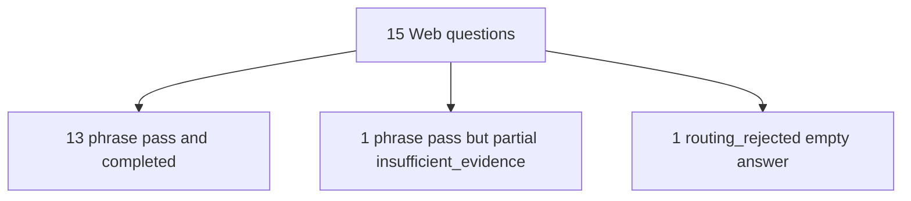

# Web mode Ask 15 (2026-10-01)

Fifteen public-web questions forced through Ask with
`search_scope=web` against local API `http://127.0.0.1:8000`.
`/api/meta` reported `web_search_enabled: true` and `/health/ready`
reported `query_ready: true`.

Private gold: `.private-eval/web-public-15-v1.json`.
Runner: [`scripts/run_web_ask.py`](../../scripts/run_web_ask.py).
Private outputs: `web-public-15-summary.json`,
`web-public-15-answers.json`, `web-public-15-progress.json`.

Scoring: a question passes when every gold fact has at least one
canonical phrase in the streamed answer text (case-insensitive).
Citations are recorded separately via SSE `citation_preview` counts.

## Result

| Outcome | Count |
| --- | ---: |
| Phrase pass | 14 |
| Phrase fail | 1 |
| SSE `completed` | 13 |
| SSE `partial` | 1 |
| SSE `error` | 1 |
| With citation previews | 13 |
| Wall clock | 376.6 s (~18.5 s mean) |



## Where the agent failed

### Hard fail (1)

| ID | Topic | What happened |
| --- | --- | --- |
| w11 | Largest planet in the solar system | SSE terminal `error` with code `routing_rejected`. Empty answer, no citations. Run status `failed`. Client cannot see a finer `web_search_*` detail because SSE strips it. |

### Soft fail (1)

| ID | Topic | What happened |
| --- | --- | --- |
| w07 | Atomic number of carbon | Phrase check passed (`6` present) but terminal was `partial` / `insufficient_evidence` with no citation previews. Grounding is incomplete even though the short fact appeared. |

## Passed questions (13 completed)

w01 HTML, w02 Tim Berners-Lee, w03 Tokyo, w04 2007, w05 Domain Name System,
w06 Jane Austen, w08 JSON, w09 CPU, w10 1991, w12 HTTPS, w13 Leonardo da Vinci,
w14 ampere, w15 1969. All completed with at least one citation preview.

## How to reproduce

```powershell
uv run python scripts/run_web_ask.py `
  --gold .private-eval/web-public-15-v1.json `
  --out .private-eval/web-public-15-summary.json `
  --answers-out .private-eval/web-public-15-answers.json `
  --progress .private-eval/web-public-15-progress.json `
  --credentials .private-eval/eval-credentials.json
```

Requires local API with `WEB_SEARCH_ENABLED=true`, configured `EXA_API_KEY`,
and evaluator credentials under `.private-eval/`.
