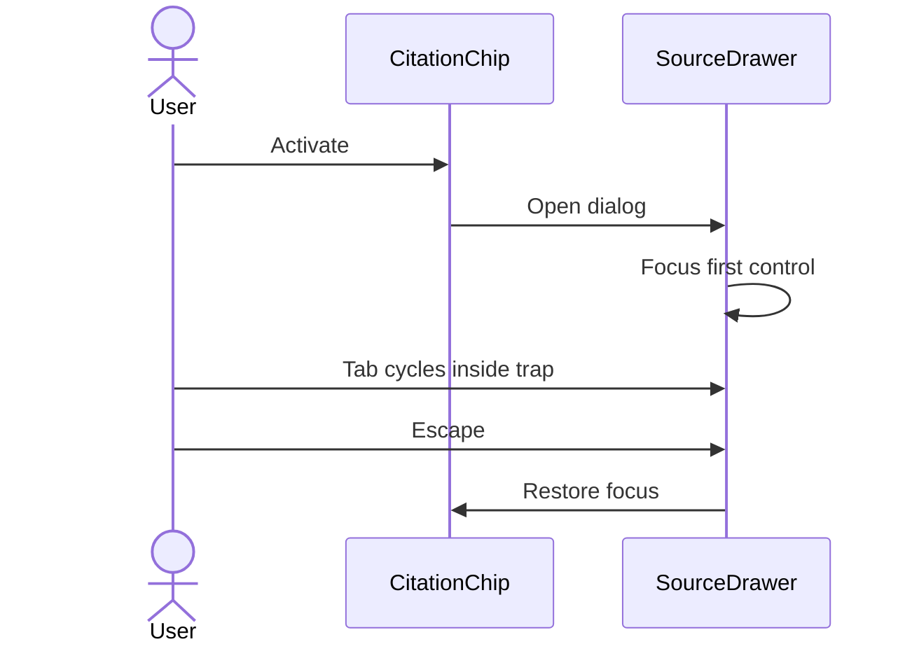

# Accessibility and security implementation (Phase 8 packet 5, integrity P08-20)

Phase 8 consumption of [STITCH_A11Y_SECURITY.md](./STITCH_A11Y_SECURITY.md).
Missing Stitch RTL and mobile frames are a gap fill, not a waiver.

Related: [STITCH_BRIEF.md](./STITCH_BRIEF.md) ·
[STITCH_A11Y_SECURITY.md](./STITCH_A11Y_SECURITY.md) ·
[DESIGN_SYSTEM.md](./DESIGN_SYSTEM.md) ·
[AUTH_AND_STREAMING.md](./AUTH_AND_STREAMING.md) ·
[CORE_RAG_SURFACES.md](./CORE_RAG_SURFACES.md) ·
[PHASE8_JOURNEY_MATRIX.md](./PHASE8_JOURNEY_MATRIX.md) ·
[FASTAPI_SECURITY.md](../api/FASTAPI_SECURITY.md) ·
[phase-08 evidence](../development/phase-08-frontend-integration-evidence.md) ·
[docs index](../README.md)

## Logical citation offsets

`GET /runs/{id}/citations` has no offset fields (GAP-07-09). The production
citation drawer for company PDFs shows typed book title, the Acrobat
logical page (`page_label`) when present, otherwise the 1-based file
page (`pdf_page_number`), optional section, and an authorized
supporting passage. Technical
ids follow. `highlightLogicalRange`
slices with `Array.from` / codepoint indexes. The reviewed fixture is
canonical text `الشركة ACME وقعت العقد.` with offsets **7–11** selecting
`ACME`, rendered in `ReviewedContentFixtures`, not in `CitationDrawer`.
Render path is React text nodes; `<mark>` children are text only.

## Focus and drawer flow



Error `StatusBanner` with `role="alert"` uses `tabIndex={-1}` and `focus()`
for 426, 402, MFA, and unclassified errors. Conversation and document
lists use a roving tabindex (`ArrowUp` / `ArrowDown` / `Home` / `End`).

## CSP and headers

`apps/frontend/next.config.ts` sends `nosniff`, `DENY`, `no-referrer`,
`X-DNS-Prefetch-Control: off`, a restrictive `Permissions-Policy`, and
CSP `default-src 'self'` with `font-src 'self'`, `img-src 'self' data: blob:`,
and `style-src 'self' 'unsafe-inline'`. `blob:` is only there so an
authorized figure PNG can be shown from a page-local object URL. The
answer never accepts an image host from the model. `connect-src` is `'self'` plus
the exact origins of `NEXT_PUBLIC_API_BASE_URL` and
`NEXT_PUBLIC_SUPABASE_URL`. Loopback FastAPI/Auth origins are added only
when `NODE_ENV=development`. Production does not ship hardcoded
localhost or `https://*.supabase.co`. Missing production public URLs
fail closed (`connect-src 'self'` only). No CDN hosts.

`'unsafe-eval'` is **development-only**. Next.js documents that React
uses `eval` for debug info in development and that production React/Next
do not require `'unsafe-eval'` by default. Production `script-src` still
includes `'unsafe-inline'` because this app's CSP is a static
`next.config.ts` header. Next.js 16 nonce CSP needs a per-request nonce
from `proxy()` plus dynamic rendering; that rewrite is not implemented
here. `style-src 'unsafe-inline'` remains (PRD-L-003).

## RTL, zoom, and mobile gap fills

English chrome stays `dir="ltr"`. Untrusted content uses `dir="auto"`
plus isolate. Codes and URLs use `dir="ltr"` isolate and wrap inside
the isolate. Diacritics use line-height `1.75`. Nine nav items at 390px
use a keyboard-accessible `<details>` **Menu** (no `href="#"`) plus
scrollable nav. Reviewed fixtures live in `ReviewedContentFixtures`
(XSS filename/entity, `javascript:` as text, `\u202E`, mixed URL,
logical highlight, stub composer, citation chip) so zoom and keyboard
checks do not need a test-auth bypass.

## Generic production errors

Unknown 5xx and unclassified mutation errors show **Something went
wrong.** Login still shows only **Sign in failed**. FastAPI `detail`
values that are not short codes are discarded. Reconnect and retry
controls remain. Production never sends `X-Test-*`.

## Contrast (A11Y-02)

Body warning copy uses `#0F172A` plus a warning-colored icon. Token
pairs are unit-tested at 4.5:1. Warning `#A16207` is not used as the
only small body-text color.

## Verification

```text
pnpm --filter smart-rag-frontend lint
pnpm --filter smart-rag-frontend exec next typegen
pnpm --filter smart-rag-frontend exec tsc --noEmit
pnpm --filter smart-rag-frontend test
pnpm --filter smart-rag-frontend build
pnpm exec playwright test
uv run python scripts/check.py --tier docs --mermaid-puppeteer-config scripts/ci/puppeteer-no-sandbox.json
```

Playwright from `apps/frontend`. Packet 6 owns full role journeys. P08-20 adds
`scripts/check_frontend_action_inventory.py` and `tests/e2e/quality-audit.spec.ts`
for unique `data-action-id` mapping, viewport overflow, and computed control
geometry. Production has no `/unavailable/*` GAP pages.
