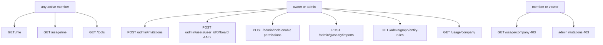

# Administration surfaces (Phase 8 packet 4)

Native Team, Tools, Curation, Usage, and Profile mapped to FastAPI
contracts. Stitch frames 02/08/11/12/13/14 are a **template, not a
layout**. This packet does not add those frames as routes and does not
create an `app/admin` folder.

Related: [API_UI_MAPPING.md](./API_UI_MAPPING.md) ·
[CORE_RAG_SURFACES.md](./CORE_RAG_SURFACES.md) ·
[AUTH_AND_STREAMING.md](./AUTH_AND_STREAMING.md) ·
[STITCH_REVIEW.md](./STITCH_REVIEW.md) ·
[PHASE8_JOURNEY_MATRIX.md](./PHASE8_JOURNEY_MATRIX.md) ·
[QUERY_BUDGETS.md](../agent/QUERY_BUDGETS.md) ·
[OPTIONAL_TOOLS.md](../agent/OPTIONAL_TOOLS.md) ·
[GLOSSARY_IMPORT.md](../api/GLOSSARY_IMPORT.md) ·
[ENTITY_RULES.md](../graph/ENTITY_RULES.md) ·
[AUDIT_CHAIN.md](../security/AUDIT_CHAIN.md) ·
[phase-08 evidence](../development/phase-08-frontend-integration-evidence.md) ·
[docs index](../README.md)

## Routes

| Route | Surface | Contract |
| --- | --- | --- |
| `/team` | Invite create + offboard by `user_id`. No member directory | `POST /admin/invitations`, `POST /admin/users/{user_id}/offboard`. Accept remains `/invitations/accept` |
| `/tools` | Catalog for any member. Enable/permissions owner/admin convenience | `GET /tools`, `POST /admin/tools`, `POST /admin/tools/{tool_key}/enable`, `POST /admin/tools/{tool_key}/permissions` |
| `/curation` | Glossary import/approve/rollback + entity rules | `/admin/glossary/imports*`, `/admin/graph/entity-rules*` |
| `/usage` | Caller totals for all; company totals owner/admin | `GET /usage/me`, `GET /usage/company`. Totals only, no prompt text |
| `/profile` | Read-only five `GET /me` fields | GAP-07-19 has no name/locale editor |

Nav adds Team, Tools, Curation, Usage, and Profile as real `Link`s. Nav
is not authorization. Viewer/member chrome hides invite, offboard, enable,
and curation mutations; `createInvitation`, `offboardUser`, and
`enableTool` still exist and FastAPI still returns 403.

## Role matrix



UI hiding is convenience. Forged `role=owner` in client state does not add
an Authorization role claim. Production never sends `X-Test-*`.

## Missing-frame decision (frame 14)

Frame 14 is not a product route. The usage page recreates the information
hierarchy from [API_UI_MAPPING.md](./API_UI_MAPPING.md): caller token and
cost meters, company totals for owner/admin, 402 `budget_exhausted` copy,
and `ready.rate_limit_degraded` / 429 rate banners. Budget-policy sliders
and graph-maintenance reserve editors are **Unavailable GAP-07-11**. There
is no `/budgets` HTTP.

## Gap table (do not mock)

| ID | UI |
| --- | --- |
| GAP-07-08 | Owner bootstrap: Unavailable on `/team`. `bootstrap_owner` has no HTTP |
| GAP-07-11 | Budget editor / critical-reserve sliders: Unavailable. Show 402 copy and usage totals. Rate: 429 + `ready.rate_limit_degraded` |
| GAP-07-12 | Audit list/export / restricted preview-download history: Unavailable. Do not invent events or leak passages |
| GAP-07-13 | Company settings CRUD: Unavailable on `/profile`. No save control |
| GAP-07-19 | Profile name/locale editor: Unavailable. Show the five `/me` fields |

No member-list HTTP: copy "No member directory API; identify users from
GET /me and audit when available". Identify offboard subjects from `GET
/me` until an audit list exists.

## Honest contracts

- Invitation create body is `{ email, role, upload_enabled }`. Roles are
  `owner` \| `admin` \| `member` \| `viewer`. The one-time token is
  mail-only; JSON never includes `raw_token`.
- Offboard is irreversible. 403 `MFA required` shows the MFA banner.
- Tool cards show `tool_key`, `version_label`, `short_name`, `purpose`,
  `required_role`, `risk_class`, and `active`. Unauthorized names are
  omitted, never fake-redacted.
- Glossary import uses an extra-forbid client builder. Extra SQL-like
  fields are not posted.
- Entity-rule approve/revoke posts `{ row_version }`. 409
  `stale_row_version` is shown honestly.
- Usage responses keep `scope`, `cost_usd`, `prompt_tokens`,
  `completion_tokens`, and `usage_rows` only.

## Failure modes

| Signal | UI |
| --- | --- |
| 403 `forbidden` | "Server denied this request (forbidden). UI hiding is convenience only." |
| 403 `MFA required` | MFA banner. Offboard needs AAL2 |
| 402 `budget_exhausted` | Budget exhausted copy. No slider |
| 429 | Rate-limit banner. Ready `rate_limit_degraded` is informational |
| 409 `stale_row_version` | Reload and retry with the current `row_version` |
| Company usage as member | Convenience-hidden; helper still 403s |
| Hostile email / token | `UserText` / `CodeText`. No HTML |

## Verification

```powershell
pnpm --filter smart-rag-frontend lint
pnpm --filter smart-rag-frontend exec next typegen
pnpm --filter smart-rag-frontend exec tsc --noEmit
pnpm --filter smart-rag-frontend test
pnpm --filter smart-rag-frontend build
```

From `apps/frontend`:

```powershell
pnpm exec playwright test
```

Docs:

```powershell
uv run python scripts/check.py --tier docs --mermaid-puppeteer-config scripts/ci/puppeteer-no-sandbox.json
```
