# Administration surfaces (Phase 8 packet 19)

One role-aware `/admin` workspace with tabs Team & access, Tools, Names &
aliases, Usage, and (when `/api/meta` `pdf_eval_workspace` is true) Evaluation.
Account is a separate `/account` page from `GET /me`. Bookmark
routes `/team`, `/tools`, `/curation`, `/usage`, and `/profile` redirect.
Stitch frames 02/08/11/12/13/14 are unused as product routes.

Related: [API_UI_MAPPING.md](./API_UI_MAPPING.md) ·
[CORE_RAG_SURFACES.md](./CORE_RAG_SURFACES.md) ·
[AUTH_AND_STREAMING.md](./AUTH_AND_STREAMING.md) ·
[STITCH_REVIEW.md](./STITCH_REVIEW.md) ·
[VISUAL_MAP.md](./VISUAL_MAP.md) ·
[PHASE8_JOURNEY_MATRIX.md](./PHASE8_JOURNEY_MATRIX.md) ·
[admin-and-auth-screens.md](./admin-and-auth-screens.md) ·
[OPTIONAL_TOOLS.md](../agent/OPTIONAL_TOOLS.md) ·
[PDF_EVAL_WORKSPACE.md](../evaluation/PDF_EVAL_WORKSPACE.md) ·
[GLOSSARY_IMPORT.md](../api/GLOSSARY_IMPORT.md) ·
[ENTITY_RULES.md](../graph/ENTITY_RULES.md) ·
[phase-08 evidence](../development/phase-08-frontend-integration-evidence.md) ·
[docs index](../README.md)

## Routes

| Route | Surface | Contract |
| --- | --- | --- |
| `/admin?tab=team` | Workspace people, pending invitations, invite, offboard | `GET /admin/users`, `POST /admin/invitations`, `POST /admin/users/{user_id}/offboard`. Accept remains `/invitations/accept` |
| `/admin?tab=tools` | Catalog search, enable/permissions, details drawer. No seed form | `GET /tools?q=`, `POST /admin/tools/{tool_key}/enable`, `POST /admin/tools/{tool_key}/permissions` |
| `/admin?tab=curation` | Word aliases (glossary import) and people/things (entity rules) | `/admin/glossary/imports*`, `/admin/graph/entity-rules*` |
| `/admin?tab=usage` | Caller totals; company totals for owner/admin. Rate-degraded banner only when `rate_limit_degraded` | `GET /usage/me`, `GET /usage/company`. Totals only, no prompt text |
| `/admin?tab=evaluation` | Local PDF evaluation workspace. Hidden unless `/api/meta` `pdf_eval_workspace` is true. Member/viewer still 403. | `/admin/pdf-eval/*`. Question-only Ask comparison. Official Recall@10 stays CLI |
| `/account` | Read-only four `/me` fields. `/profile` redirects here | `user_id`, `role`, `authorization_version`, `upload_enabled`. Sign out stays in the shell menu |

Nav shows **Admin** for owner/admin convenience and **Account** for every
signed-in user. Nav is not authorization. Member/viewer never see Admin in
nav. A direct `/admin` visit confirms with `GET /admin/graph/entity-rules`
and renders ErrorState **You don’t have access.** on 403. Forged client
roles do not add claims; FastAPI still 403s.

`POST /admin/tools` seed remains an API helper for tests. Ordinary product
UI has no seed form.

## Role matrix

```mermaid
flowchart TD
  anyMember["any active member"] --> meGet["GET /me"]
  anyMember --> usageMe["GET /usage/me"]
  anyMember --> toolsGet["GET /tools"]
  ownerAdmin["owner or admin"] --> listUsers["GET /admin/users"]
  ownerAdmin --> invitePost["POST /admin/invitations"]
  ownerAdmin --> offboardPost["POST /admin/users/user_id/offboard"]
  ownerAdmin --> toolAdmin["POST /admin/tools enable permissions"]
  ownerAdmin --> glossaryPost["POST /admin/glossary/imports"]
  ownerAdmin --> rulesGet["GET /admin/graph/entity-rules"]
  ownerAdmin --> usageCompany["GET /usage/company"]
  memberViewer["member or viewer"] --> users403["GET /admin/users 403"]
  memberViewer --> admin403["GET /admin/graph/entity-rules 403"]
  memberViewer --> company403["GET /usage/company 403"]
  memberViewer --> mutate403["admin mutations 403"]
```



UI hiding is convenience. Production never sends `X-Test-*`. Offboard uses
ordinary owner/admin Bearer authorization. There is no MFA/AAL2 step.

## Unsupported actions (omitted, not Unavailable chrome)

These have no product control and no `*-unavailable` panel:

| ID | Omission |
| --- | --- |
| GAP-07-08 | Owner bootstrap: no HTTP, no Team banner |
| GAP-07-11 | Budget editor / reserve sliders: no UI. 402 `budget_exhausted` remains a classified API state |
| GAP-07-12 | Audit list/export: no panel, no events, no passage leak |
| GAP-07-13 | Company settings CRUD: no save control on Account |
| GAP-07-19 | Profile name/locale editor: Account shows four `/me` fields only |

Offboard subjects come from `GET /admin/users` or a known `user_id`. Invitation
tokens remain mail-only.

## Honest contracts

- `GET /admin/users` lists at most 200 workspace members and 200 pending
  invitations for owner/admin. Emails and names are untrusted `UserText`.
  JSON never includes `token_hash` or `raw_token`. Members receive 403.
- Invitation create body is `{ email, role, upload_enabled }`. Roles are
  `owner` \| `admin` \| `member` \| `viewer`. The one-time token is
  mail-only; JSON never includes `raw_token`. Success UI shows invitation ID
  and expiry only.
- Offboard is irreversible. Owner/admin at single-factor may offboard.
- Tool search sends `GET /tools?q=` with the query URL-encoded. Cards show
  name, version, purpose, required role, risk, and enabled/disabled. Catalog
  seed `active` overlays the in-code registry (`app.list_tool_catalog_seeds`).
  Owner/admin still see disabled tools so they can re-enable them. Members
  never receive unauthorized names, including disabled seeds. Executor
  authorization stays in the in-code registry. Unauthorized names are omitted,
  never fake-redacted.
- Glossary import uses an extra-forbid client builder. Extra SQL-like
  fields are not posted.
- Entity-rule approve/revoke and PATCH post `{ row_version }`. 409
  `stale_row_version` shows a conflict banner and **Reload rule**.
- Suggest rule posts the existing suggestions endpoint.
- Usage responses keep `scope` (`me` or `company`), `cost_usd`, `prompt_tokens`,
  `completion_tokens`, and `usage_rows` only. Numeric values use 24px type
  and 13px labels. No charts, forecasts, or progress bars.
- `GET /me` may still emit deprecated `mfa_enrolled=false`. The Account page
  does not render it.

## Failure modes

| Signal | UI |
| --- | --- |
| 403 `forbidden` on Admin gate | “You don’t have access.” after the entity-rules GET |
| 403 on a mutation helper | Classified denial. Member/viewer stay unauthorized |
| 402 `budget_exhausted` | Classified copy on the calling surface. No slider |
| 429 | Rate-limit banner. Ready `rate_limit_degraded` is informational |
| 409 `stale_row_version` | Reload rule and retry with the current `row_version` |
| Company usage as member | Convenience-hidden; helper still 403s |
| Hostile email / token | Input values and `UserText` / `CodeText`. No HTML |

## Verification

From `apps/frontend`:

```powershell
npx vitest run src/components/administration-surfaces.test.tsx src/lib/api.test.ts src/lib/admin-bodies.test.ts src/lib/shell-navigation.test.ts
npx tsc --noEmit
```

Docs:

```powershell
uv run python scripts/check.py --tier docs --mermaid-puppeteer-config scripts/ci/puppeteer-no-sandbox.json
```
