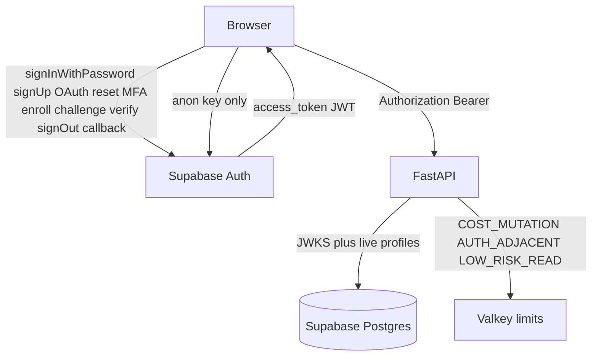
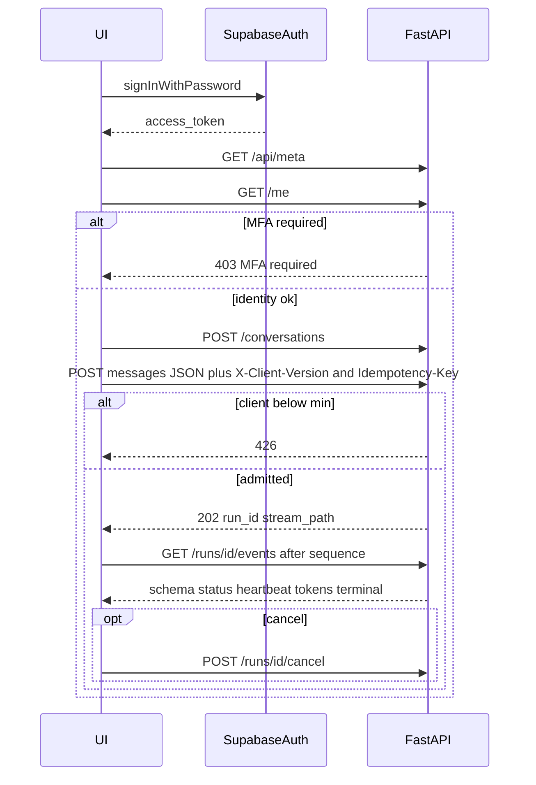

# API and UI mapping (Phase 7)

Canonical inventory of **real** Phase 2 Auth and Phase 6 FastAPI/SSE
contracts for Stitch specification. This document does not invent endpoints,
fields, or success paths. Unresolved gaps stay named.

Related: [STITCH_BRIEF.md](./STITCH_BRIEF.md) ·
[STITCH_REVIEW.md](./STITCH_REVIEW.md) ·
[THIN_DEVELOPER_UI.md](./THIN_DEVELOPER_UI.md) ·
[AUTH_AND_STREAMING.md](./AUTH_AND_STREAMING.md) ·
[CORE_RAG_SURFACES.md](./CORE_RAG_SURFACES.md) ·
[ADMINISTRATION.md](./ADMINISTRATION.md) ·
[api-ui-inventory.json](./api-ui-inventory.json) ·
[openapi.foundation.json](../api/openapi.foundation.json) ·
[SSE.md](../api/SSE.md) ·
[FASTAPI_SECURITY.md](../api/FASTAPI_SECURITY.md) ·
[AUTH_RATE_LIMIT_OWNERSHIP.md](../security/AUTH_RATE_LIMIT_OWNERSHIP.md) ·
[AUTHORIZATION_MODEL.md](../security/AUTHORIZATION_MODEL.md) ·
[phase-07 evidence](../development/phase-07-stitch-specification-evidence.md) ·
[docs index](../README.md)

Machine lock: `docs/frontend/api-ui-inventory.json` must list every OpenAPI
path and every allow-listed SSE type. `tests/unit/test_phase07_api_ui_mapping.py`
fails if the mapping adds a FastAPI path that is not in the snapshot or omits
a snapshot path.

## Ownership



| Class | Owner | FastAPI throttle? |
| --- | --- | --- |
| Email/password, password reset, session | Supabase Auth (`@supabase/ssr` 0.7.0, JS 2.57.4). Google omitted while disabled. MFA UI removed P08-12. | **No** |
| Invitation create/accept, offboarding, chat, upload, crawl, admin mutations | FastAPI | Yes (`AUTH_ADJACENT` / `COST_MUTATION`) |
| Authenticated reads | FastAPI | Yes (`LOW_RISK_READ`) |
| Anonymous sign-in | Disabled in hosted Auth | N/A |

Privileged credentials, ParadeDB, Valkey, OpenAI, and service-role keys never
appear in `NEXT_PUBLIC_*`. UI role hiding is convenience only.

## Compatibility and paid admission

| Concern | Contract | Source |
| --- | --- | --- |
| Publish | `GET /api/meta` → `api_version`, `sse_schema_version`, `min_client_version` | `MetaResponse` |
| Enforce | `X-Client-Version` on `POST /conversations/{conversation_id}/messages` only | `enforce_client_handshake` |
| Below minimum | HTTP **426** `client_version_unsupported` before reserve | `client_handshake.py` |
| Client pin | Frontend `CLIENT_VERSION` = `0.1.0` | `apps/frontend/src/lib/client-version.ts` |
| Resume | `GET /runs/{run_id}/events` does **not** re-check client version | `SSE.md` |
| Idempotency | Header `Idempotency-Key` and/or body `idempotency_key`; duplicate reuses run | `SubmitMessageRequest` |
| JSON admit | `Accept: application/json` → **202** `run_id`, `stream_path`, `reconnect`, `reservation_id`, `route_family`, `status` | thin UI path |
| SSE admit | `Accept: text/event-stream` admits then streams | `SSE.md` |
| Cancel | `POST /runs/{run_id}/cancel` | creator only |
| One terminal | `completed` \| `cancelled` \| `error` \| `partial` | `TERMINAL_SSE_EVENT_TYPES` |
| Unknown SSE | Ignore additive types; do not break the stream | `SSE.md` |

`SubmitMessageRequest` fields are `message` and optional `idempotency_key`
only. There is **no** client route override. Admission is Auto Composite
(`route_family` is server-derived). Manual Hybrid/Combined/table/inspection
controls are [GAP-07-01](#gap-register).

## SSE catalog

Source: `packages/core/src/smart_rag_core/sse/catalog.py` (`extra=forbid`).
Heartbeat interval is **15** seconds. Forbidden payload keys include
`passage`, `snippet`, `html`, `traceback`, `secret`, `token`.

| Event | Payload fields | Terminal |
| --- | --- | --- |
| `schema` | `sse_schema_version` | no |
| `status` | `stage`, `status`, optional `phase` | no |
| `tool_progress` | `tool_key`, `phase` | no |
| `heartbeat` | empty | no |
| `route_correction` | `from_route?`, `to_route?`, `reason?` | no |
| `limitation` | `code` | no |
| `deadline` | `route_family?` | no |
| `partial` | `reason` | **yes** |
| `cache` | `status` | no |
| `coverage` | `coverage_score?` | no |
| `optional_tool_disclosure` | `tool_keys` | no |
| `citation_preview` | `citation_ids`, `ranks` | no |
| `answer_origin` | `origin` | no |
| `token_delta` | `delta` | no |
| `usage` | `prompt_tokens`, `completion_tokens` (this query run) | no |
| `completed` | empty | **yes** |
| `cancelled` | empty | **yes** |
| `error` | `code` | **yes** |

Resume: `GET /runs/{run_id}/events?after=` plus `Last-Event-ID`. Replay is
`sequence > after`. Bearer required. Tombstoned conversation → **404**.
Reconnect never starts a second paid graph.

Signed limitation codes with UI copy today (`apps/frontend/src/lib/limitations.ts`):
`temporal_graph_limitation`, `graph_outage`, `bm25_unavailable`,
`graph_updating`, `media_limitation`, `insufficient_evidence`, `coverage_gap`,
`negation_unresolved`, `source_unavailable`. Additional graph codes exist in
`GraphLimitationCode` (`graph_partial_readiness`, `graph_acl_blindness`,
`graph_survival_below_threshold`, `graph_filtered_dirty`,
`global_steering_only`, `graph_empty`, `graph_deadline`, `graph_cancelled`)
and may arrive as `limitation.code`. Unknown codes render as the code string.

SSE does **not** carry original/rewritten query, profile fields/confidence,
per-channel candidate counts, BM25 index/lag bytes, rerank decision,
uncovered section ranges, inference-chain objects, or graph backlog ETA.
Those are [GAP-07-02](#gap-register).

## Sanitized HTTP errors

| `detail` | Status | Meaning |
| --- | --- | --- |
| `rate_limited` | 429 + `Retry-After` | FastAPI limiter |
| `limiter_unavailable` | 503 + `Retry-After` | Mutation limiter fail-closed |
| `authorization_rejected` / `forbidden` | 403 | Role/capability |
| `MFA required` | removed | Backend P08-11 + frontend P08-12: no MFA kind, route, or banner |
| `not_found` | 404 | Missing, unauthorized, tombstone, IDOR |
| `idempotency_conflict` | 409 | Key reuse mismatch |
| `budget_exhausted` | 402 | Durable query budget |
| `concurrency_limit` | 429 | Five-run envelope |
| `run_not_cancellable` | 409 | Terminal run |
| `client_version_unsupported` | 426 | Handshake |
| `validation_failed` | 422 | `extra=forbid` |
| `request_rejected` | 400 | Unknown admission reason |

Production UI shows these codes, never exception text.

## FastAPI path inventory

Authoritative snapshot: `docs/api/openapi.foundation.json` (45 paths).
Roles: `owner` \| `admin` \| `member` \| `viewer` from `GET /me`.

### Public

| Method | Path | Response | Authz |
| --- | --- | --- | --- |
| GET | `/health/live` | `{status}` | public |
| GET | `/health/ready` | `status`, `query_ready`, coarse `detail` (no named probes) | public |
| GET | `/ops/ready` | named dependency probes plus `query_ready` | owner/admin |
| GET | `/api/meta` | `MetaResponse` | public |

ParadeDB `down` on ready is Hybrid degrade, not BM25-snippet success.

### Identity and team

| Method | Path | Fields | Authz |
| --- | --- | --- | --- |
| GET | `/me` | `user_id`, `role`, `authorization_version`, `upload_enabled`; deprecated `mfa_enrolled` is always false and unused | any active member |
| GET | `/admin/users` | `members` (≤200: `user_id`, `email`, `display_name`, `role`, `upload_enabled`, `disabled_at`, `created_at`) and `pending_invitations` (≤200: `invitation_id`, `email`, `role`, `upload_enabled`, `expires_at`, `created_at`). Never `token_hash` or `raw_token` | owner/admin; members 403 |
| POST | `/admin/invitations` | req `email`, `role`, `upload_enabled`; resp `invitation_id`, `email`, `role`, `upload_enabled`, `expires_at` (token by mail only; `APP_ENV=test` may set `X-Test-Invitation-Token`) | owner/admin; only owner may invite owner |
| POST | `/invitations/accept` | req `token`; resp `invitation_id` | authenticated; email from JWT |
| POST | `/admin/users/{user_id}/offboard` | resp `request_id`, `subject_user_id`, `completed_at` | owner/admin |

No HTTP for owner bootstrap (`bootstrap_owner` service), MFA recovery
(`mfa_recovery.py` service), company-settings CRUD, or audit list/export.

### Documents and ingestion

| Method | Path | Fields | Authz |
| --- | --- | --- | --- |
| GET | `/documents` | `document_id`, `title?`, `visibility`, `current_version_id?`, `visibility_generation`, `created_at?`; query `limit` (default 50, max 200), `cursor` | ACL |
| GET | `/documents/{document_id}` | same fields including `created_at` | ACL else 404 |
| DELETE | `/documents/{document_id}` | **204**; unseen **404**; visible non-owner/admin **403** | owner/admin; COST_MUTATION |
| POST | `/documents/uploads` | req `declared_bytes` ≤ 104857600, `idempotency_key`; resp `reservation_id`, `storage_bucket`, `storage_path`, `expires_at`, `signed_url?`, `upload_method` | not viewer; `upload_enabled`; MFA when privileged. Local `signed_url` is **null** |
| POST | `/documents/uploads/finalize` | req `reservation_id`, `object_name`, `content_hash`, `actual_bytes`, `media_type?`, `declared_category`, `attestation_policy_version`, `idempotency_key`, `document_title?`; resp `reservation_id`, `document_id`, `version_id`, `job_id` | same upload gate |
| GET | `/ingestion/versions/{version_id}/status` | lifecycle `status` plus nested `scan`, `review`, `ocr`, `chunks_tables`, `embedding`, `bm25`, `queue_age`, `graph_handoff`, `retry_allowed` | authenticated; unauthorized **404**; `retry_allowed` owner/admin only |
| POST | `/ingestion/jobs/{job_id}/retry` | `job_id`, `status`, `detail` | owner/admin |
| POST | `/ingestion/crawls` | req `start_url`, `approved_domain`, `idempotency_key`, optional title/depth/pages/class/graph/attestation; resp ids | owner/admin |

Version `status` enum: `uploading`, `uploaded`, `scanning`, `parsing`,
`hybrid_ready`, `graph_pending`, `graph_ready`, `graph_ineligible`,
`deletion_pending`, `failed`. `DELETE /documents/{id}` is owner/admin HTTP
(tombstone + `exclude_version_from_retrieval`) and is wired in the Documents
console behind confirmation. There is **no** signed
source-preview/download HTTP route.

### Chat and runs

| Method | Path | Notes |
| --- | --- | --- |
| POST | `/conversations` | body `title?`; 201 `conversation_id`, `creator_user_id`, `title`, `created_at` |
| GET | `/conversations` | creator list; `limit` default 50 max 200; `cursor` |
| GET | `/conversations/{conversation_id}` | creator or owner/admin; else 404 |
| DELETE | `/conversations/{conversation_id}` | **204**; foreign/tombstone **404**; immediate purge |
| POST | `/conversations/{conversation_id}/messages` | handshake + admit; **requires** Idempotency-Key or body key |
| GET | `/conversations/{conversation_id}/messages` | creator-only transcript; `limit` 1–100 default 50; `before` keyset; 200 `{items, next_before_id}`; foreign/deleted **404** |
| POST | `/conversations/{conversation_id}/title` | creator-only LLM session title; 200 same shape as GET conversation plus `prompt_tokens`/`completion_tokens` for this call (0 when skipped); no-op when title is already a summary; foreign/deleted **404** |
| GET | `/runs/{run_id}` | creator only; IDOR 404 |
| POST | `/runs/{run_id}/cancel` | creator |
| GET | `/runs/{run_id}/events` | Bearer SSE resume |
| GET | `/runs/{run_id}/citations` | `citation_id`, `citation_index`, `chunk_id?`, `provenance`, `source_unavailable`; **no snippets** |
| POST | `/runs/{run_id}/feedback` | `thumbs_up`, `tag` (exact catalog), `comment?` |

Feedback tags (byte-for-byte). Thumbs up: `helpful answer`,
`accurate citation`, `correct route`, `correct calculation`,
`sufficient graph`. Thumbs down (unmerged diagnostics):
`chunk/cleaning loss`, `profile field wrong`, `candidate miss`,
`wrong rerank`, `bad refusal/overconfident answer`, `missed relationship`,
`wrong route`, `wrong calculation`, `bad citation`, `insufficient graph`.

### Graph, tables, tools, usage

| Method | Path | Notes |
| --- | --- | --- |
| POST | `/graph/inspect` | req `entity_keys` ≤12 and/or `document_id`, `depth` 1–3; resp `nodes`, `locators`, `limitations[{code,count?}]`, `row_count` ≤200, `depth`. FastAPI COST_MUTATION. No vendor prose |
| GET | `/graph/entities/search` | `q`, `limit` ≤25; hits `object_id`, `object_type`, `chunk_id`, `document_id`, `version_id`, `support` |
| GET | `/tables` | manifests without storage paths; UI preselects `?tableId=` / `?documentId=` only when listed. `?documentId=` also scopes the sidebar. Titles come from `GET /documents/{id}` for those ids. |
| POST | `/tables/analyze` | body `plan` (`TableQueryPlan` extra=forbid); resp `table_id`, `version_id`, `document_id`, `rows`, `source_ranges`. No export API. |
| GET | `/tools` | role-filtered cards; unauthorized names omitted; `q` is URL-encoded; `active` overlays catalog seed |
| POST | `/admin/tools` | owner/admin seed API only; ordinary `/admin` Tools tab has no seed form |
| POST | `/admin/tools/{tool_key}/enable` | owner/admin; catalog seed overlay on `GET /tools` |
| POST | `/admin/tools/{tool_key}/permissions` | owner/admin; upserts role permission; executor still rechecks live role |
| POST | `/admin/glossary/imports` | owner/admin |
| POST | `/admin/glossary/imports/{import_id}/approve` | owner/admin |
| POST | `/admin/glossary/imports/{import_id}/rollback` | owner/admin |
| GET | `/admin/graph/entity-rules` | owner/admin list |
| POST | `/admin/graph/entity-rules` | upsert |
| PATCH | `/admin/graph/entity-rules/{rule_id}` | update |
| POST | `/admin/graph/entity-rules/suggestions` | inactive candidate |
| POST | `/admin/graph/entity-rules/{rule_id}/approve` | approve |
| POST | `/admin/graph/entity-rules/{rule_id}/revoke` | revoke |
| GET | `/usage/me` | caller totals; no prompt text |
| GET | `/usage/company` | owner/admin; members/viewers 403 |

No `/budgets` HTTP. Spend is inside `admit_query_run`. Graph-maintenance
reserve lives on `app.company_settings` without a public read/write API.
Rolling graph ETA/cost is not an HTTP field; handoff counts are on ingestion
status `graph_handoff.{pending,processing,completed,failed,dead_letter}`.

## Canonical screen families

| Family | Verified inputs | Thin UI today | Gap |
| --- | --- | --- | --- |
| Sign-in | Auth `signInWithPassword`; ready/meta public | Email/password console | OAuth, polish |
| Sign-up | Auth `signUp` (`enable_signup=true`) | none | GAP-07-03 |
| Google OAuth | Auth `signInWithOAuth`; local `[auth.external.google] enabled=false` | none | GAP-07-04 |
| Forgot/reset | Auth `resetPasswordForEmail` | none | GAP-07-05 |
| Auth callback | Redirect includes `http://127.0.0.1:3010/auth/callback` | no page | GAP-07-05 |
| MFA enroll/challenge | Auth TOTP enroll/verify disabled | omitted | P08-12 |
| MFA recovery | `mfa_recovery.py` **service**, no router | none | GAP-07-07 |
| Lost-factor / session revoke / re-enrollment | offboard HTTP; recovery service | none | GAP-07-07 |
| Owner setup | `bootstrap_owner` **service**, no router | none | GAP-07-08 |
| Invitations | FastAPI create/accept | none | UI only |
| Team / offboard | FastAPI offboard owner/admin | none | UI only |
| Chat Auto | messages + SSE + citations + feedback + delete | yes | diagnostics limited to catalog |
| Advanced route panel | **no** request field | copy-only | GAP-07-01 |
| Documents / upload / status | list, reserve, status | reserve + status | finalize/crawl/retry UI |
| Document detail / restricted preview | GET document; citations have no snippet; no preview URL | none | GAP-07-09 |
| Graph explorer | inspect + entity search | none | UI; ETA GAP-07-10 |
| Structured table | list + analyze | none | UI |
| Tools / curation | tools + glossary + entity-rules | none | UI |
| Usage | `/usage/me`, `/usage/company` | me only | company UI |
| Budgets / graph reserve | 402 `budget_exhausted` only | none | GAP-07-11 |
| Audit history | SQL `app.append_audit_event`; local HMAC exporter | none | GAP-07-12 |
| Profile | `GET /me` | header role/id | no profile editor |
| Company settings | `app.company_settings` loaded in `profile_loader` | none | GAP-07-13 |
| Compatibility | meta + 426 | classifyApiError upgrade | designed blocking UI |
| Rate-limit | 429 `rate_limited`; ready `rate_limit_degraded` | none dedicated | UI |

## Chat admit sequence



## Negative findings (must not ship)

- UI field or action without a typed owner in this file or the gap register.
- Client-only authorization or forged-role success.
- Browser exposure of service-role, database, ParadeDB, Valkey, or OpenAI keys.
- BM25 snippets or LightRAG prose as citations.
- Raw internal errors, HTML retrieved content, or `dangerouslySetInnerHTML`.
- Claim that FastAPI throttles browser-direct Auth.
- Graph-only answering as a normal chat path.
- Fake quotas, fake BM25-healthy ParadeDB-down, or invented SSE diagnostics.
- Optimistic paid work before handshake.
- Invented FastAPI paths, including `/budgets`, `/audit`,
  `/admin/company-settings`, `/documents/{document_id}/preview`, and
  `/runs/{run_id}/source`.

## Gap register

Gaps are owning-phase API/Auth holes. Phase 7/8 must not close them with
mocks. Stitch may show an honest unavailable/blocked state.

| ID | Missing contract | Owner | Disposition |
| --- | --- | --- | --- |
| GAP-07-01 | Manual route on `SubmitMessageRequest` (`Hybrid`/`Combined`/`Structured table`/`Graph inspection`) | Phase 6 | Advanced panel is display-only of server `route_family` + `route_correction` until admit grows a typed override |
| GAP-07-02 | SSE profile, rewrite, candidate counts, BM25 index bytes, rerank, uncovered ranges, inference objects, latency | Phase 6 | Render only catalog events; do not invent static diagnostics |
| GAP-07-03 | Sign-up UI (Auth `signUp` exists) | Phase 7/8 UI | Specify Auth-direct sign-up; FastAPI still does not create profiles |
| GAP-07-04 | Google OAuth enabled locally | Phase 2/10 | Specify OAuth screens; local `enabled=false` until configured |
| GAP-07-05 | Password reset + `/auth/callback` page | Phase 7/8 UI | Auth-direct; no FastAPI reset route |
| GAP-07-06 | MFA enroll/challenge UI | Phase 7/8 UI | Auth-direct TOTP; thin UI only shows 403 banner |
| GAP-07-07 | MFA recovery HTTP | Phase 2/6 | Service only; recovery UI blocked until a router exists |
| GAP-07-08 | Owner bootstrap HTTP | Phase 2 | SQL/service only; first-owner UI blocked |
| GAP-07-09 | Signed source preview/download + restricted-read audit HTTP | Phase 6 | Citations are IDs only; no drawer fetch; do not embed Storage privileged URLs |
| GAP-07-10 | Graph backlog rolling ETA/cost HTTP | Phase 5/6 | Show `graph_handoff` counts + `graphNotReadyCopy(n)` only; never unauthorized counts |
| GAP-07-11 | Budget policy read/write HTTP | Phase 6 | Show 402 `budget_exhausted`; no budget editor |
| GAP-07-12 | Audit list/export HTTP | Phase 2/6 | Chain exists; no viewer API; do not mock events |
| GAP-07-13 | Company settings HTTP | Phase 6 | Singleton loaded for `authorization_version`; no CRUD |
| GAP-07-14 | Document delete UI | Phase 8 P08-16 | HTTP `DELETE /documents/{id}` is wired for owner/admin; members 403; 404 is not-found without title leak |
| GAP-07-15 | Upload finalize / crawl / retry UI | Phase 7/8 UI | APIs exist |
| GAP-07-16 | Graph/table/tools/glossary/entity-rule UI | Phase 7/8 UI | APIs exist |
| GAP-07-17 | Company usage dashboard | Phase 7/8 UI | `GET /usage/company` exists |
| GAP-07-18 | Invitation/team admin UI | Phase 7/8 UI | APIs exist |
| GAP-07-19 | Profile editor (name, locale) | Phase 6 | `GET /me` has no name/locale fields |
| GAP-07-20 | Hosted Auth throttling proof | Phase 10 | `local_auth_throttling_proven=False`; do not claim FastAPI covers login |

## Thin UI vs production specification

The Phase 6 console (`DeveloperApp`) is a prerequisite, not Stitch.
`docs/stitch_smart_rag_enterprise_console/` is excluded from docs checks and
is **not** current implementation evidence ([QUALITY_COMMANDS.md](../development/QUALITY_COMMANDS.md)).

## Visible control mapping (P07-04)

Every Stitch control in [STITCH_BRIEF.md](./STITCH_BRIEF.md) and every state
in [STITCH_STATES.md](./STITCH_STATES.md) maps here. Authorization is always
the server column; UI hiding is convenience. Idempotency/reconnect apply only
where listed.

### Auth-direct (not FastAPI)

| Screen | Control | Contract | Authz | Terminal / fallback |
| --- | --- | --- | --- | --- |
| A Sign in | email, password, Sign in | `signInWithPassword` | Auth | generic fail; FastAPI does not throttle |
| A Sign in | ready pills | public `GET /health/ready` (`query_ready` only) | public | informational; no named probes |
| B Sign up | email, password | `signUp` | Auth | membership still needs invite/profile |
| C Forgot | email | `resetPasswordForEmail` | Auth | Inbucket locally |
| C Reset | new password | Auth update | Auth | |
| C Callback | waiting | `exchangeCodeForSession` | Auth | |
| D MFA enroll | QR + code | `mfa.enroll` / `verify` | Auth TOTP | |
| D MFA challenge | code | `mfa.challenge` / `verify` | Auth | |
| D MFA required | banner, Sign out | 403 `MFA required` + `signOut` | FastAPI identity + Auth | no fake TOTP success |
| D Recovery | any control | GAP-07-07 | none | Unavailable |
| A Google | omitted | `signInWithOAuth` never called | GAP-07-04 disabled locally | no button |

### FastAPI identity and team

| Screen | Control | Contract | Authz | Idempotency |
| --- | --- | --- | --- | --- |
| Shell | role, user_id, upload | `GET /me` | live profile | n/a |
| E Invite create | email, role, upload_enabled | `POST /admin/invitations` | owner/admin | AUTH_ADJACENT |
| E Invite token | delivered by mail | not in JSON | owner/admin | n/a |
| E Accept | token | `POST /invitations/accept` | JWT email, not body email | AUTH_ADJACENT |
| E Offboard | user_id | `POST /admin/users/{user_id}/offboard` | owner/admin; no MFA | AUTH_ADJACENT |
| E Owner setup | bootstrap | GAP-07-08 | none | omitted; no chrome |
| E Member directory | list | `GET /admin/users` | owner/admin; members 403 | bounded; no tokens; see [ADR-workspace-member-list.md](../adr/ADR-workspace-member-list.md) |

### Chat, SSE, citations, feedback

| Screen | Control | Contract | Authz | Idempotency / resume |
| --- | --- | --- | --- | --- |
| F List | conversations | `GET /conversations` | creator | n/a |
| F Transcript | earlier messages | `GET /conversations/{id}/messages` | creator; 404 otherwise | `limit`/`before` keyset |
| F New | title optional | `POST /conversations` | creator | COST_MUTATION |
| F Title | LLM summary | `POST /conversations/{conversation_id}/title` | creator; 404 otherwise | COST_MUTATION; skip when title is already a summary |
| F Delete | delete | `DELETE /conversations/{id}` | creator or owner/admin; 204/404 | n/a |
| F Handshake | version | `GET /api/meta` then `X-Client-Version` | public then paid POST | 426 blocks reserve |
| F Send | message | `POST .../messages` body `message` | creator | `Idempotency-Key` |
| F Route | Auto label | 202 `route_family` | server-derived | no client override GAP-07-01 |
| F Advanced Hybrid/Combined/Table/Inspect buttons | — | GAP-07-01 | — | display-only of events |
| F Stream | EventSource | `GET /runs/{id}/events?after=` | creator Bearer | Last-Event-ID; no version header |
| F Cancel | cancel | `POST /runs/{id}/cancel` | creator | 409 if terminal |
| F Tokens | text | SSE `token_delta.delta` | creator | n/a |
| F Limitations | callout | SSE `limitation.code` | creator | signed copy |
| F Correction | diagnostic | `route_correction` | creator | one correction |
| F Cache | diagnostic | `cache.status` | creator | IDs only |
| F Coverage | score | `coverage.coverage_score` | creator | null hidden |
| F Tools | chips | `optional_tool_disclosure.tool_keys` | creator | n/a |
| F Heartbeat | count | `heartbeat` 15s | creator | not assertive |
| F Citations | chips | `citation_preview` then `GET /runs/{id}/citations` | creator | no snippets |
| F Source drawer | preview/download | GAP-07-09 | — | IDs/provenance only |
| F Feedback | thumbs + tag | `POST /runs/{id}/feedback` | creator | polarity catalogs, unmerged |
| F Usage strip | account totals | `GET /usage/me` | caller | no prompt text |
| F Run tokens | this run / this chat | SSE `usage`; title POST tokens on this chat | creator | this chat includes later questions in the live session |
| F Profile rewrite / candidates / BM25 bytes / rerank / inferences / latency | — | GAP-07-02 | — | do not invent |
| G 426/402/429/503 | banners | HTTP details above | — | no paid retry on 426/402 |

Unknown additive SSE types: log and ignore. One terminal among
`completed|cancelled|error|partial`.

### Documents and ingestion

| Screen | Control | Contract | Authz | Idempotency |
| --- | --- | --- | --- | --- |
| H List | cards | `GET /documents` | ACL | n/a |
| H Detail open | card | `GET /documents/{id}` | ACL else 404 | n/a |
| H Reserve | declared_bytes | `POST /documents/uploads` | upload_enabled + MFA | `idempotency_key` |
| H signed_url | display | response `signed_url` | local **null** | Phase 10 |
| H Finalize | hash, bytes, category, policy | `POST /documents/uploads/finalize` | same | `idempotency_key` |
| H Crawl | url, domain | `POST /ingestion/crawls` | owner/admin | `idempotency_key` |
| H Status | pills + BM25 + handoff | `GET /ingestion/versions/{id}/status` | authenticated | n/a |
| H Retry | retry | `POST /ingestion/jobs/{id}/retry` | owner/admin when `retry_allowed` | n/a |
| H Graph not-ready copy | sentence | `graphNotReadyCopy(n)` from authorized counts only | never restricted | n/a |
| H Delete document | owner/admin | `DELETE /documents/{id}` | owner/admin; 204/404 | COST_MUTATION |
| I Restricted preview | — | GAP-07-09 | — | Unavailable |
| I Graph tab | Open graph | `/graph?documentId=` then `POST /graph/inspect` | ACL | n/a |
| I Tables tab | list | `GET /tables` | ACL | n/a |
| I Tables tab | Open from document | `/tables?documentId=` and `/tables?tableId=&documentId=` | ACL | n/a |
| I Tables tab | Document titles | `GET /documents/{id}` for listed manifest ids | ACL; 404 keeps the id | n/a |

### Graph, tables, tools, usage, settings

| Screen | Control | Contract | Authz | Bounds |
| --- | --- | --- | --- | --- |
| J Search | q, limit | `GET /graph/entities/search` | ACL | limit ≤25 |
| J Inspect graph | chips, depth 1–3 | `POST /graph/inspect` | ACL | keys ≤12, depth ≤3, rows ≤200; list-first; no SVG/edit |
| J ETA | — | GAP-07-10 | — | handoff counts only |
| K Analyze | plan | `POST /tables/analyze` | ACL | `TableQueryPlan` extra=forbid |
| K Export | — | optional tool after disclosure | live role recheck | no button otherwise |
| L Catalog | cards, `q` | `GET /tools?q=` | role-filtered | omit unauthorized names; no seed form |
| L Enable | active | `POST /admin/tools/{key}/enable` | owner/admin | allow-listed keys |
| L Permissions | role, permission | `POST /admin/tools/{key}/permissions` | owner/admin | executor rechecks |
| L Glossary | import/approve/rollback | `/admin/glossary/imports*` | owner/admin | `idempotency_key` |
| L Entity rules | CRUD/suggest/approve/revoke/PATCH | `/admin/graph/entity-rules*` | owner/admin | `row_version`; 409 Reload rule |
| M Usage me/company | totals | `GET /usage/me`, `GET /usage/company` | company 403 else | two cards; no charts |
| M Budget editor | — | GAP-07-11 | — | omitted; 402 classified only |
| M Audit | — | GAP-07-12 | — | omitted; no panel |
| M Account | four `/me` fields | `GET /me` | any member | no name/locale editor |
| M Company settings | — | GAP-07-13 | — | omitted; no save |

### Negative mapping tests

| Attempt | Required mapping |
| --- | --- |
| Duplicate send | same `Idempotency-Key` → same `run_id` |
| Reconnect after sequence loss | `after` / `Last-Event-ID`; 404 if tombstone |
| Unknown SSE type | ignore |
| Client below min | 426; no reservation |
| Forged admin role | server 403; UI hide is convenience |
| Unauthorized source URL | GAP-07-09; no privileged href |
| Browser ParadeDB/Valkey/OpenAI keys | forbidden; only `NEXT_PUBLIC_*` anon |
| Internal traces | forbidden in SSE (`FORBIDDEN_PAYLOAD_KEYS`) |

## Verification

```powershell
uv run python -m pytest tests/unit/test_phase07_api_ui_mapping.py -q
uv run python scripts/ci/check_openapi.py
uv run python scripts/check.py --tier docs --mermaid-puppeteer-config scripts/ci/puppeteer-no-sandbox.json
```
