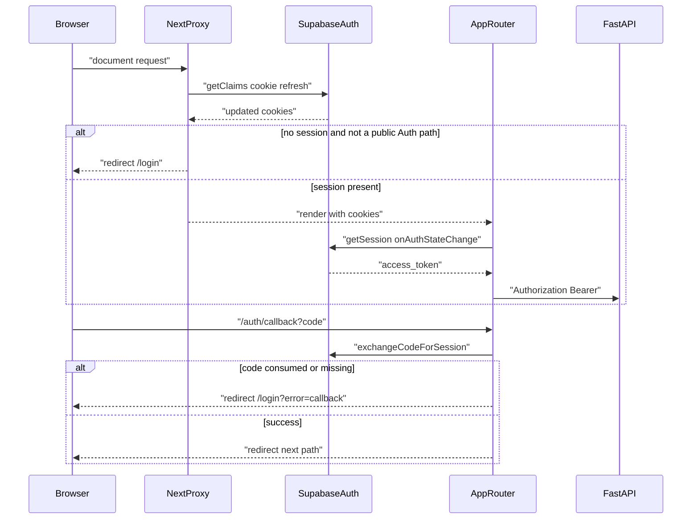

# Auth and streaming (Phase 8 packet 2)

SSR Auth, invitation accept, min-client handshake, and Bearer SSE UX.
Stitch frames are a **template, not a layout**. These routes exist because
Auth/FastAPI contracts exist, not because Stitch numbered them.

Related: [API_UI_MAPPING.md](./API_UI_MAPPING.md) ·
[THIN_DEVELOPER_UI.md](./THIN_DEVELOPER_UI.md) ·
[CORE_RAG_SURFACES.md](./CORE_RAG_SURFACES.md) ·
[ADMINISTRATION.md](./ADMINISTRATION.md) ·
[STITCH_REVIEW.md](./STITCH_REVIEW.md) ·
[PHASE8_JOURNEY_MATRIX.md](./PHASE8_JOURNEY_MATRIX.md) ·
[SSE.md](../api/SSE.md) ·
[AUTH_RATE_LIMIT_OWNERSHIP.md](../security/AUTH_RATE_LIMIT_OWNERSHIP.md) ·
[phase-08 evidence](../development/phase-08-frontend-integration-evidence.md) ·
[docs index](../README.md)

## Routes

Canonical sign-in is `/login`. Unauthenticated `/` redirects there as a
convenience. FastAPI still authorizes every Bearer call.

| Path | Contract | Notes |
| --- | --- | --- |
| `/login` | `signInWithPassword` | Generic "Sign in failed". Google omitted while disabled (GAP-07-04) |
| `/signup` | `signUp` | Invitation still required for FastAPI membership |
| `/forgot-password` | `resetPasswordForEmail` | Check-inbox copy; does not reveal existence |
| `/auth/callback` | PKCE `exchangeCodeForSession` | Replay → "Sign-in could not be completed" |
| `/auth/reset` | `updateUser({ password })` | After recovery `next=/auth/reset` |
| `/invitations/accept` | `POST /invitations/accept` `{ token }` | Email from JWT, not the form |
| `/` | Ask | Packet 15 rebuild. No route POST field. See [CORE_RAG_SURFACES.md](./CORE_RAG_SURFACES.md) |
| `/admin` | Team/Tools/Curation/Usage tabs | Convenience only. FastAPI still authorizes. Legacy `/team|/tools|/curation|/usage` redirect here |
| `/account` | Read-only `GET /me` | Legacy `/profile` redirects here. No MFA field |

`/review-fixtures` and `/unavailable/*` are not product routes; they 404.
Administration bodies live under `/admin?tab=`. See [ADMINISTRATION.md](./ADMINISTRATION.md).
Documents, graph, and tables are packet 3 native routes.

## SSR cookie flow

`@supabase/ssr` **0.7.0** and Next.js **16.3.0** `src/proxy.ts` (not
`middleware.ts`). Only `NEXT_PUBLIC_SUPABASE_URL` and
`NEXT_PUBLIC_SUPABASE_ANON_KEY`. PKCE is forced on `createServerClient`.



Missing cookies are not the security boundary. Optimistic redirects can be
wrong; FastAPI returns 401/403.

## Auth vs FastAPI throttle ownership

| Surface | Owner | UI claim |
| --- | --- | --- |
| Email/password, reset | Supabase Auth | Must **not** say FastAPI throttles login (GAP-07-20) |
| Invitation accept | FastAPI `AUTH_ADJACENT` | Sanitized `detail` codes |
| Chat POST / upload reserve | FastAPI handshake + limiter | 426/402/429/503 banners |

## MFA removed (P08-12)

TOTP enroll/challenge routes and MFA-required banners are deleted. Local Auth sets `auth.mfa.totp.enroll_enabled` and `verify_enabled` to false. Hosted residue is handled by [managed-auth-totp-residue.md](../runbooks/managed-auth-totp-residue.md). GAP-07-07 has no product route; `/unavailable/*` 404s. There is no recovery-code HTTP.


## Handshake before spend

`GET /api/meta` publishes `min_client_version` and `sse_schema_version`.
The composer compares `CLIENT_VERSION` (`0.1.0`) before
`startMessageStream`. Below minimum: banner
"This client is below min_client_version. Update before asking a question."
and Send stays disabled. Unreachable meta fails closed for **new** paid POST.
Resume GET does **not** re-handshake ([SSE.md](../api/SSE.md)). A newer
`sse_schema_version` continues; unknown events are ignored.

Server 426 remains. UI shows sanitized `detail` codes for 426/402/429/503,
never stack traces.

## Reconnect and idempotency

`startOrResumeMessageStream` POSTs only when `runId` is null or the run is
terminal. An in-flight run reconnects with GET `/runs/{id}/events?after=`
and omits `X-Client-Version`. The same `Idempotency-Key` is reused if POST
must retry; the server reuses the run. Sequences are monotonic: duplicate
or older `id` values are ignored. One terminal freezes later token deltas.
Cancel posts `/runs/{id}/cancel` and aborts the in-flight admit POST and
resume GET via `AbortSignal`. Heartbeats increment diagnostics. Frames
whose `query_run_id` is not the current run are ignored.

## Frame 01/03 and gap decisions

Frame 01 sign-in chrome is **not** a product route. Native `/login` covers
email/password, omitted Google, and readiness pills. Frame 03 owner-setup
wizard is **not** shipped (GAP-07-08). Invitation accept fills team entry.

## Failure modes

| Case | UI |
| --- | --- |
| Provider Auth error | "Sign in failed" |
| Callback replay | "Sign-in could not be completed" |
| `session_revoked` | Banner + sign out |
| Client below min | Handshake banner; no paid POST |
| Meta down | Fail closed for new paid POST |
| 402 `budget_exhausted` | Budget banner |
| 429 `rate_limited` / `concurrency_limit` | Rate banner + Retry-After |
| 503 `limiter_unavailable` | Fail-closed banner |
| Unknown SSE | Logged; stream continues |

## Verification

```text
pnpm --filter smart-rag-frontend lint
pnpm --filter smart-rag-frontend exec next typegen
pnpm --filter smart-rag-frontend exec tsc --noEmit
pnpm --filter smart-rag-frontend test
pnpm --filter smart-rag-frontend build
```

From `apps/frontend`: `pnpm exec playwright test`

Docs: `uv run python scripts/check.py --tier docs --mermaid-puppeteer-config scripts/ci/puppeteer-no-sandbox.json`
