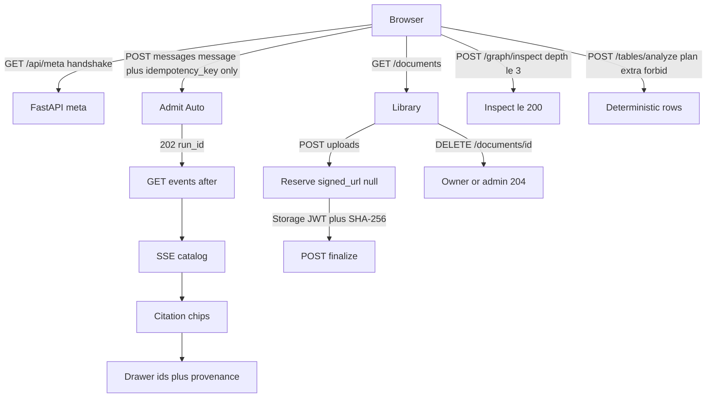

# Core RAG surfaces (Phase 8 packet 3)

Native Chat, Documents, Graph, and Tables mapped to FastAPI/SSE contracts.
Stitch frames 04/05/06/07/09/10 are a **template, not a layout** (no extra
frame routes). Their `screen.png` files are historical references only. Live
composition is the Ink & Indigo console in
[ADR-ink-indigo-visual-refresh.md](../adr/ADR-ink-indigo-visual-refresh.md)
and [workspace-screens.md](./workspace-screens.md). This packet does not
port HTML.

Related: [ADR-ink-indigo-visual-refresh.md](../adr/ADR-ink-indigo-visual-refresh.md) ·
[AUTH_AND_STREAMING.md](./AUTH_AND_STREAMING.md) ·
[THIN_DEVELOPER_UI.md](./THIN_DEVELOPER_UI.md) ·
[API_UI_MAPPING.md](./API_UI_MAPPING.md) ·
[STITCH_STATES.md](./STITCH_STATES.md) ·
[STITCH_REVIEW.md](./STITCH_REVIEW.md) ·
[VISUAL_MAP.md](./VISUAL_MAP.md) ·
[DESIGN_SYSTEM.md](./DESIGN_SYSTEM.md) ·
[ADMINISTRATION.md](./ADMINISTRATION.md) ·
[PHASE8_JOURNEY_MATRIX.md](./PHASE8_JOURNEY_MATRIX.md) ·
[SSE.md](../api/SSE.md) ·
[phase-08 evidence](../development/phase-08-frontend-integration-evidence.md) ·
[docs index](../README.md)

## Routes

| Route | Surface |
| --- | --- |
| `/` | Ask workspace. 280px Sessions rail, persisted transcript, composer card, citation drawers |
| `/documents` | Library, import/upload/crawl, keyset pagination, owner/admin delete |
| `/documents/[documentId]` | Metadata, shared IngestionStatus timeline, graph seed, tables list |
| `/graph` | Search → chips → Inspect graph; list-first plus optional React Flow |
| `/tables` | Manifests + guided `TableQueryPlan` builder, display-only sort, cell provenance |

Ask stays at `/` (`apps/frontend/src/components/chat/chat-app.tsx`). Documents live under `apps/frontend/src/components/documents/` (`document-library.tsx`, `document-detail.tsx`). Tables live under `apps/frontend/src/components/tables/` (`tables-app.tsx`). Graph lives under `apps/frontend/src/components/graph/` (`graph-explorer.tsx`): search hits become chips; Inspect graph POSTs `/graph/inspect`. List is the default accessible view. Canvas is optional `@xyflow/react`. There is no custom SVG neighborhood and no relationship editor. List pagination uses the real `created_at,id` cursor and page length; the client never invents `next_cursor`. `IngestionStatus` is shared by list pills and the detail timeline. Owner/admin delete uses `DELETE /documents/{id}` behind a name-bearing confirmation. There is no `app/chat` folder. Sessions use `GET /conversations`, `GET /conversations/{id}`, creator-only `GET /conversations/{id}/messages` (newest-first keyset, rendered oldest-first; “Load earlier messages” when `next_before_id` is set), and `POST /conversations/{id}/title` for LLM session titles. Prompt chips fill the composer only; verified `token_delta` arrives after the status line (Preparing/Retrieving/Generating/Verifying); sources open in a drawer. Draft state lives in the composer so typing does not re-render the rail. `/ops/ready` is fetched only for owner/admin; `ReadinessIndicator` owns the 15s poll. There is no `app/admin`
folder. Team, tools, curation, usage, and profile are packet 4 native
routes in [ADMINISTRATION.md](./ADMINISTRATION.md). Nav uses Next.js
`Link`. `aria-current` follows the pathname. Nav is not authorization.

## Flows



## Gap table (do not mock)

| ID | UI |
| --- | --- |
| GAP-07-01 | Auto only. Advanced panel is display-only of `route_family` and `route_correction`. No Hybrid/Combined/Table/Inspect send buttons |
| GAP-07-02 | SSE catalog only. Inference-chain objects are absent; citation chips only |
| GAP-07-09 | Source drawer: ids + provenance text. No ACME fixture. No privileged Storage URL. Preview/download unavailable |
| GAP-07-10 | No rolling ETA/cost. Authorized `graph_handoff` counts + `graphNotReadyCopy(n)` only |
| GAP-07-12 | No anomaly toast counts or audit tabs |
| GAP-07-14 | `DELETE /documents/{id}` is wired for owner/admin with confirmation. Members still 403. No source preview/download |

## Honest contracts

- `SubmitMessageRequest` is `{ message, idempotency_key? }` only.
- Local `signed_url` is **null**. `upload_method` is `supabase_storage_jwt`.
- Reserve is never Hybrid Ready.
- Graph Pending is warning, distinct from ACL blindness. ACL copy is
  "Some sources you cannot access are omitted." Counts and titles of
  unauthorized sources are ignored even if `count` is present.
- Graph-only inspection is never a success answering mode.
- ParadeDB `down` on ready plus `bm25_unavailable` are both visible.
- Tables: no SQL textarea, no client-summed total, no fake LLM commentary.
  `/tables` has no standalone export contract, so Export/Save/Share are absent.
  Optional-tool export remains a chat-run disclosure concern, not this page.
- Graph inspect has no edge list, so the canvas does not invent edges. Empty inspect copy is “No authorized graph evidence matched this inspection.”
- Production UI never sends `X-Test-User-Id` or `X-Test-Role`.
- Ask shows exactly one run-failure alert. `partial` stays on the answer
  surface. `error` after tokens keeps the tokens and omits the generic
  banner. `error` with no tokens shows one “Something went wrong”
  reference and never echoes `run_failed`. Retrieve-time
  `deadline_exhausted` is catalog `deadline` then `partial`, not
  `error` `routing_rejected`. Empty-answer deadline copy tells the user
  to send the question again.
- Ask does not keep a second live question or answer when decoded
  `GET /conversations/{id}/messages` content already matches. API
  `content` is HTML-escaped; SSE `answerText` is not.
- Sending the next question keeps the previous verified live answer in
  the transcript until `GET /conversations/{id}/messages` contains that
  assistant row. The next send must not blank `answerText` without that
  overlay; otherwise user bubbles remain and prior replies vanish.
- The composer field clears as soon as Send is accepted. Create or
  admission failure restores the draft. `send()` returns at stream
  handoff and does not wait for the verified answer.
- Ask shows this run’s prompt and completion tokens from SSE `usage` on
  the live answer meta row. The line is omitted when both counts are 0.
- Run details show **This run** (the current question’s SSE `usage`) and
  **This chat** (this run plus earlier questions in the live session and
  the session-title call). Switching conversations resets the chat total.
- Run details use human search-mode and status labels. Empty `none`
  rows, heartbeat counts, and raw node names stay out of the sheet.
  Route correction, tools, cache, coverage, and unknown events appear
  only when the stream supplied them.
- Documents list loads `GET /ingestion/versions/{id}/status` for each
  loaded `current_version_id` and shows Search ready / Graph
  pending|ready|ineligible pills without a menu click. “View processing”
  opens the shared timeline sheet. Empty `none` version ids and viewer
  role-lecture copy stay off the page.
- Document detail repeats those search/graph pills, uses a connected
  processing timeline, and omits the Graph pending warning unless status
  is `graph_pending`. Technical details skip idle `none`/zero queues.
  Empty extracted tables use “This document has no extracted tables.”
  Table names open `/tables?tableId=&documentId=`.
- Tables shows the bounded-calculation description. Raw submitted-plan
  JSON stays off the page. Empty manifests use “Extracted spreadsheet
  tables from ingested documents appear here.” and do not also show
  “Pick a table to analyze.” Document titles come from `GET /documents/{id}` for
  ids on listed manifests (and a `?documentId=` seed). That seed scopes
  the sidebar, shows Back to document, and uses the same empty-tables
  copy when that document has no extracted rows.

## Failure modes

| Signal | UI |
| --- | --- |
| Handshake below min / unreachable | Send disabled; 426 banner |
| 402 / 429 / 503 | Budget / rate / fail-closed banners |
| Document 404 | "Not found." No title |
| Ingestion status 5xx / missing RPC | List Search/Graph stay **Not indexed**; detail Processing says it could not be loaded |
| Storage upload fail | Honest error. Do not finalize a fake success |
| Crawl as member | UI hidden; helper still 403 |
| Viewer upload | Convenience hidden; server 403 |
| Document delete 403/404/429 | Confirmation stays open with classified copy; 404 navigates without a title leak |
| Inspect depth greater than 3 | Client clamps to 3 |
| Inspect 403 | Classified banner; selected chips stay |
| Empty inspect | No authorized graph evidence matched this inspection. |
| Table unknown column / SQL | Rejected before POST; Analyze is not sent |
| Table analyze 403/422/429 | Classified banner; the guided draft stays |
| Chat `partial` | Answer note only; no protocol-failure banner |
| Chat `error` after tokens | One “tokens are kept” note; no stacked generic banner |
| Chat `error` with no tokens | One “Something went wrong” banner plus run reference |

## Verification

```powershell
pnpm --filter smart-rag-frontend lint
pnpm --filter smart-rag-frontend exec next typegen
pnpm --filter smart-rag-frontend exec tsc --noEmit
pnpm --filter smart-rag-frontend test
pnpm --filter smart-rag-frontend build
```

From `apps/frontend`:

```powershell
pnpm exec playwright test
```

Docs:

```powershell
uv run python scripts/check.py --tier docs --mermaid-puppeteer-config scripts/ci/puppeteer-no-sandbox.json
```
