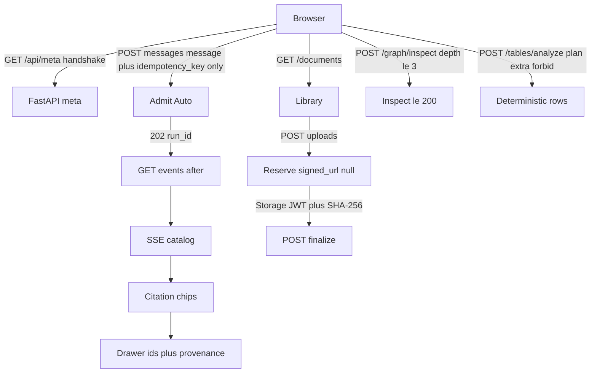

# Core RAG surfaces (Phase 8 packet 3)

Native Chat, Documents, Graph, and Tables mapped to FastAPI/SSE contracts.
Stitch frames 04/05/06/07/09/10 are a **template, not a layout** (no extra
frame routes). Their `screen.png` files are still the visual composition
target ([VISUAL_MAP.md](./VISUAL_MAP.md)). This packet does not port HTML.

Related: [AUTH_AND_STREAMING.md](./AUTH_AND_STREAMING.md) ·
[THIN_DEVELOPER_UI.md](./THIN_DEVELOPER_UI.md) ·
[API_UI_MAPPING.md](./API_UI_MAPPING.md) ·
[STITCH_STATES.md](./STITCH_STATES.md) ·
[STITCH_REVIEW.md](./STITCH_REVIEW.md) ·
[VISUAL_MAP.md](./VISUAL_MAP.md) ·
[DESIGN_SYSTEM.md](./DESIGN_SYSTEM.md) ·
[ADMINISTRATION.md](./ADMINISTRATION.md) ·
[PHASE8_JOURNEY_MATRIX.md](./PHASE8_JOURNEY_MATRIX.md) ·
[SSE.md](../api/SSE.md) ·
[phase-08 evidence](../development/phase-08-frontend-integration-evidence.md) ·
[docs index](../README.md)

## Routes

| Route | Surface |
| --- | --- |
| `/` | Auto chat. Replaces the Phase 6 DeveloperApp monolith |
| `/documents` | Library, upload/crawl convenience, status |
| `/documents/[documentId]` | Metadata, ingestion status, graph seed, tables list |
| `/graph` | Entity search + inspect, list-first, hop cap 3 |
| `/tables` | Manifests + typed `TableQueryPlan` builder |

Chat stays at `/`. There is no `app/chat` folder. There is no `app/admin`
folder. Team, tools, curation, usage, and profile are packet 4 native
routes in [ADMINISTRATION.md](./ADMINISTRATION.md). Nav uses Next.js
`Link`. `aria-current` follows the pathname. Nav is not authorization.

## Flows



## Gap table (do not mock)

| ID | UI |
| --- | --- |
| GAP-07-01 | Auto only. Advanced panel is display-only of `route_family` and `route_correction`. No Hybrid/Combined/Table/Inspect send buttons |
| GAP-07-02 | SSE catalog only. Inference-chain objects are absent; citation chips only |
| GAP-07-09 | Source drawer: ids + provenance text. No ACME fixture. No privileged Storage URL. Preview/download unavailable |
| GAP-07-10 | No rolling ETA/cost. Authorized `graph_handoff` counts + `graphNotReadyCopy(n)` only |
| GAP-07-12 | No anomaly toast counts or audit tabs |
| GAP-07-14 | No `DELETE /documents`. `deletion_pending` pill when the server returns it |

## Honest contracts

- `SubmitMessageRequest` is `{ message, idempotency_key? }` only.
- Local `signed_url` is **null**. `upload_method` is `supabase_storage_jwt`.
- Reserve is never Hybrid Ready.
- Graph Pending is warning, distinct from ACL blindness. ACL copy is
  "Some sources you cannot access are omitted." Counts and titles of
  unauthorized sources are ignored even if `count` is present.
- Graph-only inspection is never a success answering mode.
- ParadeDB `down` on ready plus `bm25_unavailable` are both visible.
- Tables: no SQL textarea, no client-summed total, no fake LLM commentary.
  Export only after `optional_tool_disclosure` listed an export tool on the
  **current chat run**. `/tables` has no disclosure, so no export button.
- Production UI never sends `X-Test-User-Id` or `X-Test-Role`.

## Failure modes

| Signal | UI |
| --- | --- |
| Handshake below min / unreachable | Send disabled; 426 banner |
| 402 / 429 / 503 | Budget / rate / fail-closed banners |
| Document 404 | "Not found." No title |
| Storage upload fail | Honest error. Do not finalize a fake success |
| Crawl as member | UI hidden; helper still 403 |
| Viewer upload | Convenience hidden; server 403 |
| Inspect depth greater than 3 | Client clamps to 3 |

## Verification

```powershell
pnpm --filter smart-rag-frontend lint
pnpm --filter smart-rag-frontend exec next typegen
pnpm --filter smart-rag-frontend exec tsc --noEmit
pnpm --filter smart-rag-frontend test
pnpm --filter smart-rag-frontend build
```

From `apps/frontend`:

```powershell
pnpm exec playwright test
```

Docs:

```powershell
uv run python scripts/check.py --tier docs --mermaid-puppeteer-config scripts/ci/puppeteer-no-sandbox.json
```
