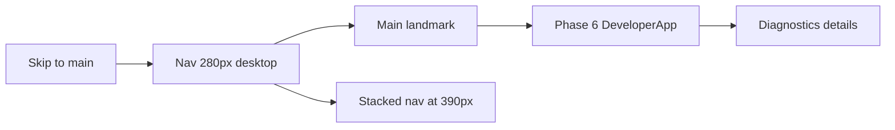

# Design system (Phase 8 packet 1)

Build-time tokens and typed primitives for the production console shell.
Canonical values are the token table in [STITCH_BRIEF.md](./STITCH_BRIEF.md).
The Stitch export is a **template, not a layout**: there is no `frame_00`
route and no design-system gallery page.

Related: [STITCH_BRIEF.md](./STITCH_BRIEF.md) ·
[STITCH_REVIEW.md](./STITCH_REVIEW.md) ·
[THIN_DEVELOPER_UI.md](./THIN_DEVELOPER_UI.md) ·
[phase-08 evidence](../development/phase-08-frontend-integration-evidence.md) ·
[docs index](../README.md)

## Source of truth

| Layer | Role |
| --- | --- |
| `STITCH_BRIEF.md` token table | Canonical hex, radius, shadow, type, motion |
| `apps/frontend/src/app/globals.css` `:root` | CSS implementation |
| `apps/frontend/src/lib/design-tokens.ts` | TypeScript copy for tests |
| Tailwind `@theme` | Maps brief variables to utilities (`bg-page`, `text-brand`) |

`DESIGN.md` YAML (`#faf8ff`, `#004ac6`), prose 10px radius, teal `#0F766E`
as canvas/accent, and gallery `backdrop-filter` are **rejected**. Do not
reintroduce them.

## Tokens

| Token | Value |
| --- | --- |
| `--color-bg` | `#F8FAFC` |
| `--color-surface` | `#FFFFFF` |
| `--color-text` | `#0F172A` |
| `--color-text-muted` | `#475569` |
| `--color-border` | `#CBD5E1` |
| `--color-accent` | `#2563EB` |
| `--color-accent-fg` | `#FFFFFF` |
| `--color-danger` | `#B91C1C` |
| `--color-warning` | `#A16207` |
| `--color-success` | `#166534` |
| `--color-focus` | `#2563EB` (2px solid ring, offset 2px) |
| `--radius-sm` | `6px` |
| `--radius-md` | `8px` |
| `--radius-lg` | `12px` |
| `--space` | `4px` grid |
| `--shadow-1` | `0 1px 2px rgb(15 23 42 / 0.08)` |
| `--shadow-2` | `0 8px 24px rgb(15 23 42 / 0.08)` |
| `--font-sans` | `"Segoe UI", "IBM Plex Sans Arabic", "Noto Naskh Arabic", sans-serif` |
| `--font-mono` | `ui-monospace, "Cascadia Code", monospace` |
| `--line-height-ar` | `1.75` |
| `--line-height-en` | `1.5` |
| `--nav-width` | `280px` |
| `--row-height` | `48px` |

Light scheme only. Motion honors `prefers-reduced-motion`. Fonts are the
system stack; no Google Fonts CDN and no self-hosted files in this packet.

## Shell metrics



- English chrome (`lang="en"`, `dir="ltr"`).
- User/content strings: `dir="auto"` plus `unicode-bidi: isolate`.
- Codes, IDs, URLs: `dir="ltr"` isolate.
- Desktop (1280): navigation column `280px`, tonal `shadow-1` / `shadow-2`.
- Mobile (390): navigation stacks above main; diagnostics start collapsed.
- List and table rows: minimum `48px`.

Packet 1 nav is **Console** → `/` only. Hidden future items are not HTTP 403.
See `CLIENT_NAV_IS_NOT_AUTHORIZATION` in
`apps/frontend/src/lib/client-authorization.ts`.

## Primitives

Typed components live in `apps/frontend/src/components/ui/`:

`AppShell`, `StatusBanner`, `StatusPill`, `CitationChip`,
`LimitationCallout`, `LiveRegion`, `Button`, `Badge`, `Input`, `Textarea`,
`FileDropZone`, `DataTable`, `Spinner`, `ErrorState`, `UserText`, `CodeText`.

Focus is the global `:focus-visible` 2px accent ring. Untrusted strings
pass through `displayText` as React text nodes.

Packet 1 wraps the existing Phase 6 `DeveloperApp` in `AppShell`. It does
not add chat/auth/admin screens, placeholder routes, or Stitch HTML.

## Prohibited patterns

Do not ship: Tailwind CDN, Google Fonts CDN, Material Symbols CDN, inline
event-handler scripts, `innerHTML` / `dangerouslySetInnerHTML`, `href="#"`,
`backdrop-filter` / `blur(`, placeholder avatars, `Math.random()` as live
diagnostics or auth, gitignored Stitch imports, `code.html`, or frame
routes.

## Failure modes

| Failure | Behavior |
| --- | --- |
| Token drift between brief, CSS, and TS | `design-tokens.test.ts` fails |
| CDN, blur, or `innerHTML` in source | `prohibited-patterns.test.ts` fails |
| Hostile filename/entity in a primitive | Renders as text; `img` count stays 0 |
| Hidden nav item | UI convenience only; FastAPI still authorizes |
| Tailwind PostCSS missing | Production build fails closed |

## Verification

```text
pnpm --filter smart-rag-frontend lint
pnpm --filter smart-rag-frontend exec next typegen
pnpm --filter smart-rag-frontend exec tsc --noEmit
pnpm --filter smart-rag-frontend test
pnpm --filter smart-rag-frontend build
pnpm --filter smart-rag-frontend exec playwright test tests/e2e/design-system.spec.ts tests/e2e/login.spec.ts
uv run python scripts/check.py --tier docs --mermaid-puppeteer-config scripts/ci/puppeteer-no-sandbox.json
```

## Troubleshooting

- Nav not 280px: confirm `globals.css` `--nav-width` and
  `app-shell.module.css` desktop media query (`min-width: 801px`).
- Geist / Google Fonts returning: `layout.tsx` must not import
  `next/font` loaders; CSP `font-src 'self'` forbids CDN hosts.
- Component tests missing DOM: `*.test.tsx` files need
  `// @vitest-environment jsdom`.
