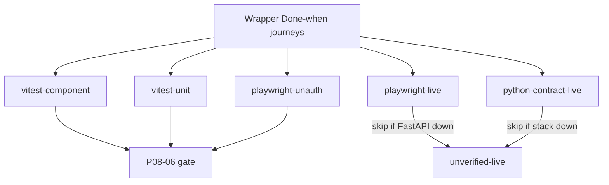

# Phase 8 journey matrix

Maps every Phase 8 wrapper Done-when / packet-6 journey to an exact test.
Stitch is a **template, not a layout**. Coverage is keyed to shipped contract
surfaces (login, chat `/`, documents, graph, tables, `/admin` tabs,
`/account`), not frame numbers. Retired `/team` `/tools` `/curation`
`/usage` `/profile` redirect. Production has no `/unavailable/*` chrome.

Related: [phase-08 evidence](../development/phase-08-frontend-integration-evidence.md) ·
[API_UI_MAPPING.md](./API_UI_MAPPING.md) ·
[CORE_RAG_SURFACES.md](./CORE_RAG_SURFACES.md) ·
[ADMINISTRATION.md](./ADMINISTRATION.md) ·
[AUTH_AND_STREAMING.md](./AUTH_AND_STREAMING.md) ·
[A11Y_SECURITY_IMPLEMENTATION.md](./A11Y_SECURITY_IMPLEMENTATION.md) ·
[docs index](../README.md)

Production UI does not send `X-Test-` headers. Playwright may skip live-only
checks when FastAPI is down **if** the same assertion exists in Vitest.

Locked limitation codes: `temporal_graph_limitation`, `bm25_unavailable`,
`graph_outage`, `media_limitation`, `negation_unresolved`, `coverage_gap`,
`insufficient_evidence`, `graph_acl_blindness`, `graph_pending`,
`graph_partial_readiness`.

Locked GAP ids: `GAP-07-01`, `GAP-07-07`, `GAP-07-08`, `GAP-07-09`,
`GAP-07-12`, `GAP-07-14`.

## Layer legend

| Layer | Meaning |
| --- | --- |
| vitest-component | jsdom + real client helpers (fetch injected or module mock of HTTP only) |
| vitest-unit | Pure helpers / fetch-injected API clients |
| playwright-unauth | Chromium against Next on :3010; `page.route` public stubs allowed |
| playwright-live | Requires live GoTrue/FastAPI; skip only when `/health/ready` is down |
| python-contract-live | Retired local FastAPI+Auth live suite; live journeys now use playwright-live |

## Auth, roles, MFA, invitations

| Journey | File | Test name | Layer | Status |
| --- | --- | --- | --- | --- |
| Sign-in chrome | `tests/e2e/login.spec.ts` | unauthenticated console shows sign-in | playwright-unauth | proven |
| Sign-up / reset links | `tests/e2e/login.spec.ts` | signup and forgot-password links are visible from login | playwright-unauth | proven |
| Callback replay | `tests/e2e/login.spec.ts` | callback replay shows generic failure copy | playwright-unauth | proven |
| Google disabled GAP-07-04 | `src/lib/handshake.test.ts` | does not invoke OAuth when the provider is disabled | vitest-unit | proven |
| MFA routes removed | `tests/e2e/login.spec.ts` | `/mfa/challenge` redirects to login; no Google button | playwright-unauth | proven |
| MFA required (chat) | `src/components/chat-app.test.tsx` | no MFA challenge/enroll links | vitest-component | proven |
| Upload leftover MFA copy | `src/lib/api.test.ts` | 403 `MFA required` is generic auth/upload failure, not `mfa_required` | vitest-unit | proven |
| MFA recovery GAP-07-07 | `src/components/auth/auth-screens.test.tsx` | has no recovery-code input that submits | vitest-component | proven |
| MFA recovery GAP-07-07 | `tests/e2e/phase08-journeys.spec.ts` | GAP-07-07 and GAP-07-08 unavailable pages have no mocked recovery or bootstrap | playwright-unauth | proven |
| Owner bootstrap GAP-07-08 | `src/components/auth/auth-screens.test.tsx` | has no owner-bootstrap form | vitest-component | proven |
| Owner bootstrap GAP-07-08 | `src/components/administration-surfaces.test.tsx` | hides invite and offboard for a viewer | vitest-component | proven |
| Invitation accept body | `src/lib/api.test.ts` | posts { token } only | vitest-unit | proven |
| Invitation token mail-only | `src/components/administration-surfaces.test.tsx` | does not render an invitation token and keeps hostile email as text | vitest-component | proven |
| Roles convenience vs server | `src/lib/roles.test.ts` | hides invite, offboard, and enable for viewer and member | vitest-unit | proven |
| Forged role headers | `src/lib/client-authorization.test.ts` | does not treat a forged client role as request authorization | vitest-unit | proven |
| session_revoked | `src/components/chat-app.test.tsx` | shows session_revoked banner and signs out | vitest-component | proven |
| session_revoked HTTP | `src/lib/api.test.ts` | throws session_revoked on 401 session_revoked | vitest-unit | proven |
| Live Auth/MFA/JWT | `tests/e2e/login.spec.ts` | browser readiness panel matches live GET /health/ready | playwright-live | proven |
| Live TOTP aal2 + Storage JWT PUT | `tests/e2e/core-rag-surfaces.spec.ts` | authenticated Auto chrome when a session exists | playwright-live | proven |
| Live sign-in / ready panel | `tests/e2e/login.spec.ts` | browser readiness panel matches live GET /health/ready | playwright-live | proven |
| Live Auto chrome | `tests/e2e/core-rag-surfaces.spec.ts` | authenticated Auto chrome when a session exists | playwright-live | proven |
| Live document 404 chrome | `tests/e2e/core-rag-surfaces.spec.ts` | stubbed document 404 shows Not found without a title | playwright-live | proven |
| Live usage 403 chrome | `tests/e2e/administration-surfaces.spec.ts` | stubbed company usage 403 stays forbidden copy when signed in | playwright-live | proven |

## Handshake, SSE, reconnect, cancel, delete

| Journey | File | Test name | Layer | Status |
| --- | --- | --- | --- | --- |
| Min-client 9.0.0 | `tests/e2e/phase08-journeys.spec.ts` | handshake 9.0.0 public stub blocks paid-work copy on login | playwright-unauth | proven |
| Handshake blocks Send | `src/components/chat-app.test.tsx` | shows Auto, blocks Send on handshake, and has no route send buttons | vitest-component | proven |
| Paid POST 426 | `src/lib/api.test.ts` | classifies upgrade and does not open the SSE GET | vitest-unit | proven |
| Idempotency-Key reuse | `src/lib/chat-view.test.ts` | reuses the same idempotency key across retry | vitest-unit | proven |
| Resume skips POST | `src/lib/api.test.ts` | prefers resume GET when runId is set and terminal is null | vitest-unit | proven |
| Auto POST no route GAP-07-01 | `src/lib/api.test.ts` | posts message and idempotency_key only, with no route field | vitest-unit | proven |
| Unknown SSE events | `src/lib/chat-view.test.ts` | keeps the answer when an unknown additive event is injected | vitest-unit | proven |
| Heartbeat + Cancel terminal | `src/lib/chat-view.test.ts` | counts heartbeats and records cancelled as the terminal | vitest-unit | proven |
| Cancel HTTP | `src/lib/api.test.ts` | posts cancel with resume headers and no X-Client-Version | vitest-unit | proven |
| Cancel from ChatApp | `src/components/chat-app.test.tsx` | Stop posts /runs/{id}/cancel without X-Client-Version | vitest-component | proven |
| Reconnect 404 private-run | `src/lib/api.test.ts` | classifies a foreign or missing run as deleted without a second POST | vitest-unit | proven |
| Reconnect 404 chrome | `src/components/chat-app.test.tsx` | reconnect 404 shows deleted copy without source text | vitest-component | proven |
| Conversation DELETE | `src/lib/api.test.ts` | DELETEs the conversation and treats 204 as success | vitest-unit | proven |
| Conversation delete chrome | `src/components/chat-app.test.tsx` | Delete conversation confirms before DELETE and Cancel sends zero requests | vitest-component | proven |
| Transcript citation restore | `src/components/chat-app.test.tsx` | restores historical Sources from citation_count without N+1 detail | vitest-component | proven |
| Live JWT chat/idempotency/delete | `tests/e2e/core-rag-surfaces.spec.ts` | authenticated Auto chrome when a session exists | playwright-live | proven |

## Routing and limitation families

Limitation honesty uses SSE `limitation.code` plus Auto POST (GAP-07-01). There
is no client route field.

| Journey | File | Test name | Layer | Status |
| --- | --- | --- | --- | --- |
| Direct / composite Auto | `src/components/chat-app.test.tsx` | renders Auto POST limitation copy, unknown events, and citations without snippets | vitest-component | proven |
| Historical `temporal_graph_limitation` | `src/lib/chat-view.test.ts` | records route correction, deadline, and limitation codes from the catalog | vitest-unit | proven |
| Broad `global_steering_only` | `src/lib/chat-view.test.ts` | records BM25, LightRAG, ACL, pending, and summary limitation codes | vitest-unit | proven |
| Summary `coverage_gap` / `insufficient_evidence` | `src/lib/chat-view.test.ts` | records route correction, deadline, and limitation codes from the catalog | vitest-unit | proven |
| Negation `negation_unresolved` | `src/lib/chat-view.test.ts` | records route correction, deadline, and limitation codes from the catalog | vitest-unit | proven |
| Media `media_limitation` | `src/lib/chat-view.test.ts` | records route correction, deadline, and limitation codes from the catalog | vitest-unit | proven |
| BM25 `bm25_unavailable` | `src/lib/limitations.test.ts` | uses signed historical-graph language | vitest-unit | proven |
| LightRAG `graph_outage` | `src/lib/limitations.test.ts` | uses signed historical-graph language | vitest-unit | proven |
| Table / comparison `source_ranges` | `src/components/tables/tables-app.test.tsx` | runs a valid analyze, labels display sort, and opens cell provenance | vitest-component | proven |
| Citations without snippets GAP-07-09 | `src/lib/api.test.ts` | keeps ids/locators and drops passage snippet fields | vitest-unit | proven |
| Live five composite streams | `tests/e2e/core-rag-surfaces.spec.ts` | authenticated Auto chrome when a session exists | playwright-live | proven |

## Documents, graph, tables, administration

| Journey | File | Test name | Layer | Status |
| --- | --- | --- | --- | --- |
| Viewer hides upload/crawl | `src/components/core-rag-surfaces.test.tsx` | hides upload and crawl for a viewer | vitest-component | proven |
| Quota 402 reserve | `src/lib/api.test.ts` | does not return a reservation on 402 quota or budget exhaustion | vitest-unit | proven |
| Crawl member 403 | `src/lib/api.test.ts` | still posts for a member helper call (server 403 is authoritative) | vitest-unit | proven |
| Quarantine labels | `src/lib/ingestion-status.test.ts` | labels Graph Pending distinctly from failed and does not invent quarantine HTTP | vitest-unit | proven |
| Graph Pending vs deletion | `src/components/core-rag-surfaces.test.tsx` | loads Graph Pending, BM25 none, and deletion_pending without a member delete control | vitest-component | proven |
| Document delete | `src/lib/api.test.ts` | deleteDocument 204/403/404/429 | vitest-unit | proven |
| Document delete chrome | `src/components/documents/document-library.test.tsx` | owner confirmation 204; member 403 copy; pagination append | vitest-component | proven |
| Document 404 no title | `src/components/core-rag-surfaces.test.tsx` | shows Not found without a title leak | vitest-component | proven |
| Unauth document 404 → login | `tests/e2e/phase08-journeys.spec.ts` | unauthenticated document 404 still redirects to login | playwright-unauth | proven |
| ACL blindness no count | `src/components/core-rag-surfaces.test.tsx` | shows ACL blindness without unauthorized counts or titles | vitest-component | proven |
| Graph Pending authorized count | `src/components/core-rag-surfaces.test.tsx` | shows Graph Pending with authorized not-ready count only | vitest-component | proven |
| Tables URL preselect | `src/components/tables/tables-app.test.tsx` | preselects an accessible tableId from the URL | vitest-component | proven |
| Tables document seed | `src/components/tables/tables-app.test.tsx` | scopes `?documentId=`, names the document, and uses document-empty copy | vitest-component | proven |
| Tables invalid plan | `src/components/tables/tables-app.test.tsx` | rejects unknown columns and raw SQL before submission | vitest-component | proven |
| Tables failure preservation | `src/components/tables/tables-app.test.tsx` | preserves the draft and submitted plan on 403 | vitest-component | proven |
| Graph search-select-inspect | `src/components/graph/graph-explorer.test.tsx` | searches, inspects, lists nodes, and opens evidence details | vitest-component | proven |
| Graph document seed | `src/components/graph/graph-explorer.test.tsx` | inspects from a document seed without entity chips | vitest-component | proven |
| Graph chip cap | `src/components/graph/graph-explorer.test.tsx` | caps chips at 12 and shows mixed-direction labels as text | vitest-component | proven |
| Graph outage vs ACL | `src/components/graph/graph-explorer.test.tsx` | distinguishes graph outage from ACL blindness | vitest-component | proven |
| Graph inspect 403 chips | `src/components/graph/graph-explorer.test.tsx` | preserves chips on inspect 403 | vitest-component | proven |
| Graph inspect 403 client | `src/lib/api.test.ts` | classifies inspect 403 as ClassifiedApiError | vitest-unit | proven |
| `graph_partial_readiness` copy | `src/lib/limitations.test.ts` | covers GraphLimitationCode values without unauthorized counts | vitest-unit | proven |
| Curation approve `row_version` | `src/components/administration-surfaces.test.tsx` | approves an entity rule with row_version only for an owner | vitest-component | proven |
| Entity-rule PATCH 409 | `src/components/administration-surfaces.test.tsx` | shows Reload rule after a stale PATCH | vitest-component | proven |
| patchEntityRule 409 | `src/lib/api.test.ts` | patchEntityRule classifies 409 stale_row_version | vitest-unit | proven |
| Admin member 403 | `src/components/administration-surfaces.test.tsx` | shows a permission error after a real 403 for a member | vitest-component | proven |
| Admin tabs URL | `src/components/administration-surfaces.test.tsx` | lets an owner switch tabs through URL state | vitest-component | proven |
| Offboard no MFA | `src/components/administration-surfaces.test.tsx` | offboards a known user id without MFA copy | vitest-component | proven |
| Tools search no seed | `src/components/administration-surfaces.test.tsx` | hides enable for a member, searches with q, and has no seed form | vitest-component | proven |
| listTools encodes `q` | `src/lib/api.test.ts` | listTools URL-encodes q | vitest-unit | proven |
| Rate / `budget_exhausted` | `src/lib/api.test.ts` | maps 402 budget_exhausted | vitest-unit | proven |
| `rate_limited` Retry-After | `src/lib/api.test.ts` | maps 429 rate_limited with Retry-After | vitest-unit | proven |
| Usage no budget/audit chrome | `src/components/administration-surfaces.test.tsx` | shows token meters and no budget slider or fake audit events | vitest-component | proven |
| Member usage no audit chrome | `src/components/administration-surfaces.test.tsx` | hides company meters for a member without audit chrome | vitest-component | proven |
| Account four `/me` fields | `src/components/administration-surfaces.test.tsx` | shows /me fields and has no settings save | vitest-component | proven |
| Abandoned/expired/oversize HTTP | `src/lib/ingestion-status.test.ts` | labels Graph Pending distinctly from failed and does not invent quarantine HTTP | vitest-unit | proven |
| Live upload signed_url null + user JWT PUT | `tests/e2e/core-rag-surfaces.spec.ts` | authenticated Auto chrome when a session exists | playwright-live | proven |

Abandoned, expired, and oversize quarantine are not distinct public JSON
enums on `GET /ingestion/versions/{id}/status`. The UI prints the server
`status` string as-is and does not invent those states.

## Interaction regression (shipped surfaces)

| Journey | File | Test name | Layer | Status |
| --- | --- | --- | --- | --- |
| Protected routes → `/login` | `tests/e2e/phase08-journeys.spec.ts` | unauthenticated shipped routes redirect to login except public auth pages | playwright-unauth | proven |
| Login chrome | `tests/e2e/phase08-journeys.spec.ts` | login chrome has skip link, Sign in, and contract nav without Stitch frames | playwright-unauth | proven |
| 232px desktop nav | `tests/e2e/design-system.spec.ts` | authenticated desktop navigation is 232px when a session exists | playwright-live | proven |
| 390px mobile nav | `tests/e2e/design-system.spec.ts` | authenticated mobile keeps compact brand and a menu control | playwright-live | proven |
| Reduced motion | `tests/e2e/design-system.spec.ts` | reduced motion disables authored transitions | playwright-unauth | proven |
| Skip link keyboard | `tests/e2e/a11y-security.spec.ts` | Tab order on login starts at the skip link and focuses main | playwright-unauth | proven |
| Login geometry/overflow | `tests/e2e/quality-audit.spec.ts` | login geometry, overflow, and mapped Sign in at required viewports | playwright-unauth | proven |
| Action inventory | `scripts/check_frontend_action_inventory.py` | unique keep IDs mapped to source and tests | python-unit | proven |
| RTL ACME offsets 7–11 | `src/components/accessibility-security.test.tsx` | wraps ACME in a mark of text nodes for offsets 7–11 | vitest-component | proven |
| XSS fixtures inert | `src/components/accessibility-security.test.tsx` | renders XSS, javascript URLs, bidi controls, and mixed text as text | vitest-component | proven |
| CSP headers | `tests/e2e/phase08-journeys.spec.ts` | login response includes CSP without Tailwind CDN | playwright-unauth | proven |
| Prohibited patterns | `src/lib/prohibited-patterns.test.ts` | rejects CDN, innerHTML, dead hashes, blur, fonts, avatars, and random auth | vitest-unit | proven |
| No `X-Test-` in api.ts | `src/lib/prohibited-patterns.test.ts` | does not send X-Test headers from api.ts | vitest-unit | proven |
| Company progress fixture | `src/lib/sse-fixtures.test.ts` | marks every route fixture as synthetic and leak-free | vitest-unit | proven |
| Verified reveal skip | `src/components/chat/verified-answer-reveal.test.tsx` | Show full answer completes immediately | vitest-component | proven |
| Rail isolation | `src/components/chat-app.test.tsx` | does not re-render the Sessions rail on token_delta | vitest-component | proven |
| Fixture Ask journey | `tests/e2e/sse-progress-fixture.spec.ts` | company fixture shows waiting then verify then skippable verified answer | playwright-live | unverified-live |
| Reduced-motion fixture | `tests/e2e/sse-progress-fixture.spec.ts` | reduced motion renders the full verified fixture immediately | playwright-live | unverified-live |

## Remaining unverified-live items

These were **not** claimed as proven in the 2026-08-17 live run. The word
**unverified-live** stays for CI skips when FastAPI is down. Re-run log:
[phase-08-later-live-verification.md](../development/phase-08-later-live-verification.md).

- P08-LV-01 Compose ParadeDB/Valkey stop-visible-on-ready
- P08-LV-02 Abandoned / expired / oversize as distinct public JSON enums
- P08-LV-03 Live WCAG lab measurement of computed styles
- P08-LV-04 Hosted Auth throttling (GAP-07-20 / Phase 10)
- P08-LV-05 Signed-in Next chrome against live graph/tables/tools/curation mutations
