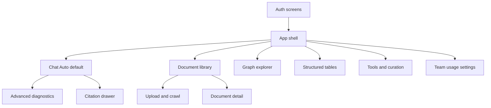

# Stitch brief (Phase 7)

Copy-ready Google Stitch prompts, frames, tokens, and localization for the
production console. This is specification only. Phase 8 implements against
[API_UI_MAPPING.md](./API_UI_MAPPING.md). Do not treat generated HTML, static
diagnostics, or mock quotas as API contracts.

Related: [API_UI_MAPPING.md](./API_UI_MAPPING.md) ·
[STITCH_STATES.md](./STITCH_STATES.md) ·
[THIN_DEVELOPER_UI.md](./THIN_DEVELOPER_UI.md) ·
[QUALITY_TARGETS.md](../QUALITY_TARGETS.md) ·
[docs index](../README.md)

[STITCH_STATES.md](./STITCH_STATES.md) is part of this brief: every
loading, empty, error, permission, quarantine, quota, compatibility,
limitation, fallback, partial-readiness, budget, and degraded state.
[STITCH_A11Y_SECURITY.md](./STITCH_A11Y_SECURITY.md) is the accessibility
and security review.
[STITCH_REVIEW.md](./STITCH_REVIEW.md) records that the delivered Stitch
export is a **template, not product layout**. Do not add Stitch frames as
routes. Implementation is the component-system fallback (do not port HTML).

## Localization decision

**v1 chrome is English.** Application chrome (nav, buttons, settings labels,
error titles) stays English. Arabic and mixed Arabic/English **content** is
first-class: user messages, filenames, entity names, citations, table cells,
URLs, and answer tokens.

Rationale: `GET /me` has no locale field ([GAP-07-19](./API_UI_MAPPING.md)).
The Phase 6 thin UI is English. Inventing a chrome-locale API would be a mock.

Direction rules:

| Surface | `dir` | Isolation |
| --- | --- | --- |
| App chrome, nav, forms | `ltr` (`lang="en"`) | none |
| User message, answer, filename, entity, table cell, citation snippet label | `dir="auto"` | `unicode-bidi: isolate` |
| Codes, IDs, URLs, emails, sheet ranges, ISO dates | `dir="ltr"` | isolate inside RTL paragraphs |
| Citation highlight offsets | logical Unicode offsets on canonical text, never visual-order | N/A |

Optional future Arabic chrome is blocked on a real locale contract. The
delivered Stitch bundle has **no** RTL or mixed-direction frames; that
remains a design-evidence gap, not a waiver. Phase 8 still implements the
fixtures in this brief.

## Canonical design tokens

Round 1 (2026-08-17) reconciles three conflicting sources. **One set
wins.** **Blur is rejected** (no frosted glass, no `backdrop-filter`).

| Source | What it said | Disposition |
| --- | --- | --- |
| This brief (pre-export) | Teal `#0F766E`, radius 8px, canvas `#F8FAFC` | Teal replaced by delivered primary |
| `smart_rag/DESIGN.md` YAML | Canvas `#faf8ff`, primary `#004ac6` | YAML lavender canvas rejected |
| `DESIGN.md` prose | Canvas `#F8FAFC`, primary `#2563EB`, radius 10px, no blur | Canvas + primary kept; 10px rejected |
| Frame HTML `tailwind.config` | Same YAML colors; `rounded-lg` = 8px | 8px kept |
| Chat frame body | `bg-[#F8FAFC]` | Confirms canvas |
| `frame_04_chat_state_gallery` | `.glass-panel` `backdrop-filter: blur(12px)` | **Rejected** |

| Token | Value | Notes |
| --- | --- | --- |
| `--color-bg` | `#F8FAFC` | page (chat frame + DESIGN prose) |
| `--color-surface` | `#FFFFFF` | cards |
| `--color-text` | `#0F172A` | AA; YAML `on-surface` `#131B2E` is equivalent |
| `--color-text-muted` | `#475569` | secondary; still AA on white |
| `--color-border` | `#CBD5E1` | 1px |
| `--color-accent` | `#2563EB` | delivered primary-container / DESIGN prose |
| `--color-accent-fg` | `#FFFFFF` | |
| `--color-danger` | `#B91C1C` | YAML error `#ba1a1a` rounded to AA body text |
| `--color-warning` | `#A16207` | quota/degraded; non-alarming |
| `--color-success` | `#166534` | ready/complete |
| `--color-focus` | `#2563EB` | 2px solid ring, offset 2px |
| `--radius-sm` | `6px` | chips |
| `--radius-md` | `8px` | inputs, buttons (`rounded-lg` in frames) |
| `--radius-lg` | `12px` | cards, drawers |
| `--space` | `4px` grid | 8/12/16/24/32 |
| `--shadow-1` | `0 1px 2px rgb(15 23 42 / 0.08)` | |
| `--shadow-2` | `0 8px 24px rgb(15 23 42 / 0.08)` | drawers; no blur overlay |
| `--font-sans` | `"Segoe UI", "IBM Plex Sans Arabic", "Noto Naskh Arabic", sans-serif` | CSP-compatible; optional self-hosted Inter later |
| `--font-mono` | `ui-monospace, "Cascadia Code", monospace` | IDs/codes |
| `--line-height-ar` | `1.75` | diacritics |
| `--line-height-en` | `1.5` | chrome |
| Motion | honor `prefers-reduced-motion` | no required animation |

Prohibited: runtime Tailwind CDN, Google Fonts CDN, Material Symbols CDN,
inline event-handler scripts, random mock metrics, external placeholder
avatars, graph-only answer chrome, purple glass, gallery blur.

## Information hierarchy



Priority on chat: (1) answer + limitation honesty, (2) citations, (3)
route/BM25/graph diagnostics, (4) token/cost. Diagnostics never outrank the
answer. `Auto` is the only primary send control. Advanced modes are a
disclosure panel that **displays** server `route_family` and
`route_correction`; they do not post a client route ([GAP-07-01](./API_UI_MAPPING.md)).

## Component inventory

Reusable primitives for Stitch and the fallback system:

| Component | Use | Notes |
| --- | --- | --- |
| `AppShell` | nav + main | English chrome, skip link |
| `StatusBanner` | errors, MFA, 426, 402, 429, degraded | role=`status` or `alert` |
| `StatusPill` | document/job lifecycle | map enum, never invent |
| `AuthForm` | email/password | Auth-direct, not FastAPI |
| `ChatTranscript` | tokens + limitations | text nodes only |
| `Composer` | message + send/cancel | 16384 cap |
| `DiagnosticList` | SSE catalog only | ignore unknown types |
| `CitationChip` | index + unavailable | opens drawer; no snippet from list |
| `SourceDrawer` | GAP-07-09 blocked | show IDs/provenance; no privileged URL |
| `LimitationCallout` | signed copy | non-alarming for BM25 degrade |
| `UploadReserveForm` | declared_bytes | `signed_url` null locally |
| `IngestionStatusCard` | nested BM25/graph_handoff | |
| `GraphInspectPanel` | nodes/locators | no vendor prose |
| `TableResult` | rows + `source_ranges` | separate from generated analysis |
| `ToolCard` | catalog | omit unauthorized names |
| `UsageMeters` | `/usage/me` or company | no prompt text |
| `LiveRegion` | stream/reconnect/terminal | polite unless error |
| `FocusRing` | keyboard | 2px accent |

## Global Stitch constraints (prepend to every prompt)

Copy this block unchanged at the top of every screen prompt:

```text
Product: Smart RAG company console (one team). Not a public chatbot.
Chrome language: English. Content may be Arabic, English, or mixed.
Do not invent API fields, quotas, BM25 scores, graph counts, or token costs.
Do not show graph-only as a normal answering mode. Auto is the default chat route.
Do not use blur, glassmorphism, stock photography, or random avatars.
Do not render retrieved HTML. All filenames, entities, answers, and table cells are plain text.
UI role hiding is convenience only; never imply the browser enforces authorization.
If a control has no backend contract, show an honest Unavailable state with a gap id, never mock data.
Tokens: background #F8FAFC, surface #FFFFFF, text #0F172A, accent #2563EB, danger #B91C1C, warning #A16207, radius 8px, no blur.
WCAG AA contrast, visible 2px focus ring, keyboard-only operable, skip link.
Desktop 1280px and mobile 390px. Mixed-direction fixtures required on chat and citations.
```

## Copy-ready screen prompts

### A. Sign in

```text
Screen: Sign in. Email and password fields, Sign in button, Forgot password link, Google sign-in button labeled "Continue with Google (when enabled)". Show GET /health/ready dependency pills (paradedb, valkey_limits, valkey_cache, lightrag) as informational, not as login success. If Google is disabled, the Google button is disabled with helper text "Google OAuth is not enabled on this project". Never claim FastAPI rate-limits this form. Empty: blank fields. Error: generic "Sign in failed" without provider traces. Env missing: banner that public Supabase URL or anon key is unset.
```

### B. Sign up

```text
Screen: Create account. Email, password, confirm. Helper: an invitation may still be required before FastAPI membership works. Do not invent a profile API. Success goes to sign-in or invitation accept, not a fake dashboard.
```

### C. Forgot / reset password / callback

```text
Screens: Forgot password (email), check-inbox, reset password (new password), /auth/callback waiting state. These are Supabase Auth-direct. Show a blocked 426-style banner only if a later FastAPI call fails handshake — not on this screen. Callback: "Completing sign-in" then route to chat; failure "Sign-in could not be completed".
```

### D. MFA enrollment / challenge / required

```text
Screens: (1) MFA required gate matching FastAPI 403 detail "MFA required" for owner/admin/upload_enabled — banner plus Sign out; no fake TOTP success. (2) Enroll TOTP via Supabase Auth (QR + verify code) when the user is signed in at aal1. (3) Challenge TOTP. Lost-factor recovery: Unavailable GAP-07-07, do not mock admin recovery codes.
```

### E. Invitation accept / owner setup / team

```text
Invitation accept: authenticated user pastes token into POST /invitations/accept; email comes from the session, not the form. Create invitation (owner/admin): email, role owner/admin/member/viewer, upload_enabled checkbox; show raw_token once. Offboard: owner/admin AAL2, user_id, irreversible copy. Owner bootstrap: Unavailable GAP-07-08. Do not list other members unless an API exists — there is no member-list HTTP route, so team admin shows invitations + offboard by user id only, with empty-state copy "No member directory API; identify users from GET /me and audit when available".
```

### F. Main chat (Auto)

```text
Main chat. Left: conversation list from GET /conversations, New chat POST /conversations, delete DELETE /conversations/{id} expecting 204. Center: transcript of token_delta text, limitation callouts from limitation.code using signed sentences, citation chips from citation_preview ids then GET /runs/{id}/citations. Composer posts POST /conversations/{id}/messages with X-Client-Version and Idempotency-Key. After 202, connect GET /runs/{id}/events?after=. Cancel posts POST /runs/{id}/cancel. Reconnect uses Last-Event-ID. Unknown SSE types: log in a collapsed Diagnostics list, do not crash. Feedback: thumbs plus required tag from the ten-tag catalog. Usage strip: GET /usage/me cost_usd and tokens. Advanced disclosure (closed by default): requested vs effective route_family from 202 and route_correction events, cache.status, coverage_score, optional_tool_disclosure.tool_keys, heartbeat count. Do not display BM25 index bytes (not in SSE). Do not provide Hybrid/Combined/Table/Inspect send buttons that change the POST body.
```

### G. Compatibility / quota / budget banners on chat

```text
Blocking upgrade: HTTP 426 before send, copy "This client is below min_client_version. Update before asking a question." Budget: HTTP 402 detail budget_exhausted. Rate: 429 Retry-After. Concurrency: 429 concurrency_limit (five runs). Fail-closed limiter: 503 limiter_unavailable. Deleted conversation: 404 after delete. MFA: 403 MFA required.
```

### H. Document library / upload / crawl / status

```text
Library: GET /documents cards with title, visibility, current_version_id. Upload: declared_bytes + reserve POST /documents/uploads. Show signed_url is null locally and upload_method supabase_storage_jwt. Finalize fields: reservation_id, object_name, content_hash, actual_bytes, declared_category, attestation_policy_version. Crawl (owner/admin): start_url, approved_domain, idempotency_key. Status: GET /ingestion/versions/{id}/status with pills for status enum uploading uploaded scanning parsing hybrid_ready graph_pending graph_ready graph_ineligible deletion_pending failed, plus bm25 lag/pending/failed/dead_letter and graph_handoff counts. Retry button only when retry_allowed. Graph not ready copy: "N relevant recent documents are not yet represented in the graph" — never restricted titles. Delete document: Unavailable GAP-07-14.
```

### I. Document detail

```text
Detail from GET /documents/{id}. Tabs: metadata, ingestion status, graph inspect seeded by document_id (depth 1-3), tables list. Restricted preview/download: Unavailable GAP-07-09; show citation ids only. Quarantine/review from nested scan.result and review.approval_status. Do not invent PII findings.
```

### J. Graph explorer

```text
Search GET /graph/entities/search?q=&limit= and inspect POST /graph/inspect. Visualize at most 200 authorized nodes. Show limitations codes including graph_acl_blindness without unauthorized names/titles/counts for other users. Distinct Graph Pending (status graph_pending / limitation graph_updating / graph_partial_readiness) versus ACL blindness. No rolling ETA field — show graph_handoff counts only (GAP-07-10). Graph-only is inspection, not chat fallback.
```

### K. Structured tables

```text
List GET /tables. Analyze POST /tables/analyze with a TableQueryPlan. Show deterministic rows and source_ranges in a sortable table, visually separated from any later generated commentary. No SQL textarea. Export: only if an optional tool card is disclosed; otherwise no export button.
```

### L. Tools, glossary, entity rules

```text
Tools catalog GET /tools cards (tool_key, version_label, short_name, purpose, required_role, risk_class, active). Admin enable/permissions for owner/admin. Glossary import/approve/rollback. Entity rules list/upsert/suggest/approve/revoke. Members see catalog only. Unauthorized tool names omitted, not redacted with fake titles.
```

### M. Usage, audit, profile, company settings

```text
Usage: GET /usage/me for everyone; GET /usage/company for owner/admin. No budget editor (GAP-07-11); 402 is the budget state. Audit history: Unavailable GAP-07-12. Profile: GET /me fields only (user_id, role, authorization_version, upload_enabled, mfa_enrolled). Company settings: Unavailable GAP-07-13.
```

## Responsive LTR/RTL frames

Generate **four** frames per critical screen (sign-in, chat, library, graph,
tables, team):

| Frame | Viewport | Direction notes |
| --- | --- | --- |
| Desktop LTR | 1280×800 | English chrome, mixed content in chat |
| Desktop mixed | 1280×800 | RTL Arabic answer with LTR URL/code chips |
| Mobile LTR | 390×844 | stacked nav, diagnostics collapsed |
| Mobile mixed | 390×844 | no horizontal clip of Arabic or URLs; wrap |

Equivalent task completion: sign in, send Auto question, open a citation
chip, reserve upload, run graph search, read a limitation. Keyboard tab order
follows reading order of chrome (LTR) then isolated content.

## Mixed-direction fixtures (reviewed examples)

Use these exact strings in Stitch frames and Phase 8 tests.

1. Mixed message: `راجع INV-SR-8801 في https://example.com/q?id=12 — القسم 3.`
2. RTL paragraph with LTR code: `الكود Policy-أ-14 ساري.` plus isolated `Policy-أ-14`.
3. Citation logical range: canonical text `الشركة ACME وقعت العقد.` highlight
   codepoint offsets 7–11 (`ACME`), not visual left-to-right index.
4. Diacritics: `إِنَّ` with line-height 1.75, no clip.
5. Long URL wrap: `https://intranet.example.invalid/procurement/2024/Q3/invoice-8801?lang=ar`
6. Filename XSS fixture (escaped): `.pdf`
7. Entity label XSS: `</script>شركة`
8. Punctuation: Arabic question mark `؟` at the logical end.

IME/caret: composer is a plain textarea; no custom shaping. Caret follows
platform bidi.

## Signed limitation copy (non-alarming)

Use [limitations.ts](../../apps/frontend/src/lib/limitations.ts) sentences.
BM25 unavailable is warning (amber), not danger-red. Graph-only must
never appear as "Answer with graph". Historical relationships stay on Hybrid.

## Accessibility baseline (expanded in STITCH_A11Y_SECURITY)

- WCAG AA contrast on all token pairs above.
- Keyboard-only: tab, enter, escape closes drawers, arrows in lists.
- Skip link to main.
- `aria-live="polite"` for tokens/heartbeat; `assertive` for 426/402/MFA/error
  terminal.
- Reduced motion: no required stream animation.
- Hit targets ≥ 24px on mobile.

## Negative prompt review

Rejected if a frame shows: invented Hybrid/Combined toggle that posts a
route; BM25 snippet as a citation; graph node count for unauthorized docs;
raw stack traces; `signed_url` populated in local copy; blur; Tailwind CDN
comment; random cost; complete corpus summary without coverage_score.

## Phase 8 consumption

Implement in `apps/frontend` with Next.js App Router 16.3, React 19,
`@supabase/ssr` 0.7.0, TanStack Query 5.85. The Stitch export is a template,
not a layout: do not add its frames as pages. Phase 8 uses accessible native
HTML plus build-time Tailwind tokens (not CDN) matching the token table in
this brief, and only surfaces with typed contracts in
[API_UI_MAPPING.md](./API_UI_MAPPING.md).
