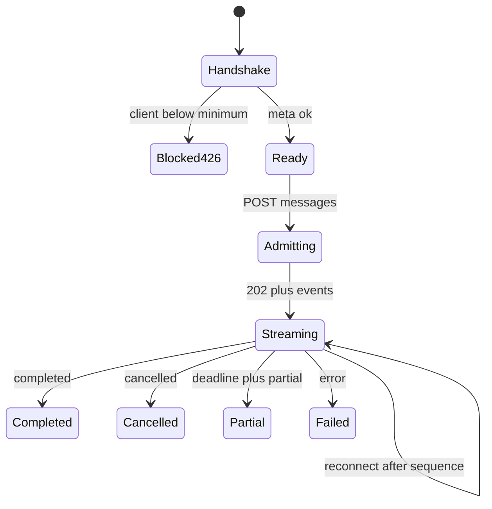

# Visible states (Phase 7)

Per-surface loading, empty, success, partial, refusal, permission, MFA,
quarantine, quota, compatibility, limitation, fallback, budget, and degraded
states. Every row maps to a real server signal in
[API_UI_MAPPING.md](./API_UI_MAPPING.md) or an explicit GAP. Part of
[STITCH_BRIEF.md](./STITCH_BRIEF.md).

Related: [STITCH_BRIEF.md](./STITCH_BRIEF.md) ·
[API_UI_MAPPING.md](./API_UI_MAPPING.md) ·
[limitations.ts](../../apps/frontend/src/lib/limitations.ts) ·
[CORE_RAG_SURFACES.md](./CORE_RAG_SURFACES.md) ·
[docs index](../README.md)

Copy uses signed sentences. Production never shows exception text. BM25
degrade and Graph Pending are **warning**, not danger. Graph-only is never a
success answering state.

Live-region: `polite` for progress/tokens; `assertive` for 426, 402,
terminal `error`.

## Shared HTTP banners

| State | Signal | Copy | Recovery | Roles |
| --- | --- | --- | --- | --- |
| Compatibility block | 426 `client_version_unsupported` | This client is below `min_client_version`. Update before asking a question. | Upgrade client; do not POST messages | all |
| Handshake loading | `GET /api/meta` in flight | Checking API version | none | all |
| Handshake failure | meta network/5xx | Cannot reach the API. | Retry meta | all |
| Version switchover | meta `sse_schema_version` changed mid-session | API schema changed. Reconnect the current run; do not start a second paid question until handshake succeeds. | Re-fetch meta; resume uses no version header | all |
| Unknown SSE event | type not in catalog | ignored in UI; listed under Diagnostics as unknown | continue stream | creator |
| Rate limited | 429 `rate_limited` + Retry-After | Too many requests. Try after N seconds. | wait | FastAPI-owned only |
| Limiter fail-closed | 503 `limiter_unavailable` | Service cannot admit this action safely. | retry later | mutations |
| Budget exhausted | 402 `budget_exhausted` | Company or user query budget is exhausted. | owner funds/wait; no hidden retry spend | all paid |
| Concurrency | 429 `concurrency_limit` | Five query runs are already active. | wait/cancel | chat |
| MFA required | removed P08-12 | MFA is not a product gate. Single-factor Auth. | none | none |
| Authz deny | 403 `forbidden` | You cannot perform this action. | none | convenience hide + server deny |
| Not found / IDOR / tombstone | 404 `not_found` | Not found. | leave | no existence leak |
| Idempotency conflict | 409 `idempotency_conflict` | This request does not match the original. | new key | chat/upload |
| Validation | 422 `validation_failed` | The request was rejected. | fix fields | mutations |
| Disabled / revoked session | 401 Caller disabled / Session revoked | Sign in again. | Auth-direct | all |
| Generic production error | other 5xx | Something went wrong. | retry | all |
| Rate-limit degraded reads | ready `rate_limit_degraded` | Read limits are running in a degraded mode. | informational | all |

FastAPI does **not** produce these banners for sign-in/OAuth/reset/MFA
challenge. Those failures are Auth-provider generic copy only.

## Auth and session

| State | Signal | Copy / UI | Recovery |
| --- | --- | --- | --- |
| First load | no session | Sign-in screen + public ready pills | none |
| Loading | Auth request in flight | Signing in | disable submit |
| Empty | blank form | placeholders only | none |
| Success | session + `GET /me` 200 | app shell | none |
| Sign-in failed | Auth error | Sign in failed | retry |
| Env missing | no `NEXT_PUBLIC_SUPABASE_*` | Public Auth configuration is missing | set env |
| Google omitted | `enabled=false` | No Google button is rendered | GAP-07-04 |
| Sign-up | Auth `signUp` | invitation may still be required | accept invite |
| Reset sent | Auth reset | Check your email (Inbucket locally) | none |
| Callback loading | `/auth/callback` | Completing sign-in | none |
| Callback failed | exchange error | Sign-in could not be completed | sign-in |
| MFA enroll empty | aal1, not enrolled | Enroll authenticator | Auth TOTP |
| MFA challenge | enroll exists | Enter code | verify |
| MFA required gate | 403 on `/me` or upload | MFA required banner, no console | enroll/challenge |
| Recovery | no HTTP | Unavailable GAP-07-07 | owning phase |
| Revoked | 401 Session revoked | Sign in again | re-auth |
| Owner bootstrap | no HTTP | Unavailable GAP-07-08 | owning phase |

## Team

| State | Signal | Copy / UI | Recovery |
| --- | --- | --- | --- |
| Invite form | owner/admin | email, role, upload_enabled | POST invitations |
| Invite success | 201 without `raw_token` | show `invitation_id` + mail-only copy | check mail / Mailpit |
| Invite forbidden | 403 | You cannot invite | none |
| Accept loading | POST accept | Accepting | none |
| Accept success | invitation_id | Continue to chat | none |
| Offboard | owner/admin Bearer | irreversible; no MFA | POST offboard |
| Member directory | no list API | omitted; no directory chrome | identify by user_id |
| Viewer | GET /me role viewer | hide invite/offboard (convenience) | server still denies |

## Chat and diagnostics

| State | Signal | Copy / UI | Live region |
| --- | --- | --- | --- |
| First load | conversations GET | list or empty | polite |
| Empty list | `[]` | No conversations yet | none |
| Loading list | GET in flight | Loading conversations | polite |
| Composer empty | no text | Send disabled | none |
| Admitting | POST messages | Asking… | polite |
| Streaming | `token_delta` | append text | polite (throttled) |
| Heartbeat | `heartbeat` every 15s | Diagnostics heartbeat count | none (avoid noise) |
| Status | `status` stage/status | collapsed diagnostics | none |
| Route correction | `route_correction` | From {from} to {to}: {reason} | polite |
| Cache | `cache.status` | cache_hit / miss / recheck_failed | none |
| Coverage | `coverage_score` | numeric or hidden if null | none |
| Tools disclosed | `optional_tool_disclosure` | tool_keys chips | none |
| Citations preview | ids/ranks | chips; fetch GET citations | none |
| Citation unavailable | `source_unavailable` | signed source_unavailable copy | polite |
| Completed | `completed` | idle composer | polite |
| Cancelled | `cancelled` or POST cancel | Run cancelled | polite |
| Reconnect | GET events `after` | Reconnecting… then replay | polite |
| Duplicate submit | same idempotency key | reuse run; no second reserve | none |
| Partial | `deadline` then `partial` | Verified partial answer. {reason} | assertive |
| Error terminal | `error.code` | sanitized code | assertive |
| Refusal insufficient | limitation `insufficient_evidence` | signed copy | polite |
| Coverage gap | `coverage_gap` | signed copy; not a full summary | polite |
| Media | `media_limitation` | signed copy | polite |
| Negation | `negation_unresolved` | signed copy; ask clarify | polite |
| Historical | `temporal_graph_limitation` | signed Hybrid copy | polite |
| BM25 degrade | `bm25_unavailable` and/or ready paradedb down | signed dense+term copy; warning | polite |
| Graph outage | `graph_outage` | Combined relabeled to Hybrid | polite |
| Graph updating | `graph_updating` / `graph_partial_readiness` | Hybrid continues; N-not-ready sentence only if authorized count exists | polite |
| ACL blindness | `graph_acl_blindness` | authorized notice only; **no** titles/counts of others | polite |
| Graph survival | `graph_survival_below_threshold` | Combined relabeled Hybrid | polite |
| Full-summary refuse | coverage/limitation without claiming complete corpus | refuse or scoped pass per coverage | polite |
| Conversation deleted | DELETE 204 then 404 | Conversation deleted | polite |
| Private run | other user run id | 404 | none |

BM25 index/lag bytes are **not** a chat SSE state. They belong on ingestion
status. Chat must not invent them (GAP-07-02).

Manual Hybrid/Combined/Table/Inspect send is not a state; the advanced panel
is read-only (GAP-07-01).

## Documents, upload, ingestion

| State | Signal | Copy / UI | Recovery |
| --- | --- | --- | --- |
| Library loading | GET /documents | Loading | none |
| Empty library | `[]` | No documents you can see | none |
| Success | list | cards | none |
| Upload disabled | `upload_enabled` false | hide/disable (convenience) | server 403 |
| MFA upload | 403 MFA required | MFA banner | TOTP |
| Quota reserve | POST uploads | reservation + null signed_url | Storage JWT local |
| Oversize | declared_bytes > 104857600 | 422/validation | smaller file |
| Quota reject | UploadQuotaError | sanitized reject | wait/reduce |
| Finalize loading | POST finalize | Finalizing | none |
| Scan | `scan.result` clean/infected/unscannable/stale_signature/over_limit/hash_mismatch | status card | retry if allowed |
| Quarantine pending | status uploading/uploaded + scan | In quarantine | wait |
| Stale signature | `stale_signature` | Scan signatures are stale | admin refresh |
| Attestation | `review.declared_category` | show category + policy version | none |
| URL approval pending | `review.approval_status` pending | Waiting for owner/admin URL approval | admin |
| Crawl enqueue | POST crawls 201 | ids | poll status |
| Parsing / OCR | status parsing; ocr.page_count | Ingestion in progress | none |
| Media-only | media_limitation on later ask; ocr 0 + no text chunks | Hybrid ready may still lack figure answers | none |
| Hybrid ready | `hybrid_ready` + bm25 verified | Hybrid Ready pill | none |
| BM25 lag | bm25.pending/failed/dead_letter/lag_seconds | Projection lag N s; not evidence | retry if allowed |
| Graph pending | `graph_pending` | Graph Pending; Hybrid usable | wait |
| Graph ready | `graph_ready` | Graph Ready | none |
| Graph ineligible | `graph_ineligible` | Not graph-eligible (restricted/company rule) | none |
| Deletion pending | `deletion_pending` | Deletion in progress | none |
| Delete action | no HTTP | Unavailable GAP-07-14 | owning phase |
| Failed | `failed` | Failed; retry if `retry_allowed` | owner/admin retry |
| Restricted preview | no source URL HTTP | Unavailable GAP-07-09; citation ids only | owning phase |
| Anomaly | local admin notification (no list API) | do not invent toast counts | GAP-07-12 overlap |

## Graph explorer

| State | Signal | Copy / UI |
| --- | --- | --- |
| Empty search | trimmed q length 0 | Search disabled |
| Empty inspect | nodes empty after inspect | No authorized graph evidence matched this inspection. |
| Loading | GET search / POST inspect | Loading |
| Success | nodes ≤200 | authorized graph |
| Empty authorized | `graph_empty` | No authorized graph objects |
| Graph Pending | document status or `graph_updating` | Graph is not ready yet |
| Partial readiness | `graph_partial_readiness` | Some authorized documents are not in the graph |
| ACL blindness | `graph_acl_blindness` | Some sources you cannot access are omitted. **Never** show their titles/counts |
| Deadline | `graph_deadline` | Inspection stopped at the deadline |
| Outage | `graph_outage` | Graph inspection unavailable |
| Seed required | 422 inspect_seed_required | Provide entity or document |
| ETA | none | Unavailable GAP-07-10; show handoff counts only |
| Relationship edit | no mutation API | omitted, not a disabled control |
| Custom SVG neighborhood | removed | React Flow canvas only |

## Tables

| State | Signal | Copy / UI |
| --- | --- | --- |
| Empty | GET /tables `[]` | No structured tables are available. |
| Analyze success | rows + source_ranges | deterministic table; display-only sort; Cell provenance drawer |
| Empty success | rows `[]` | The analysis returned no rows. |
| 404 parquet | not_found | Table artifact unavailable |
| Forbidden extra field | 422 | Plan rejected; draft preserved |
| Unknown column / SQL | client compile | rejected before POST |
| Export | none | removed; no standalone export contract |

## Tools, glossary, entity rules

| State | Signal | Copy / UI |
| --- | --- | --- |
| Catalog empty | `[]` after role filter | No tools you can use |
| Unauthorized name | omitted from GET /tools | never a redacted fake title |
| Admin forbidden | 403 | You cannot change tools |
| Glossary import | 201 | status + counts |
| Rule concurrency | stale `row_version` | refresh and retry |

## Usage, audit, profile, settings

| State | Signal | Copy / UI |
| --- | --- | --- |
| Usage me | GET /usage/me | cost_usd, tokens, rows |
| Usage company | GET /usage/company or 403 | owner/admin only |
| Budget editor | none | omitted GAP-07-11; 402 classified only |
| Audit | none | omitted GAP-07-12; no panel |
| Account | GET /me | four fields only |
| Company settings | none | omitted GAP-07-13; no save |

## Negative scenarios (must not look like success)

| Scenario | Required UI |
| --- | --- |
| Unauthorized document | 404, no title leak |
| Expired reservation | generic reject, re-reserve |
| Oversize file | validation, not silent truncate |
| Stale scan | stale_signature, not Hybrid Ready |
| Incompatible client | 426 before paid POST |
| Disconnect mid-stream | reconnect resume; no second admit |
| Duplicate submit | same run_id |
| Deadline | partial, not completed |
| ParadeDB down | bm25_unavailable + ready down; Hybrid continues |
| LightRAG down | graph_outage; Hybrid continues |
| Insufficient evidence | refuse, not a confident answer |
| Graph-only answering | **forbidden** |
| Hidden retry spend | **forbidden** |
| Full summary without coverage | **forbidden** |
| Exhaustive negation without proof | negation_unresolved |
| Restricted identity in ACL notice | **forbidden** |
| Raw exception / HTML | **forbidden** |

