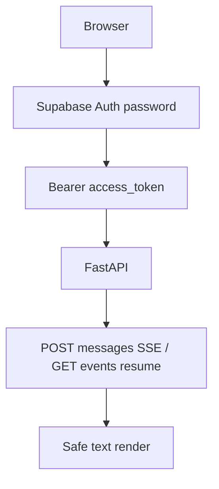

# Thin developer UI (Phase 6 packet 8)

Authenticated Next.js console for local RAG testing. This is **not** Stitch
and **not** the production frontend (Phases 7–8).

Related: [SSE.md](../api/SSE.md) ·
[FASTAPI_SECURITY.md](../api/FASTAPI_SECURITY.md) ·
[MEMORY_DELETION.md](../agent/MEMORY_DELETION.md) ·
[CONFIGURATION.md](../development/CONFIGURATION.md) ·
[docs index](../README.md)

## Scope

Sign-in, conversation list/create/delete, Auto Composite chat with fetch SSE,
reconnect/cancel, diagnostics from the accepted event catalog, citations,
unmerged feedback tags, document list, and usage totals.



## Contracts the UI does not invent

| Action | API |
| --- | --- |
| Handshake | `GET /api/meta`; paid POST sends `X-Client-Version` |
| Identity | `GET /me` (server role) |
| Chat admit | `POST /conversations/{id}/messages` with `Idempotency-Key` |
| Resume | `GET /runs/{id}/events?after=` without version header |
| Cancel | `POST /runs/{id}/cancel` |
| Delete | `DELETE /conversations/{id}` → 204 |
| Feedback | `POST /runs/{id}/feedback` with exact packet-7 tags |
| Citations | `GET /runs/{id}/citations` (no snippets) |

Unknown SSE event types are logged in diagnostics and ignored. Token and
entity text render through React text nodes plus `displayText`; `href` values
must pass `isSafeHttpUrl`. `dangerouslySetInnerHTML` is forbidden.

## Diagnostics honesty

SSE payloads are extra=forbid and do **not** include BM25 index/lag bytes.
The console shows route correction, limitation codes, cache status, coverage
score, optional tool keys, citation ids, usage tokens, and heartbeat count.
BM25 projection/index/lag remain API/ops diagnostics from earlier packets.

Graph-not-ready copy is
“N relevant recent documents are not yet represented in the graph” and never
includes restricted or ineligible counts.

## Environment

| Variable | Purpose |
| --- | --- |
| `NEXT_PUBLIC_API_BASE_URL` | FastAPI origin; default `http://127.0.0.1:8000` |
| `NEXT_PUBLIC_SUPABASE_URL` | Browser Auth project URL |
| `NEXT_PUBLIC_SUPABASE_ANON_KEY` | Browser anon key only |

Privileged service-role keys, database URLs, and OpenAI keys must never appear
in `NEXT_PUBLIC_*`.

## Verification

```
pnpm --filter smart-rag-frontend test
pnpm --filter smart-rag-frontend lint
pnpm --filter smart-rag-frontend exec tsc --noEmit
pnpm --filter smart-rag-frontend build
```

Playwright `tests/e2e/login.spec.ts` checks the sign-in heading. Live JWT +
five Composite streams through the browser are recorded separately in packet 8
evidence and stay unverified until that local run exists.
