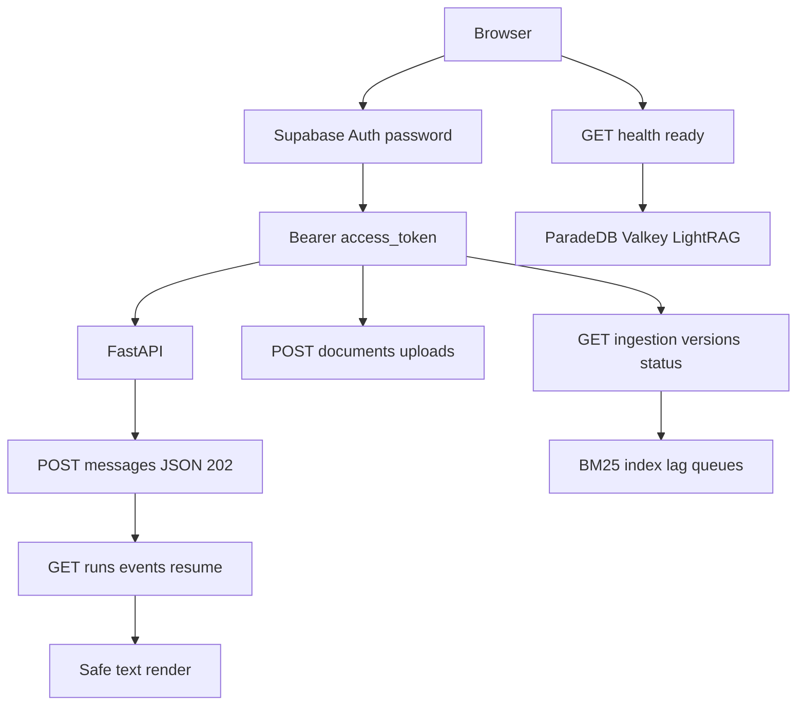

# Thin developer UI (Phase 6 packet 8)

Authenticated Next.js console for local RAG testing. Phase 8 packet 1 hosts
this surface inside the production `AppShell`; packet 2 moves sign-in to
`/login` with SSR Auth. Chat/upload on `/` after Auth was replaced in packet 3 by native Auto chat
at `/` plus `/documents`. See [CORE_RAG_SURFACES.md](./CORE_RAG_SURFACES.md).

Related: [API_UI_MAPPING.md](./API_UI_MAPPING.md) ·
[DESIGN_SYSTEM.md](./DESIGN_SYSTEM.md) ·
[AUTH_AND_STREAMING.md](./AUTH_AND_STREAMING.md) ·
[CORE_RAG_SURFACES.md](./CORE_RAG_SURFACES.md) ·
[STITCH_BRIEF.md](./STITCH_BRIEF.md) ·
[SSE.md](../api/SSE.md) ·
[FASTAPI_SECURITY.md](../api/FASTAPI_SECURITY.md) ·
[MEMORY_DELETION.md](../agent/MEMORY_DELETION.md) ·
[CONFIGURATION.md](../development/CONFIGURATION.md) ·
[docs index](../README.md)

## Scope

Sign-in, conversation list/create/delete, Auto Composite chat with fetch SSE,
reconnect/cancel, diagnostics from the accepted event catalog, citations,
unmerged feedback tags, upload reservation, version status including BM25
index/lag, public `GET /health/ready` plus owner/admin `GET /ops/ready`
named ParadeDB/Valkey/LightRAG probes, MFA-required upload, and usage totals.



## Contracts the UI does not invent

| Action | API |
| --- | --- |
| Handshake | `GET /api/meta`; paid POST sends `X-Client-Version` |
| Identity | `GET /me` (server role) |
| Chat admit | `POST /conversations/{id}/messages` with `Accept: application/json` and `Idempotency-Key` |
| Resume | `GET /runs/{id}/events?after=` without version header |
| Cancel | `POST /runs/{id}/cancel` |
| Delete | `DELETE /conversations/{id}` → 204 |
| Feedback | `POST /runs/{id}/feedback` with exact packet-7 tags |
| Citations | `GET /runs/{id}/citations` (printed page_label plus file PDF page; no snippets) |
| Upload reserve | `POST /documents/uploads`; local `signed_url` is null |
| Version status | `GET /ingestion/versions/{id}/status` for Hybrid/BM25/graph-handoff |
| Readiness | public `GET /health/ready`; named ParadeDB/Valkey/LightRAG probes on `GET /ops/ready` (owner/admin) |
| MFA | Removed from product UI. `GET /me.mfa_enrolled` is ignored (backend always false) |

Paid chat uses JSON 202 so `run_id` is in the body, then the same GET EventSource
path as reconnect. That is one paid reservation. Unknown SSE event types are
logged in diagnostics and ignored. Token and entity text render through React
text nodes plus `displayText`; `href` values must pass `isSafeHttpUrl`.
`dangerouslySetInnerHTML` is forbidden.

## Diagnostics honesty

SSE payloads are extra=forbid and do **not** include BM25 index/lag bytes.
Chat diagnostics collect route correction, limitation codes, cache status,
coverage score, optional tool keys, citation ids, usage tokens, and heartbeat
count. The Run details sheet shows only real user-facing rows: status, search
mode, correction when it happened, tools/cache/coverage when present, this-run
and this-chat usage, and the run id. Heartbeat count stays in reducer state
and is not a product row.

BM25 projection/index/lag/pending/failed/dead-letter come from
`GET /ingestion/versions/{version_id}/status`. Graph ready is never inferred
from an upload reservation. Graph-not-ready copy is
“N relevant recent documents are not yet represented in the graph” and never
includes restricted or ineligible counts.

Public `GET /health/ready` is `{status, query_ready, coarse detail}` only.
The login page polls it so query-not-ready is visible without naming ParadeDB,
Valkey, LightRAG, or the checkpointer. The browser aborts that probe after
8000ms. Signed-in owner/admin consoles merge named probes from
`GET /ops/ready`. `query_ready` is true when the Hybrid path, durable
checkpointer/store, Valkey, and real models are usable. Missing LightRAG is a
typed degraded dependency and does not fake graph readiness or block Hybrid
chat. Signed `bm25_unavailable` and `graph_outage` copy is always
on the console; live SSE still owns per-run codes. Host uvicorn without
`PARADEDB_URL` / `VALKEY_LIMITS_URL` reports public `detail=not_query_ready`,
which is not a fake-healthy probe.

Owner/admin and `upload_enabled` callers do not need MFA. Upload authorization
is role plus `upload_enabled` plus quota. Local reserve still
returns `signed_url=null`.

## Environment

| Variable | Purpose |
| --- | --- |
| `NEXT_PUBLIC_API_BASE_URL` | FastAPI origin; default `http://127.0.0.1:8000` |
| `NEXT_PUBLIC_SUPABASE_URL` | Browser Auth project URL (hosted `https://<project-ref>.supabase.co`) |
| `NEXT_PUBLIC_SUPABASE_ANON_KEY` | Browser anon key only |

Privileged service-role keys, database URLs, and OpenAI keys must never appear
in `NEXT_PUBLIC_*`. Playwright uses port `3010` so it does not reuse a Compose
frontend on `:3000`. FastAPI CORS allow-lists that origin.

## Verification

```text
pnpm --filter smart-rag-frontend test
pnpm --filter smart-rag-frontend lint
pnpm --filter smart-rag-frontend exec tsc --noEmit
pnpm --filter smart-rag-frontend build
pnpm --filter smart-rag-frontend exec playwright install chromium
pnpm --filter smart-rag-frontend exec playwright test tests/e2e/login.spec.ts
```

Playwright `tests/e2e/login.spec.ts` checks the `/login` heading, signup/forgot
links, callback failure copy, MFA-required banner, handshake stub, signed
outage copy, and (when FastAPI is up) that the login readiness panel matches
public `GET /health/ready` without named dependency pills. The frontend quality
tier installs Chromium and runs those tests; it no longer stops at
`playwright --version`. Live JWT chat,
aal2 upload `signed_url=null`, lingering-ID search after DELETE, five Composite
EventSource connections, and public ready omitting named probes are
Playwright live specs against hosted Auth plus FastAPI. Live signed-in
specs require `E2E_LIVE_EMAIL` and `E2E_LIVE_PASSWORD` (skip when unset).
Five-run heartbeat/lag remains
`tests/contract/test_sse_heartbeat.py` because live mock Composite often
finishes before the 15s heartbeat interval.

QT-EVAL-009 live Combined +10pp, live OpenAI, hosted Auth throttling, and
Phase 10 CDN/CloudFront remain unverified. Do not treat this UI as those
proofs.
