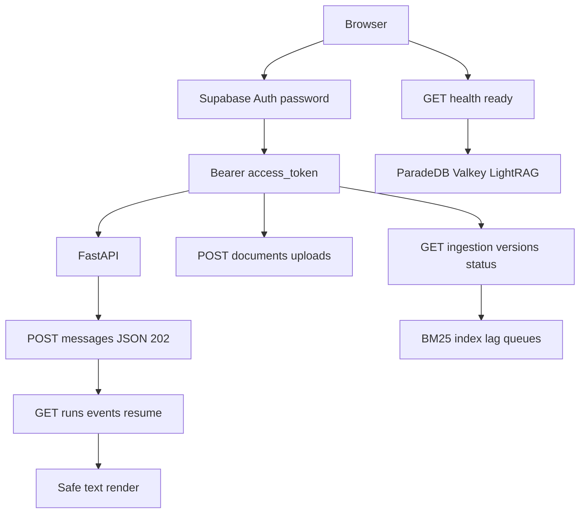

# Thin developer UI (Phase 6 packet 8)

Authenticated Next.js console for local RAG testing. Phase 8 packet 1 hosts
this surface inside the production `AppShell`; it is still not a Stitch
frame route. Tokens and primitives:
[DESIGN_SYSTEM.md](./DESIGN_SYSTEM.md).

Related: [API_UI_MAPPING.md](./API_UI_MAPPING.md) ·
[DESIGN_SYSTEM.md](./DESIGN_SYSTEM.md) ·
[STITCH_BRIEF.md](./STITCH_BRIEF.md) ·
[SSE.md](../api/SSE.md) ·
[FASTAPI_SECURITY.md](../api/FASTAPI_SECURITY.md) ·
[MEMORY_DELETION.md](../agent/MEMORY_DELETION.md) ·
[CONFIGURATION.md](../development/CONFIGURATION.md) ·
[docs index](../README.md)

## Scope

Sign-in, conversation list/create/delete, Auto Composite chat with fetch SSE,
reconnect/cancel, diagnostics from the accepted event catalog, citations,
unmerged feedback tags, upload reservation, version status including BM25
index/lag, live `GET /health/ready` (ParadeDB/Valkey/LightRAG), MFA-required
upload, and usage totals.



## Contracts the UI does not invent

| Action | API |
| --- | --- |
| Handshake | `GET /api/meta`; paid POST sends `X-Client-Version` |
| Identity | `GET /me` (server role) |
| Chat admit | `POST /conversations/{id}/messages` with `Accept: application/json` and `Idempotency-Key` |
| Resume | `GET /runs/{id}/events?after=` without version header |
| Cancel | `POST /runs/{id}/cancel` |
| Delete | `DELETE /conversations/{id}` → 204 |
| Feedback | `POST /runs/{id}/feedback` with exact packet-7 tags |
| Citations | `GET /runs/{id}/citations` (no snippets) |
| Upload reserve | `POST /documents/uploads`; local `signed_url` is null |
| Version status | `GET /ingestion/versions/{id}/status` for Hybrid/BM25/graph-handoff |
| Readiness | `GET /health/ready`; ParadeDB `down` is visible and is not BM25 success |
| MFA | `403 MFA required` for owner/admin/`upload_enabled` until TOTP aal2 |

Paid chat uses JSON 202 so `run_id` is in the body, then the same GET EventSource
path as reconnect. That is one paid reservation. Unknown SSE event types are
logged in diagnostics and ignored. Token and entity text render through React
text nodes plus `displayText`; `href` values must pass `isSafeHttpUrl`.
`dangerouslySetInnerHTML` is forbidden.

## Diagnostics honesty

SSE payloads are extra=forbid and do **not** include BM25 index/lag bytes.
Chat diagnostics show route correction, limitation codes, cache status,
coverage score, optional tool keys, citation ids, usage tokens, and heartbeat
count.

BM25 projection/index/lag/pending/failed/dead-letter come from
`GET /ingestion/versions/{version_id}/status`. Graph ready is never inferred
from an upload reservation. Graph-not-ready copy is
“N relevant recent documents are not yet represented in the graph” and never
includes restricted or ineligible counts.

`GET /health/ready` is public. The console polls it so a stopped ParadeDB,
Valkey limits, or unattached LightRAG process is visible in the browser. Signed
`bm25_unavailable` and `graph_outage` copy is always on the console; live SSE
still owns per-run codes. Host uvicorn without `PARADEDB_URL` /
`VALKEY_LIMITS_URL` reports `unconfigured`, which is not a fake-healthy probe.

Owner/admin and `upload_enabled` callers need MFA. A password JWT is `aal1`;
the UI shows **MFA required** instead of a successful upload. After TOTP
verify (`aal2`) plus `mfa_enrolled` and `upload_enabled`, local reserve still
returns `signed_url=null`.

## Environment

| Variable | Purpose |
| --- | --- |
| `NEXT_PUBLIC_API_BASE_URL` | FastAPI origin; default `http://127.0.0.1:8000` |
| `NEXT_PUBLIC_SUPABASE_URL` | Browser Auth project URL. Packet 8 Playwright forces `http://127.0.0.1:54321` |
| `NEXT_PUBLIC_SUPABASE_ANON_KEY` | Browser anon key only |

Privileged service-role keys, database URLs, and OpenAI keys must never appear
in `NEXT_PUBLIC_*`. Playwright uses port `3010` so it does not reuse a Compose
frontend on `:3000`. FastAPI CORS allow-lists that origin.

## Verification

```text
pnpm --filter smart-rag-frontend test
pnpm --filter smart-rag-frontend lint
pnpm --filter smart-rag-frontend exec tsc --noEmit
pnpm --filter smart-rag-frontend build
pnpm --filter smart-rag-frontend exec playwright install chromium
pnpm --filter smart-rag-frontend exec playwright test tests/e2e/login.spec.ts
```

Playwright `tests/e2e/login.spec.ts` checks the sign-in heading, signed outage
copy, and (when FastAPI is up) that the readiness panel matches
`GET /health/ready`. The frontend quality tier installs Chromium and runs
those tests; it no longer stops at `playwright --version`. Live JWT chat,
aal2 upload `signed_url=null`, lingering-ID search after DELETE, five Composite
EventSource connections, and compose outage-on-ready are
`tests/contract/test_thin_developer_ui_live.py` against local FastAPI + Auth.
Five-run heartbeat/lag remains
`tests/contract/test_sse_heartbeat.py` because live mock Composite often
finishes before the 15s heartbeat interval.

QT-EVAL-009 live Combined +10pp, live OpenAI, hosted Auth throttling, and
Phase 10 CDN/CloudFront remain unverified. Do not treat this UI as those
proofs.
