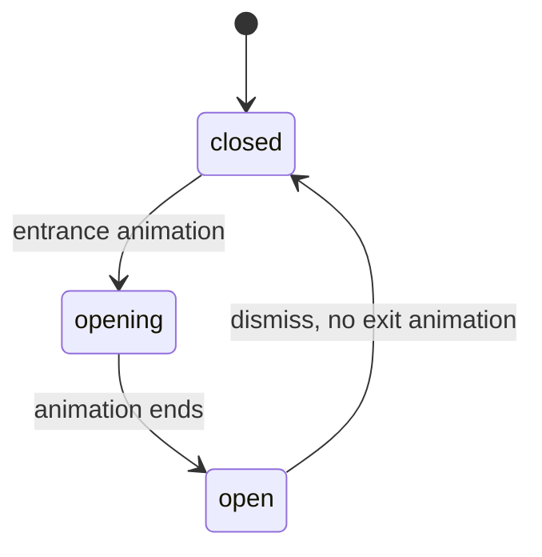

# Motion

CSS-only motion for the quiet work-tool console. Durations come from the
transitions.dev scale. No animation library code is copied. The visual
decision is [ADR-quiet-tool-visual-refresh.md](../adr/ADR-quiet-tool-visual-refresh.md).

## Purpose

Motion shows that a control, overlay, or new answer arrived. It does not
decorate resting chrome. Historical Ask messages do not replay an entrance.

## Tokens

| Token | Value | Use |
| --- | --- | --- |
| `--duration-stagger` | 40ms | Per-item delay, capped at the 8th item |
| `--duration-micro` | 80ms | Short delay before a follow-on fade |
| `--duration-quick` | 150ms | Press scale and small rises |
| `--duration-fast` | 250ms | Page, list, and panel fades |
| `--duration-slow` | 400ms | Auth and sheets |
| `--duration-very-slow` | 500ms | Progress bars |
| `--motion-fast` | 150ms smooth-out | Color and border transitions |
| `--motion-drawer` / `--motion-panel` | 250ms smooth-out | Overlay travel |
| `--ease-smooth-out` | cubic-bezier(0.22, 1, 0.36, 1) | Entrances that settle |
| `--ease-in-out` | ease-in-out | Fades |
| `--ease-bounce` | cubic-bezier(0.34, 1.36, 0.64, 1) | Citation markers only |
| `--distance-micro` / `--distance-small` / `--distance-base` | 4px / 6px / 8px | Rise distance |
| `--scale-large` / `--scale-medium` | 0.96 / 0.97 | Pop and press |

## Keyframes

- `enter-fade` — opacity only.
- `enter-rise` — fade plus an 8px rise.
- `enter-rise-small` — fade plus a 4px rise.
- `enter-pop` — fade plus a scale from 0.96.
- `enter-drop` — menus drop a few pixels.
- `enter-from-end` / `enter-from-start` — sheets slide 24px.
- `grow-x` / `grow-y` — a bar draws along one axis.
- `pulse-soft` — the current progress dot fades between 1 and 0.35.
- `shake-x` — a failed sign-in banner moves once.

## Rules

CSS only. Durations stay between 40ms and 500ms. Fill mode is `backwards`.
No blur, no `transition: all`, and no `will-change`. Stagger uses
`:nth-child` and stops growing after the 8th item. Ask entrances apply only
under `.liveTurn`.

## Placement

- Shell: the desktop rail width glides. Route content fades in.
- Auth: the header fades, the form rises in steps, and an error shakes once.
- Ask: the live user bubble, paragraphs, citation markers, and status line
  animate. History does not. The sessions rail and progress steps rise in.
- Documents, tables, graph, admin, and evaluation: panels fade. Graph nodes
  pop. Underline tabs grow from the center. Unused admin meters do not move.

## Reduced motion

`prefers-reduced-motion: reduce` sets animation and transition duration and
delay to 0s. Staggered items do not stay invisible.

## Verification

`src/lib/prohibited-patterns.test.ts` rejects gradients, the sparkle icon,
developer copy, `transition: all`, `will-change`, and fill modes `both` and
`forwards`. A second test rejects raw millisecond durations outside
`globals.css`. A temporary Playwright spec, not committed, reads computed
`animationName` and `animationDuration` on the live turn and on each surface,
and checks that reduced motion reports a duration under 1ms.

## Credits

Duration and easing names follow the public transitions.dev token scale.
No source from that site is copied into this repository.
