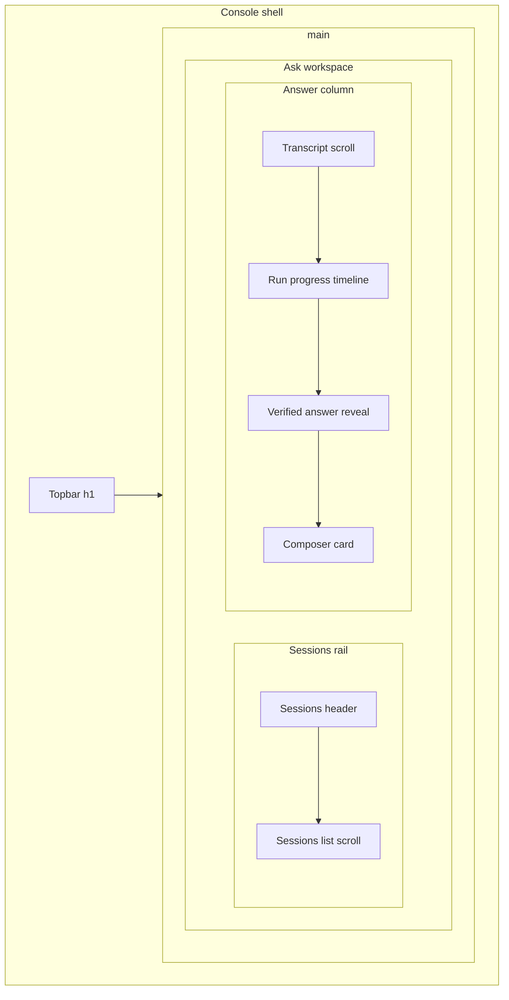
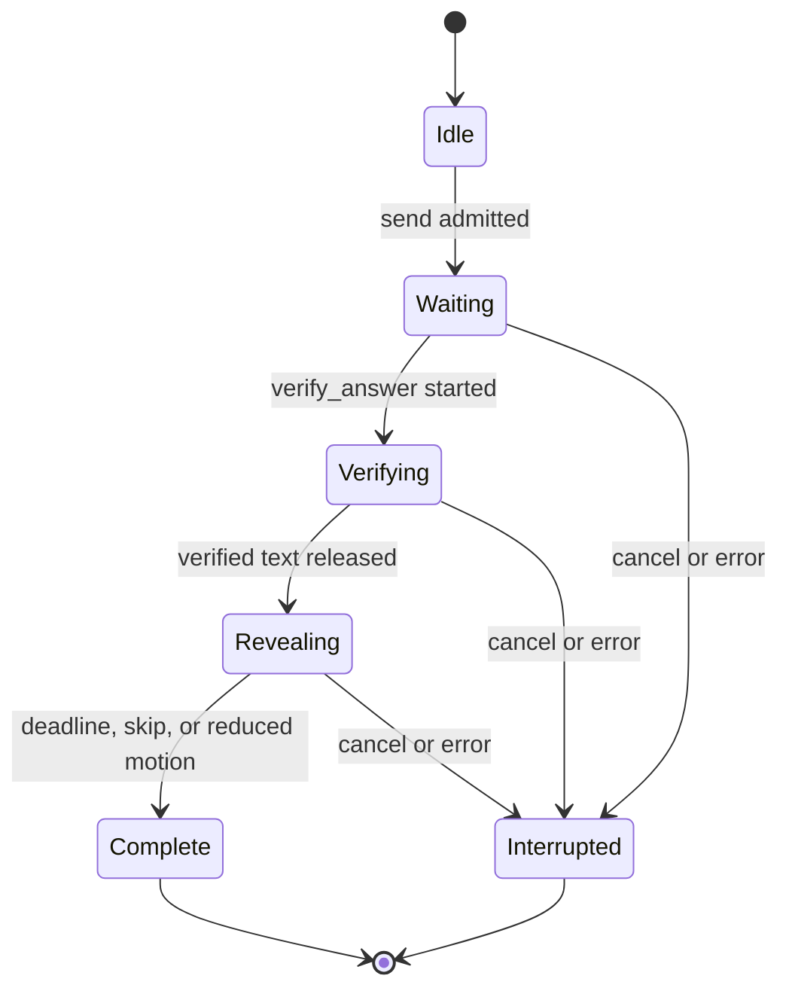
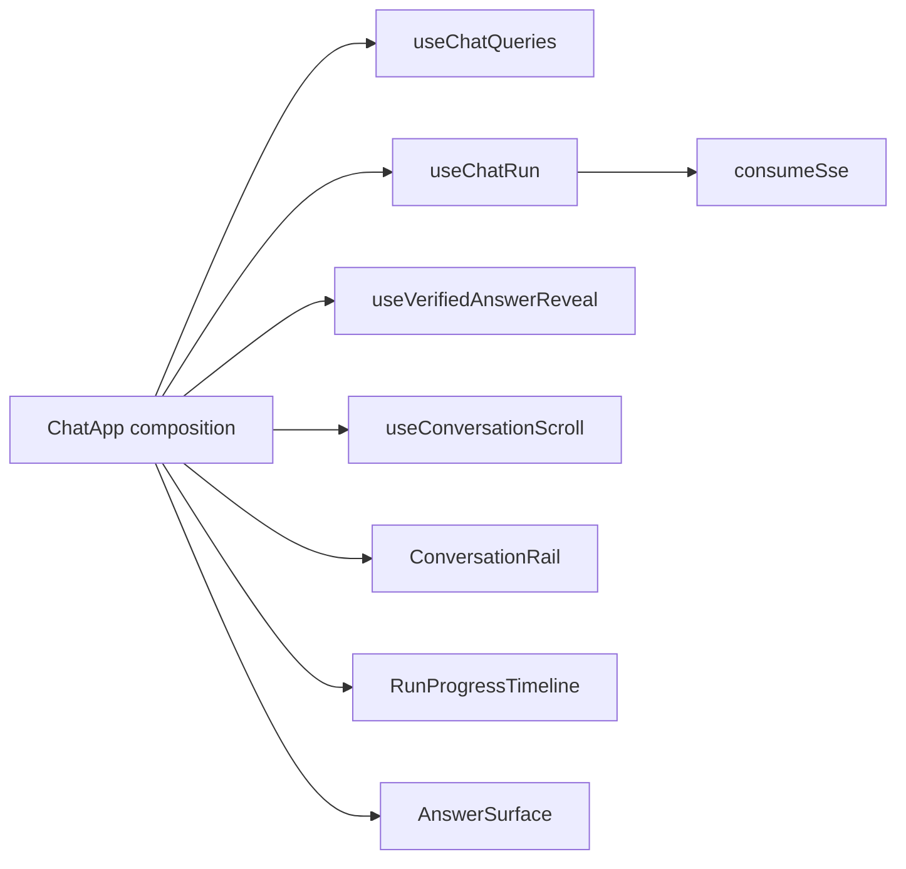
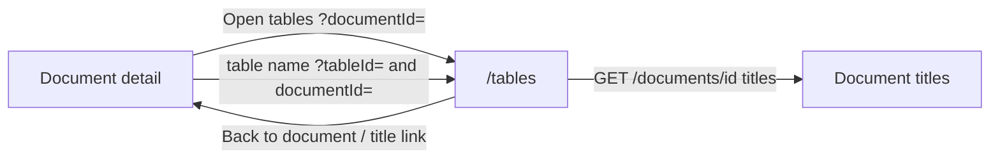

# Workspace screens

Live composition follows the Ink & Indigo refresh in
[ADR-ink-indigo-visual-refresh.md](../adr/ADR-ink-indigo-visual-refresh.md),
[`globals.css`](../../apps/frontend/src/app/globals.css), and
[`design-tokens.ts`](../../apps/frontend/src/lib/design-tokens.ts). The
Phase 8 visual-contract packet remains the interaction source; hex values,
rail treatment, and Ask transcript behavior below supersede that packet
where they disagree.

## Screen specifications

### Application shell component specification

#### `AppShell`

- Desktop grid columns are `232px minmax(0, 1fr)`; collapsed mode is `72px minmax(0, 1fr)`. Width does not animate. The shell height is `100vh` then `100dvh` so Edge on Windows still fills the viewport.
- At `>=1024px` a 32px ghost “Collapse navigation” / “Expand navigation” icon control sits at the **rail bottom**. The choice is stored in `localStorage`. Breakpoints remain the default before the first toggle. A later `1280px` rule must not force the expanded width; collapsed classes win at every desktop width.
- Nav rail uses `--color-ink` with `--color-ink-border` on the trailing edge. Topbar stays white with a bottom border.
- Main area uses canvas background and owns vertical scrolling.
- Skip link is visually hidden until focused, then appears at top-left as a Primary-style link.
- No footer is needed.

#### Brand block

- Height 56px, 16px horizontal padding.
- 32px logo tile with `--gradient-brand` and a white spark icon.
- “Smart RAG” Inter Display 15px, `--color-ink-text`. No subtitle.
- Collapsed nav shows mark only with tooltip.

#### `AppNav`

- Exact primary order: Ask, Documents, Tables, Graph.
- Admin is separated by a 16px gap and shown only for owner/admin.
- Row is 40px high, 8px horizontal margin, 8px radius, 12px horizontal inner padding.
- Icon 18px, label 14px weight 500, gap 10px.
- Active: `--color-ink-raised` background, white text, and a 3px accent bar on the left edge (full row height).
- Hover: `--color-ink-text` on `--color-ink-raised`. No hover movement.
- Collapsed: centered icons, labels visually hidden, tooltips enabled.
- Mobile sheet uses full labels and no collapsed mode.

#### `ConsoleTopbar`

- Sticky 56px white bar with bottom border. It is the only page-title owner (`h1`, page-title scale). Pages do not repeat the same title as an `h2`.
- Left: mobile menu button when needed, then one page title.
- Right order: readiness control, command control, Account control.
- Do not repeat logo in the topbar when desktop nav is visible.
- At 390px, hide command control first; keep readiness and Account.

#### `ReadinessIndicator`

- It is a button because it opens a real popover.
- Labels: “Checking,” “Ready,” “Degraded,” or “Unavailable.”
- Use corresponding neutral/success/warning/danger pill styling.
- Popover width 320px. Show “Question answering,” “Keyword search,” and “Graph search” only when real readiness fields authorize those labels.
- Primary blocking copy: “Question answering is temporarily unavailable. Try again when the service is ready.”
- Never expose DSNs, provider names not authorized for the caller, stack traces, or probe credentials.

#### `AccountMenu`

- Trigger is a 36px IconButton containing a generated two-letter initial avatar; no remote avatar. While `/me` is loading, show a neutral `··` placeholder (`data-testid="account-avatar-placeholder"`).
- Menu shows email, role badge, upload capability text, Account details, and Sign out.
- No MFA field, profile editor, locale editor, or company settings.
- Sign out is separated as a quiet-danger menu item.

#### `CommandMenu`

- Dialog width 560px.
- Search input at top; results show supported routes only.
- Each result has icon, label, and optional short description.
- Keyboard: Ctrl/Cmd+K opens, arrows move, Enter navigates, Escape closes.
- Do not include actions that submit mutations.

#### `PageHeader`

- Does not render a page title. The topbar owns the `h1`.
- Optional description (13px secondary) and one primary action.
- Mobile: stacked, action full width only when it is the page’s main task.
- Bottom margin 24px.

### Ask workspace component specification

#### Overall layout

- Use available height below topbar. The console shell is viewport-bounded (`100dvh`); non-Ask console pages still scroll inside `main`.
- Ask fills the remaining height below banners. There is no duplicate Ask `h2`. The Sessions list and the conversation body each own `overflow-y: auto`. The Sessions header and the composer stay outside those scrollports.
- At `>=1280px`: 280px Sessions rail and `minmax(0, 1fr)` main workspace. A 28px icon-only “Collapse sessions” control narrows the rail to a 52px strip. The rail width follows that column so “Expand sessions” stays visible inside the strip, not under the answer pane. “Expand sessions” restores the same mounted list. The choice is stored in `localStorage`.
- At `<1280px`: the Sessions rail stacks above the answer column (`max-height: 28vh`) instead of `display: none`. Collapse is ignored so the list stays clickable. The mobile Sessions sheet remains available from the compact bar. Composer card is full-width with 12px margins; hint text is hidden; transcript uses 16px padding. The answer stage is `flex: 1` so the composer stays at the bottom of the remaining height.
- Transcript column is centered at `max-width: 760px`. Opening a session loads `GET /conversations/{id}/messages` (newest 50, rendered oldest-first). “Load earlier messages” prepends the previous page when `next_before_id` is set.
- The Message field opts out of the 520px form-field cap. New sessions store a first-question fallback on `POST /conversations`. After the first completed or partial turn, and when the creator re-opens a fallback-titled thread, `POST /conversations/{id}/title` replaces that fallback with an LLM summary. Null titles render exactly “Untitled chat”. See [ADR-llm-conversation-titles.md](../adr/ADR-llm-conversation-titles.md).
- Answer source labels are exactly Auto, Company documents, General, Web in that order. New chats default Auto. Web is always listed. Selecting Web still requires `/api/meta` `web_search_enabled`; the API refuses Web admits when the flag is false with 503 `web_search_disabled` (banner: Web search is not enabled). That is not Valkey limiter fail-closed. Hidden chrome is not authorization.
- There is no permanent right sources/diagnostics column and no permanent 4-step stepper.

#### `SessionRail`

- White bordered panel, 14px radius, 280px wide.
- Header: “Sessions” label (13px/600) left; one 32px compact primary icon-button “New chat” (plus icon) right.
- Search is omitted because the API does not provide global search and local first-page search is misleading.
- Session row: single-line title (ellipsis, 20px line-height) and relative time on a second line (16px). Minimum row height is 56px. Age groups (Today, Yesterday, Previous 7 days, Older) are separate sticky headers, not inside the option. The Sessions list is a block scrollport; rows use `flex-shrink: 0` so Edge cannot collapse `min-height: 0` flex items on top of each other.
- Clicking a row loads that conversation’s transcript. Active row uses `--color-surface-selected` plus `--color-accent-border`.
- Delete appears on hover/focus as an icon button; the overflow menu is retained for keyboard users and shows pending “Deleting…”.
- Footer may contain Load more when cursor data supports it.
- Empty copy: “No sessions yet. Start a question to create one.”

#### Chat empty state

- Use `EmptyState` with the brand gradient tile.
- Title: “Ask a general question, or ask about your company documents for a cited answer.”
- Body: “General questions use the assistant. Company-document questions return citations you can inspect.”
- Three prompt-fill chips maximum (live corpus examples):
  - “What is LCEL according to the uploaded PDF?”
  - “How does Single Tool Execution differ from Parallel Tool Execution?”
  - “What is the relationship between Katniss Everdeen and Peeta Mellark?”
- Chips populate composer only; they never submit.

#### User message

- Align right, maximum width 85%.
- `--color-accent-muted` background, 14px radius, 10px by 14px padding.
- Text 14px/22px, `dir="auto"`.
- No avatar, edit, copy, or retry button unless backed by a contract.

#### Assistant answer

- Full-width block, no bubble. Body scale, 72ch measure.
- Citation chips, then a 12px muted meta row (relative time, route badge when known, and this run’s prompt/completion tokens from SSE `usage` when either count is greater than zero).
- Live runs append to the same list: the in-flight question is a user bubble; the stream is the last assistant block. After `GET /conversations/{id}/messages` returns that turn, omit the live copy when decoded persisted `content` already matches (API text is HTML-escaped; SSE `answerText` is not).
- Do not show a streaming caret or a pre-verification typewriter. After verification, reveal already-authoritative verified text under ADR-verified-answer-paced-reveal (skip, reduced motion, and historical messages show the full text immediately).
- Partial/cancelled/error retains existing text and adds a StatusBanner below.
- Footer order: citations, feedback, then collapsed “Run details”.

#### Status line

- While a run is active, render the server-originated node/tool timeline (started/completed/failed only). Known labels include Preparing, Retrieving, Searching, Reading, Generating, and Verifying when those stages actually arrive. After verification the status may read “Verified — displaying answer” during paced reveal. Skipped nodes never appear.
- Not rendered when idle. The permanent 4-item stepper is removed.
- Unknown stage stays in Run details, not as a new primary phase.
- Server progress may complete faster than a paint; history still retains started/completed rows.
- Presentation reveal is capped at 2.5s and 90 publications. `Show full answer`, pointer-down, and copy skip the remainder. `prefers-reduced-motion: reduce` shows the full verified text immediately. Historical messages never re-reveal.

#### `ChatComposer`

- Elevated card: white, 16px radius, border, `--shadow-composer`, 12px padding.
- Auto-growing textarea (1–8 rows), borderless inside the card, placeholder exactly “Ask anything about your documents…”.
- Footer: left hint exactly “Enter to send · Shift+Enter for a new line” (hidden below 480px); right 36px circular primary icon-button (arrow-up, `aria-label="Send"`). While pending, keep the same 36px circle, a spinner, and an accessible `Sending…` name. Do not squeeze visible “Sending…” text into the circle. No control gradient.
- Character counter appears only when remaining is under 1000, as “N characters left”. No attachments sentence.
- Running state replaces Send with Secondary/quiet-danger “Stop”.
- `Enter` submits, `Shift+Enter` inserts newline; IME composition never submits.
- Disabled reason appears immediately above composer in a StatusBanner, not only tooltip.
- Draft lives in the composer. The field clears as soon as Send is accepted so the question is not shown twice (bubble plus input) while create/admit or the stream is in flight. The draft is restored if conversation create or admission fails. `onSubmit` returns at stream handoff and must not wait for the verified answer.

#### `ReconnectState`

- Rendered only when `runId` is set, terminal is null, and the stream is disconnected.
- Warning banner above the composer with a “Reconnect” button. Never a permanent sibling of Send.
- Keep partial answer visible.

#### `CitationChip`

- 28px high evidence-muted pill, evidence text, evidence border, 12px/16px weight 600.
- Label format: `[1] Source` when a safe source label exists; otherwise `[1] Evidence`.
- Opens real Sources drawer for company citations. Web chips with a safe http(s) URL are anchors (`rel="noreferrer"`). Company Storage URLs stay non-href.

#### `SourcesDrawer`

- Width 560px desktop, full width mobile.
- Header “Sources.”
- Group citations by safe source identity only when actual provenance supports it.
- Citation card shows index, document/chunk identifiers, printed page label and file PDF page when they differ, sheet/range/URL locator fields actually present, and “Source unavailable” status when true.
- No fake excerpt, preview, download, relevance score, or open-source button.

#### `RunDetailsDrawer`

- Width 440px. Closed by default behind a ghost “Run details” control.
- Render only rows whose value is real. Skip “—”, empty, and `none` rows.
- Card layout: status, search mode, token metrics, account spend, and run id. Human labels: Status (`Completed` / `In progress` / `Partial` / `Cancelled` / `Error` / `Deadline reached`), Search mode (`Hybrid` / `Combined` / `Composite` / `Tables` / `Graph inspection` / `Web research` / `No document search`). General and Web answers use requested source / answer origin, not the Auto Composite envelope, so General does not say “Searches documents…”. Known families still get a one-line summary.
- Show “Started as” and “Why it changed” only after a real `route_correction`. Do not duplicate requested and effective when they match.
- Tools, cache, coverage, and ignored stream events appear only when the stream supplied a value.
- Do not show heartbeat counts, raw node names such as `verify_answer`, or placeholder `none` diagnostics.
- Terminal text must never say “running” when `runId` is null.
- Per-run tokens use `formatRunTokenUsage` (`412 prompt · 88 completion`) from SSE `usage` as “This run”, plus a total of prompt + completion. The total is the provider-reported sum for this question (profile, search, answer, verifier). “This chat” is that run plus earlier questions in the live conversation and `POST /conversations/{id}/title` tokens. Switching conversations resets the chat total. Account USD uses `formatUsd` on `GET /usage/me` as “Your account.”
- “Your account” labels `/usage/me`; never “Company total.”
- IDs use monospace and Copy buttons with real clipboard feedback.
- No raw traces, prompts, provider secrets, source text, nDCG, or invented latency.
- When no run exists: “Send a question to see how that answer was produced, including search mode and token usage.”

#### `FeedbackPopover`

- Opens from “Give feedback” Secondary button after terminal.
- First choose thumbs up/down, then required server tag Select for that polarity, optional comment Textarea, Submit.
- Width 360px; actions right aligned.
- Success copy: “Feedback recorded.”
- Failure copy: “Feedback could not be recorded. Try again.”
- Popover remains open on failure.

#### `SaveToQuizSheet`

- Separate owner/admin control beside Give feedback. Never replaces thumbs.
- Visible only when `GET /me` is owner/admin and `/api/meta` `pdf_eval_workspace` is true. Hidden chrome is not authorization; members still 403 on `POST /admin/pdf-eval/cases`.
- Opens a right-side sheet titled **Save to quiz** (34rem desktop, full width at 767px and below). Local tabs are **New case** and **Saved cases**. Opening always lands on New case. Form values persist in `useQuizCapture` across close/reopen.
- New case shows a read-only question card, question type, optional expected answer, 0–3 suggested sources, retention copy, and **Save quiz case**. Save statuses stay in the sheet. **View saved cases** appears after a successful save.
- Paginated saved-case selector lists summaries only (friendly query class, review status, source count). Detail, including the question, loads after selection. List, detail, and load-more have local loading, empty, error, and Retry states.
- Create posts the completed run ID, query class, optional expected answer, 0–3 citation chunk IDs, and an idempotency key. Browser question text is omitted. Split is always `development`. Never approves.
- Retention copy: “Deleting this chat does not delete the saved quiz case.”
- **Ask this question** fills the composer with the saved question only, then closes the sheet.
- **Score this answer (not Recall@10)** is enabled only for a pre-existing approved case whose normalized question matches. Newly saved drafts cannot score the run that created them. Compare sends `{ run_id }` only. Score success and failure stay on the selected-case card.

### Documents page component specification

#### Page layout

- Topbar title “Documents”. No trailing period and no duplicate page `h2`.
- Description: “Upload files or add approved websites, then track search and graph readiness.”
- Filter input uses a search icon, label “Filter by name”, and placeholder “Filter by name…”. Caption under the filter: “Filters apply to loaded documents only.”
- Primary action: “Import source.”
- Viewers do not see import controls or role-lecture copy.
- Main content is one white bordered DataTable, not multiple dashboard cards.

#### Document table

- Desktop columns: Name, Visibility, Search status, Graph status, Created, Actions.
- Name is the detail Link with document icon; optional ID appears below in monospace only when title is missing.
- Status values come from real `GET /ingestion/versions/{id}/status` for loaded rows. Search/graph pills appear automatically; they do not wait on a menu click.
- Row overflow menu includes “View details,” “View processing” when a version exists, and owner/admin “Delete.”
- Clicking blank row space does not navigate; only explicit Name link does.
- Mobile card order: Name, two status pills, visibility/created metadata, then overflow.

#### Documents empty state

- Title: “No documents yet.”
- Body: “Import a file or approved website to create searchable company knowledge.”
- Primary “Import source.”

#### `ImportSourceSheet`

- Right drawer width 560px.
- Header “Import source.”
- Two Tabs: “Files” and “Website.” Both map to real APIs.
- File tab: drop zone, selected queue, category Select, attestation Checkbox, Upload button.
- Website tab: URL Input, approved domain Input, optional title, bounded depth/pages controls only if current API exposes them, attestation, “Add website.”
- Keep one stable idempotency key while the same form submission retries.
- On success, close only after showing created document/job IDs or navigate to detail.

#### Upload queue row

- Filename, bytes, stage StatusPill, and Remove before reservation.
- Real stages: “Ready,” “Reserving,” “Uploading,” “Finalizing,” “Queued,” “Failed.”
- Upload byte progress may use a progress bar only if browser/API provides real uploaded bytes.
- Parsing, embedding, BM25, and graph stages use statuses, never fake percent.

#### `IngestionStatus`

- One component used in list/detail.
- Vertical timeline on detail; compact pills on list.
- Ordered labels from real lifecycle: Uploaded, Scanning, Parsing, Search ready, Graph pending/ready/ineligible, Failed, Deletion pending.
- Expandable technical details show scan, OCR, chunks, BM25, and graph handoff only when those fields have real values. Idle `none`/zero queues stay hidden.
- Retry is a real Secondary button visible only when `retry_allowed`.
- The Graph pending limitation callout appears only while status is `graph_pending`. Graph ineligible is a terminal pill, not a pending warning.

#### Document detail

- Header: back Link, document title, visibility/status pills, overflow menu.
- Main desktop grid: `minmax(0, 2fr) minmax(280px, 1fr)`.
- Left: processing timeline and extracted table names when `GET /tables` returns rows for this document. Empty copy: “This document has no extracted tables.” Table names open `/tables?tableId=&documentId=`.
- Right: metadata definition list and actions to “Inspect in graph” and “Open tables.” “Open tables” keeps `?documentId=`.
- Delete is in overflow/danger zone, not a large primary button.
- No source preview, download, audit, PII, or raw storage section.

#### Delete confirmation

- Title: “Delete document?”
- Body: `“<safe title>” will be removed from retrieval and scheduled for cleanup. This cannot be undone.`
- Buttons: “Cancel” and Danger “Delete document.”
- Success navigates to Documents and announces “Document deleted.”

### Tables page component specification

#### Layout

- Topbar title “Tables”. No trailing period.
- Description: “Run bounded calculations on structured data with exact cell provenance.”
- When no manifests exist, show `EmptyState` title “Extracted spreadsheet tables from ingested documents appear here.” Analyze stays visible and disabled. Do not also show “Pick a table to analyze.”
- When `?documentId=` is set and that document has no extracted tables, show the same spreadsheet empty copy. Analyze stays visible and disabled. Do not invent rows or also show “Pick a table to analyze.”
- Until a table is selected and manifests exist, show the picker plus `EmptyState` title “Pick a table to analyze” and body “Deterministic calculations with exact cell provenance.” Analyze stays visible and disabled.
- Plan-builder sections render only after a table is selected. “Add X” controls are compact secondary buttons.
- At `>=1024px`: 320px manifest sidebar and main results area; below that manifest picker is a Select.

#### Manifest sidebar

- White bordered panel, 12px radius.
- Header “Available tables”, or “Tables in this document” when `?documentId=` is set.
- Rows show safe table/sheet identity and the document title as a link to `/documents/{id}` (id fallback when `GET /documents/{id}` has no title). The title link is omitted while the list is already scoped to one document.
- `?documentId=` filters `GET /tables` rows to that document, shows Back to document plus All tables, and does not list other documents’ tables.
- Active row uses selected treatment.
- Empty: “Extracted spreadsheet tables from ingested documents appear here.” Seeded document with zero rows uses the same copy.

#### Plan builder

- White Card, title “Analysis plan”
- Field order: Table, Columns, Filters, Aggregation, Group by, Sort, Comparison.
- Selected table shows “From {document title}” as a link to `/documents/{id}`.
- Optional sections start collapsed and open via real “Add filter,” “Add aggregation,” etc.
- Repeating row has inputs plus labeled Remove IconButton.
- One Primary “Analyze” button at bottom right.
- No raw SQL editor, natural-language fake planner, Export, Save, or Share button.

#### Results

- Header row: “Results,” row count, and Secondary “View provenance” when ranges exist.
- DataTable numeric cells right aligned and use tabular numerals.
- Generated narrative is shown only if returned by an existing typed contract and clearly separated; otherwise omit.
- Empty successful result: “The analysis returned no rows.”

#### Provenance drawer

- Header “Cell provenance.”
- List Document, Version, Table, Sheet, and Ranges from the response. Document is the fetched title (id fallback) linking to `/documents/{id}`. Omit Sheet when it is empty. Monospace for version/table ids and cell ranges.
- No fake source link.
- The compiled plan is not shown as raw JSON.

### Graph page component specification

#### Layout

- Topbar title “Graph”. No trailing period.
- Cap sentence “Inspect is capped at 12 entities, depth 3, and 200 nodes.” renders once, as a 12px muted line under the pane header.
- At `>=1280px`: 300px search panel, flexible result panel, 320px inspector.
- At 1024–1279px: search plus result; inspector is right Drawer.
- Below 1024px: stacked search, list/canvas result, inspector Drawer.

#### Entity search panel

- SearchInput label “Search entities.”
- Submit/search executes only for trimmed queries meeting current API minimum.
- Results are 48px rows with object type StatusPill, safe ID/name, support metadata.
- Clicking a result selects it and adds a selected entity chip.
- Maximum 12 selected. At limit, show helper “You can inspect up to 12 entities.”
- Selected chips have real Remove controls.
- Depth Select has exact options 1, 2, 3.
- Primary action “Inspect graph.”

#### Result toolbar

- Left: result count and limitation pill.
- Right: Tabs “List” and “Canvas,” then Fit control only in Canvas.
- No Edit, Add relationship, Expand unlimited, Depth 5, Export, or Save buttons.

#### Graph list

- Default accessible representation.
- Each row: object type, object ID, hop, support, and Select.
- Selection opens inspector.
- Empty: “No authorized graph evidence matched this inspection.”

#### React Flow canvas

- White surface with subtle 16px grid dots using border color.
- Nodes: 168px wide, white, 8px radius, 1px border; selected node accent border and accent-muted background.
- Node first line object type caption, second safe object ID, footer hop/support.
- Edges: 1.5px border-strong; selected path evidence color.
- Controls bottom-right: zoom in, zoom out, fit, each labeled IconButton.
- Mini-map is omitted unless it remains legible and accessible at the bounded 200-node limit.
- Node click selects; canvas itself is not an editor.

#### Graph inspector

- Title “Evidence details”
- Empty evidence pane uses `EmptyState` title “Select a node” and body “Evidence for the selected entity appears here.”
- Definition list: Type, Object ID, Document ID, Version ID, Chunk ID, Hop, Support.
- Locator cards show page, section path, sheet/range, or safe URL fields that actually exist.
- Limitation banners appear below details.
- No vendor prose or relationship editing.
