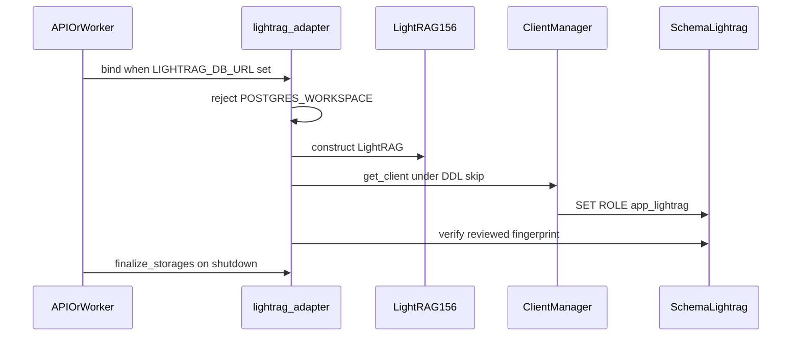
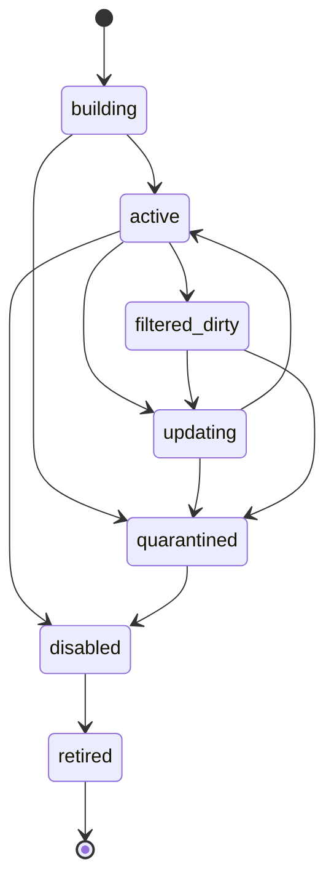

# LightRAG adapter lifecycle

Runtime attach without DDL, pool caps, search_path, finalize, and the
protected bootstrap boundary. This is not Graph Ready.

Related: [LIGHTRAG_CONTRACT.md](./LIGHTRAG_CONTRACT.md) ·
[WORKSPACE_LIFECYCLE.md](./WORKSPACE_LIFECYCLE.md) ·
[ADR-lightrag-runtime-attach-without-ddl.md](../adr/ADR-lightrag-runtime-attach-without-ddl.md) ·
[lightrag-schema-bootstrap.md](../runbooks/lightrag-schema-bootstrap.md) ·
[CONFIGURATION.md](../development/CONFIGURATION.md) ·
[phase-05 evidence](../development/phase-05-graphrag-evidence.md) ·
[05-database-connections.md](../architecture/05-database-connections.md)

## Boundaries

| Path | Credential | Vendor initialize | DDL |
| --- | --- | --- | --- |
| `scripts/ops/bootstrap_lightrag_schema.py` | `LIGHTRAG_SCHEMA_ADMIN_DSN` | yes, captured | schema-admin only |
| FastAPI lifespan / worker `stop()` | optional `LIGHTRAG_DB_URL` | attach patches skip CREATE | none |
| Unset `LIGHTRAG_DB_URL` | none | adapter unconfigured | none |

`apps/*` must not import `lightrag`. `graph.py` stays vendor-free.
`POSTGRES_WORKSPACE` is never set. Constructor workspace defaults to
`company_default`.

## Runtime attach

Runtime patches:

- `configure_vector_extension` verifies the existing `vector` type; never
  `CREATE EXTENSION`
- `check_tables` / `setup_table` require reviewed tables; never CREATE/ALTER
- `PGTableGraphStorage.initialize` skips `_DDL`
- Pool `init`/`reset` run `SET ROLE app_lightrag` after vendor `RESET ALL`

Pool cap is 4 per API process and 4 per worker process. Qualification tests
may keep `POSTGRES_MAX_CONNECTIONS=2`. `POSTGRES_CONNECTION_RETRIES=0`.

## Workspace rows

Packet 2 created application-owned rows. Packet 3 owns the writer: occupy,
heartbeat, and release on `app.graph_writer_lease`, session advisory lock,
and state transitions. See [WORKSPACE_LIFECYCLE.md](./WORKSPACE_LIFECYCLE.md).
Successful index stays `updating` until Packet 4. This is not Graph Ready.

Embedding pin on `app.graph_workspaces` is `text-embedding-3-large` at 1024.
A second model or dimension must run in an isolated process; this process
fails closed.

## Finalize

`LightRagRuntimeAdapter.finalize` calls `finalize_storages` once and resets
ClientManager. The async context manager always finalizes, including when the
body raises. A second factory in the same process must not exceed cap 4.

[docs index](../README.md)
