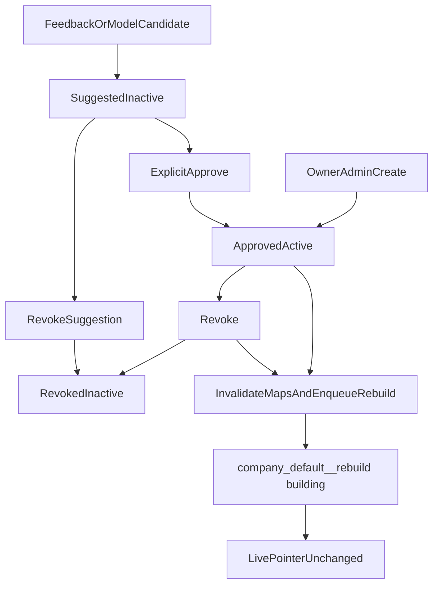

# Graph entity rules

Owner/admin curation of aliases, display labels, types, and do-not-merge
rules. Approved rules change canonical keys and extraction policy on the
next clean rebuild. Suggested feedback/model rows stay inactive until an
explicit approve. Packet 7 performs the atomic workspace pointer switch.

Related: [MAPPING.md](./MAPPING.md) ·
[GRAPH_MAPPING_CONTRACT.md](./GRAPH_MAPPING_CONTRACT.md) ·
[WORKSPACE_LIFECYCLE.md](./WORKSPACE_LIFECYCLE.md) ·
[FROZEN_GRAPH_MANIFEST.md](./FROZEN_GRAPH_MANIFEST.md) ·
[PHASE6_HANDOFF.md](./PHASE6_HANDOFF.md) ·
[GLOSSARY_IMPORT.md](../api/GLOSSARY_IMPORT.md) ·
[ADMINISTRATION.md](../frontend/ADMINISTRATION.md) ·
[phase-05 evidence](../development/phase-05-graphrag-evidence.md) ·
[docs index](../README.md)

## Canonical keys

Application merge identity is `{TYPE}::{normalized_name}` after
`normalize_for_dedup` on the type (uppercased) and name. Homonyms stay
apart: `PROJECT::atlas` is never `PRODUCT::atlas`. Mapping storage still
hashes that typed key with `graph_pipeline_v1`. Ambiguous aliases and
do-not-merge names return no canonical name and stay separate.

Do-not-merge always wins. Missing vendor type does not consume a typed
alias. Suggested and revoked rows are not loaded by `load_entity_rules`.

Native LightRAG names are never copied into Hybrid `search_aliases`. SME
glossary import remains a separate owner/admin path.

## Status and authorization

| Status | `active` | Affects mapping | Notes |
| --- | --- | --- | --- |
| `suggested` | false | no | Feedback/model provenance and confidence. Never auto-approved |
| `approved` | true | yes | Owner/admin create or explicit approve |
| `revoked` | false | no | Soft deactivate. Approved revocations invalidate maps |

Mutations require owner/admin via `CallerContext` plus
`validate_caller_context`. Members and viewers receive `403 forbidden`.
Updates carry optimistic `row_version`; stale writes return `409`.
Append-only `app.audit_events` records upsert/approve/revoke without
corpus text. Entity rules cannot set `graph_eligible` or broaden ACL.



## Invalidation and rebuild scheduling

`graph_pipeline_v1` is not rewritten. Approved create/update/approve/revoke
bumps `app.graph_extraction_policy.entity_rules_generation`, prefixes live
map `config_generation` with `invalidated:`, sets Graph Ready versions back
to `graph_pending`, upserts a bounded `map_repair` row, and enqueues a
`rebuild` job. Isolation uses `company_default__rebuild` in `building`.
The singleton pointer stays on the prior workspace until Packet 7.

Query-time resolver already requires matching `config_generation` and
`graph_ready`. Stale maps fail closed immediately. Generation `1` with an
empty extraction hash keeps Packet 5 mapping digests until the first bump.

Extraction overlay (allowed types/languages, JSON mode, gleaning `0..3`,
relation-label policy) is hashed into the policy row. Rules apply to
canonicalization before the clean parallel rebuild. Vendor graph tables
are not patched in place.

## Routes

| Method | Path | Caller | Effect |
| --- | --- | --- | --- |
| GET | `/admin/graph/entity-rules` | owner, admin | List suggested/approved/revoked |
| POST | `/admin/graph/entity-rules` | owner, admin | Create. Admin default is approved |
| PATCH | `/admin/graph/entity-rules/{id}` | owner, admin | Update with `row_version` |
| POST | `/admin/graph/entity-rules/suggestions` | owner, admin | Inactive candidate |
| POST | `/admin/graph/entity-rules/{id}/approve` | owner, admin | Explicit approval |
| POST | `/admin/graph/entity-rules/{id}/revoke` | owner, admin | Soft revoke |

## Failure modes

| Symptom | Cause | Route |
| --- | --- | --- |
| `forbidden` | Member/viewer or failed caller context | 403 |
| `stale_row_version` | Concurrent update | 409 |
| `auto_approval_forbidden` | Feedback/model inserted as approved | 400 |
| `cross_type_alias` | Typed key for a different type | 400 |
| `alias_conflict` / `alias_cycle` | Same-type merge collision | 400 |
| `unknown_entity_type` | Type not in extraction allow-list | 400 |
| Maps still queryable after approve | Invalidation skipped | fail closed; do not claim Graph Ready |

## Verification

```powershell
uv run python scripts/ci/check_migrations.py
uv run python -m pytest tests/unit/test_entity_rules.py tests/unit/test_entity_rules_openapi.py tests/unit/test_phase3_graph_scope_guard.py tests/unit/test_graph_mapping.py tests/contract/test_entity_rules.py -q
uv run python scripts/check.py --tier docs --mermaid-puppeteer-config scripts/ci/puppeteer-no-sandbox.json
```
