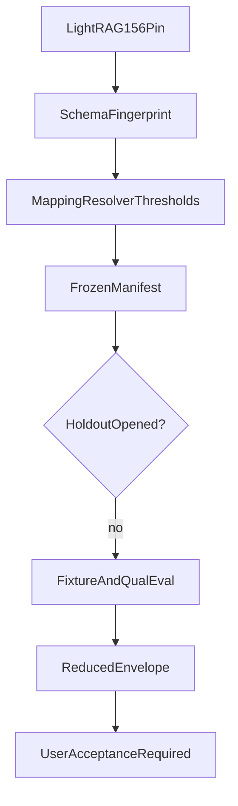

# Frozen graph configuration manifest

Phase 5 Packet 8 freeze of the LightRAG pin, schema fingerprint,
models, chunker, entity-rules generation, mapping/resolver
thresholds, workspace generation, delimiter/limits, and adapter
bounds. Holdout labels were not opened. Combined answer quality
is not claimed.

Related: [PHASE5_GRAPH_EVAL.md](../evaluation/PHASE5_GRAPH_EVAL.md) ·
[PHASE6_HANDOFF.md](./PHASE6_HANDOFF.md) ·
[SCALING_OPTIONS.md](./SCALING_OPTIONS.md) ·
[LIGHTRAG_CONTRACT.md](./LIGHTRAG_CONTRACT.md) ·
[QUALITY_TARGETS.md](../QUALITY_TARGETS.md) ·
[phase-05 evidence](../development/phase-05-graphrag-evidence.md) ·
[docs index](../README.md)

## Decision

- Holdout opened: `false`
- Packet 1-7 pin commit: `c546f9c`
- Client decision: `pending_user_acceptance`
- Entity-rules generation: `1`
- Workspace config generation: `8222c35ccc95225538d081203d3453eab72ce203500d68b4216cf48e7867a850`

Phase 5 proves graph infrastructure, mapping, resolver, and envelope only. Phase 6 owns Combined fusion, verifier/citations, holdout, and the at-least-10-point relationship/multi-hop gain. This packet does not claim Combined answer quality.

## Pins

| Pin | Value |
| --- | --- |
| `adapter_candidates` | `12` |
| `adapter_hops` | `3` |
| `adapter_paths` | `6` |
| `chunk_overlap_token_size` | `100` |
| `chunk_token_size` | `1200` |
| `cleanup_sla_hours` | `24` |
| `code_revision_git_sha` | `52b331f06320a5086e1018c2fa1149abe72a33f8` |
| `coverage_arabic_mixed_min` | `0.85` |
| `coverage_overall_min` | `0.90` |
| `dataset_schema` | `phase4-dataset-v1` |
| `embedding_dimensions` | `1024` |
| `embedding_model` | `text-embedding-3-large` |
| `entity_rules_generation` | `1` |
| `graph_field_sep` | `<SEP>` |
| `graph_pipeline_version` | `graph_pipeline_v1` |
| `graph_storage` | `PGTableGraphStorage` |
| `index_estimate_usd` | `0.5` |
| `inspect_deadline_seconds` | `10.0` |
| `inspect_depth` | `3` |
| `inspect_rows` | `200` |
| `inspect_statement_timeout` | `3s` |
| `label_revision` | `phase4-labels-synthetic-v1` |
| `lightrag` | `1.5.6` |
| `lightrag_commit` | `b33c6b0812cddf39206e48a9810112e51f025274` |
| `max_source_ids_entity` | `200` |
| `max_source_ids_relation` | `200` |
| `packet7_pin_commit` | `c546f9c` |
| `rebuild_sla_days` | `7` |
| `source_envelope` | `graph_source_envelope_v1` |
| `support_min` | `0.80` |
| `tiktoken_model` | `gpt-4o-mini` |
| `workspace` | `company_default` |

## Artifact hashes

| Artifact | SHA-256 |
| --- | --- |
| `extraction_policy` | `b8719e2481b2f8ed85be76d13e19c092428e92ffdf3d36bcd5e5e9656c65bd08` |
| `holdout_manifest_ids_only` | `afcd733c02f65d18d2b745933e0b74ca4aec165c6279d651bb2ba6d491a2b052` |
| `lightrag_wheel` | `81b8aa8b09c11e446f94b53dbbef8d6becd900a7a44685fca95ff59cf5c8e457` |
| `manifest_development` | `077defdca7e31d7932960b0e57f0e6f96e4d6322a6fdb81c771ae55f793fd2c6` |
| `manifest_qualification` | `afe1b83648e51a2cb9ff12ea66c9dd6ab5e31309da6dd8b82608ce8b9e329b09` |
| `schema_fingerprint_v1` | `76f10dcd3b4f64736b5b1d32961f375b4b60f224ea865bd06dfa3e46114977dc` |
| `workspace_config_generation` | `8222c35ccc95225538d081203d3453eab72ce203500d68b4216cf48e7867a850` |

## Dataset hashes (development and qualification only)

Holdout `case_ids` are hashed as a sealed id list. Holdout labels
were not materialized. Qualification class counts are recorded in
[PHASE5_GRAPH_EVAL.md](../evaluation/PHASE5_GRAPH_EVAL.md).
