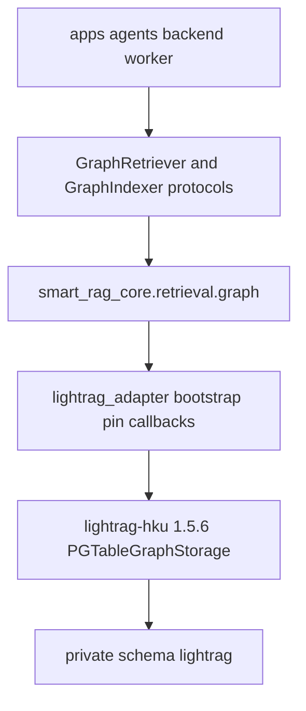

# LightRAG pin and qualification contract

Immutable pin, public/private API matrix, source/ID semantics, callbacks,
rejected assumptions, and Packet 2 private-schema attach. Production
`ainsert`/query wiring and Graph Ready mappings remain later packets.

Related: [phase-05 evidence](../development/phase-05-graphrag-evidence.md) ·
[ADAPTER_LIFECYCLE.md](./ADAPTER_LIFECYCLE.md) ·
[WORKSPACE_LIFECYCLE.md](./WORKSPACE_LIFECYCLE.md) ·
[TOOL_VERSIONS.md](../development/TOOL_VERSIONS.md) ·
[CONFIGURATION.md](../development/CONFIGURATION.md) ·
[ADR-graph-source-identity-envelope.md](../adr/ADR-graph-source-identity-envelope.md) ·
[ADR-lightrag-runtime-attach-without-ddl.md](../adr/ADR-lightrag-runtime-attach-without-ddl.md) ·
[ADR-lightrag-identical-content-collapse.md](../adr/ADR-lightrag-identical-content-collapse.md) ·
[lightrag-schema-bootstrap.md](../runbooks/lightrag-schema-bootstrap.md) ·
[ADR index](../adr/README.md) ·
[docs index](../README.md)

## Pin

| Field | Value |
| --- | --- |
| Distribution | `lightrag-hku==1.5.6` |
| License | MIT |
| Release commit | `b33c6b0812cddf39206e48a9810112e51f025274` |
| Wheel SHA-256 | `81b8aa8b09c11e446f94b53dbbef8d6becd900a7a44685fca95ff59cf5c8e457` |
| Sdist SHA-256 | `1c5afb96db5cd9f0b13b7d8d93ce1daf5a51bf7e2f74fe5ce4fe3eb9be03e77f` |
| Direct companions | `asyncpg==0.31.0`, `pgvector==0.5.0` |
| App embedding | `text-embedding-3-large` at 1024 dimensions |
| Chunker overlay | 1200 tokens, 100 overlap, tiktoken `gpt-4o-mini` |
| Selected graph storage | `PGTableGraphStorage` |
| Forbidden graph storage | `PGGraphStorage` (Apache AGE) |

Do not install LightRAG extras `api` or `offline`. Do not float to Git `main`
or a newer release without a new qualification plus an approved version change.

## Transitive hard dependencies

Recorded from `uv.lock` for `lightrag-hku==1.5.6` (not extras): `aiohttp`,
`configparser`, `google-api-core`, `google-genai`, `json-repair`,
`nano-vectordb`, `networkx`, `numpy`, `packaging`, `pandas`, `pipmaster`,
`pydantic`, `pypinyin`, `python-dotenv`, `pyyaml`, `setuptools`, `tenacity`,
`tiktoken`, `xlsxwriter`.

`asyncpg` and `pgvector` are direct pins so `pipmaster.is_installed` is true.
Qualification tests fail if `pipmaster.install` is called.

## Primary sources (2026-08-15)

- PyPI 1.5.6: <https://pypi.org/project/lightrag-hku/1.5.6/>
- GitHub commit: <https://github.com/HKUDS/LightRAG/tree/b33c6b0812cddf39206e48a9810112e51f025274>
- ProgrammingWithCore (vendor spelling Programing): <https://github.com/HKUDS/LightRAG/blob/b33c6b0812cddf39206e48a9810112e51f025274/docs/ProgramingWithCore.md>
- Installed wheel source under `.venv/Lib/site-packages/lightrag/` (authoritative for APIs)

## Application protocol versus vendor



`apps/*` and `retrieval/graph.py` must not import `lightrag`. Only the core
adapter, bootstrap, pin, callback, and qualification modules may import vendor
classes. The ops script calls core bootstrap and does not import `lightrag`.

## Public API matrix (qualified)

| API | Pin contract |
| --- | --- |
| `from lightrag import LightRAG, QueryParam` | Required |
| `PGTableGraphStorage` | Selected graph engine; no AGE |
| `PGKVStorage`, `PGVectorStorage`, `PGDocStatusStorage` | Selected companions |
| `PGGraphStorage` | Exists; forbidden as selected engine |
| `initialize_storages` / `finalize_storages` | Mandatory; always finalize |
| `ainsert(..., ids, file_paths, track_id) -> str` | `track_id` is monitoring only |
| `aquery_data(query, param) -> dict` | Forces `only_need_context=True` |
| `adelete_by_doc_id(doc_id, delete_llm_cache=False) -> DeletionResult` | `success` / `not_found` / `not_allowed` / `fail` |
| `aget_docs_by_ids` | Status including `processed` / `failed` |
| `EmbeddingFunc` | 1024-dim gateway vectors; numpy ndarray |

`QueryParam` fields used: `mode`, `only_need_context`, `only_need_prompt`,
`response_type`, `stream`, `top_k`, `chunk_top_k`, `max_entity_tokens`,
`max_relation_tokens`, `max_total_tokens`, `hl_keywords`, `ll_keywords`,
`conversation_history`, `user_prompt`, `enable_rerank`, `include_references`.

Keyword bypass in `operate.get_keywords_from_query`: if `hl_keywords` **or**
`ll_keywords` is non-empty, `extract_keywords_only` is not called. This project
still requires **both** lists non-empty for hybrid/local graph queries.

## Structured `aquery_data` success envelope

Field names from the installed 1.5.6 `LightRAG.aquery_data` docstring, also
stored at
[aquery_data_success_envelope.json](../../tests/fixtures/lightrag/aquery_data_success_envelope.json):

- Top: `status`, `message`, `data`, `metadata`
- `data`: `entities`, `relationships`, `chunks`, `references`
- Entity: `entity_name`, `entity_type`, `description`, `source_id`, `file_path`,
  `created_at`, `reference_id`
- Relation: `src_id`, `tgt_id`, `description`, `keywords`, `weight`,
  `source_id`, `file_path`, `created_at`, `reference_id`
- Chunk: `content`, `file_path`, `chunk_id`, `reference_id`
- Metadata: `query_mode`, `keywords.{high_level,low_level}`, optional
  `processing_info`

Application leads keep entity names, relation endpoints, parsed `source_id`
tokens, chunk IDs, and echoed keywords. Descriptions, relation keywords, file
paths, and reference ordinals are never citation or integrity IDs.

Rendered `only_need_context` prose is rejected; there is no context parser.

## Source and ID semantics

| Token | Role | Not allowed as |
| --- | --- | --- |
| Caller `ids` | Canonical document-version ID | — |
| `file_paths` | Unique opaque basename token | Citation, integrity ID |
| `track_id` | Monitoring | Idempotency key |
| `source_id` | Vendor chunk tokens joined by `<SEP>` | Silent complete provenance |
| `content_hash` | Vendor duplicate detector | Application identity |
| Normalized entity names / endpoint pairs | Lead discovery | Citations |

Delimiter: `GRAPH_FIELD_SEP = "<SEP>"`. Retention caps:
`DEFAULT_MAX_SOURCE_IDS_PER_ENTITY = 200` and
`DEFAULT_MAX_SOURCE_IDS_PER_RELATION = 200`. Empty, blank, duplicate, or
at-cap lists fail closed (possible truncation).

`normalize_document_file_path` reduces paths to a basename. Unique opaque
basenames are required. Duplicate basename and duplicate **raw** content-hash
are vendor behaviors. Live 1.5.6 qualification proved raw identical text
collapses. Application inserts therefore prefix
`bind_graph_source_text` so vendor hashes include `document_version_id`.
Raw `bind_identity=false` inserts remain the negative fixture. See
[ADR-graph-source-identity-envelope.md](../adr/ADR-graph-source-identity-envelope.md).

## Schema and bootstrap

LightRAG uses schema-unqualified table names. Qualification creates a
disposable private schema and sets `search_path` to
`{schema},extensions,public` so pgvector in `extensions` remains visible.
`PGTableGraphStorage` DDL creates `lightrag_graph_nodes` and
`lightrag_graph_edges`. Vector tables are model/dimension suffixed.

`CREATE EXTENSION IF NOT EXISTS vector` may run for `PGVectorStorage`. A
"could not create vector extension" warning is fatal for this pin. PGTable
must not create Apache AGE. A second `initialize_storages` on the same schema
must not drift.

`pgvector.asyncpg.register_vector` defaults to `schema='public'`. Local
Supabase stores the type in `extensions`. The qualification harness wraps
that function and tries `public` then `extensions`. This is a test/harness
adapter, not a production Graph setting.

Live fingerprints are captured by contract tests against disposable schemas;
they are not production migrations (Packet 2).

## Pool, workspace, retries

| Setting | Qualification value | Why |
| --- | --- | --- |
| `POSTGRES_MAX_CONNECTIONS` | `2` | Default 50 is too high |
| `POSTGRES_CONNECTION_RETRIES` | `0` | Application owns retry; vendor 10 is unbounded |
| `POSTGRES_SERVER_SETTINGS` | `search_path={schema},extensions,public` | Unqualified tables + pgvector |
| `POSTGRES_WORKSPACE` | unset unless testing override | Env overrides constructor workspace and collapses isolation |
| Process pool | `ClientManager` | First vector model/dimension wins; finalize then reset between cases |
| `cosine_better_than_threshold` | `-1.0` in qualification only | Mock hash vectors have no semantic neighborhood; production GraphRAG must not inherit this floor |

Do not hold a database transaction across model calls.

## Callbacks

Every LLM/embedding/rerank call is counted and routed through
`EmbeddingGateway` / `ModelGateway`. Qualification uses `MOCK_MODEL_MODE`
(default). OpenAI is not called.

| Kind | Expected on keyword-bypass `aquery_data` |
| --- | --- |
| `keyword_extract` | 0 |
| `answer_generate` | 0 |
| `entity_extract` | counted during insert |
| `embed` | counted |
| `rerank` | 0 (`enable_rerank=False`; native rerank is not qualified) |

One retry layer only (`max_retries=0` on provider adapters). Timeouts are
required on role LLM configs.

## Deletion and status

`DocStatus`: `pending`, `parsing`, `analyzing`, `processing`, `preprocessed`,
`processed`, `failed`. Unsupported `DeletionResult.status` values fail closed.

## Adapter bounds

`apply_query_bounds` clamps `top_k` / `chunk_top_k` to 12, token budgets, and a
45s deadline. Native engine settings do not replace these controls.

## Packet 2 private schema and runtime attach

Reviewed vendor tables live only in schema `lightrag` (plus
`schema_capture_status`). Vector tables are suffixed
`text_embedding_3_large_1024d`. AGE is absent. Browser, `anon`,
`authenticated`, and `service_role` have no vendor-table access.

Runtime attach (`runtime_attach_without_ddl`) skips vendor CREATE/ALTER and
`SET ROLE app_lightrag` on pooled connections. API/worker never call
`initialize_storages` with schema-admin credentials. See
[ADAPTER_LIFECYCLE.md](./ADAPTER_LIFECYCLE.md).

Application-owned `app.graph_workspaces`, `app.graph_active_workspace_pointer`,
and `app.graph_writer_lease` are written by Packet 3. Successful vendor
`processed` leaves the workspace `updating` and the document `graph_pending`.
See [WORKSPACE_LIFECYCLE.md](./WORKSPACE_LIFECYCLE.md).

## Rejected assumptions

- AGE / `PGGraphStorage` as a fallback engine
- Parsing human-rendered context as evidence
- Using file paths, reference ordinals, descriptions, keywords, track IDs,
  source hashes, or normalized names as citations or idempotency keys
- Runtime `pipmaster.install`
- Floating to newest LightRAG
- Production `initialize_storages` on API/worker startup
- DDL/CREATE for `app_lightrag`
- Vendor tables in `public`
- `POSTGRES_WORKSPACE` in runtime
- Weakening the identical-content independence gate

## Verification

```powershell
uv run python -m pytest tests/unit/test_lightrag_pin.py tests/unit/test_lightrag_adapter.py tests/contract/test_lightrag_contract.py tests/contract/test_lightrag_bootstrap.py -q
```

Contract tests skip when local Supabase Postgres is down unless
`SMART_RAG_REQUIRE_JOB_INTEGRATION=1`.
