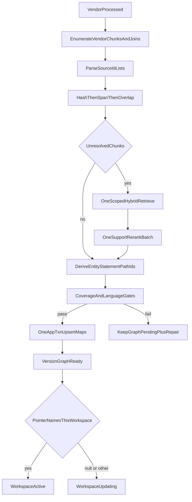

# Canonical graph evidence mapping

Packet 4 maps LightRAG vendor objects onto canonical Hybrid passages and
marks a document version Graph Ready in one application transaction. Vendor
`processed` is not Graph Ready. Query-time Hybrid support search is forbidden.

Related: [GRAPH_MAPPING_CONTRACT.md](./GRAPH_MAPPING_CONTRACT.md) ·
[LIGHTRAG_CONTRACT.md](./LIGHTRAG_CONTRACT.md) ·
[WORKSPACE_LIFECYCLE.md](./WORKSPACE_LIFECYCLE.md) ·
[RETRIEVAL.md](./RETRIEVAL.md) ·
[HYBRID_RETRIEVAL_CONTRACT.md](../retrieval/HYBRID_RETRIEVAL_CONTRACT.md) ·
[INGESTION_LIMITS.md](../ingestion/INGESTION_LIMITS.md) ·
[phase-05 evidence](../development/phase-05-graphrag-evidence.md) ·
[docs index](../README.md)

## Identities

Application IDs are hashes of `graph_pipeline_v1` plus structured fields.
They never embed file paths, reference ordinals, descriptions, keywords-as
prose, or a native predicate id.

| Object | Identity |
| --- | --- |
| Source | `document_version_id` + SHA-256 of pipeline and config generation |
| Internal chunk key | `workspace:config_generation:vendor_chunk_id` (not a cross-version app ID) |
| Canonical entity | versioned type + canonical name after active `graph_entity_rules` |
| Statement | pipeline + subject key + object key + normalized **keywords** label |
| Path-edge | ordered statement IDs + direction + version |

Envelope `strip_graph_source_envelope` runs **before** hash, span, or overlap
against `app.document_chunks.content_hash` (ingest `content_hash()` /
`normalize_for_dedup`). Duplicate raw text stays independently attributable.

## Mapping flow



One document causes at most **one** Hybrid retrieve scoped to that
`version_id` and **one** OpenAI support rerank batch (pool ≤ 20, returned IDs
must equal the supplied set). Mapping never calls Hybrid per relation.

## Gates

| Gate | Threshold | Failure |
| --- | --- | --- |
| Support | ≥ 0.80 | object unavailable |
| Overall coverage | ≥ 0.90 when English objects exist | stay `graph_pending` |
| Arabic / mixed | ≥ 0.85 per-language numerator/denominator | stay `graph_pending` |
| Source-id list | Packet 1 caps 200/200 | truncated/ambiguous unavailable |
| Cross-version support | forbidden | `cross_version_source` |

English-heavy aggregates cannot hide an Arabic miss. Telemetry records
language, document, object type, method, truncation, and failure reason.

## Graph Ready transaction

`GraphMappingService.map_after_vendor_success` (in `jobs/`, not scanned by
the Phase 3 scope guard) commits one transaction that:

1. Rechecks current version, Hybrid Ready, eligibility, and config generation.
2. Deletes prior chunk/evidence rows for this version/workspace, then upserts
   `lightrag_source_map`, `lightrag_chunk_map`, and `graph_evidence_map`.
3. Inserts `graph_mapping_telemetry` and keyed `graph_map_repair_jobs`.
4. Sets `document_versions.status = graph_ready` only when every gate passes.
5. Transitions workspace `updating` → `active` only when the singleton pointer
   already names this workspace. A null pointer still allows Graph Ready on
   the version and does not invent Packet 7 switch.

If gates fail, maps and repair rows persist, status stays `graph_pending`,
and the index job can still complete with `maps_verified: false`. Repair never
runs query-time Hybrid and never lowers thresholds.

Unavailable, stale, ambiguous, truncated, or below-threshold objects cannot
contribute to Graph Ready or later query.

## Failure modes

| Symptom | Cause | Route |
| --- | --- | --- |
| `vendor_not_processed` | Status is not terminal `processed` | repair; stay pending |
| `vendor_basename_mismatch` | Basename is not `g-{version_id}.txt` | repair |
| `source_truncated` / `source_ambiguous` | `<SEP>` list at cap, blank, or duplicate | object unavailable |
| `unsupported_relation` | Empty structured `keywords` | statement unavailable |
| `ambiguous_entity` | Alias/do-not-merge collision | entity unavailable |
| `language_gate` | Arabic/mixed slice below 0.85 | pending + repair |
| `mapping_budget_*` | Vendor or model-call cap exceeded | pending + repair |

## Security

Mapping SQL uses `SET ROLE app_worker` for canonical tables and adapter
`SET ROLE app_lightrag` for unqualified vendor catalog reads. Worker RLS
remains the write path. Packet 5 grants `app_api` SELECT on the map tables
(`USING true`) so the resolver/inspection RPCs can join; ACL, current
pointer, deletion, and support are rechecked in SQL and never leaked as
restricted names. Query-time repair upserts use `app.enqueue_graph_map_repair`
as `app_api`. `apps/` must not import `lightrag` or mention mapping table
names.

## Verification

```powershell
uv run python scripts/ci/check_migrations.py
uv run python -m pytest tests/unit/test_graph_mapping.py tests/contract/test_graph_mapping.py tests/unit/test_phase3_graph_scope_guard.py tests/unit/test_lightrag_pin.py tests/unit/test_hybrid_run.py -q
uv run python scripts/check.py --tier docs --mermaid-puppeteer-config scripts/ci/puppeteer-no-sandbox.json
```
