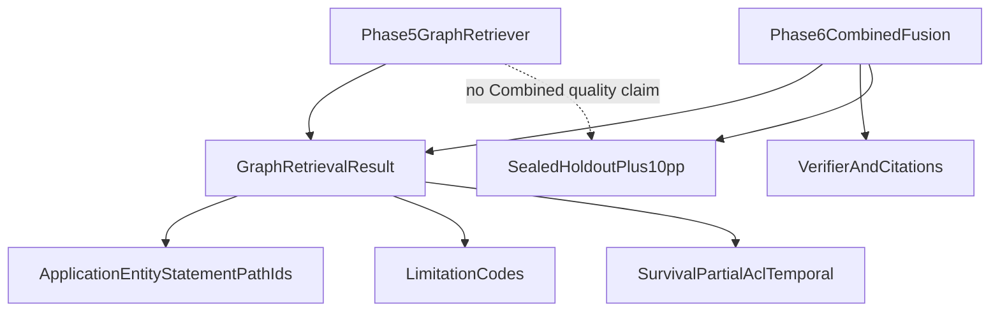

# Phase 6 graph handoff

Frozen GraphRAG interfaces and fixtures for Phase 6. Phase 5 proves graph
infrastructure, mapping, resolver, and envelope only.

**Phase 5 does not claim Combined answer quality.** Phase 6 owns Combined fusion, verifier/citations in final answers, the immutable launch holdout, and the at-least-10-point relationship/multi-hop gain over Hybrid (QT-EVAL-009). An unexecuted Phase 6 label is not a Packet 8 pass.

## Claim hygiene (do not over-claim)

Phase 6 query, SSE, Combined fusion, and UI copy must keep these lines
honest. They are not optional footnotes.

- **Real company content stays prohibited.** Deny-by-default external
  processing remains in force until provider matrix rows are `verified`.
  Do not ingest client files on the answering path. See
  [OPENAI_DATA_GOVERNANCE.md](../security/OPENAI_DATA_GOVERNANCE.md).
- **Hybrid Recall@10 / exact-code@5 / alias@10 are synthetic open-split
  numbers with identity rerank and a sealed holdout.** Packet 9 used
  `rerank_call_count=0` (not live OpenAI Responses rerank), compact
  markdown, sidecar-mapped UUIDs. Do not quote those percents as launch
  Hybrid quality or Combined gain. See
  [PHASE4_RANKED_IDS.md](../evaluation/PHASE4_RANKED_IDS.md) and
  [HYBRID_RETRIEVAL_CONTRACT.md](../retrieval/HYBRID_RETRIEVAL_CONTRACT.md).
- **Advertised GraphRAG envelope is 15 labeled `graph_mapping` documents.**
  Source-chunk capacity is unverified. Bulk onboarding is blocked. Do not
  show 2,000 documents / 200,000 chunks as current capacity. See
  [SCALING_OPTIONS.md](./SCALING_OPTIONS.md).
- **Combined +10 pp (QT-EVAL-009) must use live mapping/extraction** on the
  15 labeled documents (or a newly collected set). CoverageSlice fixture
  language floors in [PHASE5_GRAPH_EVAL.md](../evaluation/PHASE5_GRAPH_EVAL.md)
  are **not** Combined quality and are **not** live extraction P/R. Packet 3
  implemented resolved-path fusion and recorded live +10pp as **unverified**.
- **SSE and the testing UI remain unimplemented.** Packet 4 wired
  `fuse_evidence` → `compose_tables` → `disclose_optional_tools` →
  `generate_answer` → `verify_answer` on the query graph. Do not treat that
  as launch Combined quality, chat streaming, or Stitch UI. See
  [COMBINED_FUSION.md](../agent/COMBINED_FUSION.md),
  [ANSWER_VERIFICATION.md](../agent/ANSWER_VERIFICATION.md), and
  [OPTIONAL_TOOLS.md](../agent/OPTIONAL_TOOLS.md).

Related: [FROZEN_GRAPH_MANIFEST.md](./FROZEN_GRAPH_MANIFEST.md) ·
[PHASE5_GRAPH_EVAL.md](../evaluation/PHASE5_GRAPH_EVAL.md) ·
[COMBINED_FUSION.md](../agent/COMBINED_FUSION.md) ·
[ANSWER_VERIFICATION.md](../agent/ANSWER_VERIFICATION.md) ·
[OPTIONAL_TOOLS.md](../agent/OPTIONAL_TOOLS.md) ·
[RETRIEVAL.md](./RETRIEVAL.md) ·
[GRAPH_MAPPING_CONTRACT.md](./GRAPH_MAPPING_CONTRACT.md) ·
[ENTITY_RULES.md](./ENTITY_RULES.md) ·
[WORKSPACE_LIFECYCLE.md](./WORKSPACE_LIFECYCLE.md) ·
[SCALING_OPTIONS.md](./SCALING_OPTIONS.md) ·
[DATASET_SPEC.md](../evaluation/DATASET_SPEC.md) ·
[PHASE4_RANKED_IDS.md](../evaluation/PHASE4_RANKED_IDS.md) ·
[HYBRID_RETRIEVAL_CONTRACT.md](../retrieval/HYBRID_RETRIEVAL_CONTRACT.md) ·
[OPENAI_DATA_GOVERNANCE.md](../security/OPENAI_DATA_GOVERNANCE.md) ·
[ADR-hybrid-pilot-release-cut.md](../adr/ADR-hybrid-pilot-release-cut.md) ·
[RISK_REGISTER.md](../development/RISK_REGISTER.md) ·
[phase-05 evidence](../development/phase-05-graphrag-evidence.md) ·
[docs index](../README.md)

## Frozen protocols and result types

Phase 6 must depend on project protocols, never LightRAG classes.

| Symbol | Module | Contract |
| --- | --- | --- |
| `GraphRetriever` | `smart_rag_core.retrieval.graph` | `retrieve_local`, `retrieve_hybrid`, `retrieve_global_steering` |
| `GraphLeadSet` | same | structured leads only; no rendered context prose |
| `GraphQueryBounds` | same | 12 candidates, 3 hops, 6 paths, 45s query deadline |
| `GraphRetrievalResult` | `smart_rag_core.retrieval.graph_results` | surviving candidates, paths, locators, counters |
| `GraphInspectResult` | same | depth 3, 200 rows, 10s deadline, 3s `statement_timeout` |
| `retrieve_graph` | `smart_rag_core.retrieval.graph_retriever` | query-time adapter plus resolver |

`GraphRetrievalResult` fields Phase 6 may consume:

- `mode`: `local`, `hybrid`, or `global`
- `candidates`: application objects with `support` / `confidence` ≥ 0.80
- `paths`: at most six, at most three hops
- `steering`: at most three global expansions; never evidence
- `locators`: canonical chunk coordinates only
- `graph_survival_ratio`: supported / returned, or null when empty
- `partial_readiness_count`: company-visible Hybrid-ready versions not Graph Ready
- `acl_blindness_count`: authorized-only restricted ineligible count
- `limitations`: typed codes without restricted names
- `diagnostics`: machine drop reasons, no titles
- `counters`: `keyword_extract`, `answer_generate`, and `support_searches` must stay 0
- `rolling_survival`: 20-sample interface; not a live alerter

## Keywords and identifiers

| Input | Rule |
| --- | --- |
| `hl_keywords` | Non-empty high-level topics from `QueryProfile` |
| `ll_keywords` | Non-empty entities/codes/relations from `QueryProfile` |
| Empty keyword list | Fail closed; do not let LightRAG extract keywords |
| Application entity key | `{TYPE}::{normalized_name}` |
| `graph_statement_id` | pipeline, subject key, object key, relation-label key |
| Path-edge id | ordered surviving statement ids |
| Canonical evidence | Supabase chunk UUIDs after resolver recheck |

Vendor names, descriptions, relation keywords, file paths, and reference
ordinals are not citation IDs.

## Limitation codes

| Code | Phase 6 expectation |
| --- | --- |
| `graph_survival_below_threshold` | Relabel Combined → Hybrid; do not answer from graph leads |
| `graph_partial_readiness` | Increase Hybrid weight; show authorized not-yet-graph count |
| `graph_acl_blindness` | Authorized user only; never disclose restricted existence to others |
| `temporal_graph_limitation` | Historical / `as_of` stays Hybrid; graph is current-version only |
| `graph_outage` | Missing pointer, quarantined, disabled, retired, building |
| `graph_updating` | Mutation in flight; inspection unavailable |
| `graph_filtered_dirty` | Strict resolver only while rebuild proceeds |
| `global_steering_only` | At most three Hybrid expansions; not evidence |
| `graph_empty` | No structured leads |
| `graph_deadline` / `graph_cancelled` | Verified partial / insufficient; no fake completion |

## Survival, partial readiness, ACL blindness, temporal

- Survival fallback floor: 0.50. Rolling alert: mean below 0.80 across 20 Combined queries (Phase 6 records Combined; Phase 5 only persists the window interface).
- Partial readiness counts company-visible current versions in `hybrid_ready` or `graph_pending` the caller can read.
- ACL blindness counts restricted graph-ineligible versions the caller can read. Unauthorized callers get silence, not a zero that reveals existence.
- Temporal: superseded graph rows are not queryable. `as_of` and historical relationship/multi-hop emit `temporal_graph_limitation` and skip the vendor.

## Workspace states

| State | Combined (Phase 6) | Inspection |
| --- | --- | --- |
| `active` | May use resolver results | Allowed within bounds |
| `updating` | Hybrid-only | Unavailable |
| `filtered_dirty` | Strict resolver only | Strict resolver only |
| `quarantined` / `disabled` / `retired` / `building` | Hybrid-only (`graph_outage`) | Unavailable |

## Frozen fixtures Phase 6 may score

Use development then qualification loaders only until an authorized holdout
opening exists. Holdout default remains `HoldoutAccess.denied()`.

| Class | Runtime owner | Phase 5 use | Phase 6 use |
| --- | --- | --- | --- |
| `graph_mapping` | Phase 5 | Fixture mapping/survival, not live extraction P/R | Repair/mapping regressions |
| `relationship` | Phase 5 and 6 | Labels only; no Combined fusion | Combined vs Hybrid +10pp on **live** mapping/extraction, not CoverageSlice fixtures |
| `multi_hop` | Phase 5 and 6 | Labels only | Combined vs Hybrid +10pp on **live** mapping/extraction, not CoverageSlice fixtures |
| `arabic_mixed` | Phase 4 | Mapping language gate fixtures | Profile/retrieval, not graph gold |

Live LightRAG extraction precision/recall on the qualification corpus is
**unverified** in Packet 8. Do not treat fixture CoverageSlice gates as
that measurement. Combined +10 pp (QT-EVAL-009) must use live
mapping/extraction on the 15 labeled documents, not these fixture floors.

## Explicit ownership split

Phase 5 delivered: pin 1.5.6, `PGTableGraphStorage`, identity envelope,
adapter, single writer, mapping/Graph Ready, resolver/inspection, entity
rules, pointer CAS, 24h/7d tombstones, quarantine, same-schema upgrade
refuse, reduced envelope, scaling options.

Phase 6 must still implement: Combined fusion and ablation versus naive
union, answer verifier and citations, SSE, query-agent orchestration,
final holdout, and QT-EVAL-009. Packet 8 does not implement those paths.

Related: [QUERY_ROUTING.md](../agent/QUERY_ROUTING.md) (Phase 6 packet 2)
invokes `GraphRetriever.retrieve_local` / `retrieve_hybrid` /
`retrieve_global_steering` with precomputed `hl_keywords`/`ll_keywords`
only. Empty keywords fail closed. Packet 3 owns Combined fusion.
