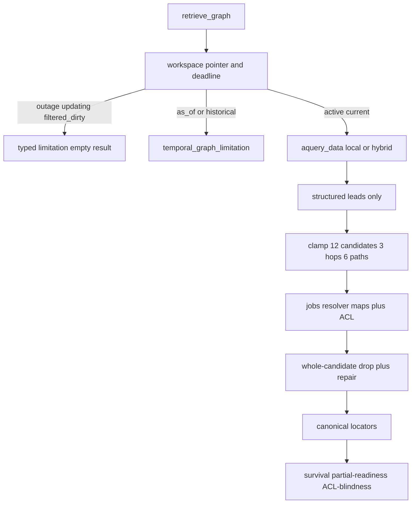
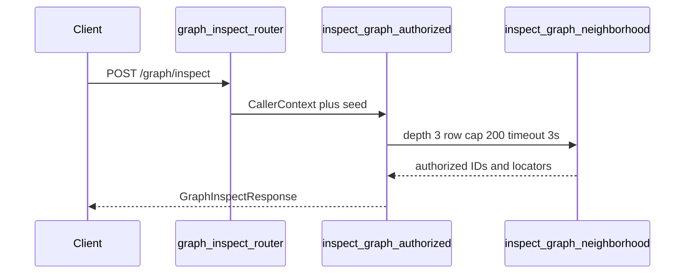

# Structured graph retrieval

Packet 5 turns LightRAG into a bounded lead generator behind
`GraphRetriever`, then resolves every lead through application maps and
canonical Supabase rows. Combined answers, SSE, and holdout scoring are
Phase 6. This packet does not mark GraphRAG complete.

Related: [LIGHTRAG_CONTRACT.md](./LIGHTRAG_CONTRACT.md) ·
[MAPPING.md](./MAPPING.md) ·
[GRAPH_MAPPING_CONTRACT.md](./GRAPH_MAPPING_CONTRACT.md) ·
[WORKSPACE_LIFECYCLE.md](./WORKSPACE_LIFECYCLE.md) ·
[INGESTION_LIMITS.md](../ingestion/INGESTION_LIMITS.md) ·
[phase-05 evidence](../development/phase-05-graphrag-evidence.md) ·
[docs index](../README.md)

## Query path

1. Revalidate the singleton workspace pointer, mapping config generation,
   caller snapshot, current-only policy, and remaining deadline.
2. Call adapter `aquery_data` as `local` or graph-`hybrid` (never `naive` /
   `mix`). Both keyword lists are required. `enable_rerank=false`.
3. Parse structured fields only. Clamp to 12 candidates, 3 hops, 6 paths.
4. Resolve entities/statements/path edges through maps, then batch-recheck
   ACL, current pointer, deletion, eligibility, support ≥ 0.80, and
   config generation.
5. Drop the whole candidate when any required piece fails. Enqueue one
   bounded `query_resolve` repair. Never run query-time Hybrid.
6. Fetch canonical locators from `document_chunks`. Return application IDs,
   paths, locators, confidence/support, limitations, and counters.



Global mode is a separate path: at most three topic/entity expansions,
never evidence, signal `global_steering_only`. Phase 6 may re-enter Hybrid.

## Fail-closed workspace

Query and inspection require `graph_workspaces.state = active` and an
attached pointer. Combined fallback is Phase 6; Packet 5 returns:

| State | Signal |
| --- | --- |
| missing pointer, quarantined, disabled, retired, building | `graph_outage` |
| `updating` | `graph_updating` |
| `filtered_dirty` | `graph_filtered_dirty` |

## Survival and visibility

`graph_survival_ratio = supported_resolved / returned_graph_candidates`.
Null when no candidates were returned. Below 0.50 emits
`graph_survival_below_threshold`. The rolling 0.80 / 20 window is recorded
on `app.graph_survival_samples` and is not a live alerter.

Partial readiness counts company-visible current versions in
`hybrid_ready` or `graph_pending` that the caller can read. ACL blindness
counts restricted graph-ineligible versions the caller can read.
Unauthorized restricted documents contribute neither count nor name.

## Inspection

`POST /graph/inspect` requires authentication. Members and viewers are
allowed; SQL rechecks `caller_can_read_document`. Depth 3, 200 rows,
`statement_timeout='3s'`, 10-second end-to-end deadline. Native prose is
omitted. The FastAPI router must not mention map-table names.



## Callback proof

`CountedLightRagCallbacks` must stay at `keyword_extract=0` and
`answer_generate=0` on the query path. `GraphQueryCounters.support_searches`
and `repair_hybrid_searches` are hard-zeroed. Outer `asyncio.wait_for`
cancels the query task; process adapter `finalize` is not per query.

## Verification

```powershell
uv run python scripts/ci/check_migrations.py
uv run python -m pytest tests/unit/test_phase3_graph_scope_guard.py tests/unit/test_lightrag_pin.py tests/unit/test_graph_mapping.py tests/unit/test_graph_resolver.py tests/unit/test_graph_retriever.py tests/unit/test_graph_inspect_openapi.py tests/contract/test_graph_retrieval.py -q
uv run python scripts/check.py --tier docs --mermaid-puppeteer-config scripts/ci/puppeteer-no-sandbox.json
```
