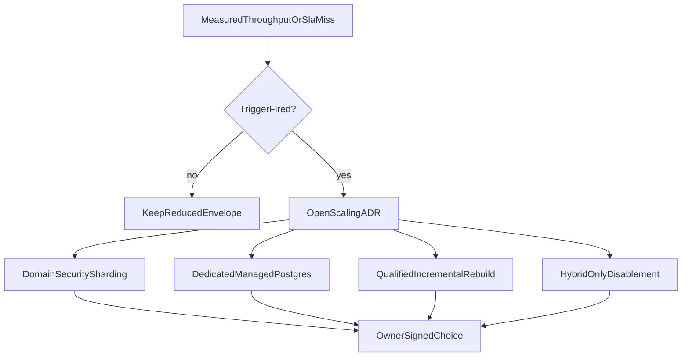

# Graph scaling options

Options only. Packet 8 records trigger-review candidates before bulk
onboarding so a seven-day or budget trigger does not start from zero. This
file does **not** implement sharding, a dedicated LightRAG database,
incremental compaction, or Hybrid-only productization.

Related: [FROZEN_GRAPH_MANIFEST.md](./FROZEN_GRAPH_MANIFEST.md) ·
[PHASE5_GRAPH_EVAL.md](../evaluation/PHASE5_GRAPH_EVAL.md) ·
[PHASE6_HANDOFF.md](./PHASE6_HANDOFF.md) ·
[WORKSPACE_LIFECYCLE.md](./WORKSPACE_LIFECYCLE.md) ·
[QUALITY_TARGETS.md](../QUALITY_TARGETS.md) ·
[AVAILABILITY_AND_ISOLATION_TRIGGERS.md](../architecture/AVAILABILITY_AND_ISOLATION_TRIGGERS.md) ·
[phase-05 evidence](../development/phase-05-graphrag-evidence.md) ·
[ADR-lightrag-async-embed-batched-sources.md](../adr/ADR-lightrag-async-embed-batched-sources.md) ·
[docs index](../README.md)

## Why this document exists

The signed Phase 1 graph envelope is 2,000 current documents and 200,000
graph source chunks with a seven-day clean rebuild. Packet 8 did not measure
a full rebuild. Sequential jobs at the 600-second index deadline cannot
finish 2,000 documents in seven days. The advertised envelope is therefore
**reduced to 15 labeled `graph_mapping` documents** (source-chunk capacity
unverified) and bulk onboarding is blocked. Crossing a trigger below opens
an ADR that compares these options with continued Hybrid-only disablement.

## Options

### 1. Domain or security-boundary sharding

Split the shared v1 workspace by an owner-signed domain or security
boundary, still behind `GraphRetriever` / `GraphIndexer`. Each shard keeps
one concurrency-one writer, one pointer, and the same resolver/ACL
contract. Per-ACL LightRAG workspaces remain deferred unless a later ADR
reverses that.

Use when: one writer cannot drain Graph Ready inside seven days after the
envelope is raised, or two product domains have disjoint graph-eligible
corpora.

Do not use when: the split would mix ACL-restricted documents into a
company-visible shard, or would require query-time fan-out across shards
without a signed bound.

### 2. Dedicated managed LightRAG PostgreSQL behind protocols

Move vendor `PGTableGraphStorage` / KV / vector / status tables to a
dedicated managed PostgreSQL instance. Application protocols stay in
`packages/core`. Canonical evidence, ACL, and current-version authority
remain on Supabase.

Use when: graph rebuild or vendor storage dominates CPU/IO, replica lag
cannot meet deletion/ACL semantics, or the selected Supabase tier cannot
keep LightRAG session connections under the Phase 2 70% budget.

Do not use when: the move would let inspection or Combined read vendor
tables with a user JWT, or would skip the resolver.

### 3. Qualified incremental compaction or rebuild

Evaluate pin-supported incremental compaction or batched rebuild of dirty
workspaces instead of a full clean rebuild every seven days. Qualification
must prove identical mapping/survival/ACL postconditions on a restored
copy, then a pointer switch. Same-schema in-place mix remains forbidden.

Use when: dirty tombstones accumulate faster than a full rebuild can
finish, and the pin documents a compaction API that preserves source
identity.

Do not use when: the pin only offers undocumented per-entity surgery, or
qualification cannot restore/rollback.

### 4. Hybrid-only disablement

Leave canonical Hybrid retrieval serving answers. Combined and inspection
stay unavailable (`graph_outage` / disabled). Canonical deletion and ACL
continue. Graph jobs remain quarantined until a funded rebuild or a signed
re-enable.

Use when: the maintenance reserve is unfunded, survival alerts persist
seven days, two consecutive upgrade qualifications fail, or the reduced
envelope still cannot meet the seven-day SLO.

This is the default fail-closed path already implemented in Packet 7. It is
an option in the trigger review, not a new feature.

## Triggers and decision inputs

Open the ADR when any of the following occurs after the reduced envelope is
accepted:

| Trigger | Decision inputs |
| --- | --- |
| Clean rebuild of the **advertised** envelope exceeds seven days | measured documents/hour, queue age, ETA confidence, hardware SKU |
| Monthly reserve cannot cover `max(USD 800, 4 × measured full-rebuild cost)` | measured rebuild cost, owner funding, quarantine duration |
| Rolling graph survival stays below 0.80 across 20 Combined queries for seven days | per-language survival, mapping coverage, repair backlog |
| Database CPU/IO above 70% for three 15-minute windows in a week after tuning | connection budget, LightRAG vs Hybrid share, replica lag |
| Two consecutive isolated upgrade qualifications fail | schema diff, snapshot restore evidence, disable review |
| Owner wants to raise the envelope toward 2,000 / 200,000 | new measured rebuild, reserve, and per-language gates |

Decision inputs that must appear in the ADR: current advertised envelope,
measured documents/hour through mapping-verified Graph Ready, cost per
version, peak database CPU/IO, mapping coverage by language, survival,
tombstone age, reserve remaining, and whether Combined is even enabled
(Phase 6). Subjective extrapolation without those inputs is not a pass.

## Out of scope here

- Implementing any option above
- Query-agent, SSE, or Combined fusion (Phase 6)
- Claiming the 2,000 / 200,000 envelope is proven
- Advertising more than 15 labeled `graph_mapping` documents as current GraphRAG capacity
- Raising Combined relationship/multi-hop quality by 10 percentage points
- Raising `MAX_GRAPH_PASSAGE_SOURCES`, insert batch size, or the LightRAG
  embedding watchdog without a signed load-test of the async batched path

## Single-writer throughput

Graph mutations remain one PostgreSQL advisory-lock writer. Batched
`AsyncOpenAI` inserts raise the chance that Graph-200 can finish without a
watchdog kill; they do **not** add a second writer. Load-test documents/hour
through mapping-verified Graph Ready before increasing the advertised
envelope. When that measured rate cannot drain the envelope inside seven
days, open a scaling ADR from the options above instead of raising batch
size or `default_embedding_timeout`.
