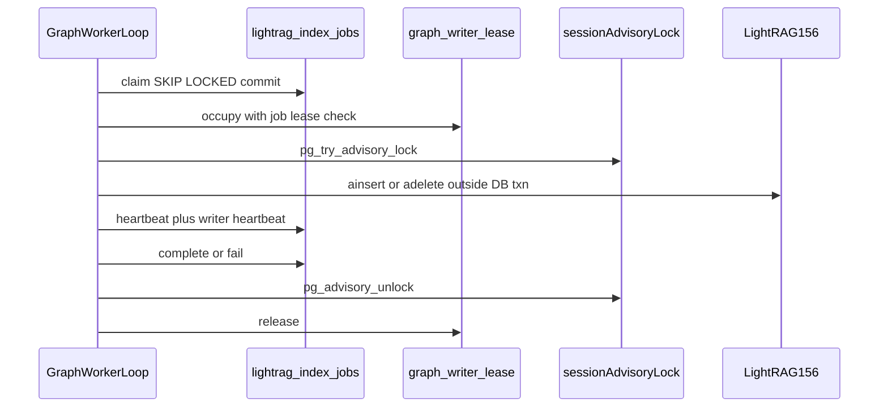
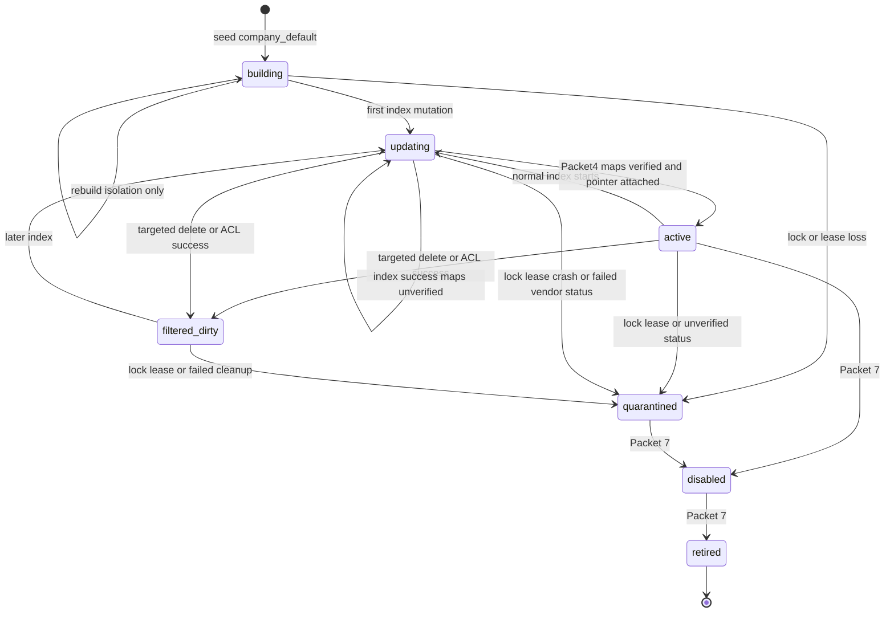

# Graph workspace lifecycle

Durable single-writer insert/delete, application advisory lock, budgets,
backlog ETA, and crash recovery for LightRAG mutations. This is not mapping
and does not flip public Graph Ready. Vendor `processed` only authorizes
Packet 4.

Related: [ADAPTER_LIFECYCLE.md](./ADAPTER_LIFECYCLE.md) ·
[LIGHTRAG_CONTRACT.md](./LIGHTRAG_CONTRACT.md) ·
[MAPPING.md](./MAPPING.md) ·
[JOB_STATE_MACHINE.md](../ingestion/JOB_STATE_MACHINE.md) ·
[INGESTION_LIMITS.md](../ingestion/INGESTION_LIMITS.md) ·
[CONFIGURATION.md](../development/CONFIGURATION.md) ·
[phase-05 evidence](../development/phase-05-graphrag-evidence.md) ·
[docs index](../README.md)

## Writer serialization

Two application layers, never the vendor schema-migration lock:

1. Durable singleton `app.graph_writer_lease` (owner, token, `expires_at`)
   occupied in the same short transaction as the job-lease check.
2. Session-level `pg_advisory_lock(key1, key2)` on a dedicated `app_worker`
   connection held for the mutation duration. Autocommit is required so no
   transaction spans extraction.

Lock keys are SHA-256 of `smart-rag-graph-writer-v1:{workspace_key}` truncated
to two positive int4 values. Connection loss releases the session lock. The
worker then cancels new effects, persists `quarantined`, and enqueues
reconciliation.

Process memory and Valkey are not writer authority. Job leases remain
required in addition to the writer lease.



## Workspace states

Durable states: `building`, `active`, `updating`, `filtered_dirty`,
`quarantined`, `disabled`, `retired`. Only one verified generation is
intended to be `active`. Packet 3 never returns `active` after insert
because maps are unverified. Successful index leaves `updating`. Packet 4
marks the version Graph Ready in one application transaction and may set
workspace `active` when maps verify **and** the singleton pointer already
names this workspace. A null pointer still allows Graph Ready on the version
and does not bump generation (Packet 7).



Pointer switch with `SELECT ... FOR UPDATE` on generation is Packet 7.
Packet 3 may attach `company_default` when the pointer is null without
bumping generation and without marking `active`. Rebuild uses a separate
`{workspace_key}__rebuild` row in `building` and does not switch the
pointer. A second LightRAG instance cannot share this process, so Packet 3
isolates that workspace only; corpus reindex is Packet 7.

## Job types and priority

| Operation | Kind | Budget kind | Pause | Success workspace |
| --- | --- | --- | --- | --- |
| `index` | normal | `graph_index` | skipped when pending index greater than 50 | `updating`, or `active` after Packet 4 maps verify and the pointer already names this workspace |
| `remove` | maintenance | `graph_maintenance` | always claimable | `filtered_dirty` |
| `graph_acl_remove` | maintenance | `graph_maintenance` | always claimable | `filtered_dirty` |
| `rebuild` | maintenance | `graph_maintenance` | always claimable | isolated `building`, pointer unchanged |
| reconciliation payload | maintenance | none extra | low priority | inspect vendor status; stay `quarantined` |

Claims already order `critical` then `high` then `normal` then `low`.
Maintenance outranks paused index admission. Hybrid ingestion continues
during the graph-handoff pause.

Idempotency for index handoff remains
`graph_index:{version_id}:{hash}:{lightrag_v1}:{graph_pipeline_v1}`.
`track_id` is monitoring only.

## Insertion contract

Before `ainsert`:

- `app.assert_graph_index_allowed`
- Hybrid Ready (`hybrid_verified_at` and public status `graph_pending`)
- document and version `graph_eligible`
- payload `content_hash` / `chunk_set_hash` match
- embedding pin `text-embedding-3-large` at 1024
- expected pointer generation when present on the payload

Text is ordered `app.document_chunks.raw_text` (`chunk_index` ascending).
Identity is `str(version_id)`. Basename is `g-{version_id}.txt`. Envelope
`bind_graph_source_text` then `ainsert(..., ids=[version_id], file_paths=[basename], track_id=fresh)`.
Chunker overlay 1200/100 `gpt-4o-mini` is stored on `config_snapshot`.

Vendor statuses `processed` and `failed` are terminal. `processed` does not
by itself change `document_versions.status`. Packet 4 mapping may set
`graph_ready` in the same job after maps verify. Replay that finds
an existing `processed` row skips a second insert.

## Budgets

`ingestion_daily` remains Hybrid ingest only. Packet 3 adds:

- `graph_index` against `company_settings.daily_graph_index_budget_usd` (default 20)
- `graph_maintenance` against `monthly_graph_maintenance_budget_usd` (default 800)

Normal jobs must not consume the maintenance reserve. Every gateway callback
goes through `CountedLightRagCallbacks`. Vendor retries stay zero;
application code owns one retry. Timeout-after-send is ledgers if a vendor
row exists; a duplicate insert is not issued.

## Recovery matrix

| Crash point | Durable result |
| --- | --- |
| Before claim | pending job unchanged |
| After claim, before writer occupy | job lease expires; reclaim |
| Writer occupy lost to peer | fail transient; no quarantine |
| Advisory lock busy | fail transient; release writer |
| Lock or lease loss during mutation | cancel new writes; `quarantined`; reconciliation job |
| `ainsert` timeout after send | poll existing vendor row; ledger possible bill |
| Vendor `failed` or unverifiable status | `quarantined`; no public ready |
| Vendor `processed` | job completed; Packet 4 maps; Graph Ready only if gates pass |
| Worker shutdown | session lock drops; reclaim plus quarantine if partial |

## Metrics

Derived only from durable rows (`GraphMetricsService`):

- pending index count and pending maintenance count
- oldest pending age
- mapping-verified completion count (zero until Packet 4)
- documents/hour from those completions only
- ETA with `insufficient-sample` while that count is zero (never fake throughput)
- attempted (reserved+committed) versus settled (committed) graph cost
- owner-approved bulk window columns on `company_settings`; null means inactive.
  Packet 3 does not invent a window or admin UI.

## Admission and worker

`JOB_LEASE_SECONDS` (default 300) is reused for job and writer leases.
`LIGHTRAG_DB_URL` unset keeps the adapter unconfigured and the graph loop
idle. The worker polls graph jobs on every cycle, including while ingestion
is busy. Graph writer concurrency remains one via lease plus advisory lock.

## Verification

```powershell
uv run python -m pytest tests/unit/test_graph_writer.py tests/unit/test_lightrag_indexer.py tests/unit/test_graph_metrics.py tests/unit/test_phase3_graph_scope_guard.py tests/unit/test_lightrag_pin.py -q
uv run python -m pytest tests/contract/test_graph_writer.py tests/contract/test_job_leases.py -q
```

[docs index](../README.md)
