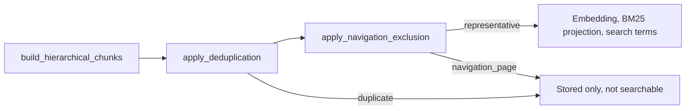

# Chunking contract

**Owning phase:** 3 (ingestion). **Policy version:** `chunking_v2` (new ingest). Historical rows may still carry `chunking_v1`; readers must remain compatible. **Tokenizer:** `cl100k_base_v1` (OpenAI `text-embedding-3-large` sizing).

## Hierarchy

Typed parser elements become **document → section (parent) → passage** chunks. Parents aggregate ordered child passage references and are bounded to **1,500 tokens** for expansion context. A parent is stored as a search representative like a passage, so it is embedded, projected to BM25, and retrievable unless deduplication or the navigation rule below excludes it.

## Passage sizing

| Rule | Value |
| --- | --- |
| Ordinary prose target | **200–400 tokens** (≥90% of ordinary prose fixtures) |
| Adjacent prose-sibling overlap | **40–60 tokens** |
| Normal hard cap | **600 tokens** |
| Parent section cap | **1,500 tokens** |

`chunking_v1` kept 401–600 token ordinary prose unsplit. `chunking_v2` splits that band toward 200–400 using paragraph then sentence boundaries, then token windows. Page-break elements still flush the prose buffer; page-boundary merge is allowed only when the parser proves continuous reading order and the same heading ancestry. Cross-heading merge is forbidden. Parents are not counted as ordinary prose.

Count-only analysis of private PDF SHA-256
`72cdfc0f74bb1f60e0b61e950da06683e2db0aa04e90a59bdf271fcedfecf1f1`
on 2026-09-09: 640 ordinary passages, 495 in 200–400 (**0.7734**), 134
under 200, 11 in 401–600, 0 over 600. Parser kinds were paragraph/page_break/figure
only (zero headings). PDF heading extraction (`parser_v1_pdf_headings_v1`)
is additive and does not relax the 200–400 token band or 600-token cap.
Live 2026-09-10 parse of that PDF with `parser_v1_pdf_headings_v1` (per-line
blocks plus same-size bold headings) produced 3555 chunks and failed
`embedding_batch_over_limit` (2048). `parser_v1_pdf_headings_v2` keeps
standalone large titles as headings, leaves same-size bold labels as
paragraphs, and merges consecutive body lines before chunking. Live
Graph-disabled ingest of that hash with `parser_v1_pdf_headings_v2` produced
1045 chunks and 274 distinct `section_path` values, all under the 2048
embedding input cap. The 90% gate
is a Packet 5 stop, not a reason to relax merge rules. `document_chunks.page_number` is the 1-based PDF file
page (`page_index + 1`). Printed `/PageLabels` values (roman or arabic) are
copied onto provenance locators as `page_label`. Chat company-PDF chips use
the typed toolbar page (`pdf_page_number` = `page_index + 1`) and must not
treat `page_label` as the displayed page.

PDF line joins (`parser_v1_pdf_reflow_v4`, `join_pdf_lines` in
`ingestion/parser/helpers.py`): lines of one PyMuPDF block join with a
space, and lines of different blocks join with `PARAGRAPH_DELIMITER`
(`\n\n`). When a line ends in a letter plus ASCII `-`, U+2010 HYPHEN,
or U+00AD SOFT HYPHEN (`LINE_END_HYPHENS`) and the next line starts
lowercase, the two join with no hyphen and no space. Before v4 only
ASCII `-` joined, so typeset books stored letter + U+2010 + space +
letter splits (719 of 1,016 chunks of the private PDF above). Limits:
a real compound broken at its own hyphen at a line end loses the
hyphen, and a suspended hyphen at a line end is joined to the next
word. Hyphens inside a line are untouched. Any change to this rule
changes `PDF_PARSER_VERSION`, the parser config hash, and every PDF
chunk ID, so the stored document needs a re-ingest.

## Atomicity

- **Tables:** split only between rows; repeat header row on each row-chunk.
- **Lists:** split only between top-level items; retain list introduction on each item-chunk.
- **Code/captions:** never split silently. Oversized atomics use a documented fragment fallback sharing one `atomic_element_id`, full locators, order, `fragment_ordinal`, and `is_atomic_exception`.

## Stable IDs

Chunk IDs are UUID5 values derived from document/version namespace, element IDs/path, normalized content hash, parser/cleaning/chunking/tokenizer/dedup versions, and fragment ordinal. Identical inputs/config replay to identical IDs.

## Deduplication

- **Exact:** normalized SHA-256 within a version; keep one searchable representative plus every duplicate locator and `duplicate_of_chunk_id`.
- **Near (intra-version only):** 5-word-shingle Jaccard ≥ **0.92** when fuzzy policy meets **≥99% precision** and **≥85% recall** on fixtures; otherwise **exact-only** fallback (`dedup_v1`). Current fixture evaluation: precision **1.0**, recall **0.5** → **exact-only active**.
- **Cross-document:** never hard-delete; authority/date may differ.

## Navigation pages

`apply_navigation_exclusion` (`ingestion/chunking/navigation.py`, policy
`navigation_v1`) runs right after deduplication. It judges every chunk
that is still a search representative, passage or parent, on its own
`raw_text`. A flagged chunk stays stored with its locators and gets
`is_search_representative = false`, `duplicate_of_chunk_id = NULL`, and
provenance `search_exclusion_reason = "navigation_page"`. The existing
representative filters keep it out of embedding, the BM25 projection,
deterministic and title search terms, and the dense, BM25, and term
channels. No migration: provenance is JSONB.



**Meaning of the flag.** `is_search_representative = false` has two
causes: `duplicate_of_chunk_id` set (exact duplicate of that chunk), or
`duplicate_of_chunk_id` NULL with reason `navigation_page`. No reader
dereferences `duplicate_of_chunk_id` except the repository insert
order, which accepts NULL.

**Rule (structure only; never a title, hash, page number, heading, or
format).** Dot leaders become spaces and text splits on whitespace. A
page reference is 1 to 4 digits, optionally a range joined by `-` or
U+2010 to U+2014, or a lowercase roman numeral of two or more letters,
with trailing `,;:.` ignored. A run of consecutive page references
closes one entry. A chunk is navigation when it has at least 3 runs, at
most 5.0 words per run, and at most 1.0 sentence break per 100 tokens.
Entries are counted instead of lines because PDF reflow joins the lines
of one block (median 3 lines of about 57 tokens per contents chunk).

**Parents, children, guard.** Each chunk is judged on its own text, so
an index parent is flagged even when one child is only a letter
heading; a child is never excluded because its parent is. Parent
context expansion does not filter on the flag, so a representative
child of an excluded parent can still expand to index text. If every
representative of a version would be flagged, nothing is flagged.

| Calibration group (private PDF above) | Chunks | Flagged | Words per run (3+ runs) | Sentence breaks per 100 tokens |
| --- | ---: | ---: | --- | --- |
| Contents passages and parent | 13 | 13 | 1.67–3.80 | 0 |
| Index passages and parents | 74 | 55 | 2.00–4.33 | 0 |
| Glossary passages and parent | 7 | 0 | 274.5 (parent only) | 5.63–8.05 |
| Prose passages and parents | 922 | 0 | 5.83–316 | 0–8.11 |

**Limits.** Index fragments with fewer than 3 runs stay searchable (19
of 74, each at most 13 tokens). Short-label number tables and code
listings with per-line numbers can match. A lowercase word that is a
valid roman numeral (`mix`, `cm`) counts as a page reference. LightRAG
source loading (`jobs/graph_source_text.py`,
`jobs/graph_mapping_persist.py`) reads undeleted chunks without this
flag, so graph-eligible documents still send navigation chunks to graph
extraction. `navigation_v1` is in the chunking config hash, not in the
chunk ID; re-chunking a version under a new rule keeps IDs and the
upsert rewrites the flag and provenance.

## Stored book after the answer-loss re-ingest (2026-09-25)

Counts only (private report `a8_version_report.py`). Document `95e6c763`
was soft-deleted and the same PDF was uploaded as document
`b56d5774`, version `d7e3206a` (`parser_v1_pdf_reflow_v4`,
`navigation_v1`, `graph_ineligible`).

| Measure | Before (`e119bf87`) | After (`d7e3206a`) |
| --- | ---: | ---: |
| Chunks (passages / parents) | 1,016 (742 / 274) | 1,005 (731 / 274) |
| Search representatives | 1,015 | 936 |
| Exact duplicates | 1 | 1 |
| Navigation exclusions (parents) | 0 (0) | 68 (20) |
| Chunks with a letter, U+2010, space, letter split | 719 | 7 |
| Split occurrences | 2,732 | 8 |
| Glossary chunks searchable (pp. 337-340) | 7 / 7 | 7 / 7 |
| Representatives without an embedding | 0 | 0 |
| Completed embedding ledger inputs | 1,015 | 936 |

On the 11-question subset (a01-a10, a38), the fact chunk reached
dense, BM25, fused, rerank-pool, and selected evidence in 11, 4, 9,
9, and 9 questions, against 11, 5, 9, 9, and 8 before. The
generated answer held the fact in 8 questions and the released answer
in 7, against 8 and 2 before. Outcomes: `strict_phrase` 6,
`verifier_refusal_after_fusion` 4, `wrong_phrasing` 1.

## Heading inventory (Phase 4 consumer)

Phase 3 stores heading ancestry on each chunk (`section_path`). Phase 4 whole-document coverage uses the **authorized current heading inventory**: distinct `section_path` values on current, undeleted, ACL-visible chunks of exactly one document version. Do not create a second inventory table.

## Typed tables

CSV/XLSX cells materialize to private **`table-artifacts`** Parquet (`table_parquet_v1`) with explicit Arrow schema, provenance JSON per row, manifest hash linkage, and no flatten-only prose substitution. Hybrid indexing treats those Parquet artifacts as sufficient content: `build_hierarchical_chunks` returns no passages for `csv`/`xlsx`, and `index_hybrid_content` persists tables without calling the embedding gateway. BM25 verification then accepts a matching empty projection when `document_tables` rows exist.

## Verification

```bash
uv run pytest tests/unit/test_navigation_exclusion.py tests/unit/test_pdf_line_joins.py tests/unit/test_chunking_service.py tests/unit/test_chunking_dedup.py tests/unit/test_table_parquet.py tests/contract/test_duckdb_parquet_sandbox.py -q
```

Related: [INGESTION_LIMITS.md](./INGESTION_LIMITS.md) · [docs index](../README.md)
