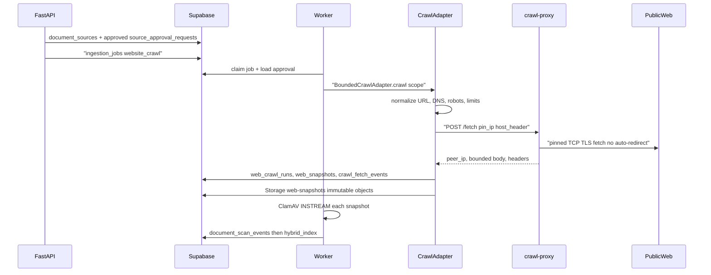

# Approved crawl policy

Phase 3 Packet 4 constrains website ingestion to **owner/admin-approved** origins fetched **only** through the restricted `crawl-proxy` service. API, worker, and future parser sandboxes must not open direct public HTTP(S) sockets.

Related: [INGESTION_LIMITS.md](./INGESTION_LIMITS.md) · [SCAN_BEFORE_INDEX.md](./SCAN_BEFORE_INDEX.md) · [CRAWL_EGRESS_AND_PROXY.md](../runbooks/CRAWL_EGRESS_AND_PROXY.md)

## Flow



## Policy gates (fail closed)

| Gate | Behavior |
| --- | --- |
| Approval | Latest `source_approval_requests.status = approved`, non-expired, domain/start URL bound |
| URL normalize | HTTP/HTTPS only; no userinfo; no fragments; allowed ports; max length |
| IP literals | Reject decimal/octal/hex/IPv6-mapped-private/zone IDs |
| DNS | Resolve all A/AAAA; reject private/loopback/link-local/metadata/mixed answers |
| Peer pin | Proxy connects to `pin_ip`; mismatch fails closed |
| Redirects | Disabled in proxy; core revalidates every hop |
| Headers | Strip Authorization/Cookie/Proxy-Authorization |
| Robots | RFC 9309 evaluation after security checks; deny cannot broaden access |
| MIME | `text/html`, `text/plain`, `application/xhtml+xml` only |
| Bytes | Wire/decoded per-page and per-crawl totals; decompression ratio cap |

## Provenance

Each crawl writes:

- `app.web_crawl_runs` — run status, totals, policy version
- `app.web_snapshots` — immutable Storage path, hash, redirect chain, peer/DNS metadata
- `app.crawl_fetch_events` — append-only per-hop decisions (allowed/denied/failed)

Storage layout: `web-snapshots/sources/{source_id}/crawls/{crawl_version}/{hash}.html`

## Verification

```bash
uv run pytest tests/unit/test_crawl_policy.py tests/unit/test_crawl_proxy.py -q
uv run pytest tests/contract/test_crawl_ssrf.py -q
```
