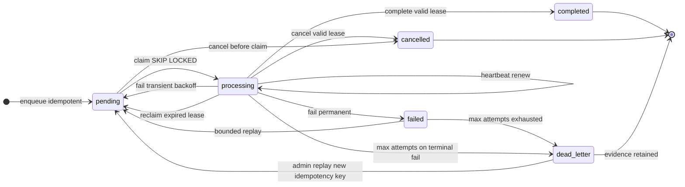
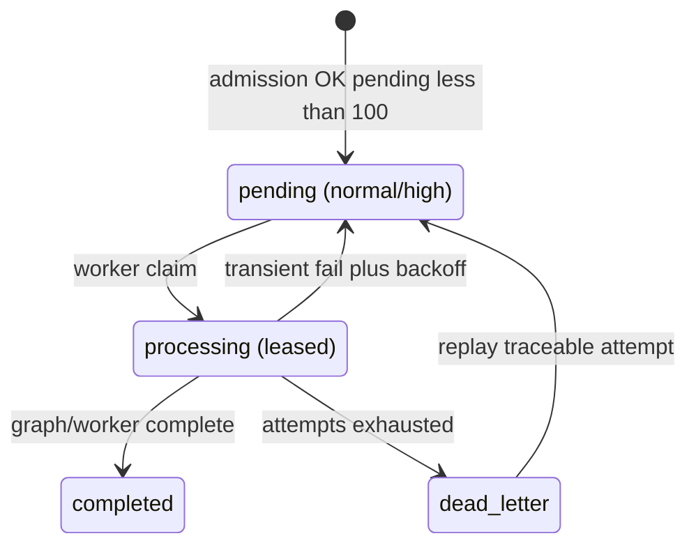
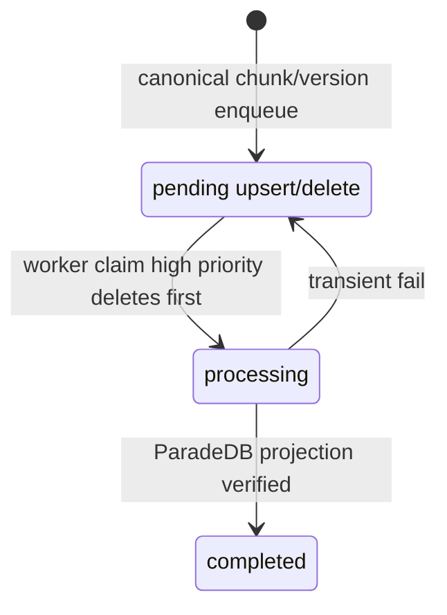
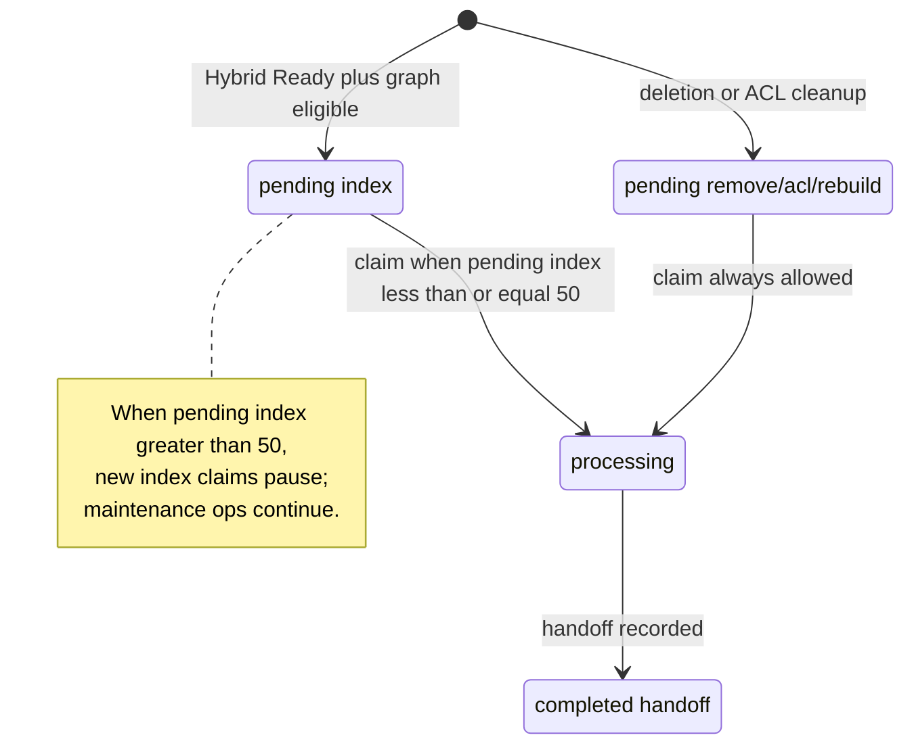

# Durable job state machine

State transitions for Phase 3 durable queues: ingestion, BM25 projection, LightRAG graph handoff, deletion/ACL cleanup, and dead-letter handling. Queue authority is Supabase Postgres only; Valkey is never authoritative.

Related: [INGESTION_LIMITS.md](./INGESTION_LIMITS.md) · [Phase 3 evidence](../development/phase-03-ingestion-evidence.md)

## Shared lifecycle

All primary queue tables (`app.ingestion_jobs`, `app.bm25_index_jobs`, `app.lightrag_index_jobs`) share `app.job_status` and lease columns documented in Phase 2.

## Priority bands

| Priority | Typical workloads |
| --- | --- |
| `critical` | Security cleanup, legal hold, forced deletion |
| `high` | Deletion/ACL BM25 purge, graph ACL remove |
| `normal` | Scan/parse/chunk/embed, BM25 upsert, graph index handoff |
| `low` | Reconciliation, deferred rebuild batches |

Claims order `critical` → `high` → `normal` → `low`, then age (`created_at`), then `estimated_size_bytes`.

## Ingestion jobs

Admission rejects enqueue when pending ingestion jobs ≥ **100** or daily ingestion budget reservation fails.

## BM25 index jobs

## Graph handoff (LightRAG index jobs)

Phase 3 stops at durable `Graph Pending` handoff; Phase 5 owns graph mutation.

## Dead-letter queue

`app.dead_letter_jobs` preserves terminal failure evidence. Replay creates a **new** primary-queue row with a fresh `idempotency_key` and `payload_ref.replay_of` pointing at the dead-letter/source job. Original dead-letter rows are never deleted by replay.

## Side-effect ledger

`app.job_operation_ledger` dedupes graph/worker side effects by `(job_table, job_id, operation_key)`. Valid writes require a non-expired lease token on the owning job row. Lease loss or cancellation blocks new ledger inserts.

## Checkpointer boundary

LangGraph checkpoints store compact IDs/tokens/hashes only—never raw bytes, local paths, or secrets. Phase 3 probe graph uses in-memory checkpointer because `langgraph-checkpoint-postgres` is not yet pinned; production wiring follows the Phase 2 bootstrap migration in `langgraph` schema without runtime auto-migrate.
