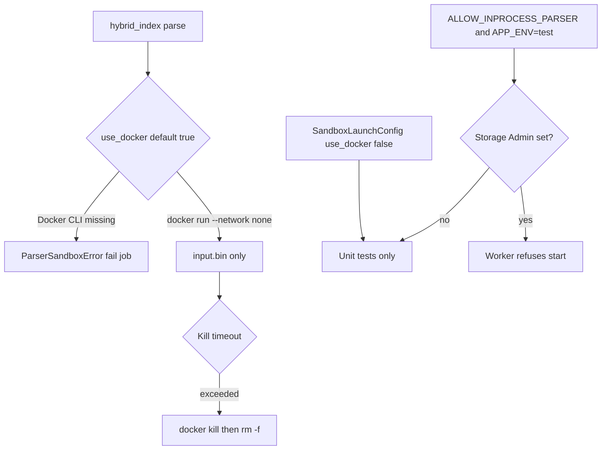

# Parser sandbox fail-closed

Untrusted parse/OCR runs in a no-network Docker (gVisor-capable) sandbox.
Missing Docker does **not** fall back to in-process parsing next to worker
secrets.

Related: [SCAN_BEFORE_INDEX.md](./SCAN_BEFORE_INDEX.md) · [INGESTION_LIMITS.md](./INGESTION_LIMITS.md) · [ADR-parser-isolation.md](../adr/ADR-parser-isolation.md) · [PARSER_BAKEOFF.md](../evaluation/PARSER_BAKEOFF.md) · [ADR-anydoc-local-parser-bakeoff.md](../adr/ADR-anydoc-local-parser-bakeoff.md)

## Launch policy



| Mode | When allowed |
| --- | --- |
| Docker sandbox | Default for `ParserSandboxLauncher()` and worker jobs |
| Explicit in-process | Callers pass `SandboxLaunchConfig(use_docker=False)` (unit tests) |
| Env in-process | `ALLOW_INPROCESS_PARSER=true` **and** `APP_ENV=test` only |

Worker start fails when Docker is unavailable and in-process is not permitted.
If in-process would be used, the worker also refuses to start when
`SUPABASE_STORAGE_ADMIN_SECRET` is set.

## Input path and ZIP bombs

Sandbox host files are always named `input.bin`. Original filenames are format
hints only. ZIP members are stream-extracted against a hard expanded-byte cap;
parent-traversing member names fail closed. Timed-out containers are
`docker kill`'d by the unique `--name`.

## Environment

| Variable | Default | Notes |
| --- | --- | --- |
| `ALLOW_INPROCESS_PARSER` | false | Worker settings; invalid unless `APP_ENV=test` |
| `APP_ENV` | local | Must be `test` for in-process parsing |

## Verification

```bash
uv run pytest tests/unit/test_parser_sandbox.py tests/contract/test_parser_sandbox.py tests/contract/test_privileged_secrets_absent.py -q
```

## Failure modes

| Condition | Route |
| --- | --- |
| Docker missing on worker | Startup `parser_sandbox_docker_required` |
| Docker missing mid-job | `ParserSandboxError`; job fails |
| In-process + Storage Admin | Startup `inprocess_parser_forbidden_with_storage_admin_secret` |
| ZIP bomb / path traversal | Failed parse, zero elements |

## Troubleshooting

Build `smart-rag-parser-sandbox:local` before live parse jobs. Do not set
`ALLOW_INPROCESS_PARSER` on staging or production. Do not copy Storage Admin
into a worker that parses in-process.
