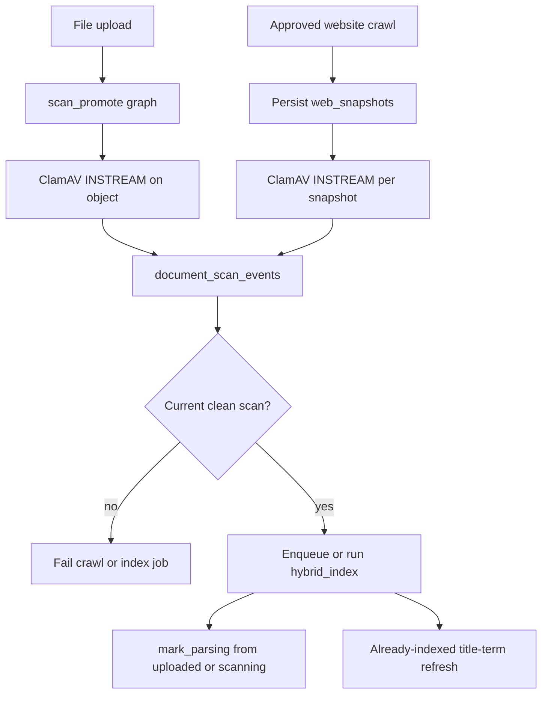

# Scan before hybrid index

Website snapshots and file uploads must have a **current clean** ClamAV row in
`app.document_scan_events` before `hybrid_index` may parse or embed. Fake clean
scan success is forbidden.

Related: [PARSER_SANDBOX.md](./PARSER_SANDBOX.md) · [CRAWL_POLICY.md](./CRAWL_POLICY.md) · [CLAMAV_SCAN_AND_PROMOTION.md](../runbooks/CLAMAV_SCAN_AND_PROMOTION.md)

## Flow



## File uploads

`scan_promote` downloads exact Storage bytes, scans with the existing ClamAV
client, inserts an append-only scan event, then promotes and enqueues
`hybrid_index`. Dirty, stale, hash-mismatch, or unscannable results stay
quarantined.

## Website crawls

After snapshots persist, the crawl graph calls `scan_object_bytes` for each
snapshot (same ClamAV path as scan-promote). It does not invent a second
scanner. Missing Storage/ClamAV configuration or any non-clean result fails
the crawl job and **does not** enqueue `hybrid_index`.

## Index gate

`mark_parsing_for_index` refuses `uploaded` without a current clean scan except
explicit `APP_ENV=test` fixtures that set `allow_index_without_scan`. Already
indexed public statuses (`hybrid_ready`, `graph_ineligible`) skip parse/scan
and call
`app.sync_document_title_search_terms` so a title rename can refresh terms
without a full re-parse. Crawl runs require a current clean event for
**every** snapshot hash. Index governance loads scan freshness, attestation
policy version, declared category, and `subprocessor_matrix_verified` from
worker settings. Content class is `real_company` unless the payload explicitly
says `synthetic`.

## Verification

```bash
uv run pytest tests/contract/test_hybrid_index_enqueue.py tests/unit/test_index_scan_gate.py tests/unit/test_parser_sandbox.py -q
```

## Failure modes

| Condition | Route |
| --- | --- |
| No scan row / stale >24h | `missing_or_stale_scan`; job fails |
| Infected / unscannable snapshot | Crawl fails; no hybrid_index |
| ClamAV unreachable | Crawl/scan fails closed; never fake clean |
| Real company + unverified matrix | Embedding governance denies |

## Troubleshooting

If hybrid_index fails with `missing_or_stale_scan`, inspect
`app.document_scan_events` for the version hash. Re-run scan-promote or crawl
after ClamAV signatures are current. Do not set `scan_evidence_current=True`
in graph code.
