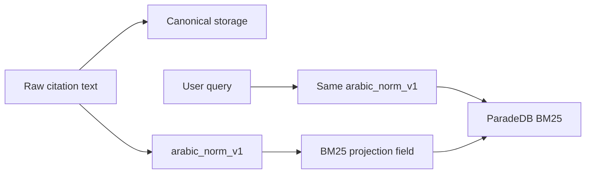

# Arabic normalization (`arabic_norm_v1`)

**Owning phase:** 2 (migration + conformance). Phase 4 consumes this for BM25 retrieval behavior.

## Contract

| Item | Value |
| --- | --- |
| Version id | `arabic_norm_v1` |
| SQL | `search.normalize_arabic_v1(text)` (immutable, schema-qualified) |
| Core | `smart_rag_core.text.normalize_arabic_v1` |
| ParadeDB | `infra/paradedb/sql/arabic_norm_v1.sql` (same function) |
| Fixtures | `tests/fixtures/arabic_normalization/arabic_norm_v1.json` |

Raw source text, citation display, and logical offsets **never** use the search form.

## Transformations (ordered)

1. Unicode NFC
2. Strip harakat / tatweel / annotation marks
3. Fold alef/hamza variants, ya/alef-maqsura, ta-marbuta→ه, Arabic-Indic digits→ASCII
4. Latin `lower`
5. Replace punctuation (except hyphen) with spaces
6. Collapse whitespace; trim

Idempotent: normalizing an already-normalized string is a no-op.

## Failure modes

- SQL/core/ParadeDB drift → Packet 1 parity tests fail; BM25 must not ship.
- Query-time version ≠ active projection version → fail closed / degrade (ParadeDB `search.assert_arabic_normalization_version`).

## Verification

```powershell
uv run pytest tests/contract/test_arabic_normalization_parity.py -q
```

## Diagram



[docs index](../README.md) · [BM25 projection](../architecture/07-bm25-projection.md)
