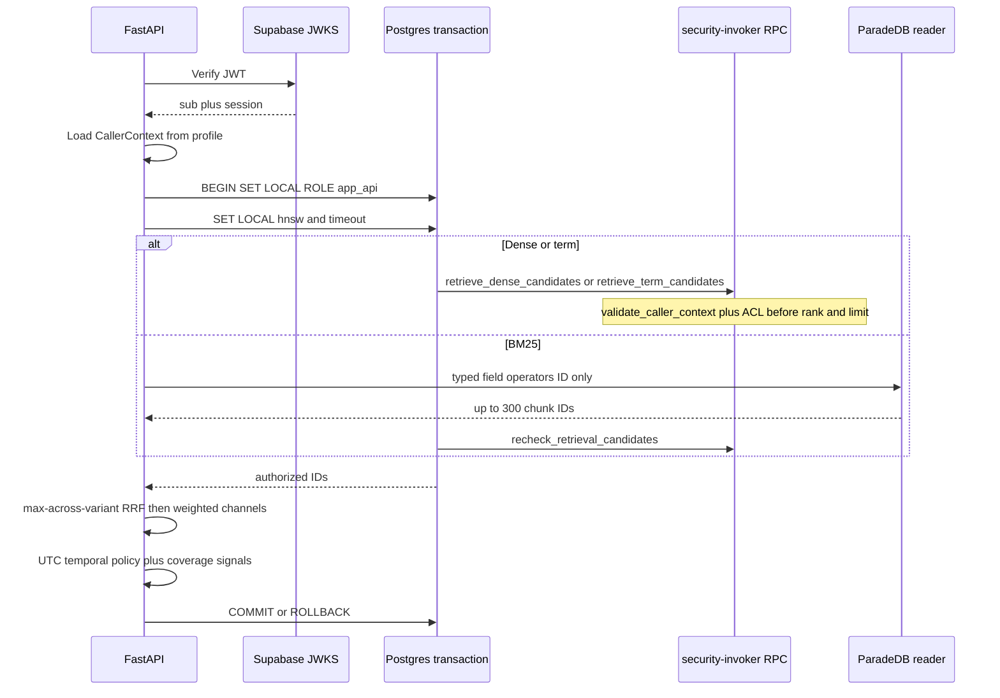
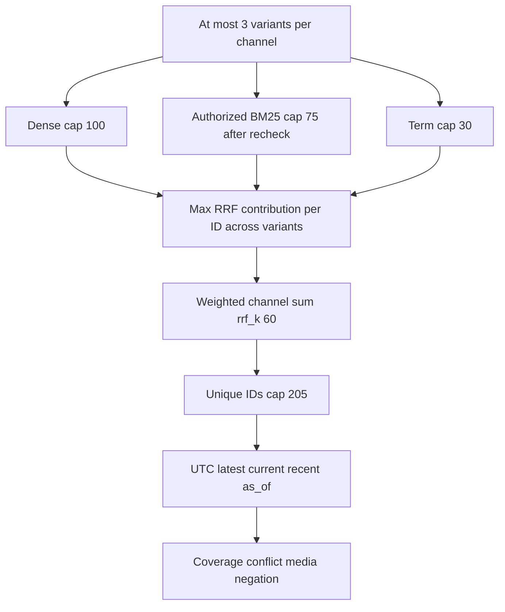
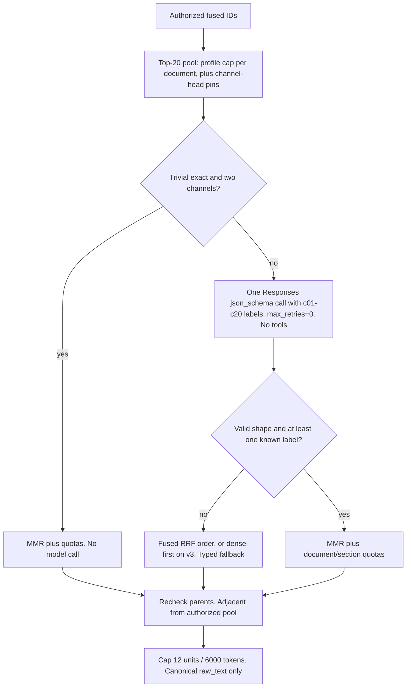
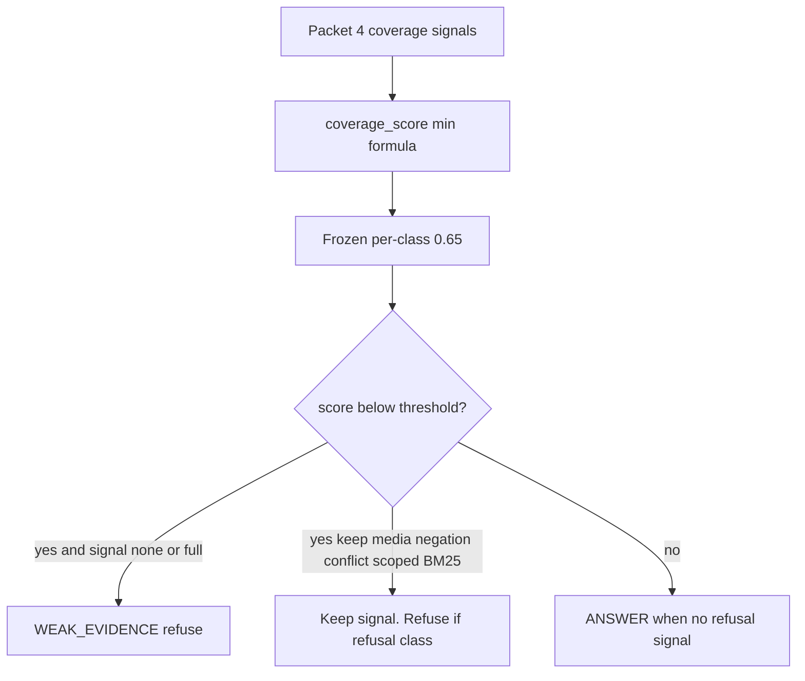

# Hybrid retrieval contract

Single source for versioned Hybrid channel profiles. Packet 2 freezes dense,
BM25, term, HNSW, and authorization foundations. Packet 3 freezes
``hybrid_default_v1`` as the only query-profile retrieval ID. Packet 4 freezes
RRF, channel weights, the 205 pre-fusion union, UTC temporal policies, coverage
signals, and the versioned cache-key/recheck interface. Packet 5 freezes the
top-20 OpenAI rerank contract, skip policy, MMR/quotas, and parent expansion.
Packet 6 freezes per-class ``coverage_score`` thresholds at ``0.65`` in the
hashed artifact ``retrieval/frozen/hybrid_default_v1.json``. Packet 8 froze
those values as the winning profile and recorded a holdout **no-go**. Holdout is never
used for tuning. Unequal RRF weights and a different ``rrf_k`` were **not**
selected. Frozen profile values in this file were **not** retuned after Packet 9.

## Source selectors and duplicate copies

Named authorized titles are scope selectors only. After an exact-one
authorized match, the title is stripped from the ranking query so selector
tokens cannot dominate dense or BM25 ranking. Ambiguous and unauthorized
names stay unscoped and indistinguishable. Exact duplicate citation text is
collapsed after ACL and current-version recheck; documents are never deleted
automatically. The term channel searches the ranking sentence plus bounded
extracted codes, acronyms, entities, and aliases. BM25 unique capping
round-robins variants so one variant cannot consume the survivor cap.

## Long-document runtime profile (P06-62)

`hybrid_long_document_v3` is the runtime long-document profile (answer-loss
repair A4). Runtime retrieve loads it after an exact-one authorized
version scope with more than five representatives, and also when the
question stays unscoped or ambiguous, the caller can read 1 to 8 current
documents, and the largest of those documents has more than five
representatives (`small_corpus_long_document`). The small-corpus path
does not apply a version filter. Trivial exact lookups stay on
`hybrid_default_v1`. The failed `hybrid_long_document_v1.json` digest stays
unfrozen. OpenAI rerank starts only when remaining retrieve-slice
seconds are at least `RERANK_RESERVED_SECONDS` (3.0). Version-scoped
exact dense starts only when the retrieve slice is at least
`EXACT_START_MIN_SLICE_SECONDS` (25, equal to `HYBRID_DEADLINE_SECONDS`).
Production Ask remaining is below that after profile and embedding, so
ANN starts first. The 25s Hybrid ceiling is not raised. The P06-70
gate that required this admission is
[p06-70-stage-isolation-2026-09-21.md](../development/phase-06/p06-70-stage-isolation-2026-09-21.md)
(`deadline_budget`).

`hybrid_long_document_v3` copies `hybrid_long_document_v2` and adds two
fields. `dense_head_pin` 12 pins the first 12 authorized dense IDs into
the rerank pool; the BM25 pin stays `CHANNEL_HEAD_PIN` (5), and pins still
cannot add an ID outside the fused list. `fallback_order` `dense_first`
applies only when rerank does not complete (the reserve gate skipped it,
or the call returned a fallback reason other than `none`): pool members
found by dense search come first in dense-rank order, then the rest in
fused order. A partial `rerank_v2` ranking counts as completed; only its
appended tail uses that order. MMR, quotas, parent expansion, the 12-unit
cap, and the 6000-token budget are unchanged. Both fields default to the
old behavior (`5`, `rrf`), so `hybrid_default_v1` and
`hybrid_long_document_v2` bytes and digests are unchanged. Canonical
SHA-256 `9906823616660f79d9a4d40d936f811961e127e095acd7d389b3e0d23f51d6c8`
(`FROZEN_LONG_DOCUMENT_V3_PROFILE_SHA256`). Rollback: route to
`hybrid_long_document_v2`, which stays pinned and loadable. For v3 this
replaces the rule "falls back to deterministic RRF", approved in
[ADR-retrieved-answer-loss-repair.md](../adr/ADR-retrieved-answer-loss-repair.md).

Channel-phase window (answer-loss repair A5): channels wait only
`min(slice, max(CHANNEL_MIN_SECONDS, slice - RERANK_RESERVED_SECONDS - CHANNEL_PHASE_RESERVE_SECONDS))`
with `CHANNEL_MIN_SECONDS` 2.0 and `CHANNEL_PHASE_RESERVE_SECONDS` 1.5
(p90 of measured post-channel work, approved as decision D5). A channel still
running then is a channel timeout, as before. The slice, the 25 s Hybrid
deadline, and the 50 s run deadline are unchanged. Cutting a channel early can
cost recall; see [HYBRID_STAGE_TIMINGS_2026-09.md](../evaluation/HYBRID_STAGE_TIMINGS_2026-09.md).

## Stage timings and rerank sub-codes

`HybridBranchDiagnostics` carries two ID-free fields.
`stage_timings_ms` maps stage names to non-negative integer
milliseconds. Allowed keys are `HYBRID_STAGE_TIMING_KEYS` in
`retrieval/profiles.py`: `scope_ms`, `embed_ms`, `channels_ms`,
`channel_dense_ms`, `channel_bm25_ms`, `channel_term_ms`,
`assemble_ms`, `temporal_load_ms`, `pool_preload_ms`,
`rerank_gate_remaining_ms`, `rerank_call_ms`, `selection_ms`,
`locator_reload_ms`, and `retrieve_total_ms`. A channel that timed out
has no `channel_*_ms` key. `rerank_call_ms` exists only when the
rerank callback ran, so a `rerank_timeout` without it means the
remaining-slice gate skipped the call. `rerank_gate_remaining_ms` is
the remaining slice that the gate compared with
`RERANK_RESERVED_SECONDS`; it is measured before pool preload. Cache
hits and fail-closed returns carry only `scope_ms`.

`rerank_invalid_subcode` is `json`, `hash`, `length`, `duplicate`, or
`unknown_id` when `rerank_fallback` is `rerank_schema_invalid` and the
payload failed application validation (`RerankPayloadError`). It is
empty otherwise, including when the provider text was not JSON (the
gateway fails before a payload exists). The diagnostics builder drops
unknown keys, negative values, and unknown sub-codes instead of
failing the branch.

`scripts/eval_ask_stage_export.py` writes both fields per run
(`unknown` for older checkpoints). Its per-run
`bm25_degraded_explicit` is `False` when `fallback_reason` is `none`
or empty, and runs with `none` do not lower the aggregate flag.
Measured values:
[HYBRID_STAGE_TIMINGS_2026-09.md](../evaluation/HYBRID_STAGE_TIMINGS_2026-09.md).

## Claim hygiene (Packet 9 metrics)

Do not quote Hybrid Recall@10 / exact-code@5 / alias@10 as launch, Combined,
or production quality without these qualifiers. Profile numbers above stay
frozen; this section does not retune them.

- Corpus and labels are synthetic (`synthetic_provisional`); compact
  markdown; sidecar-mapped UUIDs. Holdout remains sealed
  (`holdout_opened=false`).
- Packet 9 live ranked-ID used **identity rerank**
  (`rerank_call_count=0`), not live OpenAI Responses rerank. The rerank
  contract in this file exists; the published Recall@K numbers do not
  include it.
- Locator correctness is not citation-assembler completeness (QT-EVAL-002
  locators ≠ citation completeness).
- Structured-table labeled Parquet eval did **not** run
  (`execute_compiled_query` count 0); table p95 is `not_run`.

See [PHASE4_RANKED_IDS.md](../evaluation/PHASE4_RANKED_IDS.md).

Related: [ARABIC_NORMALIZATION.md](./ARABIC_NORMALIZATION.md) ·
[BM25_PROJECTION_CONTRACT.md](./BM25_PROJECTION_CONTRACT.md) ·
[HYBRID_TUNING.md](./HYBRID_TUNING.md) ·
[PROHIBITED_V1_METHODS.md](./PROHIBITED_V1_METHODS.md) ·
[STRUCTURED_TABLE.md](./STRUCTURED_TABLE.md) ·
[QUALITY_TARGETS.md](../QUALITY_TARGETS.md) ·
[IDENTITY_PROPAGATION.md](../security/IDENTITY_PROPAGATION.md) ·
[COVERAGE_CALIBRATION.md](../evaluation/COVERAGE_CALIBRATION.md) ·
[COVERAGE_QUALIFICATION.md](../evaluation/COVERAGE_QUALIFICATION.md) ·
[RERANK_COUNTERFACTUAL.md](../evaluation/RERANK_COUNTERFACTUAL.md) ·
[PHASE4_FREEZE.md](../evaluation/PHASE4_FREEZE.md) ·
[PHASE4_ABLATIONS.md](../evaluation/PHASE4_ABLATIONS.md) ·
[PHASE4_HOLDOUT.md](../evaluation/PHASE4_HOLDOUT.md) ·
[PHASE4_RANKED_IDS.md](../evaluation/PHASE4_RANKED_IDS.md) ·
[phase-04 evidence](../development/phase-04-hybrid-rag-evidence.md)

## Protocol



Direct/pooled SQL does not inherit JWT identity. Caller IDs passed into RPCs
are **server-derived** and rechecked against live `profiles` and
`authorization_version`. PostgREST/anon/authenticated/`service_role` are not
granted retrieval EXECUTE.

## Frozen Packet 2 values

Every row records unit, source/baseline, allowed range, selected value,
dataset/config version, metric evidence, owner, rollback, and review trigger.

| Tunable | Unit | Source / baseline | Allowed range | Selected | Dataset / config | Evidence | Owner | Rollback | Review trigger |
| --- | --- | --- | --- | --- | --- | --- | --- | --- | --- |
| Dense candidate cap | IDs / query | Plan Packet 2 / skill | 1–100 | **100** | `phase4-dataset-v1` (not ingested) | SQL `LEAST(..., 100)` plus fixture clamp | retrieval | 100 | Packet 4 fusion |
| BM25 scan cap | IDs | Plan: 300 over 3 pages | 1–300 | **300** one top-N (no keyset) | `bm25_v1` | Typed queries; keyset not qualified on pg_search 0.25.2 | retrieval | 300 | If pin qualifies stable cursors |
| BM25 authorized survivors | IDs | Plan | 1–75 | **75** | `bm25_v1` | Recheck `LIMIT 75` | retrieval | 75 | Packet 4 |
| Term candidate cap | IDs | Plan | 1–30 | **30** | identifier-rules-v1 | SQL clamp | retrieval | 30 | Packet 6 calibration |
| Exact fallback row cap | authorized rows | Plan | ≤10,000 | **10,000** | `app.retrieval_exact_row_cap()` | Hard count, not planner estimate | retrieval | 10,000 | Envelope change |
| `hnsw.iterative_scan` | enum | pgvector 0.8 default `off` | `off` / `relaxed_order` / `strict_order` | **strict_order** | pgvector 0.8.0 local | Does **not** make HNSW exact | retrieval | `strict_order` | pgvector major bump |
| `hnsw.ef_search` low/medium/high | integer | pgvector default **40** | 4–1000 | **40 / 80 / 120** | seeded fixture | Fixture ANN IDs matched exact top-5 | retrieval | 40 | Packet 6 on development set |
| `hnsw.max_scan_tuples` | tuples (approx) | pgvector default 20,000 | ≥1 | **8000 / 16000 / 20000** | seeded fixture | Approximate visit bound, not a hard cap | retrieval | 20000 | Underfill vs exact oracle |
| `hnsw.scan_mem_multiplier` | × `work_mem` | pgvector default 1 | 1–1000 | **2** | pgvector 0.8 docs | Scales `work_mem` only | retrieval | 1 | Memory pressure |
| Retrieval `work_mem` | bytes | `app_api` role 8MB | bounded | **32MB** SET LOCAL | role timeouts Packet 2 | Transaction-local | retrieval | 8MB | Pool OOM |
| Statement timeout | ms | Hybrid p95 2s first evidence; `app_api` 15s | < 15s role default | **8000** | QT-LAT-001 | SET LOCAL | retrieval | 8000 | Latency miss |
| Trigram threshold | similarity | pg_trgm default 0.3 | 0–1 | **0.3** | pg_trgm | SET LOCAL `pg_trgm.similarity_threshold` | retrieval | 0.3 | Packet 6 |
| Vector opclass | — | ADR embedding | cosine | **`vector_cosine_ops` 1024** | ADR-embedding-model-dimension | HNSW index | retrieval | cosine | New embedding ADR |
| Arabic normalizer | version | Phase 2 | `arabic_norm_v1` only | **arabic_norm_v1** | parity fixtures | Byte-identical core/SQL/ParadeDB | retrieval | none | Second normalizer forbidden |
| BM25 tokenizer | — | Phase 2 pin | unicode_words, no stemmer | **`pdb.unicode_words`** | pg_search 0.25.2 | No English stemmer on Arabic | retrieval | unicode_words | Ablation packet |
| BM25 field order | priority | Plan | title > heading/alias > body | **title, heading, alias, body** | `bm25_v1` | Separate parameterized field queries | retrieval | same | Packet 4 boosts |
| BM25 operators | enum | ParadeDB match/phrase | `\|\|\|` `&&&` `###` | typed only; **no `pdb.parse`** | contract tests | Injection text stays a bound parameter | retrieval | typed | Pin change |
| Fallback `bm25_unavailable` | reason | Plan | enum | recorded, dense+term continue | Packet 2 | ParadeDB error or missing index | retrieval | same | Packet 4 coverage |
| Fallback `dense_unavailable` | reason | Packet 9 | enum | named | Packet 9 | Dense channel timeout/error | retrieval | same | Live retrieve |
| Fallback `term_unavailable` | reason | Packet 9 | enum | named | Packet 9 | Term channel timeout/error | retrieval | same | Live retrieve |
| Fallback `auth_context_invalid` | reason | Packet 9 | enum | named | Packet 9 | Missing/forged/stale caller | retrieval | same | Live retrieve |
| Fallback `retrieval_empty` | reason | Packet 9 | enum | named | Packet 9 | All channels empty after recheck | retrieval | same | Live retrieve |
| Fallback `retrieval_timeout` | reason | Packet 9 | enum | named | Packet 9 | Retrieval slice exhausted | retrieval | same | Live retrieve |
| Fallback `weak_evidence` | reason | Plan exact bound | enum | exact refused when count > 10k | Packet 2 | No unbounded seq scan | retrieval | same | Envelope change |
| Evidence unit cap | units | Plan Packet 9 | 1–12 | **12** hard max (target 8–12) | `FINAL_EVIDENCE_MAX` | Context selector | retrieval | 12 | Packet 9 |
| Query embed accounting | calls | Global QT-MC | 1 batched | original ∪ ≤3 variants | Packet 9 | Counts toward Hybrid 7 | retrieval | 1 | Live retrieve |
| Retrieval profile ID | enum | Plan Packet 3 | allow-listed IDs | **`hybrid_default_v1`** | `query_profile_v1` | LLM cannot set weights, depths, SQL, or timeouts | retrieval | `hybrid_default_v1` | New allow-listed ID |

## Frozen Packet 4 values

Packet 4 does not calibrate on holdout. Equal channel weights and the 90-day
`recent` window are plan-safe defaults until Packet 6 measures development
then qualification.



| Tunable | Unit | Source / baseline | Allowed range | Selected | Dataset / config | Evidence | Owner | Rollback | Review trigger |
| --- | --- | --- | --- | --- | --- | --- | --- | --- | --- |
| RRF `k` | dimensionless | Plan Packet 4 | 60 | **60** | `hybrid_default_v1` | No ranked-ID evidence to retune | retrieval | 60 | Future sealed holdout after live ranked-ID repair |
| Channel weights dense/BM25/term | weight | Equal until measured | >0 allow-listed | **1.0 / 1.0 / 1.0** | `hybrid_default_v1` | Unequal weights not selected | retrieval | 1.0 | Future ranked-ID ablation |
| Variant credit | rule | Plan | max, never sum | **max per ID** | unit tests | Order/duplicate invariant | retrieval | max | Packet 6 |
| Pre-fusion unique IDs | IDs / query | Plan | 1–205 | **205** | unit overflow | Truncate after fused sort | retrieval | 205 | Packet 6 depths |
| Metadata product | multiplier | Plan | `[1.0, 1.15]` | **clamp 1.15** | unit clamp | ACL/current-version are hard filters | retrieval | 1.15 | Packet 6 |
| Hybrid deadline | seconds | Global contract | ≤25 | **25** | `HYBRID_DEADLINE_SECONDS` | Parallel channels cancel; timeout ≠ empty | retrieval | 25 | Latency miss |
| Retrieval slice | seconds | Ask evidence repair; SQL timeout stays 8000ms | < Hybrid 25s | **10.0** | `RETRIEVAL_SLICE_SECONDS` | Channels + rerank share this slice; the branch clamp is `max(2, min(remaining - 8, 10))` | retrieval | 8.0 | Latency miss |
| `recent` window | days | Plan UTC | positive | **90** provisional | QT-TZ-001 | Unknown dates excluded | retrieval | 90 | Packet 6 |
| Temporal intents | enum | Plan / QT-TZ-001 | `none` `latest` `current` `recent` `as_of` | **UTC only** | temporal unit tests | Naive/Hijri timestamps rejected | retrieval | UTC | Signed company TZ |
| Coverage signals | enum | Plan Packet 4 | listed enums | **signals plus numeric score** | unit fixtures | Full-summary refused when headings missing | retrieval | same | Live ranked-ID coverage |
| Cache key | SHA-256 | Plan Packet 4 | versioned material | **IDs/ranks only** | `hybrid_cache_key` | Must recheck before evidence; outage is a miss | retrieval | same | Overlay Packet 26 retrieve-path injection |
| BM25 degradation | reason | Plan | `bm25_unavailable` / version / timeout | **visible dense+term** | assemble tests | Never labeled three-channel Hybrid | retrieval | same | Circuit breaker |

Raw channel scores never mix. Equal fused scores break ties by effective date,
published date, then canonical ID. Equally authoritative current contradictions
emit `conflict` with both IDs.

## Frozen Packet 5 values

Accuracy-first: rerank every non-trivial knowledge query with at least two
authorized candidates. Skip only a trivial exact identifier/quoted-phrase
lookup with complete terms/filters and two independent channel signals.
Numeric score gaps never skip. Support is a ranking feature, not a
probability. Live OpenAI is unused while `MOCK_MODEL_MODE=true`. The
batched query embedding and the one rerank call consume the run-local
reservation (`usage_kind=embedding` / `rerank`) or fail closed when
remaining USD or model calls cannot cover the kind cap.



Counterfactuals: [RERANK_COUNTERFACTUAL.md](../evaluation/RERANK_COUNTERFACTUAL.md).

`rerank_v2` (answer-loss repair A3) sends each pool candidate as a
label `c01` to `c20` in pool order plus its canonical excerpt. Chunk
UUIDs and the input hash never reach the model; the adapter still
computes the hash and traces it. The strict schema is
`{status, ranking, support}`: `ranking` is an array of label enum
values (1 to pool-size items) and `support` maps every label to
`[0, 1]`. The schema depends only on the pool size. The server maps
labels back to IDs, keeps the first occurrence of each label, ignores
unknown labels, and appends unranked candidates in fallback order (fused, or dense-first under `hybrid_long_document_v3`) with
support 0. A partial ranking still counts as a completed rerank
(`rerank_fallback` `none`); diagnostics record `rerank_partial`,
`rerank_ranked_count`, and `rerank_appended_count`. A payload that
fails the shape check (`json`), an empty ranking (`length`), or a
ranking with no known label (`unknown_id`) is `rerank_schema_invalid`
with that sub-code. Provider text that is not JSON stays
`rerank_schema_invalid` with an empty sub-code. One call, no retry.

The frozen `hybrid_default_v1` numbers in the table below are unchanged.
At runtime the pool is fused order under that profile's per-document cap,
plus up to five dense heads and five BM25 heads that are already in the
authorized fused list (`CHANNEL_HEAD_PIN`). Pins bypass the per-document
cap, count toward the pool size, and keep fused order. A small authorized
corpus selects `hybrid_long_document_v3` instead, whose own frozen cap is
20, whose document quota is 12, and whose dense pin is 12. See
[ADR-small-corpus-long-document-and-channel-pins.md](../adr/ADR-small-corpus-long-document-and-channel-pins.md).

| Tunable | Unit | Source / baseline | Allowed range | Selected | Dataset / config | Evidence | Owner | Rollback | Review trigger |
| --- | --- | --- | --- | --- | --- | --- | --- | --- | --- |
| Rerank pool | IDs | Plan | 2–20 | **20** | `hybrid_default_v1` | `build_rerank_pool` | retrieval | 20 | Packet 6 |
| Max passages per document in pool | IDs | Plan | 1–5 | **5** | unit quota test | Duplicates cannot crowd the pool | retrieval | 5 | Packet 6 |
| Rerank model | model id | OpenAI Responses structured output | allow-listed | **`gpt-4o-mini`** | `openai==2.26.0` | Mock identity in CI; live unverified | retrieval | `gpt-4o-mini` | Packet 6 live bake-off |
| Rerank prompt | version | Answer-loss repair A3 | `rerank_v1`, `rerank_v2` | **`rerank_v2`** | SHA-256 `995a87d869b3330aac0b5e2d64b764a32cc8542c7d85d9182118945ce9560cab`; `rerank_v1` stays pinned as `RERANK_V1_PROMPT_SHA256` | Changelog | retrieval | `rerank_v1` | Prompt edit |
| SDK retries | count | Plan one-operation | 0 | **0** | OpenAI client `max_retries=0` | Timeout/429 fall back to RRF | retrieval | 0 | SDK bump |
| Excerpt bound | chars / passage | Input bound | 1–400 | **400** | `RERANK_EXCERPT_CHARS` | Canonical `raw_text` only | retrieval | 400 | Token miss |
| MMR lambda | mix | Plan | (0, 1] | **0.7** provisional | Jaccard on `arabic_norm_v1` | Unit diversity test | retrieval | 0.7 | Packet 6 |
| Document / section quota | passages | Plan | ≥1 | **2 / 2** | unit quota | Retrieval MMR keeps this floor. Post-fusion `apply_document_section_quotas` raises it with `max(floor, ceil(limit / distinct))` so a single-document corpus can fill 12 slots | retrieval | 2 | Packet 6 |
| Final evidence | units / tokens | Plan ~8–12 | ≤12 / ≤6000 | **12 / 6000** | trim after parents | Recheck after expansion | retrieval | 12 / 3500 | Packet 6 |
| Skip policy | rule | Plan | trivial exact only | **two-channel exact/quote** | counterfactual script | No score-gap skip; Packet 6 did not retune | retrieval | same | Live always-rerank |

`app.fetch_authorized_chunk_context` still raises `context_batch_exceeds_limit`
above 75 IDs **per RPC**. The retrieve path loads only the rerank-pool IDs
before the one-shot reranker (`rerank_preload_ids`), then batches any larger
parent/selected fetches. Coverage is recomputed after final selection. Parallel
dense, term, and BM25-recheck channels each open a dedicated Supabase
connection from the full Postgres URL; they must not share one `psycopg`
connection (`Connection.info.dsn` omits the password). Variant BM25 must not
put `version_id` in the same `WHERE` as `pdb.score` on pg_search 0.25.2;
scope by `chunk_id = ANY(...)` after a btree lookup. See
[BM25_PROJECTION_CONTRACT.md](./BM25_PROJECTION_CONTRACT.md).

## Frozen Packet 6 values

Runtime loads only ``hybrid_default_v1``. Unknown ids, including the documented
rollback id ``hybrid_packet5_v1``, fail closed. Mutating the JSON after the
pinned SHA-256 is a runtime error.

```text
coverage_score = min(
  required_term_entity_coverage,
  subquestion_coverage,
  min(1, distinct_evidence_count / profile_minimum),
  support_confidence
)
```

Simple queries use subquestion coverage 1 and profile minimum 1. Relationship
needs two units. Broad synthesis needs three. Multi-part needs one unit per
subquestion. ``support_confidence`` is rerank support when rerank ran, else
``1.0`` for exact or two-channel winners, else ``0.60``. It is not a
probability. Weak coverage is the development baseline ``<0.65``. False
supported answers carry loss weight 2; unnecessary refusals carry weight 1.



| Tunable | Unit | Source / baseline | Allowed range | Selected | Dataset / config | Evidence | Owner | Rollback | Review trigger |
| --- | --- | --- | --- | --- | --- | --- | --- | --- | --- |
| Coverage threshold (all classes) | score | Development baseline 0.65 | 0.50–0.90 | **0.65** | `hybrid_default_v1` SHA-256 `37343b15449600a4e756e7f72b9282cf709713019e033fe470a9b91fa21f0ec0` | [COVERAGE_CALIBRATION.md](../evaluation/COVERAGE_CALIBRATION.md) | retrieval | 0.65 | Independently sealed holdout (not opened in Packet 8) |
| False-supported loss weight | weight | Plan | >0 | **2** | occupancy eval | Qualification confirm | retrieval | 2 | Label revision |
| Unnecessary-refusal loss weight | weight | Plan | >0 | **1** | occupancy eval | Qualification confirm | retrieval | 1 | Label revision |
| Profile id | id | Packet 3 | allow-listed | **`hybrid_default_v1`** | hashed JSON | Unknown id fails closed | retrieval | `hybrid_packet5_v1` docs-only | Hash mismatch |

Channel depths, rerank skip, MMR, and quotas were **not** retuned. Packet 5
counterfactuals remain the recall evidence for those values. Occupancy
calibration is not a live ranked-ID ablation.

## Frozen Packet 7 structured-table values

Ordinary cell/text lookup stays Hybrid. Calculation binds
`structured_table_query` when the profile has `table_intent` and a calculation
hint. See [STRUCTURED_TABLE.md](./STRUCTURED_TABLE.md).

| Tunable | Unit | Source / baseline | Allowed range | Selected | Dataset / config | Evidence | Owner | Rollback | Review trigger |
| --- | --- | --- | --- | --- | --- | --- | --- | --- | --- |
| Statement deadline | seconds | Plan Packet 7 | >0 | **3.0** | DuckDB 1.2.1 subprocess | Unit timeout terminate-then-kill | retrieval | 3.0 | Labeled-table p95 still unverified |
| Kill grace | seconds | Plan Packet 7 | >0 | **0.5** | same | Unit FakeProc | retrieval | 0.5 | Hang incidents |
| DuckDB memory_limit | bytes label | Adversarial bound | allow-listed | **64MB** | pin 1.2.1 | Connect config | retrieval | 64MB | Host RAM change |
| Temp directory size | bytes label | Adversarial bound | allow-listed | **32MB** | pin 1.2.1 | Connect config | retrieval | 32MB | Spill incidents |
| Threads | count | Plan | 1 | **1** | pin 1.2.1 | Connect config | retrieval | 1 | Never raise in v1 |
| Output rows | rows | Plan | 1–1000 | **1000** hard; plan default 100 | Packet 7 | Over-limit fails closed | retrieval | 1000 | Wide-sheet abuse |
| Output bytes | bytes | Plan | 1–1048576 | **1048576** | Packet 7 | Worker JSON cap | retrieval | 1048576 | Wide-sheet abuse |
| Scanned rows LIMIT | rows | Plan | 1–100000 | **100000** | Packet 7 | Compiler LIMIT | retrieval | 100000 | Envelope change |
| Timezone | IANA | Plan UTC | UTC | **UTC** | Packet 7 | `SET TimeZone='UTC'` | retrieval | UTC | Signed company TZ |

## Not selected (Packet 8 freeze)

Packet 8 recorded a **no-go**. See [PHASE4_FREEZE.md](../evaluation/PHASE4_FREEZE.md)
and [PHASE4_HOLDOUT.md](../evaluation/PHASE4_HOLDOUT.md). Winning profile remains
`hybrid_default_v1`. Cache TTLs and unequal RRF weights stay unselected.

| Tunable | Owner packet | Status |
| --- | --- | --- |
| Cache TTLs / Valkey store | 8 / overlay 26 | retrieve-path `RetrievalCacheStore`; IDs/ranks plus mandatory recheck; outage is a miss |
| Unequal RRF channel weights | 8 | not selected; no ranked-ID evidence |
| Live Hybrid Recall@10 / citation percents | 8 | Packet 8 unverified; Packet 9 measured synthetic open-split Recall@K with **identity rerank** (`rerank_call_count=0`); holdout sealed; locators ≠ citation completeness; table Parquet eval `not_run` |

## Authorization negatives

Zero rows for missing, forged, disabled, stale `authorization_version`,
cross-scope (member vs restricted without ACL), stale current-version,
soft-deleted chunks, `service_role` EXECUTE, and PostgREST/anon RPC calls.
Table-owner (superuser) connections still run `validate_caller_context` inside
the invoker function; NULL caller IDs return no rows.

## Citations

Dense/term/BM25 adapters return **canonical chunk IDs** only. Citation display
must read `document_chunks.raw_text`. BM25 `body_search` and
`search_normalized` are search forms and must not be shown as evidence.

## Verification

```powershell
uv run pytest tests/unit/test_hybrid_retrieval_foundations.py tests/unit/test_hybrid_fusion.py tests/unit/test_hybrid_rerank.py tests/unit/test_hybrid_coverage.py tests/unit/test_phase4_dataset.py tests/unit/test_structured_table.py tests/unit/test_phase4_freeze.py tests/contract/test_hybrid_retrieval.py tests/contract/test_hybrid_fusion.py tests/contract/test_hybrid_rerank.py tests/contract/test_structured_table.py -q
uv run python scripts/eval_coverage_calibration.py
uv run python scripts/eval_coverage_qualification.py
uv run python scripts/eval_rerank_counterfactual.py
uv run python scripts/eval_phase4_freeze.py
uv run python scripts/ci/check_migrations.py
```

## Rollback

Drop forward via later expand/contract migrations
`20260814130000_hybrid_retrieval_v1.sql`,
`20260814140000_hybrid_rerank_context_v1.sql`, and
`20260814150000_structured_table_v1.sql`. ParadeDB index rebuild is derived
(`infra/paradedb/migrations/20260814130000_bm25_search_index.sql`).
